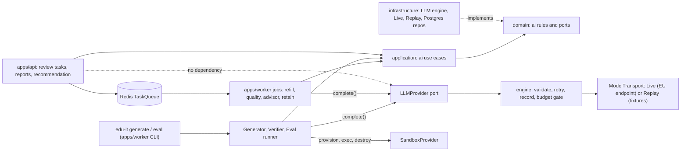
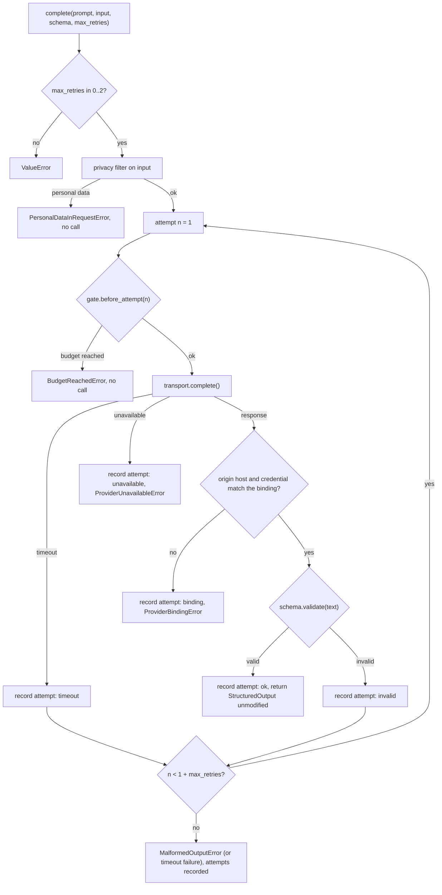
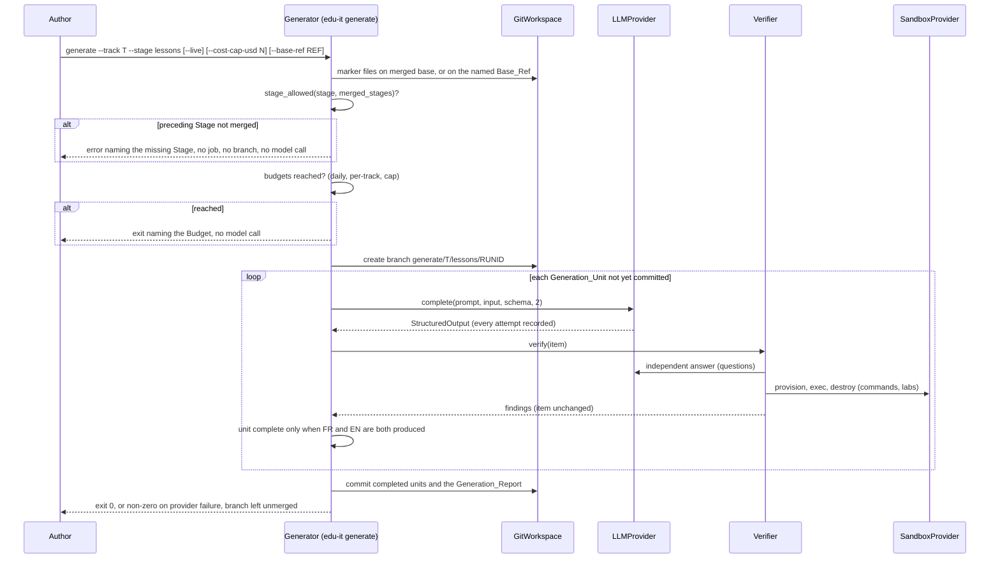
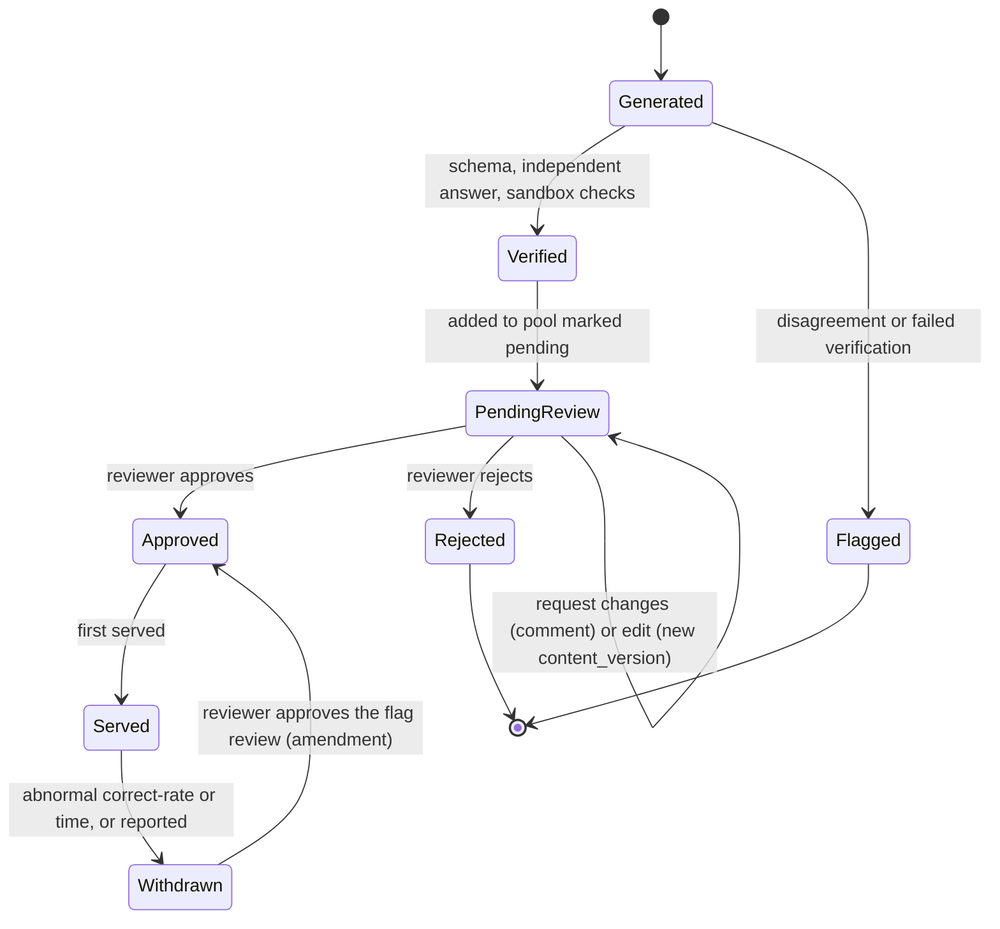
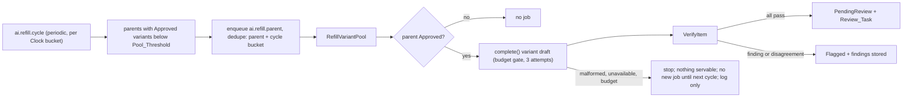
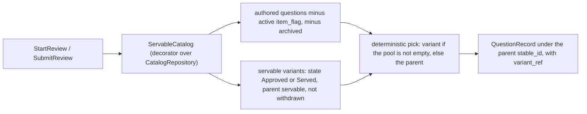
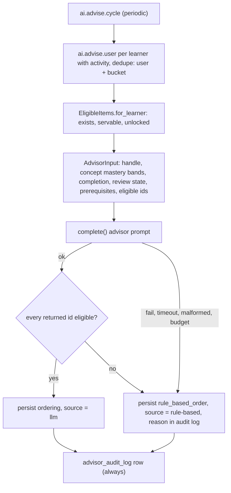
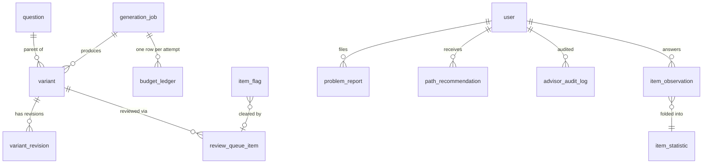

# Design Document

## Overview

This design realizes the `ai-content` requirements: an ahead-of-time pipeline that drafts content with
an LLM, verifies it automatically, and puts it in front of an expert before any learner sees it. It
builds on the hands-on-labs phase (`docs/reports/phase-3.md`), which delivered the `SandboxProvider`
runtime, the Golden_Set seed content and the strict `content validate` gate. Authoritative rules stay
in steering and are linked, not restated: AI generation and review
(#[[file:.kiro/steering/ai-content.md]]), content pipeline and localization
(#[[file:.kiro/steering/content.md]]), domain rules (#[[file:.kiro/steering/domain-rules.md]]), labs
and sandboxes (#[[file:.kiro/steering/labs.md]]), authentication and privacy
(#[[file:.kiro/steering/auth-privacy.md]]), API conventions (#[[file:.kiro/steering/api-conventions.md]]),
layering (#[[file:.kiro/steering/structure.md]]), quality and testing
(#[[file:.kiro/steering/quality.md]]) and process (#[[file:.kiro/steering/working-agreements.md]]). The
`LLMProvider` signatures, stages, variant lifecycle, path advisor and failure scenario 4.4 come from
`docs/AI-CONTENT-DESIGN.md` (D6), the tables from `docs/DATA-MODEL.md` (D3), and ADRs 0001 (versions),
0003 (Redis task queue) and 0007 (LLM provider and data residency) apply.

**Core invariant.** Learners only ever see content an expert approved. The design enforces it in three
independent places: the validator rejects unreviewed AI items before merge, the serving code returns
only Approved or Served items, and the worker builds practice sets through the same serving filter.

### Design goals

- The LLM sits behind one port with the D6 signature. Everything that talks to a model goes through
  it, so validation, bounded retries, cost recording and budget checks cannot be bypassed.
- Rules are pure, framework-free domain functions wherever possible (lifecycle transitions, budget
  gate, privacy filter, ordering, duplicate and similarity checks, statistics folding). That makes
  almost all behavior testable with the fakes and the fake `Clock`, and property-testable.
- No learner action triggers a synchronous LLM call. The serving code has no `LLMProvider` dependency
  at all, so this is true by construction, and a static test asserts it.
- Business numbers live in `edu_it_domain/config.py`; time comes only from the injected `Clock`.

### Findings from reading the existing code

The requirements were written without checking the code. Reading `packages/` and `apps/` turned up
these facts. Each one shaped the design below.

| # | Finding | Design consequence |
|---|---|---|
| F1 | The `LLMProvider` port in `edu_it_domain/ports/llm_provider.py` is the Phase 1 placeholder `complete(prompt, *, model, stop) -> LLMCompletion`, not the D6 signature `complete(prompt_version, input, schema, max_retries) -> StructuredOutput`. `Fake_LLMProvider` and its tests (`test_fake_llm_provider.py`, `test_ports.py`, `test_fake_substitutability.py`) use the old shape. | The port is replaced by the D6 signature. `LLMCompletion` leaves the domain and becomes an infrastructure-internal `RawCompletion`. The fake and its tests are migrated in the same change. |
| F2 | `tools/tests/test_package_dependency_graph.py` allows `edu-it-application` and `edu-it-infrastructure` to depend on `edu-it-domain` only, and `edu-it-content` on nothing. The content Pydantic schemas are the output schemas of generation. | Generation code that needs the content schemas, git or the filesystem lives in `apps/worker` (which already depends on `edu-it-content`, and already hosts the `edu-it-grant-role` CLI). Pure rules live in the domain; orchestration that needs ports only lives in the application layer. No new package and no change to the dependency test. |
| F3 | `_check_reviewer` in `packages/content/edu_it_content/validation.py` rejects an `ai` item only when `reviewed_by` is missing. Requirement 6.1 names both `reviewed_by` and `reviewed_at`. `--allow-pending` tolerates `ai-reviewer-present` for listed labs only. | The rule is tightened to require both fields. The 24 seed `ai` items sampled all carry both. The check is run again over all seed content as a task. `--allow-pending` is not extended. |
| F4 | `content validate` is strict by default. A Generation_Branch of fresh `ai` items therefore fails it by design (Requirement 6.2). | The Generator itself runs the structural checks only (a new `include_review_rule=False` switch), never the reviewer rule. The red CI on the branch is the intended merge gate. |
| F5 | `metadata.py` already declares skeleton tables for `generation_job`, `variant`, `review_queue_item`, `item_statistic`, `path_recommendation` and `budget_ledger`, created by revision `0001`. They lack the columns the requirements need (no `stable_id` on a job, no per-attempt rows, no track on a job). `PERSONAL_DATA_TABLES` already lists `path_recommendation`. | Revision `0005_ai_content` is additive: it adds columns to those tables and creates the new tables, following the inspect-then-add pattern of `0002_labs_runtime`. |
| F6 | `Answer` has no correctness or elapsed time, and spaced reviews (`SubmitReviewUseCase`) record no answer rows at all. Requirement 19.1 needs `correct_rate` and `avg_time_ms` per item. | A new append-only `item_observation` table is written by `AttemptQuizUseCase` and `SubmitReviewUseCase` through an optional `ObservationRecorder` port. The worker folds it into `item_statistic`. `answer` is unchanged. |
| F7 | `RoleAssignmentRepository.set_role` is last-write-wins: one `role_assignment` and so one `track_scope` per user. | Reviewer expertise is that single track scope. Multi-track reviewers need a role-model change that is out of scope and is listed under open questions. |
| F8 | ADR 0007 requires a provider behind `LLMProvider`, a DPA and EU residency, but names no vendor. `.env.example` has `LLM_PROVIDER_BACKEND=fake` and `LLM_PROVIDER_API_KEY`. | The Live_Provider is built against an infrastructure `ModelTransport` protocol with a contract suite. Choosing the vendor is decision D1 below, recorded as an ADR 0007 addendum before any Live_Provider call (Requirement 1.11). The vendor adapter is verified by contract tests on recorded vendor-shaped responses before the Live_Run (Requirement 1.10). |
| F9 | The worker composes only the lab consumers (`build_lab_worker`, `build_served_worker` returns `LabWorker`). The `Scheduler` fires periodic jobs once per `Clock` bucket with a dedupe key `<job>:tick:<n>`. | A sibling `build_ai_worker` and `AiWorker` follow the same shape, and `serve.py` starts both. Refill, advisor, quality and retention cycles reuse `Scheduler`. |
| F10 | `edu_it_domain` has a 90% coverage gate, and `validate_lab_config` refuses to start on a bad Config. | Pure rules go in the domain with property tests, and a `validate_ai_config` is added and called at worker and API startup. |
| F11 | D6 and `ai-content.md` make `Withdrawn` terminal. Requirement 19.4 says approving a Flagged_Item review returns it to serving. | A reviewer reinstatement transition `Withdrawn -> Approved` is added. This amends D6 and the steering file in the same change (decision D3). |
| F12 | `ci.yml` runs on every push to any branch with a shallow default checkout. | The prompt-immutability check needs history, so its CI step fetches enough depth to diff against the base. |

### Decisions to confirm at review

These are choices where the requirements leave room, where a requirement and the existing code pull in
different directions, or where steering must change. Each is reflected below.

1. **D1, vendor.** ADR 0007 does not name a provider. An addendum must name one that satisfies the DPA
   and EU residency before any Live_Provider call (Requirement 1.11), including the optional smoke call
   described under "Delivery order and dependencies". Until then everything runs on the Replay_Provider
   and the fake. This is the only external blocker. Once the addendum exists, the vendor adapter is built
   and contract-tested in Milestone A (Requirement 1.10), so vendor surprises appear before the Live_Run.
2. **D2, ports are replaced, not added.** The D6 `LLMProvider` replaces the placeholder (F1).
3. **D3, D6 amendment.** Add `Withdrawn -> Approved` (reviewer reinstatement after a flag review) to D6,
   `ai-content.md` and the diagram. Without it Requirement 19.4 cannot be met for Variants.
4. **D4, where variants are served.** Variants are served in spaced-review sessions only, not in graded
   quiz attempts. Quiz attempts stay pinned to the authored `content_version` (failure 4.5), and reviews
   are where learners meet the same question repeatedly. A served variant is presented under its Parent
   question's `stable_id` so the 24-hour anti-farming rule and mastery keep working per question.
5. **D5, reviewer edits.** Requirement 16 applies to Variants. Authored items are edited by pull request,
   by the two-workflow rule in the Introduction.
6. **D6, report counting.** The Report_Threshold counts distinct learners who reported the item's
   current `content_version`, so a fixed item is not kept flagged by stale reports. A flag is cleared
   only by a reviewer's decision on its Review_Task. Both rules are now stated in the requirements
   (18.4 and 18.9), so they are no longer design interpretations.
7. **D7, observations.** Every quiz and review answer appends one `item_observation`. Elapsed time is
   client-reported, optional and clamped to `ITEM_ELAPSED_MS_MAX`. An observation without elapsed time
   counts toward `correct_rate` but not `avg_time_ms`.
8. **D8, readability and similarity measures.** Flesch reading ease (EN) and Kandel-Moles (FR) for
   readability, and 5-word shingle containment against the source corpus for similarity. Limits are
   Config proposals.
9. **D9, budget race.** Budgets are checked before each attempt against ledger sums. Two worker replicas
   can both pass the check, so overshoot is bounded by one in-flight attempt per concurrent job. The
   Live_Run is single-process and unaffected.
10. **D10, new Config values.** Every number the requirements leave open is in the Config table below,
    marked "initial Config value" for the user to confirm: budgets, thresholds, limits, cycle intervals
    and retention periods.
11. **D11, governance files.** The PR_Template is written per Stage by the Generator under
    `.github/PULL_REQUEST_TEMPLATE/`, and `.github/CODEOWNERS` maps each `content/<track>/` path to a
    reviewer team handle. The real handles are the project owner's to supply.
12. **D12, ADR and steering updates in the same change.** An ADR 0007 addendum, the D6 and `ai-content.md`
    amendment (D3), the D3 data-model additions and `.env.example` all change together, per
    #[[file:.kiro/steering/working-agreements.md]].

### Requirement interpretations

| Requirement | Interpretation |
|---|---|
| 5.3 "preceding Stage has no merged output" | A Stage counts as merged when its marker files exist on the merged base (default `main`), read through `git ls-tree`. Where a Base_Ref is named explicitly (5.14), the markers are read from that ref instead, without merging anything. Brief has no predecessor. |
| 6.1 "no `reviewed_by` and `reviewed_at`" | Rejected when either is missing. |
| 7.5, 7.11 | Command outputs are never part of the LLM draft. The lesson draft schema holds commands only, the Verifier produces outputs in a Verification_Sandbox, and the Generator assembles the MDX from draft plus outputs. The draft itself is never edited. |
| 12.6 "resume keyed by `stable_id`" | A Generation_Unit already committed on the Generation_Branch or merged is skipped when its `stable_id` exists. |
| 14.1 for authored items | Authored items carry no lifecycle column. An item is Approved when it is `human`, or `ai` with both reviewer fields, and has no active `item_flag` and is not archived. |
| 20.1 "serve the Approved Parent_Question" | The review pool falls back to the authored question. |
| 22.7 | Withdrawal affects requests after the state change. Already served responses and caches are not recalled. |

Requirements 2.1 (what is constructible in the test environment) and 18.4 (the Report_Threshold counting
the current `content_version`, with withdrawal from serving) were earlier read into the design as
interpretations. They are now stated in the requirements, so the design follows them directly and the
corresponding notes under "Provider selection and the test guarantee" and decision D6 only describe how
they are met.

## Architecture

### Layering and package map

The layering is unchanged: `api -> application -> domain <- infrastructure`
(#[[file:.kiro/steering/structure.md]]). New code lands in these places.

| Layer | New location | Contents |
|---|---|---|
| Domain | `packages/domain/edu_it_domain/ai/` | `inputs.py` (typed LLM input kinds and field allowlist), `privacy.py`, `pseudonym.py`, `lifecycle.py`, `budget.py`, `fixtures.py` (key and fixture value), `ordering.py` (rule-based order and LLM-order check), `serving.py`, `quality.py` (incremental statistics, flag rules), `checks.py` (normalise, duplicate, coverage, readability, similarity), `generation.py` (stage order, unit planning, resume). |
| Domain ports | `packages/domain/edu_it_domain/ports/` | `llm_provider.py` (replaced), `generation_ledger.py`, `variants.py`, `review_tasks.py`, `item_quality.py`, `problem_reports.py`, `path_recommendations.py`. The existing `SandboxProvider`, `TaskQueue`, `Clock`, `IdGenerator`, `IdempotencyStore`, `RoleAssignmentRepository` and `CatalogRepository` are reused. |
| Domain config | `edu_it_domain/config.py` | AI Config block (table below) and `validate_ai_config`. |
| Application | `packages/application/edu_it_application/ai/` | `VerifyItem`, `VerifyLab`, `RefillVariantPool`, `ReviewTaskActions` (approve, reject, request changes, edit), `ListReviewTasks`, `SubmitProblemReport`, `FoldObservations`, `EvaluateFlags`, `FlagItem`, `RunPathAdvisor`, `GetRecommendation`, `DismissRecommendation`, `PurgeAiData`, and the `ServableCatalog` decorator over `CatalogRepository`. |
| Infrastructure | `packages/infrastructure/edu_it_infrastructure/` | `llm/engine.py` (validate, retry, record), `llm/transport.py` (`ModelTransport`, `RawCompletion`), `llm/live.py`, `llm/replay.py`, `llm/fixture_store.py`, `llm/pydantic_schema.py`, `fakes/llm_provider.py` (migrated), Postgres and in-memory repositories for the new ports, `composition.py` additions. |
| API | `apps/api/edu_it_api/` | `review_tasks.py` router, `problem_reports.py`, `recommendations.py`, schemas, `errors/ai.py`, route table entries. |
| Worker | `apps/worker/edu_it_worker/ai/` | `generator.py`, `stages.py`, `prompt_store.py`, `content_writer.py`, `git_workspace.py`, `report.py`, `eval_runner.py`, `jobs.py`, `composition.py`, `cli.py` (`edu-it-generate`, `edu-it-eval`). |
| Content | `packages/content/` | `QuestionVariant` and the stage draft schemas in `schemas.py`; validator switch and tightened reviewer rule. |
| Web | `apps/web/src/` | Reviewer queue pages, "Report a problem" control, dashboard recommendation card. |
| Repo | `prompts/`, `evals/`, `.github/`, `tools/` | Prompt files, eval suites and fixtures, CODEOWNERS and PR templates, prompt-immutability check, verification suite. |



### The LLMProvider port and its engine

The domain port is exactly the D6 signature. The parameter names are kept.

```python
class LLMProvider(Protocol):
    def complete(
        self,
        prompt_version: PromptRef,      # pins prompt_id and prompt_version
        input: LLMInput,                # typed, allowlisted fields only
        schema: OutputSchema,           # validates raw model text -> mapping
        max_retries: int,               # 0..LLM_MAX_RETRIES (2); anything else is a ValueError
    ) -> StructuredOutput: ...
```

`StructuredOutput` carries the validated mapping, the `PromptRef`, the model of the accepted attempt and
a tuple of `AttemptUsage(model, input_tokens, output_tokens, cost_cents, outcome)` covering every
attempt. Errors are domain exceptions: `MalformedOutputError` (all attempts failed validation),
`ProviderUnavailableError`, `ProviderBindingError`, `BudgetReachedError(kind)`, `MissingFixtureError(key)`
and `PersonalDataInRequestError`.

All implementations except the fake share one engine in infrastructure, so the rules hold for Live and
Replay alike.



Notes on this flow:

- The output is whatever `schema.validate` returned for the raw text. The engine never edits, patches
  or defaults a field (Requirements 1.5, 12.1).
- Every attempt, including failed ones, reaches the `UsageSink` before the next step, so cost and
  tokens survive any failure (Requirements 1.4, 12.1, 12.3). The sink writes the `budget_ledger` row and
  updates the owning `generation_job`.
- `gate.before_attempt` is evaluated before every attempt including retries, with no switch to disable
  it (Requirement 10.4, 10.5). The gate and sink are bound to one job by construction.
- Timeouts are retried inside the bound. Unavailability, binding failures and budget stops are not
  retried.
- The engine takes `OutputSchema`, a one-method protocol. The Pydantic adapter lives in infrastructure
  (which may use Pydantic) and receives the model class from the caller, so infrastructure never imports
  `edu-it-content`.

### Provider selection and the test guarantee

`build_llm_provider(settings, job_scope)` in `composition.py` mirrors `build_sandbox_provider` and its
`ProviderSelectionError`.

| `EDU_IT_ENV` | `LLM_PROVIDER_BACKEND=fake` | `replay` | `live` |
|---|---|---|---|
| `test` | allowed (unit tests of callers only) | allowed, the default | refused with `ProviderSelectionError` |
| `development` | allowed | allowed | allowed |
| `production` | refused | refused | allowed |

Requirement 2.1 states that while the test environment is active the composition root refuses to
construct the Live_Provider, and that the Replay_Provider is the only LLMProvider implementation that
returns recorded model responses. The table meets both: in `test`, `live` is refused and the fake never
touches a model or returns a recorded response. A root-level pytest plugin (`tools/pytest_no_model_network.py`,
enabled through `addopts`) patches `socket.socket.connect` so that any connection to a non-loopback
address fails the test. This is the Requirement 2.5 test, and it also covers the mocked OAuth and Docker
tests, which already use loopback or unix sockets. A self-test proves the guard trips.

The binding for Requirements 1.7 to 1.9 is `ProviderBinding(allowed_hosts, credential_id)`, built from
`LLM_PROVIDER_ALLOWED_HOSTS` (EU endpoints only) and a fingerprint of `LLM_PROVIDER_API_KEY`. The
transport reports the host of the final response URL and the fingerprint of the key it actually sent. A
redirect to another host, or a response served under another key, is rejected even when the body passes
the schema.

### Generation flow (one Stage)



The Git port has no merge and no push method, so Requirement 5.9 is structural. A static test greps the
generator package for those verbs and for protected branch names.

**Base_Ref (Requirements 5.14 to 5.16).** When `--base-ref REF` is named, the Generator reads the
Stage_Markers of the preceding Stage from `REF` (for example the outline Generation_Branch) through the
same read-only `git ls-tree`. The ref is a source of markers only: nothing is merged, checked out over the
working tree or pushed, and the new Generation_Branch is still created from the merged default branch. If
the markers are found neither in merged output nor in the named ref, the refusal path is identical to the
one above (no job, no branch, no model call, error naming the missing Stage). The Base_Ref does not
replace the gate, it only widens where markers may be found, and there is no option that skips the gate.
The unit-resume rule reads the same ref, so units already committed there are skipped.

### Variant lifecycle

D6 states and transitions are kept, with one addition (D3).



A reviewer edit of a Variant that is already Approved or Served does not change the Variant's state.
It creates a new `variant_revision` in PendingReview. The serving code keeps using the revision named
by `variant.approved_content_version` until the new revision is approved (Requirement 16). Rejecting the
revision leaves the old one served.

### Refill and serving flow





`ServableCatalog` wraps the `CatalogRepository` that the API composition already injects, so the existing
use cases need no change except to carry `variant_ref` and record observations. The deterministic pick is
a hash of `(user, parent, review schedule due_at)` over the stable-sorted servable pool, so start and
submit agree without session state. The submit request echoes `variant_ref`, which pins an in-flight
review to the variant it started with, the same principle as quiz content-version pinning.

### Path advisor flow



The handle is `HMAC-SHA256(ADVISOR_HANDLE_KEY, run_id + ":" + user_stable_id)`, truncated and prefixed.
It differs between runs and cannot be derived from the account identifier without the key. The mapping
from handle to learner exists only in the worker's memory for the duration of the run. The audit log row
links to the learner (so it can be deleted with them) and carries the handle, but no LLM request log or
fixture ever pairs a handle with an identity.

### Delivery order and dependencies

The build order follows what each step needs from the previous ones. Milestones A, B and C are those of
Requirement 22.

1. **Network guard and config.** The no-network pytest plugin, `validate_ai_config` and the AI Config
   block come first, so every later test runs under the guard and no number is hard-coded.
2. **Pure domain rules.** Lifecycle, budget gate, privacy, pseudonym, fixture keys, checks, ordering,
   serving and quality folding. They need nothing but the Config, and everything above them depends on them.
3. **Schemas and validator.** `QuestionVariant`, the stage draft models, the tightened reviewer rule and
   the `include_review_rule` switch. The engine and the Generator need the schemas.
4. **Persistence.** Revision `0005_ai_content`, the ledger and job ports, and their in-memory and Postgres
   repositories. The engine records every attempt, so it needs the ledger. Each personal-data table is
   registered for export, deletion and retention in this same step for the tables introduced here
   (hazard B).
5. **Engine and transports.** The engine, the Replay and fake providers, then the vendor `ModelTransport`
   adapter with its contract tests as soon as the ADR 0007 addendum (D1) exists, plus an optional tiny,
   capped smoke call (hazard C). Doing this in Milestone A surfaces vendor surprises long before the
   closing Live_Run.
6. **Prompts.** Prompt store, immutability check, the glossary, then the drafting prompts.
7. **Verifier.** It needs the sandbox port, the engine for the independent answer, and the checks.
8. **Generator.** Stage gate with the optional Base_Ref, units, content writer, report and governance
   files. It needs everything above. This closes the Milestone A invariant test.
9. **Evals.** The eval runner and the golden suite, which need the engine, prompts and fixtures.
10. **Milestone B.** The variant lifecycle and repositories, together with the `item_flag` table and the
    `active_flags` read port in memory and Postgres (hazard A); the review backend; `ServableCatalog` and
    serving; refill; then the reviewer and learner UI, which need the backend endpoints.
11. **Milestone C.** The flag write side (`FlagItem`, statistics, reports), problem reports, the path
    advisor, and the proof tests for export, deletion and retention.
12. **Closing.** The Live_Run with the hand-authored brief and the outline Generation_Branch as Base_Ref,
    the traceability checks, and the Phase_4_Report.

The reason for this order is that each layer is tested only with fakes of the layers below it, the budget
and privacy rules exist before any code can call a model, and the three sequencing hazards (flag read
side, personal-data registration, vendor adapter) are resolved at the earliest milestone that needs them.

## Components and Interfaces

### Domain ports (new or changed)

```python
# generation_ledger.py: one job per Generation_Run, one ledger row per attempt
class GenerationLedger(Protocol):
    def open_job(self, job: NewJob) -> JobRef: ...                      # kind, track, stage, cost cap
    def record_attempt(self, job: JobRef, usage: AttemptUsage) -> None: ...  # ledger row + job totals
    def close_job(self, job: JobRef, status: JobStatus) -> None: ...
    def spent_today(self, day_start: datetime) -> int: ...              # cents, all jobs
    def spent_for_track(self, track_stable_id: str) -> int: ...
    def spent_for_job(self, job: JobRef) -> int: ...

# variants.py
class VariantRepository(Protocol):
    def add(self, variant: NewVariant) -> None: ...
    def get(self, stable_id: str) -> Variant | None: ...
    def save(self, variant: Variant) -> None: ...                       # state change, atomic with its task
    def count_approved(self, parent_question_id: str) -> int: ...
    def parents_below(self, threshold: int) -> Sequence[str]: ...
    def list_servable(self, parent_question_id: str) -> Sequence[VariantRevision]: ...
    def add_revision(self, revision: NewRevision) -> None: ...

# review_tasks.py
class ReviewTaskRepository(Protocol):
    def add(self, task: NewReviewTask) -> None: ...                     # idempotent per (target, kind, open)
    def get(self, stable_id: str) -> ReviewTask | None: ...
    def decide(self, task: ReviewTask, decision: Decision) -> None: ... # transition + variant write in one transaction
    def page(self, tracks: Collection[str], after: TaskCursor | None, limit: int) -> Page[ReviewTask]: ...

# item_quality.py
class ObservationRecorder(Protocol):
    def record(self, obs: ItemObservation) -> None: ...
class ItemQualityRepository(Protocol):
    def observations_after(self, last_id: int, limit: int) -> Sequence[ItemObservation]: ...
    def apply(self, stats: Mapping[ItemKey, ItemStat], new_cursor: int) -> None: ...  # one transaction
    def get(self, key: ItemKey) -> ItemStat | None: ...
    def flag(self, key: ItemKey, reason: FlagReason) -> bool: ...        # False if already flagged
    def clear_flag(self, key: ItemKey, task_id: str) -> None: ...
    def active_flags(self, keys: Collection[ItemKey]) -> frozenset[ItemKey]: ...

# problem_reports.py / path_recommendations.py: add/get/list/delete_for_user, reporters_for(item, version),
#   latest_undismissed(user), dismiss(id), append_audit(entry)
```

`record_attempt` and `apply` are single-transaction operations at the adapter, so the ledger and the
cursor never drift from the data they describe.

**Flag read side versus write side (sequencing hazard A).** `ServableCatalog` is built in Milestone B and
excludes items with an active `item_flag` (Requirements 14 and 20). The read side therefore cannot wait
for the quality work of Milestone C. It is split as follows:

- **Milestone B, with the variant repositories:** the `item_flag` table (in revision `0005_ai_content`),
  the `ItemFlagReader` port holding `active_flags(keys)`, and its in-memory and Postgres
  implementations under the shared contract suite. Tests in B set flags directly through the repository
  fixtures to prove that flagged items are never served.
- **Milestone C, write side:** `FlagItem`, `flag` and `clear_flag`, the statistics fold, `EvaluateFlags`,
  problem reports and the reviewer decision that clears a flag.

In the listing above, `active_flags` belongs to the B-side reader. `flag`, `clear_flag`, `observations_after`
and `apply` belong to the C-side `ItemQualityRepository`, which extends the reader.

### Domain rules (pure, in `edu_it_domain/ai/`)

| Module | Functions | Requirements |
|---|---|---|
| `lifecycle.py` | `VariantState`, `TRANSITIONS`, `transition(state, event)`, `SERVABLE_STATES`, `is_servable(state)` | 13, 14, 15, 19, 22 |
| `budget.py` | `check_attempt(spent_day, spent_track, spent_job, limits) -> BudgetReached or None` | 10, 12.4, 24 |
| `inputs.py`, `privacy.py` | `LLMInput(kind, fields)`, `INPUT_FIELDS[kind]`, `scan(input, seeded=())` | 3 |
| `pseudonym.py` | `handle(key, run_id, user_id)` | 3.3, 17.1 |
| `fixtures.py` | `fixture_key(prompt, input)`, `Fixture`, `encode`, `decode` | 2 |
| `checks.py` | `normalise`, `is_duplicate`, `coverage`, `readability_en`, `readability_fr`, `similarity`, `finding_for_limit` | 7 |
| `generation.py` | `STAGES`, `stage_allowed`, `merged_stages`, `plan_units`, `remaining_units`, `commit_set` | 5, 12, 24 |
| `ordering.py` | `rule_based_order`, `check_llm_order` | 17 |
| `serving.py` | `servable_variants`, `pick_variant`, `resolve_question` | 14, 20 |
| `quality.py` | `fold(stat, obs)`, `is_anomalous`, `reports_reach_threshold` | 18, 19 |

`rule_based_order` is total and deterministic. It orders eligible items so that every item follows its
eligible prerequisites, then by due reviews first, then lowest mastery, then `stable_id`, and returns at
most `PATH_RECOMMENDATION_LENGTH` items. An empty eligible set gives an empty ordering.

### Typed LLM input and the privacy filter

`LLMInput` is a frozen value `(kind, fields)`. Each `InputKind` (`BRIEF`, `OUTLINE`, `LESSON`, `QUIZ`,
`LAB`, `PROJECT`, `VARIANT`, `VERIFY_ANSWER`, `ADVISOR`, `EVAL`) has a closed allowlist of top-level field
names, for example `VERIFY_ANSWER` allows `question`, `options`, `locale` and has no field that could hold
the key. This is the structural half of D6 Section 6: personal data and terminal I/O have no field to go
in. The value scan is defense in depth: it rejects email addresses, `usr_`-prefixed and session-token
shaped strings, and any seeded sample supplied by tests. Learner free text cannot be detected by pattern,
so the guarantee for it is that no kind accepts it and `ProblemReport.comment` has no code path to an
`LLMInput` (a static test asserts the worker's quality code never imports the LLM port).

### Infrastructure

- `llm/engine.py` implements the flow above. It takes a `ModelTransport`, a `ProviderBinding`, an
  `AttemptGate`, a `UsageSink` and a `Clock`.
- `llm/replay.py` is the Replay_Provider: a transport whose `complete` looks up the Fixture by
  `fixture_key` and returns recorded attempts in order. A miss raises `MissingFixtureError` naming the key
  and the transport owns no socket. Because it runs through the same engine, recorded invalid attempts
  replay faithfully and tests exercise retry and budget logic deterministically.
- `llm/live.py` is the Live_Provider transport. In record mode it also writes each exchange through
  `fixture_store` after the privacy scan of the stored payload (Requirement 3.2). It uses the standard
  library HTTP client over TLS, so no new dependency enters ADR 0001. The vendor-specific request and
  response shape is isolated behind `ModelTransport` (decision D1).
- `llm/fixture_store.py` reads and writes `evals/fixtures/<prompt_id>/<key>.json` as canonical JSON
  (sorted keys, UTF-8). A Fixture holds the request payload and an ordered list of attempts, so retries
  with different responses under one key replay in order.
- `fakes/llm_provider.py` is migrated to the new port. It returns canned or deterministic stub
  `StructuredOutput` with zero cost and records calls.
- Postgres and in-memory implementations of every new repository port, with one shared contract suite, as
  for the existing repositories (`test_account_repositories_contract.py` pattern).

### Application use cases

| Use case | Behavior |
|---|---|
| `VerifyItem` | Runs the applicable checks for an item and returns `(findings, outputs)`. It never mutates the item. Checks: answer (questions), command outputs (lessons), lab matrix (labs), duplicate, coverage, readability, similarity. |
| `VerifyLab` | Provisions Starting_State and Reference_Solution sandboxes as one unit, runs every check in each, destroys both in a `finally` after both phases finished or failed. Each check run is bounded by `min(check.timeout, USABLE_RUN_BUDGET)` and each phase by `LAB_GRADING_RUN_DEADLINE`; the 10 s spacing is respected per sandbox, which the two-sandbox split makes moot. It calls the sandbox port directly and reuses the harness argv helpers from `edu_it_application.labs` where they take ports only. |
| `RefillVariantPool` | Requires an Approved parent, computes the shortfall against the Pool_Threshold (capped by `VARIANTS_PER_REFILL_MAX`), drafts, verifies, then stores `PendingReview` plus a Review_Task, or `Flagged` plus findings. On any stop reason it creates nothing servable and does not re-enqueue. |
| `ReviewTaskActions` | `approve`, `reject`, `request_changes`, `edit`. Checks the actor's `track_scope` against the task's track first. A denial raises before any write. Each action is one transaction over the variant, the revision and the task. |
| `ListReviewTasks` | Cursor-paginated over the reviewer's track, using the shared cursor codec. |
| `SubmitProblemReport` | Reserves the `Idempotency-Key`, validates the comment length, stores the report with `stable_id` and `content_version`, then enqueues `ai.quality.evaluate_item` best-effort. |
| `FoldObservations` | Reads observations after the cursor, folds them with `quality.fold`, writes stats and the new cursor in one transaction. |
| `EvaluateFlags` | For items touched by a fold or a new report, applies `is_anomalous` and `reports_reach_threshold` and calls `FlagItem`. |
| `FlagItem` | Idempotent: sets the item flag or withdraws the Variant, creates exactly one open Review_Task listing the report count or anomaly, and enqueues a refill when a pool becomes empty. |
| `RunPathAdvisor` | The flow above. Any failure ends in `rule_based_order`. It always writes an audit row. |
| `GetRecommendation` | Latest undismissed recommendation, re-filtered at read time against current eligibility so a later withdrawal never surfaces. |
| `PurgeAiData` | Deletes rows older than the retention periods, idempotently. |

### Worker

`build_ai_worker` validates the AI Config first and refuses to start on an invalid Config, then wires
consumers and a `Scheduler` with these jobs, all with bucket-based dedupe keys.

| Job | Kind | Dedupe key |
|---|---|---|
| `ai.refill.cycle` | periodic, `REFILL_CYCLE_INTERVAL` | `ai.refill.cycle:tick:<n>` |
| `ai.refill.parent` | on demand | `ai.refill.parent:<parent>:<bucket>` |
| `ai.quality.cycle` | periodic, `QUALITY_CYCLE_INTERVAL` | `ai.quality.cycle:tick:<n>` |
| `ai.quality.evaluate_item` | on demand | `ai.quality.evaluate_item:<item>` |
| `ai.advise.cycle` | periodic, `ADVISOR_CYCLE_INTERVAL` | `ai.advise.cycle:tick:<n>` |
| `ai.advise.user` | on demand | `ai.advise.user:<user>:<bucket>` |
| `ai.retain` | periodic, `AI_RETENTION_INTERVAL` | `ai.retain:tick:<n>` |

Handlers follow the lab pattern: they log and swallow unexpected errors because a later cycle recovers
every job. A refill that stops on malformed output, unavailability or a reached Budget logs a warning and
ends. The bucket in its dedupe key is what prevents a second job for that parent before the next cycle,
and nothing else happens: no alert, no email, no escalation (Requirement 13.10).

`serve.py` is extended so that `build_served_worker` returns both workers and `main` starts and stops
both. Worker egress is limited to the LLM provider and the Kubernetes API by the existing topology
(#[[file:.kiro/steering/tech.md]]), so no deployment change is needed beyond the provider hostname.

### Generator, prompts, evals and CLI

`edu-it-generate` and `edu-it-eval` are `argparse` CLIs registered in `apps/worker/pyproject.toml`, in the
style of `edu-it-content` and `edu-it-grant-role`.

```
edu-it-generate --track T --stage {brief,outline,lessons,quizzes,labs,project}
                [--live | --record] [--cost-cap-usd N] [--limit-units N] [--base-ref REF]
edu-it-eval     [--suite golden] [--live] [--cost-cap-usd N]
```

`--base-ref` is optional, defaults to the merged default branch, and names the ref from which
preceding-Stage markers are read (Requirements 5.14 to 5.16). There is no option that skips the
stage-order gate or the budget gate (Requirements 5.13, 5.16, 10.5). `--live`
selects the Live_Provider, `--record` additionally writes Fixtures, and without either the Replay_Provider
is used.

**Stages and merged markers.** A Stage is merged when all its marker files exist on the merged default
branch, or on the named Base_Ref when one is given.

| Stage | Marker on base ref | Generation_Unit |
|---|---|---|
| brief | `content/<track>/brief.json` | the brief |
| outline | `tracks.json`, `modules.json`, `lessons.json`, `concepts.json`, `prerequisites.json` | the outline (one unit) |
| lessons | `mdx/<lesson>.fr.mdx` and `.en.mdx` for every outline lesson | one lesson, FR and EN |
| quizzes | `quizzes.json`, `questions.json`, `question_options.json` | one quiz with its questions |
| labs | `labs.json`, `lab_tasks.json`, `lab_checks.json`, bundles | one lab |
| project | `projects.json`, `rubrics.json`, `rubric_criteria.json` | one project |

A unit is committed only when its FR and EN are both complete and its JSON and MDX files are written
together by `content_writer.py`, which writes sorted, stable JSON so diffs stay reviewable. A budget stop
or provider failure discards the partial unit, lists it in the report and commits the rest. A rerun skips
units whose `stable_id` already exists on the branch or base.

**Provenance** is written on every item: `origin: ai`, `model`, `prompt_id`, `prompt_version`,
`generation_date` (from the `Clock`), `reviewed_by` and `reviewed_at` absent, `content_version` a SHA-256
of the canonical content, and a `stable_id` minted by the `IdGenerator` with a slug rule matching the
seed content (`lesson.<slug>`).

**Prompts.** `prompts/<prompt_id>__v<version>.md` with a front-matter block (`output_schema`, `input_kind`,
`includes`). `prompt_store.py` loads, parses and hashes them. A new text is a new `v` file. The
Glossary_Prompt is `prompts/glossary__v1.md`, a table of `term_en | term_fr` pairs, and each drafting
prompt lists `includes: glossary@1`, so changing the glossary needs a new glossary version and a new
drafting version. `tools/check_prompt_immutability.py --base <ref>` diffs `prompts/` against the base and
fails with the names of any modified, renamed or deleted existing file. A test requires every Linux
fundamentals concept title pair and every Networking seed term in `evals/glossary/networking-terms.json`
to appear in the glossary.

**Evals.** `evals/suites/golden.json` holds cases built from the Golden_Set. Case kinds:
`schema-conformance` (the drafting prompt's output validates), `answer-key` (the Independent_Answerer
selects the golden key) and `glossary-terms` (required term pairs appear in both locales). The runner is
deterministic: cases are sorted, nothing reads the wall clock, and the report contains Prompt versions,
case outcomes and the aggregate pass rate only. Under `EDU_IT_ENV=test` it only accepts the
Replay_Provider. With `--live` it applies the same budget gate as the Generator.

**Report and governance files.** The Generation_Report is committed at
`docs/generation/<track>/<stage>-<run>.md`: one section per item (provenance, tokens, cost), every
Verification_Finding, discarded or missing units, and the remaining Budget. The count of findings is
taken from the same list the Verifier returns, so report and record cannot disagree. The Generator also
writes `.github/PULL_REQUEST_TEMPLATE/ai-generation-<stage>.md` with the checklist (correctness, FR/EN
parity, glossary use, sources, finding review) and ensures `.github/CODEOWNERS` has a line for
`content/<track>/` (decision D11).

### Verifier details

| Check | Item types | Mechanism |
|---|---|---|
| Schema | all | Done by `complete()` against the stage schema. |
| Independent answer | questions, variants | `VERIFY_ANSWER` input has no key field. Uses `independent_llm` (different model or provider when `LLM_VERIFIER_MODEL` or a second binding is configured, otherwise the same, recorded in the finding detail). A different answer records a `disagreement` finding, flags the item, leaves the key as generated. |
| Command output | lessons | The lesson draft schema holds command lines only. They run in a Verification_Sandbox on the lab base image as the learner user, with `exec` timeouts. Outputs are returned as data for the Generator to assemble. A failing command is a finding. |
| Lab matrix | labs | `VerifyLab` as above. A check that passes on the Starting_State, or fails on the Reference_Solution, is a finding and flags the lab. |
| Duplicate | all | Exact match of `normalise(text)` against the corpus of existing items. Near-duplicates are left to the similarity check (Requirement 7.12). |
| Coverage | track | Concepts of the track with no item produce one finding each, plus the ratio. |
| Readability | lessons | Per locale score against `READABILITY_BOUNDS`. |
| Similarity | all text | Fraction of 5-word shingles found in the source corpus against `SIMILARITY_LIMIT`. |

Every check run uses `SandboxProvider` only through the port, so with `Fake_SandboxProvider` the whole
verifier is testable without Docker. Sandboxes are created through `try/finally` so cleanup holds on every
exception.

### API surface (`/v1`, all by `stable_id`)

| Method and path | Auth | Use case | Notes |
|---|---|---|---|
| `GET /review-tasks` | cookie, reviewer | `ListReviewTasks` | cursor pagination; only the reviewer's track |
| `GET /review-tasks/{id}` | cookie, reviewer | `ReviewTaskActions` read | Variant in FR and EN, provenance, findings |
| `POST /review-tasks/{id}/approve` | cookie, reviewer | approve | records `reviewed_by`, `reviewed_at` |
| `POST /review-tasks/{id}/reject` | cookie, reviewer | reject | |
| `POST /review-tasks/{id}/request-changes` | cookie, reviewer | request changes | body: `comment` |
| `POST /review-tasks/{id}/edit` | cookie, reviewer | edit | body: edited Variant FR and EN; new `content_version` |
| `POST /problem-reports` | cookie | `SubmitProblemReport` | `Idempotency-Key` required |
| `GET /path-recommendation` | cookie | `GetRecommendation` | latest undismissed or 204 |
| `POST /path-recommendation/{id}/dismissal` | cookie | `DismissRecommendation` | idempotent |

Errors are RFC 9457 problem documents from `errors/ai.py`, translated through the existing locale
machinery: 403 `reviewer-expertise-required`, 404, 409 `review-task-already-decided`, 422 for a comment
over `PROBLEM_REPORT_COMMENT_MAX_CHARS` or an invalid category, and 404/422 `no-servable-question`
(Requirement 20.4) raised by the review endpoints when a concept has nothing servable. Mutating routes
use the existing CSRF gate. The review endpoints are listed in `route_table.py`, which feeds CORS and the
completeness tests.

### Web

The web changes follow the existing learner and lab pages: a reviewer queue list and detail page under
`/[locale]/reviewer` with approve, edit, request changes and reject, FR and EN strings, and the same
axe-core checks as the learner pages (Requirement 15.9); a "Report a problem" control on question, lesson
and lab views; and a dashboard recommendation card with a dismiss action. I did not inspect the
`apps/web` source tree for this design, so exact file paths and component names are settled in the tasks.

### Content and validator extensions

- `schemas.py` gains `QuestionVariant` (bilingual prompt, options with a single correct key, concept ids)
  and the stage draft models (`BriefDraft`, `OutlineDraft`, `LessonDraft` with `commands`, `QuizDraft`,
  `LabDraft` with `reference_solution`, `ProjectDraft`). They are the schemas passed to `complete()`.
- `validate_content(content, *, include_review_rule=True)`: the Generator passes `False`; the CLI and CI
  never do. `_check_reviewer` requires both reviewer fields.

### Config additions (`edu_it_domain/config.py`)

Values marked "fixed" come from the requirements or D6. The rest are initial Config values for the user to
confirm.

| Name | Initial value | Source |
|---|---|---|
| `LLM_MAX_ATTEMPTS` / `LLM_MAX_RETRIES` | 3 / 2 | fixed (D6, Requirement 1.3) |
| `LLM_ATTEMPT_TIMEOUT` | 60 s | proposal |
| `AI_BUDGET_DAILY_CENTS` | 2500 | proposal |
| `AI_BUDGET_PER_TRACK_CENTS` | 5000 | proposal |
| `LIVE_RUN_COST_CAP_CENTS` | 2000 | fixed (Requirement 24.1) |
| `VARIANT_POOL_THRESHOLD` | 3 | fixed (glossary) |
| `VARIANTS_PER_REFILL_MAX` | 3 | proposal |
| `REFILL_CYCLE_INTERVAL` | 1 hour | proposal |
| `QUALITY_CYCLE_INTERVAL` | 5 minutes | proposal |
| `ADVISOR_CYCLE_INTERVAL` | 24 hours | proposal |
| `PATH_RECOMMENDATION_LENGTH` | 5 | proposal |
| `REPORT_THRESHOLD` | 3 | fixed (glossary) |
| `PROBLEM_REPORT_COMMENT_MAX_CHARS` | 1000 | proposal |
| `PROBLEM_REPORT_CATEGORIES` | incorrect, unclear, translation, outdated, technical, other | proposal |
| `ITEM_STAT_MIN_SAMPLES` | 20 | proposal |
| `ITEM_CORRECT_RATE_BOUNDS` | 0.10 to 0.98 | proposal |
| `ITEM_AVG_TIME_BOUNDS_MS` | 3000 to 300000 | proposal |
| `ITEM_ELAPSED_MS_MAX` | 600000 | proposal |
| `READABILITY_BOUNDS` | 20.0 to 80.0 | proposal |
| `SIMILARITY_LIMIT` | 0.25 | proposal |
| `AI_RETENTION_OBSERVATION` | 90 days | proposal |
| `AI_RETENTION_PROBLEM_REPORT` | 365 days | proposal |
| `AI_RETENTION_RECOMMENDATION` / `AI_RETENTION_AUDIT` | 90 days / 90 days | proposal |
| `AI_RETENTION_INTERVAL` | 24 hours | proposal |

`validate_ai_config` checks that bounds are ordered, `LLM_MAX_ATTEMPTS == 1 + LLM_MAX_RETRIES`, the cap
is positive and not above the daily budget, and every retention is positive. It names every offending key,
like `validate_lab_config`.

New environment variables (added to `.env.example` and `CompositionSettings`): `LLM_PROVIDER_BACKEND`
(`fake`, `replay`, `live`), `LLM_PROVIDER_ENDPOINT`, `LLM_PROVIDER_ALLOWED_HOSTS`, `LLM_MODEL_GENERATION`,
`LLM_MODEL_VERIFIER`, `LLM_PRICES`, `LLM_FIXTURE_DIR`, `LLM_RECORD`, `ADVISOR_HANDLE_KEY` (required in
production; startup refuses without it).

### Live run, report and verification suite

The Live_Run is a manual procedure for the project owner, and the outline stays unmerged throughout
(Requirement 24.3):

1. The owner hand-authors and merges the Networking_Track brief (Requirement 24.13). The brief is not
   generated, so no model call is needed for it.
2. `edu-it-generate --track networking-basics --stage outline --live --record --cost-cap-usd 20` creates
   the outline Generation_Branch, left unmerged.
3. `edu-it-generate --track networking-basics --stage lessons --limit-units 1 --live --record
   --cost-cap-usd 20 --base-ref <outline Generation_Branch>` reads the outline Stage_Markers from that
   branch (Requirements 5.14, 24.12). Nothing is merged and the stage gate is not bypassed: with the
   branch absent or without the markers, the run is refused as in Requirement 5.3.

The track title is "Networking basics" (EN) and "Bases du réseau" (FR). The cap is evaluated as the
tightest of the run cap, the per-track budget and the daily budget. The Live_Run requires the vendor
decision D1 recorded as an ADR 0007 addendum, the vendor adapter already contract-tested on recorded
vendor-shaped responses (Requirement 1.10), a configured key and the Docker daemon for the sandbox checks.

`tools/run_verification.py` gets an `ai-content` suite and `tools/phase_report.py` writes
`docs/reports/phase-4.md` only when every acceptance check ran and passed, naming the failing or missing
check otherwise (Requirement 25.6). A traceability test, like `test_labs_verification_suite.py`, maps
every requirement to at least one existing test.

## Data Models

Revision `0005_ai_content` is additive and follows the inspect-then-add style of `0002_labs_runtime`:
existing rows survive, and `downgrade` removes only what `upgrade` added. Table-name groups are exported
from `metadata.py` as for the earlier revisions.

### Changes to existing skeleton tables

| Table | Added columns |
|---|---|
| `generation_job` | `stable_id` (unique), `kind` (stage, refill, advisor, eval), `track_stable_id`, `stage`, `unit_key`, `prompt_id`, `prompt_version`, `cost_cap_cents`, `branch`, `started_at`, `finished_at`, `findings_json`. Existing `status`, `model`, `tokens`, `cost_cents` stay as the job totals. |
| `budget_ledger` | `attempt_no`, `model`, `input_tokens`, `output_tokens`, `outcome` (ok, invalid, timeout, unavailable, binding), `track_stable_id`, `recorded_at`. Existing `tokens`, `cost_cents` hold the attempt's totals. One row per attempt. |
| `variant` | `parent_question_stable_id`, `track_stable_id`, `approved_content_version`, `withdrawn_reason`, `created_at`. `lifecycle_state` keeps the D6 state names. |
| `review_queue_item` | `stable_id` (unique), `kind` (new_variant, edited_revision, flagged_item), `target_kind` (variant, question, lesson, lab), `target_stable_id`, `revision_content_version`, `track_stable_id`, `reason`, `comment`, `decided_at`, `created_at`; `variant_id` becomes nullable. |
| `item_statistic` | `item_kind`, `item_stable_id`, `sample_count`, `correct_count`, `timed_count`, `total_time_ms`, `updated_at`. `correct_rate` and `avg_time_ms` stay as derived columns written with each fold. |
| `path_recommendation` | `stable_id` (unique), `source` stays (`llm`, `rule-based`), `ordering` holds JSON, added `created_at`, `dismissed_at`, `run_id`. |

### New tables

| Table | Columns | Personal data |
|---|---|---|
| `variant_revision` | `id`, `variant_id`, `content_version`, `body_json` (FR and EN prompt, options, key), `state`, `origin`, `model`, `prompt_id`, `prompt_version`, `generation_date`, `reviewed_by`, `reviewed_at`, `findings_json`, `created_at`; unique `(variant_id, content_version)` | no |
| `item_flag` | `id`, `item_kind`, `item_stable_id`, `reason_kind` (reports, statistics), `detail`, `flagged_at`, `cleared_at`, `cleared_by_task`; partial unique index on active `(item_kind, item_stable_id)` | no |
| `item_observation` | `id` (monotonic), `user_id` FK, `item_kind`, `item_stable_id`, `variant_ref`, `correct`, `elapsed_ms`, `observed_at` | yes |
| `ai_cursor` | `name` (primary key), `value` | no |
| `problem_report` | `id`, `stable_id`, `user_id` FK, `item_kind`, `item_stable_id`, `content_version`, `category`, `comment`, `created_at` | yes |
| `advisor_audit_log` | `id`, `stable_id`, `user_id` FK, `run_id`, `handle`, `source`, `outcome`, `reason`, `returned_ids_json`, `recorded_at` | yes |



### Personal data coverage

**Registered in the change that introduces each table (sequencing hazard B, Requirement 21.6).** Each
personal-data table (`item_observation`, `problem_report`, `advisor_audit_log`, and the changes to
`path_recommendation`) is registered in `PERSONAL_DATA_TABLES`, the export, the deletion and the
retention policy in the same change that introduces it, together with its `docs/DATA-MODEL.md` entry and
its `test_gdpr_*_coverage` case. There is no final GDPR step that adds tables. The closing GDPR work
(Requirement 21.1 to 21.5, Property 38) is proof by test that the coverage already in place is complete.

`item_observation`, `problem_report` and `advisor_audit_log` are added to `PERSONAL_DATA_TABLES` (each
before its parent in deletion order, which here is only `user`) and to `docs/DATA-MODEL.md` Section 13,
with export, deletion and retention. `path_recommendation` keeps its existing coverage and now includes
`dismissed_at`, so dismissals are exported and deleted with the row. Aggregates in `item_statistic` carry
no user link and are kept on deletion (Requirement 21.3). Observations not yet folded when their learner
is deleted are deleted with them. This is accepted, as an aggregate that missed a few answers is better
than keeping the link. `PurgeAiData` applies the retention periods to the three tables and to superseded
recommendations. `docs/DATA-MODEL.md` Sections 2, 3, 11 and 13 are updated in the same change, and the
`test_gdpr_*_coverage` tests continue to compare the port tuple with the document.

## Correctness Properties

*A property is a characteristic or behavior that should hold true across all valid executions of a system-essentially, a formal statement about what the system should do. Properties serve as the bridge between human-readable specifications and machine-verifiable correctness guarantees.*

Most of the rules in this feature are pure functions or small state machines over ports with fakes, so
property-based testing fits well. The parts that are not suited to it (the live model call, Docker
sandboxes, the browser pages, the migration against a populated database and the manual Live_Run) are
covered by the example and integration tests in the Testing Strategy.

The prework classified each acceptance criterion. After a reflection pass, criteria that share one rule
were merged: for example the lab matrix criteria 8.1 to 8.4 became one property, and the interruption
criteria 12.2, 12.4, 12.7, 12.8 and 24.9 to 24.11 became one. Each property below stands for its own
rule.

### Property 1: Structured output is validated, unmodified and bounded

*For any* scripted sequence of raw model responses and any `max_retries` in 0 to 2, `complete` SHALL
return a result if and only if one of the first `1 + max_retries` responses passes the schema; the
returned mapping SHALL equal the schema's parse of that accepted response with no field rewritten,
patched or coerced; and the number of transport calls SHALL never exceed 3. A `max_retries` outside 0
to 2 SHALL raise `ValueError` before any call.

**Validates: Requirements 1.2, 1.3, 1.5**

### Property 2: Every attempt is recorded

*For any* sequence of attempts that ends in success, malformed output, timeout or unavailability, the
number of ledger rows SHALL equal the number of attempts made, each row SHALL carry that attempt's model,
input tokens, output tokens and cost, and the job totals SHALL equal the sum of the rows, including for
failed attempts.

**Validates: Requirements 1.4, 12.1, 12.3**

### Property 3: Responses outside the configured binding are rejected

*For any* response whose origin host or credential fingerprint differs from the configured
`ProviderBinding`, including a response whose body passes the schema, the call SHALL fail with
`ProviderBindingError` and return no output; for any response whose origin matches, the binding SHALL not
cause a rejection.

**Validates: Requirements 1.8, 1.9**

### Property 4: Fixture keys are deterministic and Fixtures round-trip

*For any* `prompt_id`, `prompt_version` and nested `input`, the Fixture key SHALL be unchanged by the
ordering of mapping keys and SHALL differ for different triples; and *for any* Fixture, decoding its
encoding, and reading back what the store wrote, SHALL produce an equal Fixture.

**Validates: Requirements 2.2, 2.6**

### Property 5: Replay returns what was recorded and fails clearly on a miss

*For any* set of recorded Fixtures, a request whose key matches SHALL return the recorded attempts in
order through the engine; and *for any* request whose key is absent, the Replay_Provider SHALL raise
`MissingFixtureError` whose message contains the key, having opened no network connection.

**Validates: Requirements 2.3, 2.4**

### Property 6: LLM inputs carry only allowed data

*For any* `LLMInput` whose fields are all in the allowlist of its kind and whose values are free of
personal-data patterns, the privacy filter SHALL accept it; *for any* input that contains an unknown
field, or a seeded personal-data sample (user identifier, name, email address, OAuth identity, session
data, terminal output, learner free text or Problem_Report comment) at any depth of any string or key,
the filter SHALL reject it with `PersonalDataInRequestError`; and *for any* quality, report or comment
flow, no comment text SHALL appear in any input the fake provider received. The same filter applies to a
Recorded_Payload before a Fixture is written.

**Validates: Requirements 3.1, 3.2, 3.4, 18.6**

### Property 7: Pseudonymous handles do not expose or link identities

*For any* user identifier and run identifier, the Advisor_Input SHALL not contain the identifier or its
substrings, the handle SHALL be the same for the same pair and different across different run identifiers
for the same user, and the handle SHALL not be computable without the secret key.

**Validates: Requirements 3.3, 17.1**

### Property 8: Prompt files are named by id and version and never edited

*For any* `prompt_id` and `prompt_version`, parsing the file name built from them SHALL return them; and
*for any* base and head set of prompt files, the immutability check SHALL fail if and only if some file
present in the base has different content, a different name or is absent in the head, and its failure
output SHALL name exactly those files. Adding a new version file SHALL pass.

**Validates: Requirements 4.1, 4.2, 4.3**

### Property 9: The stage gate depends only on the preceding Stage

*For any* set of merged Stages, *any* set of Stages whose markers are on a named Base_Ref, and any
requested Stage, the Generator SHALL proceed if and only if the requested Stage is `brief` or its
immediate predecessor is merged or has its markers on the named Base_Ref, and a Base_Ref SHALL never
cause a merge; on refusal it SHALL name the missing
Stage and the fake provider SHALL have received zero calls, no job SHALL have been opened and no branch
created; and *for any* track slug and Stage, the branch name SHALL contain both and be a valid git
reference.

**Validates: Requirements 5.3, 5.4, 5.11, 5.12, 5.14, 5.15, 5.16**

### Property 10: Generated items are unreviewed, bilingual, pinned and not servable

*For any* generated unit set, every item SHALL have `origin` equal to `ai`, empty `reviewed_by` and
`reviewed_at`, both an FR and an EN value for every learner-facing field, `prompt_id` and
`prompt_version` equal to the `PromptRef` that produced it, and a lifecycle or approval state that is not
servable.

**Validates: Requirements 4.5, 5.8, 5.10, 22.1, 24.8**

### Property 11: The validator rejects exactly the unreviewed AI items

*For any* item set with arbitrary origins and reviewer fields, `content validate` SHALL report a failure
for an item if and only if its origin is `ai` and `reviewed_by` or `reviewed_at` is missing, naming that
item; and the result SHALL not depend on the branch the content is read from.

**Validates: Requirements 6.1, 6.2**

### Property 12: The independent answerer is blind and the key is never changed

*For any* generated question, the `VERIFY_ANSWER` input SHALL contain no field that identifies or marks
the correct option; and *for any* generated key and answerer response, if they differ the Verifier SHALL
record exactly one disagreement finding and flag the item, and if they match it SHALL record none, with
the key unchanged in both cases.

**Validates: Requirements 7.2, 7.4, 12.5**

### Property 13: Command outputs and executions come from the sandbox only

*For any* lesson draft with commands and any scripted sandbox results, the outputs attached by the
Verifier SHALL equal the sandbox results, no output field SHALL exist in the draft schema, and every
`exec` SHALL target a handle returned by `provision`.

**Validates: Requirements 7.5, 7.6**

### Property 14: The Verifier never alters items or findings

*For any* item and any combination of check results, the item after verification SHALL equal the item
before, and the findings list SHALL only grow, with no earlier finding removed or changed.

**Validates: Requirements 7.11**

### Property 15: Duplicate detection is exact on normalised text

*For any* corpus and candidate text, a duplicate finding SHALL be recorded if and only if the normalised
candidate equals the normalised text of some corpus item; texts that differ beyond normalisation SHALL
not produce a duplicate finding.

**Validates: Requirements 7.7, 7.12**

### Property 16: Coverage findings name every uncovered concept

*For any* set of track concepts and generated items mapped to concepts, the Verifier SHALL record one
finding per concept with no item and none for covered concepts, and the reported coverage SHALL equal the
number of covered concepts over the total.

**Validates: Requirements 7.8**

### Property 17: Readability and similarity findings follow the limits

*For any* readability score and bounds, a finding SHALL be recorded if and only if the score is outside
the bounds; *for any* generated text and corpus, a similarity finding SHALL be recorded if and only if the
shingle containment exceeds the limit; and the containment of a text in a corpus that contains it SHALL be
1 while a text sharing no shingle with the corpus SHALL score 0.

**Validates: Requirements 7.9, 7.10**

### Property 18: Lab findings follow the check matrix

*For any* lab with checks and any pass or fail result of each check on the Starting_State and on the
Reference_Solution, every check SHALL be run in both sandboxes, a finding SHALL exist for a check if and
only if it passes on the Starting_State or fails on the Reference_Solution, and the lab SHALL be flagged
if and only if at least one such finding exists.

**Validates: Requirements 8.1, 8.2, 8.3, 8.4**

### Property 19: Verification sandboxes are destroyed together and within bounds

*For any* sequence of exec outcomes, including failures, timeouts and provider errors at any step, after
`VerifyLab` returns or raises the fake provider SHALL list no managed sandbox, no sandbox of the lab SHALL
have been destroyed before both check sets finished or failed, and every `exec` timeout SHALL be at most
the minimum of the check's timeout and `USABLE_RUN_BUDGET`.

**Validates: Requirements 8.5, 8.6, 8.7**

### Property 20: The Generation_Report is complete and consistent

*For any* run with any items, findings, failures and spend, the report SHALL list every generated item
with its provenance, tokens and cost, SHALL list every finding so that the finding count equals the
number recorded by the Verifier, and SHALL state the remaining Budget equal to the smallest remaining
amount across the daily, per-track and cap limits; and for a Live_Run it SHALL include the total cost,
tokens and models.

**Validates: Requirements 9.1, 9.2, 9.3, 9.4, 24.6**

### Property 21: The budget gate holds before every attempt

*For any* sequence of attempt costs and any daily, per-track and job limits, an attempt SHALL be made if
and only if the daily, per-track and job spend are each below their limit at that moment; no attempt
SHALL follow one after which any limit is reached; a run that starts with a limit already reached SHALL
make zero calls and report which Budget it was; and no option SHALL change this.

**Validates: Requirements 10.1, 10.2, 10.3, 10.4**

### Property 22: The Eval_Report is deterministic and its pass rate is exact

*For any* set of case outcomes and any ordering of the input cases, `edu-it eval` with the same Fixtures
and Prompt versions SHALL produce byte-identical reports, naming each Prompt version and case outcome,
with an aggregate pass rate equal to passed cases over all cases.

**Validates: Requirements 11.2, 11.5**

### Property 23: Interrupted runs commit only complete units and resume exactly

*For any* unit plan and any interruption (budget reached, provider unavailable, malformed output or cost
cap) at any point, the committed set SHALL consist only of units complete in both locales, partially
produced units SHALL be discarded and listed in the report with the items not generated, the exit SHALL be
non-zero on provider failure and name the Budget on a budget stop; and *for any* committed subset, a rerun
SHALL generate exactly the plan minus the committed `stable_id` set, so repeated runs end with every unit
committed once.

**Validates: Requirements 12.2, 12.4, 12.6, 12.7, 12.8, 24.5, 24.9, 24.10, 24.11**

### Property 24: Variant states only move along the allowed transitions

*For any* sequence of events applied to a Variant, every resulting state SHALL be reachable through the
D6 transition table plus the reviewer reinstatement; `Flagged` and `Rejected` SHALL stay terminal; a
Variant that passes every check SHALL become `PendingReview` with exactly one Review_Task, and one that
fails a check or disagrees SHALL become `Flagged` with its findings stored; approve SHALL set `Approved`
with `reviewed_by` and `reviewed_at`, reject SHALL set `Rejected` with both, and request changes SHALL
leave `PendingReview` with the comment attached.

**Validates: Requirements 13.3, 13.4, 15.4, 15.5, 15.6**

### Property 25: Refill is triggered by the threshold, once per cycle, and failure serves nothing

*For any* set of parents with their Approved counts and states, the cycle SHALL enqueue a refill for a
parent if and only if the parent is Approved and its Approved count is below the Pool_Threshold; running
the cycle again in the same bucket SHALL enqueue nothing new; and *for any* refill that stops on
malformed output, an unavailable provider or a reached Budget, no Variant in a servable state SHALL exist
as a result, the pool count SHALL be unchanged, and no further job SHALL be enqueued for that parent
before the next bucket.

**Validates: Requirements 13.1, 13.6, 13.7, 13.8, 13.9**

### Property 26: Serving returns only Approved items, from the moment of change

*For any* set of items with arbitrary lifecycle states and flags, the items returned by the serving code
SHALL be a subset of those that are Approved or Served, not archived and not flagged; and *for any*
sequence in which an item becomes Rejected, retired, Flagged or Withdrawn, every serving request after
that change SHALL exclude it.

**Validates: Requirements 14.1, 14.2, 14.6, 22.2, 22.5, 22.6**

### Property 27: Emptied pools fall back to the parent, and flagged parents to another question

*For any* parent, variant pool and flag state, resolution SHALL return a servable Variant when one exists;
otherwise the parent when the parent is servable; otherwise another servable question of the concept when
one exists; and otherwise a no-servable-question result, never a flagged parent or any Variant of a
flagged parent.

**Validates: Requirements 20.1, 20.3, 20.5**

### Property 28: Review tasks are scoped and authorized

*For any* set of Review_Tasks and reviewers with a track scope, a reviewer's listing SHALL equal exactly
the tasks of their track; and *for any* action by a user whose scope does not match the task's track, the
result SHALL be a 403 problem document, with the Variant, the revision, the task and the transition log
unchanged.

**Validates: Requirements 15.1, 15.8, 15.11, 15.12**

### Property 29: Reviewer edits never interrupt or bypass serving

*For any* Approved or Served Variant and any reviewer edit, the edit SHALL create a revision with a
different `content_version` and a Review_Task; serving SHALL continue to return the previously approved
version until the revision is approved, after which new attempts SHALL receive the new version and
existing completions SHALL be unchanged; and rejecting the revision SHALL leave the previous version
served. An edit SHALL never produce an Approved revision without an approve action.

**Validates: Requirements 15.7, 16.1, 16.2, 16.3, 16.4**

### Property 30: Review task pages cover the list exactly once

*For any* set of Review_Tasks and any page size, following `next_cursor` SHALL return every task exactly
once, in a stable order, with no repeat and no gap.

**Validates: Requirements 15.10**

### Property 31: Persisted recommendations contain only Eligible_Items, with a fallback and an audit row

*For any* eligible set and any advisor outcome (valid order, order with an unknown, unapproved or locked
id, failure, timeout, malformed output or a reached Budget), the persisted ordering SHALL be a subset of
the eligible set; it SHALL equal the LLM's order with `source` `llm` only when every returned id is
eligible, and otherwise SHALL equal the rule-based order with `source` `rule-based` and a reason in the
audit log; and exactly one audit row SHALL be written per run, carrying the handle, source, outcome and
returned identifiers. A displayed recommendation SHALL be a subset of the persisted ordering still
eligible at read time.

**Validates: Requirements 17.3, 17.4, 17.5, 17.6, 17.9, 22.3**

### Property 32: The rule-based order is total, deterministic and respects prerequisites

*For any* eligible set, prerequisite graph and mastery values, `rule_based_order` SHALL return the same
list for the same input, include only eligible items, list no item before an eligible prerequisite of it,
return at most `PATH_RECOMMENDATION_LENGTH` items, and return an empty list for an empty eligible set
without error.

**Validates: Requirements 17.5**

### Property 33: Dismissal removes a recommendation from view and is idempotent

*For any* recommendation, after a dismissal the latest recommendation shown to that learner SHALL not be
the dismissed one, and dismissing it again SHALL leave the state unchanged.

**Validates: Requirements 17.8**

### Property 34: Problem reports are stored once and bounded

*For any* report and any repeat count under one `Idempotency-Key`, exactly one report SHALL be stored,
holding the item's `stable_id` and `content_version`, the category and the optional comment, and every
repeat SHALL return the original result; and *for any* comment, a length above
`PROBLEM_REPORT_COMMENT_MAX_CHARS` SHALL produce a 422 problem document with nothing stored, while a
length at or below it SHALL be accepted.

**Validates: Requirements 18.2, 18.3, 18.5**

### Property 35: The report threshold counts distinct learners of the current version

*For any* set of reports, the item SHALL be flagged if and only if the number of distinct learners who
reported its current `content_version` is at least `REPORT_THRESHOLD`; repeated reports by one learner
and reports on older versions SHALL not add to the count.

**Validates: Requirements 18.4**

### Property 36: Statistics fold equals the batch result and anomalies follow the bounds

*For any* sequence of observations split into any chunks, folding chunk by chunk SHALL give the same
sample count, correct count and time sums as folding all at once, so `correct_rate` and `avg_time_ms` are
independent of chunking; and *for any* statistic, the item SHALL be treated as anomalous if and only if
the sample count is at least `ITEM_STAT_MIN_SAMPLES` and the correct rate or the average time is outside
its bounds.

**Validates: Requirements 19.1, 19.2**

### Property 37: Flagging is idempotent and a review decision settles it

*For any* item that becomes a Flagged_Item, `FlagItem` SHALL withdraw it from serving, set a Variant to
`Withdrawn`, create exactly one open Review_Task listing the report count or anomaly, and enqueue a refill
when a pool becomes empty; flagging it again SHALL create no second task; approving the task SHALL return
it to serving and rejecting it SHALL keep it out.

**Validates: Requirements 18.4, 18.7, 19.3, 19.4, 19.5**

### Property 38: Export, deletion and retention cover every new personal-data table

*For any* learner with reports, recommendations, dismissals, audit entries and observations, the export
SHALL contain them all; after deletion the export SHALL contain none of that learner's rows in any new
table while the aggregate `item_statistic` rows SHALL be unchanged and carry no learner link; and
`PurgeAiData` SHALL delete exactly the rows older than their retention period and be idempotent.

**Validates: Requirements 21.1, 21.2, 21.3, 21.4, 21.5, 21.6**

### Property 39: The phase report is passing only when every check ran and passed

*For any* set of acceptance check results, the report generator SHALL write a passing Phase_4_Report if
and only if every required check is present and passed, and otherwise SHALL not write it as passing and
SHALL name every check that did not run or did not pass.

**Validates: Requirements 25.6**

## Error Handling

| Situation | Behavior |
|---|---|
| Output fails the schema | Retried inside the 3-attempt bound. After the last attempt the item is flagged, the output is kept as returned and never corrected, every attempt is recorded, and the report lists the item and the failure. |
| Provider timeout | Counts as an attempt and is retried inside the bound. |
| Provider unavailable (connect failure, authentication, 5xx) | Not retried. The Stage stops, completed units and the report are committed, and the CLI exits non-zero. A refill or advisor job logs and ends. |
| Response outside the binding | `ProviderBindingError`. The response is discarded, the call fails, nothing is retried. |
| Budget reached | The attempt is not made. The Generator exits naming the Budget, commits complete units and lists the discarded one. Workers log and end the job. |
| Personal data in a request or Fixture payload | `PersonalDataInRequestError`. No call is made and no Fixture is written. |
| Missing Fixture in replay | `MissingFixtureError` naming the key. No network connection is opened. |
| Preceding Stage not merged, and not found on the named Base_Ref | The CLI exits with an error naming it. No job, no branch, no model call. |
| Verification sandbox cannot be provisioned or an exec fails | A finding is recorded for the item (never a silent pass) and every sandbox is still destroyed. |
| Verification finding | Recorded and listed in the report. The item is flagged where the rule says so and is never altered or hidden. |
| Reviewer without track expertise | 403 problem document. No state change and no transition recorded. |
| Review task already decided | 409 problem document. |
| Problem report comment too long, or invalid category | 422 problem document, nothing stored. |
| Repeated report with the same key | The stored result is returned. A reused key with another body is the existing idempotency conflict. |
| No servable question for a concept | RFC 9457 problem document with a translated, actionable `detail` in FR and EN. |
| Advisor failure or invalid order | The rule-based order is persisted with `source` `rule-based` and the reason in the audit log. The learner never sees an error. |
| Invalid AI Config at startup | `validate_ai_config` names every offending key, the worker or CLI refuses to start and no model call is made. |
| `ADVISOR_HANDLE_KEY` missing in production | Startup refusal. |
| Worker job exception | Logged, swallowed, and recovered by the next cycle, as for the lab jobs. |
| Learner-facing errors | Translated problem documents. Provider messages, keys, prompts and stack traces stay in logs. |

## Testing Strategy

Both kinds of test are needed. Property tests check the universal rules above across many generated
inputs. Unit and integration tests cover specific examples, wiring and the parts where behavior does not
vary with input.

### Property tests

- **Library:** Hypothesis, already pinned in ADR 0001 (6.170.12) and used across the repository. Nothing is
  implemented from scratch.
- **Iterations:** at least 100 examples per property (`max_examples=100` or more).
- **One test per property.** Each carries the tag
  `Feature: ai-content, Property {n}: {property text}` on a single line, as the earlier phases do
  (the repository already ignores E501 for test files whose tags are long).
- **Where they live:** domain rules in `packages/domain/tests/test_ai_*_properties.py`; engine, replay,
  fixtures, verifier, repositories and GDPR in `packages/infrastructure/tests/`; use cases in
  `packages/application/tests/`; the Generator, jobs and eval runner in `apps/worker/tests/`; review,
  reports and serving endpoints in `apps/api/tests/`; the prompt check and report guard in `tools/tests/`.
- **Generators:** scripted `ModelTransport` response sequences for Properties 1 to 5, nested JSON with
  injected seeded personal-data samples for 6, scripted `Fake_SandboxProvider` results and fault points
  for 13, 18 and 19, unit plans with interruption points for 23, and states-and-events sequences for 24,
  26 and 37.
- **Fakes:** `Fake_LLMProvider` (migrated), the Replay transport, `Fake_SandboxProvider`, `Test_Clock`,
  the in-memory repositories, an in-memory `GitWorkspace` and the in-memory `TaskQueue`. No property test
  uses a network, Docker or a real clock.

### Unit and example tests

- Port conformance: Live, Replay and Fake satisfy the new `LLMProvider` protocol; a contract suite runs
  the Postgres and in-memory repositories against the same cases.
- Provider selection table: `test`, `development`, `production` against `fake`, `replay`, `live`.
- Network guard self-test, and a test that the Replay path opens no socket (Requirement 2.5).
- Static tests: serving and review modules import no LLM port (14.3); the generator package has no
  `merge`, `push` or protected branch name (5.9); no CLI option bypasses the gates (5.13, 10.5); the domain
  has no provider SDK import (1.6) through `tools/check_domain_boundary.py`.
- Governance data: CODEOWNERS has a line for each `content/<track>/`; the glossary contains every Linux
  concept pair and every Networking seed term; the per-Stage PR template has all checklist items.
- Validator: strict validation still passes all Phase 2 and Phase 3 content (6.3) after the tightened rule.
- Migration `0005`: upgrade and downgrade over a database that already holds rows from earlier
  revisions, with rows intact (23.4), following the existing `test_migration_*` pattern.
- API: every item state through every serving endpoint (14.4); 403, 409 and 422 problem documents in FR and
  EN; route table completeness including the new routes; OpenAPI publication test.
- Worker: building review and practice sets selects only approved items (14.5); a failed refill sends no
  mail and enqueues nothing (13.10, 18.8); the Generator against the fake git, fake sandbox and replay
  provider for each Stage.
- Web (vitest and Playwright): reviewer queue actions, FR and EN strings, axe-core on reviewer pages
  (15.9), the report control, the dashboard card.
- Milestone tests for the core invariant (Requirement 22): Milestone A asserts no generated item has a
  reviewer or a servable state, B asserts approved-only serving at the API and the worker, C asserts
  flagged items and recommendations never contain a non-approved item.

### Integration and manual tests (not suited to property testing)

- The Live_Provider against the real endpoint is exercised only by the manual Live_Run (and the optional
  capped smoke call), never in CI. Before any such call, the vendor adapter is covered by contract tests
  on recorded vendor-shaped responses (Requirement 1.10), which run in CI without network.
- Sandbox verification against the real Docker provider uses the existing `docker` marker and the lab
  images.
- The Live_Run (Requirement 24) is run by the project owner and recorded in the Phase_4_Report. It needs
  decision D1, an API key and a Docker daemon, and is listed under "what was not verified" if it did not run.

### Coverage and gates

- The `edu_it_domain` coverage gate stays at 90%. The new pure modules are covered by their properties.
- Lint, `mypy`, unit tests, property tests and `content validate` run after each milestone
  (Requirement 23.1) through the existing task runner.
- `tools/run_verification.py --suite ai-content` runs the acceptance checks, and
  `tools/tests/test_ai_content_verification_suite.py` maps each requirement to at least one existing test
  (Requirement 23.2), as `test_labs_verification_suite.py` does for labs.

### Open questions for review

- **D1:** which provider satisfies the DPA and EU residency? This blocks only the Live_Run.
- **D3:** is the `Withdrawn -> Approved` amendment to D6 and `ai-content.md` acceptable?
- **D4 and D5:** is serving Variants only in reviews, and editing only Variants, acceptable?
- Should reviewers be able to hold expertise in several tracks? Today `role_assignment` allows one
  `track_scope` per user (finding F7), and this design keeps that.
- Are the Config proposals in the table (budgets, thresholds, limits, retention) acceptable, and what are
  the real CODEOWNERS handles (D11)?
