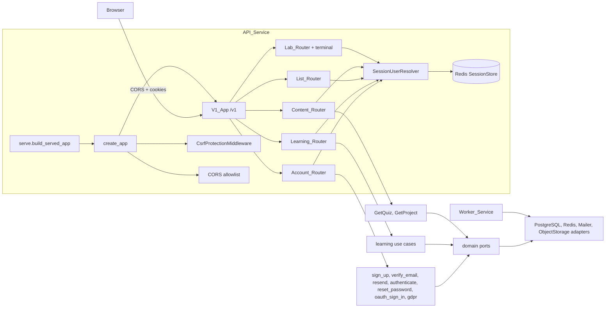
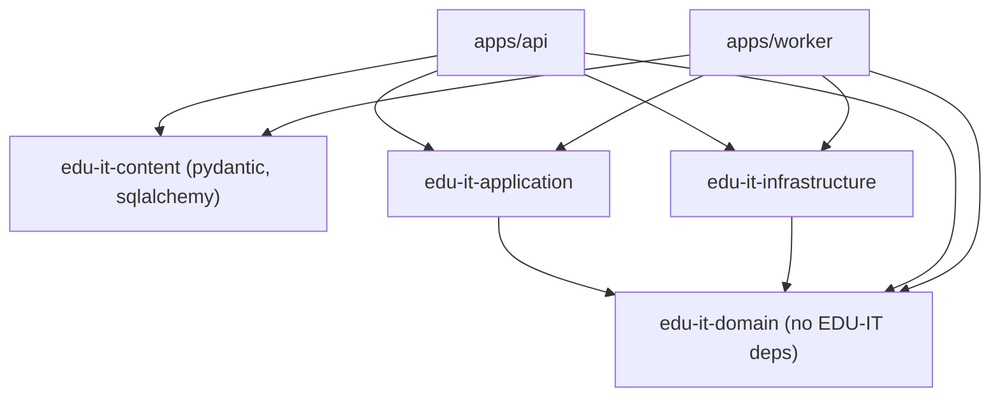
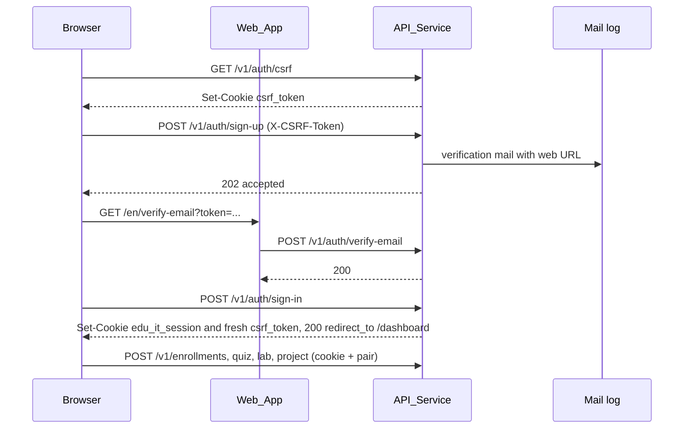

# Design Document

## Overview

This design wires the existing application use cases into the served API and the web app, and adds
the small amount of infrastructure those use cases need to run against real PostgreSQL, Redis, and
SMTP/console mail. It realizes `.kiro/specs/api-route-wiring/requirements.md`. It adds no business
rule. Authoritative rules stay in steering and are linked, not restated: authentication and privacy
(#[[file:.kiro/steering/auth-privacy.md]]), API conventions
(#[[file:.kiro/steering/api-conventions.md]]), domain rules
(#[[file:.kiro/steering/domain-rules.md]]), labs (#[[file:.kiro/steering/labs.md]]), layering
(#[[file:.kiro/steering/structure.md]]), technology (#[[file:.kiro/steering/tech.md]]), quality
(#[[file:.kiro/steering/quality.md]]), and process
(#[[file:.kiro/steering/working-agreements.md]]). ADR 0001 (versions) and ADR 0004 (sessions) apply.

### Milestones

The delivery is split in two inside this spec. Milestone 1 is the shortest path that unblocks
hands-on-labs task 24 and ends with the gate that reruns `run_verification --suite labs`. Milestone 2
starts only after that gate has passed.

| Milestone | Scope |
|---|---|
| 1 (unblock) | CSRF, CORS, and cookies; sign-up, verify-email and resend, sign-in, sign-out, session probe; `credential` and `verification_link` persistence (revision `0003`); the verification link builder; learning and list mounting; quiz and project read routes; pending project reviewer; PostgreSQL catalog sync; OpenAPI export; web client and the pages these flows need; `e2e_stack`; real-stack Seed_Lab test; the gate task |
| 2 (follow-up) | Password reset routes and pages; GitHub OAuth (with PKCE); account export, download, and deletion; `reset_link` and `pending_oauth_link` (revision `0004`); their properties and tests; a final regression run |

### Design goals

- One composition root builds every router from one set of real adapters, and the same builder
  accepts fakes, so tests, the OpenAPI export, and the served app share one wiring path.
- One shared session resolver authenticates every route. Labs, learning, content, account, and
  GDPR routes can never disagree about who the caller is.
- The api layer stays thin. Routes parse a Pydantic v2 body, call one use case, and map the result
  or the typed error to a response. Errors are rendered as RFC 9457 Problem_Details by handlers,
  never inline.
- Use cases stay framework-free. Anything environment-specific (base URLs, cookie names, hashing
  cost) enters through an injected collaborator.
- Anything genuinely missing is added as a port plus an adapter, never as business logic in a route.
- The package dependency graph stays acyclic and explicit (see "Package dependency direction").

### Research findings that shaped the design

| Question | Finding | Design consequence |
|---|---|---|
| Does the sign-up use case persist the password? | No. `SignUpUseCase` computes `password_hasher(...)` and drops the value. `test_e2e_authentication.py` calls `credentials.set_password` itself. | Sign-up gains an injected `CredentialStore` and stores the hash before it sends mail (Requirement 7.3). This corrects a defect, not a rule. |
| Do the account use cases do equal work for known and unknown emails? | No. The existing-email branch of sign-up skips the hash, and the resend and reset branches for an unknown email return before minting a token. | Each branch gets a decoy invocation so the counted work is equal (Requirements 3.11, 5.6). |
| Is there a production `CredentialStore` or hasher? | No. Only `In_Memory_CredentialStore`. ADR 0001 pins no hashing library. | Use `hashlib.scrypt` from the standard library (memory-hard, salted, no new dependency). A new dependency would need an ADR pin first. |
| Do link tables exist? | No. `metadata.py` has `user`, `session`, `oauth_link`, `role_assignment` only, and two revisions (`0001`, `0002`). | Revision `0003_accounts_runtime` (Milestone 1) adds `credential` and `verification_link`. Revision `0004_accounts_oauth_reset` (Milestone 2) adds `reset_link` and `pending_oauth_link`. |
| Can the browser call the API today? | No CORS middleware exists. The web (`:3000`) and API (`:8000`) are different origins. Cookies ignore ports, so `localhost` shares them. | Add an allowlist CORS layer fed by the existing `LAB_ALLOWED_WEB_ORIGINS` Config value, with credentials and methods derived from the Route_Table. Keep direct browser-to-API calls, matching how labs and the terminal WebSocket already work. |
| Which HTTP methods does the API use? | `labs.py:234` defines `PUT /lab-sessions/{session_id}/files`, besides `GET`, `POST`, and `DELETE`. | The CORS method list is derived from `ROUTE_TABLE`, never hand-written. |
| Who issues the CSRF cookie? | Nobody. The perf docstring says the web app does; the web code does not. | `GET /v1/auth/csrf` issues the pair. The generated client calls it lazily. Server actions generate their own pair. |
| Why does the OpenAPI document have no paths? | `openapi_export.py` calls `create_app()` with no routers. | Export builds the V1_App from the fake-backed router set, so no datastore is contacted. |
| How does `/v1` reach quiz and project content? | The web calls `GET /quizzes/{id}` and `GET /projects/{id}`. No such route exists, and `CatalogRepository` has no text. | Add two read use cases and a Content_Router. Text comes from the synced content store, structure from the catalog. |
| Where do catalog rows come from? | `sync` is in-memory. `tools/perf/stack.py` writes seven tables and misses quiz, question, option, project, rubric, prerequisite. | Add `Postgres_ContentStore` behind the existing `ContentStore` port, in `packages/content` (see "Package dependency direction"). Perf `seed_database` delegates to it. |
| Do enrollment and project submission need new use cases? | No. `EnrollUseCase`, `SubmitProjectUseCase`, and their routes exist in `learning.py`. | Mount them. Add only a non-fake `ProjectReviewer` adapter that leaves submissions pending. |
| Does reset completion already rotate sessions? | Yes. `CompletePasswordResetUseCase` revokes every prior Session and establishes exactly one new Session (Foundations 9.5, 28.1, 28.2). | Reference it. The route only sets the cookie and a fresh `csrf_token`. |
| Does anything require fresh authentication for account deletion? | No. Foundations 14.2 requires only a distinct confirmation step, and `auth-privacy.md` is silent. | Not invented here. It is an open decision (below) and a recorded risk. |
| Do GitHub OAuth Apps support PKCE? | Yes. [GitHub's OAuth documentation](https://docs.github.com/en/apps/oauth-apps/building-oauth-apps/authorizing-oauth-apps) lists `code_challenge` and `code_challenge_method` on the authorize request (only `S256` is accepted) and `code_verifier` on the token exchange, and suggests storing the verifier in a cookie next to `state`. Content was rephrased for compliance with licensing restrictions. | Milestone 2 uses PKCE S256 in addition to `state`. |
| Is there an object-storage adapter to reuse for exports? | `ExportUserDataUseCase` already writes to the `ObjectStorage` port under `exports/{user_stable_id}.json`. `FileSystem_ObjectStorage` and `In_Memory_ObjectStorage` exist but no composition wires one. `.env.example` already defines `OBJECT_STORAGE_BACKEND`. | Wire the port from `OBJECT_STORAGE_BACKEND`. No separate `export_storage_dir` setting. |
| Does the web convention for wire member names exist? | `docs/API-CONVENTIONS.md` and the API-conventions steering are silent on member casing. Existing responses use snake_case (`server_now`, `user_id`, `content_version`, `stable_id`, `offer_resend`). Only `apps/web/src/api-client.ts` reads the sign-in wire member; the other `redirectTo` occurrences are internal TypeScript properties. | The wire member is `redirect_to`. `api-client.ts` maps it to the internal `redirectTo`. |
| Which function validates new Config constants? | `validate_lab_config` (in `edu_it_domain/labs/config_rules.py`) checks only `LAB_CONFIG_KEYS`, which are lab keys. `config.py` exposes names through its `__all__` list. | New account constants are added to `config.py` and to its `__all__`. No validator registration is needed. |

### Decisions to confirm at review

1. **Direct browser-to-API calls with CORS and credentials**, not a Next.js rewrite proxy. This keeps
   one pattern for REST, SSE, and WebSocket. The cost is a CORS allowlist and the supported topology
   below. The cookie domain variable is renamed `COOKIE_DOMAIN` because it now applies to the session
   cookie and the `csrf_token` cookie.
2. **Supported deployment topology: same-site.** The Web_App and API_Service must share one
   registrable domain (for example `app.example.com` and `api.example.com` with `COOKIE_DOMAIN=example.com`)
   or run on `localhost`. `SameSite=Lax` cookies and the script read of the `csrf_token` cookie depend
   on it. A cross-site deployment is unsupported. `.env.example` states this (Requirement 2.11).
3. **Verification and reset links open Web_App pages** that `POST` the token. A `GET` that changes
   state would be fired by mail scanners and link previews.
4. **`hashlib.scrypt`** for password hashing, to avoid a new pinned dependency. Parameters are
   business numbers in `domain/config.py`.
5. **OAuth callback is a `GET` redirect** protected by `state` and PKCE S256 held in a short-lived
   cookie, instead of the CSRF pair, because GitHub cannot send the header. The confirm and decline
   routes are `POST` and use the pair. State verification is kept in addition to PKCE.
6. **Pending project review** is the production behavior until a reviewer product exists. The
   Journey_Test only requires the "Submitted" state, and "Processes" unlocks from the quiz and lab
   mastery that the Journey_Test already earns.
7. **`GET /reviews/schedule` stays out of scope.** The dashboard already tolerates its absence.
8. **The `ContentStore` adapter lives in `packages/content`** (see "Package dependency direction").
   Confirm that adding `sqlalchemy` to that package is acceptable.
9. **Open decision: fresh authentication for account deletion.** Options: (a) require the current
   password, (b) require a sign-in newer than a configured age, (c) keep the existing behavior, where
   `POST /account/deletion` needs `confirm: true` and a valid Session only. The default in this spec
   is (c), because (a) and (b) are new business rules and no steering or Foundations requirement asks
   for them. The gap is recorded in `docs/RISKS.md` (Requirement 16.8). Choosing (a) or (b) needs its
   own change to Foundations 14.
10. **Open decision: Golden_Set, orphan, and reviewer state in `Postgres_ContentStore`.** The
    relational tables have a `content_provenance.reviewed_by` foreign key to `user.id` and
    `reviewed_at`, but no column for Golden_Set membership or the orphaned-progress flag. This spec
    adds no table for them (revision `0003` creates only `credential` and `verification_link`).
    Default: `mark_golden` and `orphan_progress` keep their state in process for the sync run and
    log it, and `record_review` writes `reviewed_at` and resolves `reviewed_by` to a user when it
    can. Persisting the other two is a follow-up for the phase that consumes them.
11. **Mail latency is not equalized.** The equal-work criteria cover password hashing and token
    minting. A real mail send for an existing account still takes longer than a skipped send for an
    unknown one. Moving delivery to the task queue would equalize it but would change the 502 contract
    of Foundations 24. The residual risk is recorded in `docs/RISKS.md`.
12. **Export download goes through the API.** `ObjectStorage` has no presigned URL operation, so the
    API streams the export from the port at `GET /v1/account/export/download`, keyed by the
    authenticated user only.

## Architecture



### Package dependency direction

The `ContentStore` port, `StoredItem`, and `ContentStatus` live in
`packages/content/edu_it_content/content_store.py`, not in the domain. Today `packages/domain` and
`packages/content` depend on no EDU-IT package, and `packages/infrastructure` and
`packages/application` depend on `edu-it-domain` only. Three placements for the PostgreSQL adapter
were compared.

| Option | New EDU-IT edge | Problem |
|---|---|---|
| Adapter in `edu_it_infrastructure`, CLI option in `edu_it_content` | `content` to `infrastructure` for the CLI, or `infrastructure` to `content` for the port | The content CLI cannot import infrastructure without a new edge, and infrastructure importing content for the port type adds the opposite edge. Either way a cycle risk appears, and infrastructure today types the content store structurally (`Content_LabCatalog`) precisely to avoid it. |
| Move the port, `StoredItem`, and `ContentStatus` into the domain | `content` to `domain` | Acyclic, but a large refactor of the sync module, the CLI, the lab approval module, and their tests, and the content CLI still needs the adapter, which would then sit in infrastructure. |
| **Adapter in `packages/content` (chosen)** | none | Adds only the third-party dependency `sqlalchemy` to `packages/content`. |

**Chosen:** `edu_it_content/postgres_store.py` holds `Postgres_ContentStore`. It takes an injected
SQLAlchemy `Engine`, imports no other EDU-IT package, and reads the catalog table definitions by
reflection (`MetaData.reflect(bind=engine, only=<catalog tables>)`) so that Alembic in
`packages/infrastructure` remains the only owner of the schema and no table is declared twice.
The adapter raises an error naming the missing table when the migrations have not been applied.
The `edu-it-content sync --database-url` option builds the engine; the driver comes from an optional
extra `postgres` that pins `psycopg[binary]` at the version already in ADR 0001. `sqlalchemy` is pinned
at the version ADR 0001 already records (`2.1.6`), and the ADR gains a row that lists
`packages/content` as a consumer, before the manifest changes (Requirement 16.4). Contract tests for
the adapter live in `apps/api/tests`, because `apps/api` is the only package that depends on both
`edu-it-content` and `edu-it-infrastructure`: those tests create the schema from the infrastructure
metadata and then run the adapter against it.



A new test, `tools/tests/test_package_dependency_graph.py`, parses every workspace `pyproject.toml`
and asserts that the graph is acyclic, that `edu-it-domain` and `edu-it-content` list no `edu-it-*`
dependency, that `edu-it-application` and `edu-it-infrastructure` list only `edu-it-domain`, that no
`packages/*` project depends on an `apps/*` project, and that every third-party dependency of
`edu-it-content` appears in `docs/adr/0001-versions.md` at the same exact version.
`tools/check_domain_boundary.py` only inspects domain imports, so it is run unchanged next to the new
test and is not extended.

### Composition

`apps/api/edu_it_api/composition.py` is refactored into three functions:

- `build_adapters(settings, *, fakes: bool) -> ApiAdapters` returns one frozen dataclass with every
  port implementation. With `fakes=False` it uses PostgreSQL, Redis, the configured Mailer, and
  Object_Storage. With `fakes=True` it uses the in-memory fakes from `edu_it_infrastructure.fakes`:
  `In_Memory_UserRepository`, `In_Memory_SessionRepository`, `In_Memory_SessionStore`,
  `In_Memory_CredentialStore`, `In_Memory_VerificationLinkRepository`,
  `In_Memory_ResetLinkRepository`, `In_Memory_OAuthLinkRepository`,
  `In_Memory_PendingOAuthLinkRepository`, `In_Memory_SignInRateLimiter`,
  `In_Memory_CatalogRepository`, `In_Memory_EnrollmentRepository`, `In_Memory_ProgressRepository`,
  `In_Memory_MasteryRepository`, `In_Memory_ReviewRepository`, `In_Memory_AttemptRepository`,
  `In_Memory_IdempotencyStore`, `In_Memory_PersonalDataGateway`, `In_Memory_ObjectStorage`,
  `Console_Mailer`, `Fake_ProjectReviewer`, `Fake_SandboxProvider`, and `Test_Clock`. No Redis or
  PostgreSQL client is built.
- `build_api_routers(adapters, *, content_root, config) -> ApiRouters` builds the five routers, the
  terminal registry, and the shared `SessionUserResolver`. It contains no environment access.
- `build_served_app()` in `serve.py` calls both and passes `v1_routers=[...]` to `create_app`.

`create_app` already receives a list of routers internally (`v1_routers` is built from
`learning_router` and `lab_router`). Its signature changes to accept `v1_routers: Sequence[APIRouter]`
directly, keeping `learning_router` and `lab_router` as accepted aliases so existing tests still
compile. It also installs the CORS layer as the outermost middleware (CORS, then request logging,
then CSRF). `openapi_export.py` calls the builders with `fakes=True` and forces the conditional
OAuth routes on with `Fake_GitHubOAuthClient`, so the export contacts nothing and the document lists
every Route_Table route.

When any of the GitHub OAuth variables is set, `build_adapters` requires all three. When none is set
the OAuth routes are not mounted (Requirements 1.9, 1.10). Object_Storage is built from
`OBJECT_STORAGE_BACKEND` in Milestone 2 only; Milestone 1 does not construct it.

### Request flow for the journey



## Components and Interfaces

### Route table

This table is the single normative list of V1_App routes. `ROUTE_TABLE` in
`edu_it_api/route_table.py` mirrors it entry for entry. `/health` and `/ready` are served by the
outer app, outside `/v1`, and are not in the table. A route marked conditional is mounted only when
its condition holds; the exported OpenAPI document lists conditional routes anyway (Requirement 1.5).

| Method and path | Auth | Use case | Success | Typed errors | Milestone | Condition |
|---|---|---|---|---|---|---|
| `GET /auth/csrf` | none | none (token issuer) | 200 `{token}` | none | 1 | always |
| `POST /auth/sign-up` | none | `SignUpUseCase` | 202 `{accepted:true}` | 422 validation, 502 mail | 1 | always |
| `POST /auth/verify-email` | none | `VerifyEmailUseCase` | 200 `{verified:true}` | 400 link invalid (`offer_resend`) | 1 | always |
| `POST /auth/verify-email/resend` | none | `ResendVerificationUseCase` | 202 `{accepted:true}` | 422, 502 | 1 | always |
| `POST /auth/sign-in` | none | `AuthenticateUseCase` | 200 `{redirect_to}` + cookies | 401, 403, 429 | 1 | always |
| `POST /auth/sign-out` | optional | `SignOutUseCase` | 204 + expired cookie | none | 1 | always |
| `GET /auth/session` | cookie | `AuthenticateSessionUseCase` | 200 `{user_id}` | 401 | 1 | always |
| `POST /auth/password-reset` | none | `RequestPasswordResetUseCase` | 202 `{accepted:true}` | 422, 502 | 2 | always |
| `POST /auth/password-reset/complete` | none | `CompletePasswordResetUseCase` | 200 + cookies | 400 (`offer_restart`), 422 | 2 | always |
| `GET /auth/github/authorize` | none | `GitHubOAuthClient.authorize_url` | 302 | none | 2 | OAuth configured |
| `GET /auth/github/callback` | state cookie | `CompleteOAuthCallbackUseCase` | 302 + cookies | 302 with error code | 2 | OAuth configured |
| `POST /auth/github/confirm` | pending cookie | `ConfirmOAuthLinkUseCase` | 200 + cookies | 400 | 2 | OAuth configured |
| `POST /auth/github/decline` | pending cookie | `DeclineOAuthLinkUseCase` | 204 | none | 2 | OAuth configured |
| `POST /account/export` | cookie | `ExportUserDataUseCase` | 200 `{download_path, size_bytes}` | 401 | 2 | always |
| `GET /account/export/download` | cookie | `ObjectStorage.get` | 200 JSON attachment | 401, 404 | 2 | always |
| `POST /account/deletion` | cookie | `DeleteAccountUseCase` | 204 + expired cookie | 400, 500 | 2 | always |
| `POST /enrollments` | cookie | `EnrollUseCase` | 201 or 200 | existing | 1 | always |
| `GET /enrollments` | cookie | `ListEnrollmentsUseCase` | existing | existing | 1 | always |
| `GET /progress` | cookie | `GetProgressUseCase` | existing | existing | 1 | always |
| `GET /lessons/{stable_id}` | cookie | `GetLessonUseCase` | existing | existing | 1 | always |
| `POST /quiz-attempts` | cookie | `AttemptQuizUseCase` | existing | existing | 1 | always |
| `GET /quiz-attempts` | cookie | `ListQuizAttemptsUseCase` | existing | existing | 1 | always |
| `POST /hints` | cookie | `RevealHintUseCase` | existing | existing | 1 | always |
| `GET /reviews` | cookie | `StartReviewUseCase` | existing | existing | 1 | always |
| `POST /reviews` | cookie | `SubmitReviewUseCase` | existing | existing | 1 | always |
| `POST /project-submissions` | cookie | `SubmitProjectUseCase` | 201 `pending` | existing | 1 | always |
| `GET /quizzes/{stable_id}` | cookie | `GetQuizUseCase` (new) | 200 | 404 | 1 | always |
| `GET /projects/{stable_id}` | cookie | `GetProjectUseCase` (new) | 200 | 404 | 1 | always |
| `GET /labs/{lab_id}` | cookie | existing | existing | existing | 1 | always |
| `POST /lab-sessions` | cookie | existing | existing | existing | 1 | always |
| `GET /lab-sessions` | cookie | existing | existing | existing | 1 | always |
| `GET /lab-sessions/{session_id}` | cookie | existing | existing | existing | 1 | always |
| `DELETE /lab-sessions/{session_id}` | cookie | existing | existing | existing | 1 | always |
| `POST /lab-sessions/{session_id}/reset` | cookie | existing | existing | existing | 1 | always |
| `PUT /lab-sessions/{session_id}/files` | cookie | existing | existing | existing | 1 | always |
| `POST /lab-sessions/{session_id}/hints` | cookie | existing | existing | existing | 1 | always |
| `POST /lab-sessions/{session_id}/grading-runs` | cookie | existing | existing | existing | 1 | always |
| `GET /lab-sessions/{session_id}/grading-runs/{run_id}` | cookie | existing | existing | existing | 1 | always |
| `GET /lab-sessions/{session_id}/grading-runs/{run_id}/events` | cookie | existing | existing (SSE) | existing | 1 | always |
| `WS /lab-sessions/{session_id}/terminal` | cookie | existing | upgrade | existing | 1 | always |

`ROUTE_TABLE` starts with the Milestone 1 entries. Each Milestone 2 task appends its own entries, so
the table and the mounted routes never diverge at any point. Two tests keep it honest: the OpenAPI
completeness test compares the document paths and methods with the table, and a lab-route test
compares the lab entries with the routes of the real `Lab_Router`, so a lab route cannot be added
without being listed.

### Shared session resolver (`edu_it_api/identity.py`)

```python
@dataclass(frozen=True, slots=True)
class SessionUserResolver:
    session_store: SessionStore
    cookie_name: str = SESSION_COOKIE_NAME

    def __call__(self, request: Request) -> str: ...      # raises NotAuthenticated
    def ref(self, request: Request) -> str | None: ...     # cookie value or None
```

It raises `NotAuthenticated`, a new exception mapped to a 401 Problem_Details by
`errors/accounts.py`. `composition.py` passes the same instance to `LabServices.current_user`,
`LearningServices.current_user`, `ListServices.current_user`, the Content_Router, and the Account_Router.
It replaces the inline closure that raises a bare `HTTPException(401)` today, so labs also return a
translated Problem_Details.

### Session cookie and CSRF (`edu_it_api/session_cookie.py`, `edu_it_api/csrf_tokens.py`)

```python
@dataclass(frozen=True, slots=True)
class CookieSettings:
    environment: Environment
    domain: str | None        # COOKIE_DOMAIN
    max_age: timedelta        # SESSION_DURATION

def set_session_cookie(response: Response, ref: str, s: CookieSettings) -> None: ...
def expire_session_cookie(response: Response, s: CookieSettings) -> None: ...
def new_csrf_token() -> str: ...                          # secrets.token_urlsafe(32)
def set_csrf_cookie(response: Response, token: str, s: CookieSettings) -> None: ...
def ensure_csrf_cookie(request: Request, response: Response, s: CookieSettings) -> str: ...
```

`set_session_cookie` sets `HttpOnly`, `SameSite=Lax`, `Path=/`, `Max-Age`, `Secure` only in
production, and `Domain` only when configured. `set_csrf_cookie` sets the same `SameSite=Lax`,
`Path=/`, `Max-Age`, `Secure` (production only), and `Domain` (when configured), and deliberately
omits `HttpOnly`, because the double-submit scheme requires scripts to read the cookie. Both cookies
therefore share the cookie domain, which is what lets a Web_App on a sibling subdomain read the
token. `ensure_csrf_cookie` returns an existing well-formed cookie value (using `csrf.token_is_valid`'s
minimum length) or issues a new one.

**Rotation.** A successful sign-in, password-reset completion, OAuth sign-in, or OAuth link
confirmation calls `set_session_cookie` with the reference the use case just created and
`set_csrf_cookie` with `new_csrf_token()`. The route never passes a reference taken from the request
cookie to any use case, so a presented Session is never reused or refreshed. Revoking the other
Sessions on reset completion is already done by `CompletePasswordResetUseCase`.

### CORS (`edu_it_api/cors.py`)

`install_cors(app, origins, route_table)` adds Starlette's `CORSMiddleware` with
`allow_origins=origins`, `allow_credentials=True`, and
`allow_methods=sorted({e.method for e in route_table if e.method != "WS"} | {"OPTIONS"})`, which is
`DELETE, GET, OPTIONS, POST, PUT` for the table above. Methods are never hand-listed. The allowed
headers are `Content-Type`, `X-CSRF-Token`, `Idempotency-Key`, `Accept-Language`, and `Accept`. Origins
come from `LAB_ALLOWED_WEB_ORIGINS`. Middleware order in `create_app`: CORS outermost (so preflights
never reach CSRF), then request logging, then CSRF. An origin outside the list gets no allow headers.

### Account router (`edu_it_api/accounts.py`, `accounts_schemas.py`)

```python
@dataclass(frozen=True, slots=True)
class AccountServices:
    resolver: SessionUserResolver
    cookies: CookieSettings
    sign_up: SignUpUseCase
    verify_email: VerifyEmailUseCase
    resend: ResendVerificationUseCase
    sign_in: AuthenticateUseCase
    sign_out: SignOutUseCase
    authenticate_session: AuthenticateSessionUseCase
    request_reset: RequestPasswordResetUseCase | None       # Milestone 2
    complete_reset: CompletePasswordResetUseCase | None     # Milestone 2
    export_data: ExportUserDataUseCase | None               # Milestone 2
    delete_account: DeleteAccountUseCase | None             # Milestone 2
    export_storage: ObjectStorage | None                    # Milestone 2

def build_account_router(services: AccountServices) -> APIRouter: ...
```

Request models inherit a `_Strict` base with `model_config = ConfigDict(extra="forbid")`.

**Email and password validation (choice).** The request models type `email` and `password` as a
plain `str` with no length, pattern, or format constraint. The use case is the single validator of
email shape, email length (254 characters), and password policy, so a 255-character email always
reaches `SignUpUseCase` and comes back as `SignUpValidationError`, which the error table maps to a
422 with one `fields` entry per rejected field. Request-validation failures that remain, such as an
unknown extra field or a missing member, are rendered by the existing `RequestValidationError`
handler (`errors/handlers.py`), which already produces the same `fields` shape through
`build_validation_problem`. Both paths therefore return the same Problem_Details structure and
Requirement 3.3 holds without a second mapping.

Response models are frozen. Sign-in returns `SignInResponse(redirect_to="/dashboard")` and never the
session reference. The API returns a locale-free path; the Web_App prefixes the current locale
(`/{locale}{redirect_to}`, Requirement 14.8). A route handler calls exactly one use case and one
cookie helper.

### Equal-work changes in the use cases

These are changes to the call sequence only. They add no rule and no outcome change.

| Use case | Branch | Added decoy |
|---|---|---|
| `SignUpUseCase.execute` | email already registered (unverified or verified) | one `password_hasher(request.password)` call whose result is discarded, so the branch performs the same single hash as the new-user branch |
| `ResendVerificationUseCase.execute` | unknown email or already verified | one `token_factory()` call whose result is discarded |
| `RequestPasswordResetUseCase.execute` (Milestone 2) | unregistered email | one `token_factory()` call whose result is discarded |

The scrypt call dominates sign-up latency, so equalizing the hash call closes the large timing gap.
Resend and reset-request do no password hashing in any branch, so there is no scrypt to equalize
there; their token mint is equalized and the remaining difference is mail delivery latency, which is
decision 11 above. Tests count calls with a counting fake hasher and a counting token factory
instead of timing anything.

### OAuth (`edu_it_api/oauth.py`, port `GitHubOAuthClient`) (Milestone 2)

```python
class GitHubOAuthClient(Protocol):
    def authorize_url(self, state: str, code_challenge: str) -> str: ...
    def exchange(self, code: str, code_verifier: str) -> GitHubIdentity | None: ...  # None on denial or failure

@dataclass(frozen=True, slots=True)
class GitHubIdentity:
    subject: str
    email: str
    email_verified: bool

def new_pkce_verifier() -> str: ...            # secrets.token_urlsafe(64), 86 characters
def pkce_challenge(verifier: str) -> str: ...  # unpadded base64url(SHA-256(verifier)), 43 characters
```

The port lives in `edu_it_domain/ports/github_oauth.py`. The adapter `Urllib_GitHubOAuthClient`
(`edu_it_infrastructure/github_oauth.py`) uses `urllib.request` with a 10 s timeout and reads
`GITHUB_OAUTH_CLIENT_ID`, `GITHUB_OAUTH_CLIENT_SECRET`, and `GITHUB_OAUTH_CALLBACK_URL` through
`CompositionSettings`. The authorize route stores `state` and the PKCE `code_verifier` together in one
cookie `edu_it_oauth_state` (value `{state}.{verifier}`; both parts are URL-safe base64 and contain no
dot), `HttpOnly`, `SameSite=Lax`, `Path=/v1/auth/github`, `Secure` in production, `Max-Age` equal to
`OAUTH_STATE_TTL`. The callback route compares `state` with `hmac.compare_digest`, passes the stored
verifier to `exchange`, and deletes the cookie in every outcome. The state cookie is host-only and is
not given `COOKIE_DOMAIN`, because only the API host reads it. `Fake_GitHubOAuthClient` drives all
tests and asserts the `code_verifier` it receives hashes to the `code_challenge` it was given. No test
opens a socket.

When no GitHub variable is set the routes are not mounted and a request to `/v1/auth/github/*` gets
the generic 404 Problem_Details. Partial configuration stops the process (Requirements 1.9, 1.10).

### Error mapping (`edu_it_api/errors/accounts.py`)

`install_account_error_handlers(app)` is added to `install_error_handlers`, next to the learning and
lab installers. New `ProblemType` entries, each with fr and en `detail`:

| Condition | Status | Slug | Milestone |
|---|---|---|---|
| `SignUpValidationError` | 422 | `validation-error` with `fields` | 1 |
| `SignUpMailDeliveryError`, `ResendVerificationError`, `PasswordResetMailDeliveryError` | 502 | `mail-delivery-failed` | 1 (reset error: 2) |
| `VerifyEmailOutcome.INVALID_OR_EXPIRED` | 400 | `verification-link-invalid`, `offer_resend: true` | 1 |
| `SignInFailure.INVALID_CREDENTIALS` | 401 | `invalid-credentials` | 1 |
| `SignInFailure.EMAIL_NOT_VERIFIED` | 403 | `email-not-verified` | 1 |
| `SignInFailure.RATE_LIMITED` | 429 | `too-many-attempts`, `Retry-After` | 1 |
| `NotAuthenticated` | 401 | `not-authenticated` | 1 |
| `ResetCompletionOutcome` invalid link | 400 | `reset-link-invalid`, `offer_restart: true` | 2 |
| reset password policy | 422 | `validation-error` | 2 |
| `AccountDeletionError` | 500 | `deletion-incomplete` | 2 |
| export not found | 404 | `export-not-found` | 2 |
| `OAuthCallbackError` | 302 to `/{locale}/sign-in?error=<code>` | not a body | 2 |

Details never include provider text, SQL, or stack traces. Unexpected exceptions keep going to the
existing `_handle_unexpected_error`. The mail-failure mapping (502 with `mail-delivery-failed`) is
written into `docs/API-CONVENTIONS.md` by a task, so other routes that send mail stay consistent
(Requirement 16.9).

### Content router (`edu_it_api/content_routes.py`) and read use cases

```python
class GetQuizUseCase:
    def __init__(self, *, catalog: CatalogRepository, text: ContentTextSource) -> None: ...
    def execute(self, quiz_id: StableId, locale: str) -> QuizView: ...

class GetProjectUseCase:
    def __init__(self, *, catalog: CatalogRepository, text: ContentTextSource) -> None: ...
    def execute(self, project_id: StableId, locale: str) -> ProjectView: ...
```

`ContentTextSource` is a new domain port: `quiz_text(quiz_id, locale)`, `project_text(project_id,
locale)`. `Content_StoreTextSource` in infrastructure reads the same synced content store the lab
catalog reads (`load_synced_store`). Like `Content_LabCatalog`, it types the store structurally with a
small Protocol, so `edu-it-infrastructure` does not import `edu-it-content`; the API composition
passes the store in. Both use cases raise the existing `NotFoundError` for an unknown or archived
item. `QuizView` carries no correctness flag: the builder copies `option_id` and text only. Locale
fallback to English happens in the text source, mirroring `GetLessonUseCase`.

### Learning composition

`build_learning_services(adapters, content)` returns `LearningServices` and `ListServices` using the
constructor calls shown in `apps/api/tests/test_learning_latency.py`, with PostgreSQL repositories in
place of the SQLite test engine, `Redis_IdempotencyStore(redis, encode_attempt_result,
decode_attempt_result)`, `System_Clock`, `Uuid_IdGenerator`, and `Pending_ProjectReviewer`. The
`Postgres_LessonRepository` text loader reads from the synced content store.

### Infrastructure additions

| Component | Location | Port | Milestone |
|---|---|---|---|
| `Scrypt_PasswordHasher` (`hash`, `verify`, `dummy_verify`) | `edu_it_infrastructure/password_hasher.py` | none (callable plus verifier) | 1 |
| `Postgres_CredentialStore`, `Postgres_VerificationLinkRepository` | `persistence/account_repositories.py` | `CredentialStore`, `VerificationLinkRepository` | 1 |
| `Postgres_ResetLinkRepository`, `Postgres_PendingOAuthLinkRepository`, `Postgres_OAuthLinkRepository` | same | link ports | 2 |
| `Postgres_ContentStore` | `packages/content/edu_it_content/postgres_store.py` | `ContentStore` (in `packages/content`) | 1 |
| `Pending_ProjectReviewer` | `adapters/project_reviewer.py` | `ProjectReviewer` | 1 |
| `Web_LinkBuilder` | `edu_it_infrastructure/link_builder.py` | `LinkBuilder` (new domain port) | 1 (reset URL: 2) |
| `Content_StoreTextSource` | `adapters/content_text.py` | `ContentTextSource` (new domain port) | 1 |
| `Urllib_GitHubOAuthClient` | `edu_it_infrastructure/github_oauth.py` | `GitHubOAuthClient` | 2 |
| `FileSystem_ObjectStorage` (existing, now wired) and `In_Memory_ObjectStorage` | `adapters/object_storage.py`, `fakes` | `ObjectStorage` (existing) | 2 |

`LinkBuilder` is a domain port: `verification_url(token, locale) -> str`,
`reset_url(token, locale) -> str`. The sign-up and resend use cases take it as a required
constructor argument in Milestone 1, and the request-reset use case takes it in Milestone 2.
`SignUpUseCase` also takes `credentials: CredentialStore`. Existing test fixtures that build these
use cases are updated in the same change as each constructor change.

### Web changes (`apps/web`)

- `scripts/generate-client.mjs` is unchanged in contract. The input document now has paths, so the
  generator emits typed operations. `GeneratedClient.call` stays for operations the document does not
  type. `src/generated/api-client.ts` is regenerated, never edited.
- `src/api-client.ts` and the adapters in `learning-api.ts`, `practice-api.ts`, `lab-api.ts`
  construct their client through one `createApiClient({ cookie? })` factory. In the browser it adds
  `credentials: 'include'` and the `X-CSRF-Token` header (reading the `csrf_token` cookie, calling
  `GET /auth/csrf` once if absent). On the server it forwards the request cookie and generates a
  fresh pair per call.
- `AUTH_PATHS` becomes: sign-up `/auth/sign-up`, sign-in `/auth/sign-in`, verify-email resend
  `/auth/verify-email/resend`, and (Milestone 2) reset-password `/auth/password-reset`. `verifyEmail(token)`
  is added in Milestone 1, `completePasswordReset(token, newPassword)` in Milestone 2.
- `createAuthApi` in `api-client.ts` reads the wire member `redirect_to` and returns it as the
  internal `redirectTo` property that `auth-forms.ts` and `auth-form.tsx` already use. Those files and
  their tests keep the internal name. The sign-in page navigates to `/{locale}{redirectTo}`.
- Milestone 1 pages: `verify-email/page.tsx` reads `searchParams.token`; sign-up redirects to
  `/{locale}/verify-email`; sign-in navigates with the locale prefix. Milestone 2 pages:
  `reset-password/page.tsx` switches between the request form and the new-password form; sign-in shows
  the GitHub link when `NEXT_PUBLIC_GITHUB_SIGN_IN_ENABLED=true`; a new `auth/github/confirm/page.tsx`
  renders confirm and decline buttons. All strings are added to the fr and en catalogs.
- `.env.example` sets `NEXT_PUBLIC_API_BASE_URL=http://localhost:8000/v1` and renames the cookie
  domain entry to `COOKIE_DOMAIN=` (empty by default) with the same-site comment of Requirement 2.11.
  Milestone 2 adds `NEXT_PUBLIC_GITHUB_SIGN_IN_ENABLED=false` and `OBJECT_STORAGE_ROOT=`.
- `session.ts` already calls `GET /auth/session` with the cookie; it works once the route exists.

### Worker

`apps/worker` keeps its composition. It already shares `lab_composition` and the Postgres mastery
repository. No account route needs it. A new integration test asserts that after the worker records a
passed Check, `GET /progress` shows the lab task completion, which is the path "Processes" unlocks
through.

### Stack bootstrap (`tools/e2e_stack.py`)

A script with `up`, `down`, and `env` subcommands. `up` starts PostgreSQL and Redis from
`deploy/` Compose, runs `python -m edu_it_infrastructure.persistence.runner upgrade`, runs
`edu-it-content sync --database-url`, builds the Lab_Images, starts the worker and the API with
`SANDBOX_PROVIDER=docker EDU_IT_ENV=development MAILER_BACKEND=console`, tees API output to
`E2E_MAIL_LOG`, and starts the web app. The image build runs `docker buildx bake` against
`lab-images/docker-bake.hcl` and passes the `ALPINE_MIRROR` environment variable through when it is
set; the script does not run, install, or require `trivy`. `env` prints the variables the Playwright
config needs. A `--dry-run` flag prints the plan without side effects, which is how the script is
unit-tested, including the `ALPINE_MIRROR` pass-through and the absence of any `trivy` step.

## Data Models

### Migration `0003_accounts_runtime` (Milestone 1)

| Table | Columns | Constraints |
|---|---|---|
| `credential` | `id` pk, `user_id` fk `user.id`, `secret` string(255), `updated_at` timestamptz | unique `user_id` |
| `verification_link` | `id` pk, `token_digest` string(64), `user_id` fk, `issued_at`, `expires_at`, `consumed_at` null | unique `token_digest` |

Revision `0003` creates no other table. Its downgrade drops only these two tables.

### Migration `0004_accounts_oauth_reset` (Milestone 2)

| Table | Columns | Constraints |
|---|---|---|
| `reset_link` | same shape as `verification_link` | unique `token_digest` |
| `pending_oauth_link` | `id` pk, `token_digest` string(64), `provider` string(32), `subject` string(255), `user_id` fk, `email` string(254), `issued_at`, `expires_at`, `consumed_at` null | unique `token_digest` |

`token_digest` is the hex SHA-256 of the raw token. `oauth_link` already exists. None of the new
tables carries a `stable_id`: they are not API-addressable. All of them reference `user`, so they are
personal-data tables and join `docs/DATA-MODEL.md` Section 13 with export, deletion, and retention
paths, in the same change as the revision that creates them (`credential` and `verification_link`
with `0003`, `reset_link` and `pending_oauth_link` with `0004`). Links keep the existing 24 h and 1 h
expiry from `domain/config.py`; expired rows are removed by the existing retention sweep, extended to
the tables of each milestone.

`mark_consumed` is a single statement, `UPDATE ... SET consumed_at = :t WHERE token_digest = :d AND
consumed_at IS NULL`, and returns whether one row changed. That gives exactly-once consumption under
concurrency on PostgreSQL.

### Password hash string

`scrypt$N$r$p$<salt_b64>$<hash_b64>`. `N`, `r`, `p`, salt length, and key length are constants in
`domain/config.py` (`PASSWORD_HASH_SCRYPT_N` and siblings), added to the module's `__all__`. `verify`
parses the parameters from the stored string, so a later cost increase does not invalidate old
hashes. Comparison uses `hmac.compare_digest`. A missing credential and a wrong password both return
`False` after a dummy hash, so the work done is the same.

### API schemas

```python
class SignUpBody(_Strict):    email: str; password: str; locale: Literal["fr","en"] = "en"
class SignInBody(_Strict):    email: str; password: str
class VerifyBody(_Strict):    token: str
class ResendBody(_Strict):    email: str
class ResetRequestBody(_Strict):  email: str                   # Milestone 2
class ResetCompleteBody(_Strict): token: str; new_password: str  # Milestone 2
class DeleteBody(_Strict):    confirm: bool                    # Milestone 2
class AcceptedResponse(_Resp):    accepted: Literal[True]
class SignInResponse(_Resp):      redirect_to: str
class SessionResponse(_Resp):     user_id: str
class CsrfResponse(_Resp):        token: str
class ExportResponse(_Resp):      download_path: str; size_bytes: int   # Milestone 2
class QuizResponse(_Resp):        stable_id; title; content_version; questions: list[QuizQuestion]
class QuizQuestion(_Resp):        stable_id; prompt; options: list[Option]; hints: list[str]
class ProjectResponse(_Resp):     stable_id; title; description; rubric: list[Criterion]
```

`email` and `password` carry no `max_length`, `pattern`, or format constraint. Wire member names are
snake_case throughout.

The pending OAuth cookie `edu_it_oauth_pending` holds the raw pending token (`HttpOnly`,
`SameSite=Lax`, short `Max-Age` equal to `OAUTH_LINK_CONFIRMATION_WINDOW`). The state and PKCE cookie
`edu_it_oauth_state` is described in the OAuth section.

### Configuration additions

`CompositionSettings` gains `web_base_url`, `cookie_domain`, `allowed_web_origins` (defaulting to
`LAB_ALLOWED_WEB_ORIGINS`) in Milestone 1, and `github_client_id`, `github_client_secret`,
`github_callback_url`, `object_storage_backend`, and `object_storage_root` in Milestone 2. There is no
`export_storage_dir`: exports go through the `ObjectStorage` port. `domain/config.py` gains the scrypt
parameters in Milestone 1 and `OAUTH_STATE_TTL` in Milestone 2, and both are added to its `__all__`
list. `.env.example` lists each new variable.

## Correctness Properties

*A property is a characteristic or behavior that should hold true across all valid executions of a system-essentially, a formal statement about what the system should do. Properties serve as the bridge between human-readable specifications and machine-verifiable correctness guarantees.*

### Property 1: Password hash round trip

For any password, verifying it against its own stored hash returns true; for any different password it returns false; hashing the same password twice yields two different stored strings; and verifying any password for a user with no credential returns false.

**Validates: Requirements 7.1, 7.2**

### Property 2: Sign-up, verification, and sign-in compose

For any valid email and policy-compliant password, signing up, opening the emailed verification link, and signing in with the same credentials returns 200, sets a Session_Cookie that resolves to the new user, and the user holds only the learner role.

**Validates: Requirements 3.1, 3.5, 3.9, 4.1, 7.3**

### Property 3: Accepted responses never disclose account existence

For any email, the response to sign-up, verification resend, and (Milestone 2) password-reset request is identical in status and body whether the email is new, registered and unverified, or registered and verified; and for any such email the number of Password_Hasher invocations on sign-up and the number of token-factory invocations on resend and reset-request, counted by fakes and never by wall-clock time, are the same for every class of email.

**Validates: Requirements 3.2, 3.7, 3.11, 5.1, 5.6**

### Property 4: Sign-in failures are indistinguishable

For any email and password, the response for an unknown account equals the response for a wrong password on a known account in status, Problem_Details type, and body.

**Validates: Requirements 4.2**

### Property 5: Authenticated routes reject missing or invalid sessions

For any authenticated route in `ROUTE_TABLE` and any session cookie that is absent, random, expired, or revoked, the response is a 401 `application/problem+json` document and no state changes.

**Validates: Requirements 1.3, 1.4, 4.7**

### Property 6: Cookie attributes follow configuration

For any environment, optional cookie domain, session reference, and csrf token, the issued Session_Cookie is `HttpOnly`, `SameSite=Lax`, `Path=/`, has `Max-Age` equal to `SESSION_DURATION` in seconds, carries `Secure` if and only if the environment is production, and carries `Domain` if and only if a domain is configured; and the issued `csrf_token` cookie is not `HttpOnly`, is `SameSite=Lax` with `Path=/`, carries `Secure` if and only if the environment is production, and carries the same `Domain` as the Session_Cookie.

**Validates: Requirements 2.1, 2.2, 2.3, 2.4**

### Property 7: CSRF issuance and enforcement

For any number of calls to `GET /auth/csrf`, the returned token is URL-safe with at least 32 characters, equals the `csrf_token` cookie, and passes the CSRF middleware as cookie and header; for any well-formed existing cookie the endpoint returns that same token; and for any unsafe route in `ROUTE_TABLE` a request without a matching pair is rejected with 403 and changes no state.

**Validates: Requirements 2.4, 2.5, 2.6**

### Property 8: CORS follows the allowlist and the route table

For any request origin string, the response carries an allow-origin header and allow-credentials if and only if the origin is in `LAB_ALLOWED_WEB_ORIGINS`; and for any entry of `ROUTE_TABLE` other than a WebSocket and any allowed origin, a preflight request for that method and path succeeds and lists that method in its allowed methods, which includes `PUT` for the lab file save.

**Validates: Requirements 2.8, 2.9**

### Property 9: Failures and logs never leak secrets or set sessions

For any failing account request and any generated password, the response sets no Session_Cookie, and neither the response body nor any captured log record contains the password, the stored hash, a session reference, or an injected exception marker string.

**Validates: Requirements 2.10, 4.8, 16.6**

### Property 10: Account link URLs round trip

For any token and locale, the verification URL and (Milestone 2) the reset URL parse to the configured web base host, the path `/{locale}/verify-email` or `/{locale}/reset-password`, and a `token` query value equal to the original token, contain no whitespace, and appear in a mail whose language matches the locale.

**Validates: Requirements 8.1, 8.2, 8.4, 8.5**

### Property 11: Link tokens are stored as digests and consumed once

For any link and any raw token, the persisted row never contains the raw token and a lookup by the raw token returns the link; consuming the link a second time returns false (single consume, sequential); and, on PostgreSQL only, for any number of concurrent consumers between 2 and 20 exactly one `mark_consumed` call returns true. The concurrent part runs only when `DATABASE_URL` points to PostgreSQL, and in CI against the PostgreSQL service; on SQLite only the digest and sequential single-consume parts run.

**Validates: Requirements 7.5, 7.6, 7.8, 7.12**

### Property 12: Invalid input and invalid links leave state unchanged

For any request body with an unknown extra field, with an invalid email or password (including an email of 255 or more characters), or with an expired, used, or unknown link token, the API returns the documented 4xx Problem_Details, the `fields` list names exactly the rejected fields in the same shape for use-case and request-validation failures, and no user, password, link, or session changes.

**Validates: Requirements 3.3, 3.6, 3.10, 5.4, 5.5**

### Property 13: OAuth state and PKCE derivation

For any two state strings, `state_matches` is true if and only if they are equal, and any callback with a differing state creates no user, link, or session; and for any generated verifier, the verifier has between 43 and 128 URL-safe characters and the challenge equals the unpadded base64url encoding of its SHA-256 digest, so the verifier given to the token exchange always hashes to the challenge given to the authorize URL.

**Validates: Requirements 6.1, 6.2**

### Property 14: Content reads are complete, safe, and localized

For any quiz or project in the store and any locale, the response lists the same questions, options, and rubric criteria as the catalog, contains no key that reveals a correct option, and returns the English text wherever the requested locale has no translation.

**Validates: Requirements 10.1, 10.2, 10.3, 10.4, 10.7**

### Property 15: Repeated mutations are idempotent

For any number of repeated sign-out calls the status is 204; for any number of repeated enrollments the first returns 201, the rest return 200, and one enrollment exists; and for any number of quiz attempts sent with one `Idempotency-Key` exactly one `quiz_attempt` is recorded and every response body is equal.

**Validates: Requirements 4.5, 9.4, 9.6**

### Property 16: Project submissions are pending or rejected whole

For any submission and rubric, a complete submission records exactly one `project_submission` and returns `pending`, an incomplete one returns a Problem_Details response and records none, and `Pending_ProjectReviewer.review` returns `None`.

**Validates: Requirements 11.1, 11.3, 11.4**

### Property 17: Learning responses expose stable identifiers only

For any response of a learning, content, or list route, no member is a bare integer primary key and every resource reference is a `stable_id` string.

**Validates: Requirements 9.8**

### Property 18: Content store contract and idempotent sync

For any valid content set, syncing it into the PostgreSQL store satisfies the same `ContentStore` contract as the in-memory store, a second sync reports no change and leaves every row equal, and an edit updates rows in place without removing any learner completion.

**Validates: Requirements 12.1, 12.3, 12.4**

### Property 19: The generated client sends the CSRF pair and credentials

For any unsafe call and any `csrf_token` cookie value, the browser client sends `credentials: 'include'` and an `X-CSRF-Token` header equal to the cookie value, and when the cookie is absent it requests `GET /auth/csrf` exactly once before the call.

**Validates: Requirements 14.3**

### Property 20: Credential-establishing routes rotate the session and the CSRF token

For any session cookie value presented on a request (absent, valid, revoked, or random) and any successful sign-in, password-reset completion (Milestone 2), OAuth sign-in (Milestone 2), or OAuth link confirmation (Milestone 2), the response sets a Session_Cookie whose reference differs from the presented one and resolves to the user, and sets a `csrf_token` cookie that differs from the presented `csrf_token` cookie; and after a password-reset completion every other Session of the user no longer authenticates.

**Validates: Requirements 4.9, 5.3, 6.3, 6.6, 6.10**

## Error Handling

- **Use case errors** raise typed exceptions. `errors/accounts.py` maps each to a Problem_Details,
  localized with the existing `request_locale` and `build_problem` helpers. A route never builds an
  error body by hand.
- **Mail failures** keep the account in a safe state (the use cases already do) and return 502 with
  the slug `mail-delivery-failed`. The learner can resend (Foundations 24).
- **Non-disclosure:** accepted responses for sign-up, resend, and reset are built from one constant
  per route. Failure paths that exist only for registered accounts (mail delivery to an existing
  owner) return the same 502 a new user would get. Equal work is enforced by decoy calls (see
  "Equal-work changes in the use cases").
- **Startup failures:** a missing or malformed `WEB_BASE_URL`, an invalid lab Config, an adapter
  that cannot be built, a partial GitHub OAuth configuration, or an `OBJECT_STORAGE_BACKEND` value
  without an adapter stops the process and logs the adapter or variable name, never a secret value.
  An unset GitHub OAuth configuration is not a failure: the OAuth routes are simply not mounted.
- **Datastore outages:** the existing datastore handler returns 503 Problem_Details; readiness keeps
  reporting not-ready.
- **OAuth failures** redirect with a short error code, not a body, and create nothing. The state
  cookie is deleted in every callback outcome.
- **CSRF and CORS:** a missing pair returns the existing 403. A disallowed origin gets no CORS
  headers, so the browser blocks the response.
- **Logging:** structured records carry the Request_ID, user `stable_id`, and event names only. Raw
  emails, passwords, tokens, and session references are never logged.
- **Clock:** link expiry, session expiry, and rate limits read the injected `Clock`. Production
  wires `System_Clock` only.

## Testing Strategy

### Approach

Property-based testing applies here: the account flows, cookie builder, link builder, hasher, and
read use cases are pure or in-memory testable, and their input spaces are large. Wiring, migrations,
and the real stack use smoke, integration, and example tests instead.

- **Python property tests:** Hypothesis, minimum 100 examples, in `apps/api/tests`,
  `packages/infrastructure/tests`, and `packages/application/tests`. Each test carries the comment
  `Feature: api-route-wiring, Property {n}: {text}`. Clock-dependent properties use `Test_Clock`.
  Stateful flows (Properties 2, 5, 15, 20) use fakes through FastAPI's `TestClient` against the
  Served_App built with `fakes=True`.
- **Web property tests:** fast-check, minimum 100 runs, for Property 19 and the existing key-parity
  property. Component tests use the existing vitest setup.
- **Contract suites:** one parametrized suite per port (`CredentialStore`, the four link
  repositories, `ContentStore`) runs against the in-memory fake and the SQL adapter. The SQL adapter
  runs on SQLite in unit tests, like `test_learning_latency.py`, and on PostgreSQL when
  `DATABASE_URL` is set. Concurrency cases are PostgreSQL-only because SQLite serializes writers and
  would pass them vacuously; they are skipped without `DATABASE_URL` and always run in CI against a
  PostgreSQL service container (Property 11). The `Postgres_ContentStore` contract suite lives in
  `apps/api/tests` (see "Package dependency direction").
- **Unit and example tests:** route status mapping per error (one test per row of the error table),
  mail failure paths, rate-limit boundary with the fake clock, OAuth outcomes with
  `Fake_GitHubOAuthClient`, deletion without confirmation, unknown and archived content, startup
  refusal, the dry-run plan of `tools/e2e_stack.py`, an OAuth-unconfigured start (routes absent,
  404 Problem_Details) and a partial OAuth configuration (startup error naming the variables), and
  the counting-fake examples for equal work.
- **Integration tests:** migration up and down for each revision, the OpenAPI export with sockets
  forbidden and completeness against `ROUTE_TABLE` (conditional routes present in the export, and
  absent from a Served_App built without OAuth configuration), the lab-route comparison against the
  real `Lab_Router`, the in-process HTTP journey (Requirement 17.7), the worker-then-progress test,
  the perf `mint_learner` cookie authenticating against the Served_App, and
  `tools/tests/test_package_dependency_graph.py` together with `tools/check_domain_boundary.py`.
- **Real stack:** `labs-playwright-real` (the Journey_Test), plus a new `e2e/real/seed-labs.e2e.ts`
  that passes both Seed_Labs in `/fr` and `/en`. The mock-API specs stay on the deterministic mock.

### Regression gates

These are gates, not system requirements. They run at every checkpoint task and in both final tasks.

- The existing foundations, learning-core, and hands-on-labs suites pass unchanged, except for
  constructor updates to the sign-up, resend, and request-reset fixtures.
- Every existing web unit, property, and accessibility test passes, and `labs-axe` covers the new
  pages in `/fr` and `/en`.
- The Worker_Service tests pass whenever the shared adapter builders change.
- The Milestone 1 gate runs `python tools/run_verification.py --suite labs` with the Real_Stack up.
  The image checks of that suite need `trivy` on `PATH` at the ADR 0001 pin (`0.76.1`); a
  container-based `trivy` invocation is an acceptable way to provide it. The bootstrap does not install it.
- The Milestone 2 final task reruns the labs suite and the web accessibility suite after the
  Milestone 2 changes.

### Property-based testing library choices

Hypothesis for Python and fast-check for TypeScript are the libraries the repository already uses
(ADR 0001). No property-based testing is written from scratch.

### Traceability to earlier specs

| This spec | Foundations | Learning core | Hands-on labs |
|---|---|---|---|
| Req 1, 2 | 8.5, 11, 17.4, 19 | 18.6 | 12.1, 12.2 |
| Req 3 | 7.1 to 7.9, 24.1, 24.3, 25.1, 25.2 | none | none |
| Req 4 | 8.1 to 8.5, 12.1 to 12.4 | none | none |
| Req 5 | 9.1 to 9.6, 24.2, 25.3, 28 | none | none |
| Req 6 | 10.1 to 10.7, 21.5, 26 | none | none |
| Req 7 | 5.1, 5.2, 7.3, 8.1, 9.2, 14 | 22 | none |
| Req 8 | 7.3, 9.1 | none | none |
| Req 9 | none | 17.1 to 17.5, 18.1 to 18.4, 18.6, 23, 24, 28 | none |
| Req 10 | 15 | 17.3, 19.4, 19.5 | none |
| Req 11 | none | 18.5, 20.1 to 20.4 | none |
| Req 12 | 4 | 12 to 16, 25, 26 | 20.12, 23 |
| Req 13 | 14.1 to 14.4 | 22 | 24.4 |
| Req 14 | 15, 16, 17 | 19 | 15 |
| Req 15 | none | none | 6, 15 |
| Req 16 | 1.8, 18.6, 19.6 | none | 4.12 to 4.14 |
| Req 17 | none | none | 32.1 to 32.3 |
| Final gate tasks | none | none | 32, 35 (task 24 gate) |
