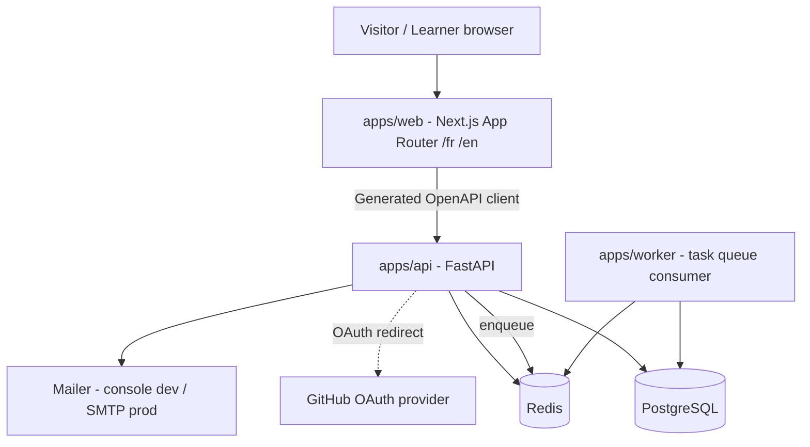
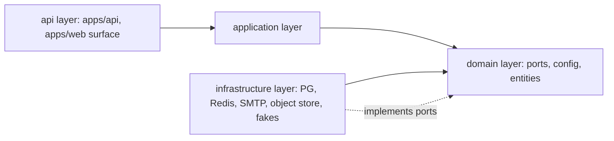
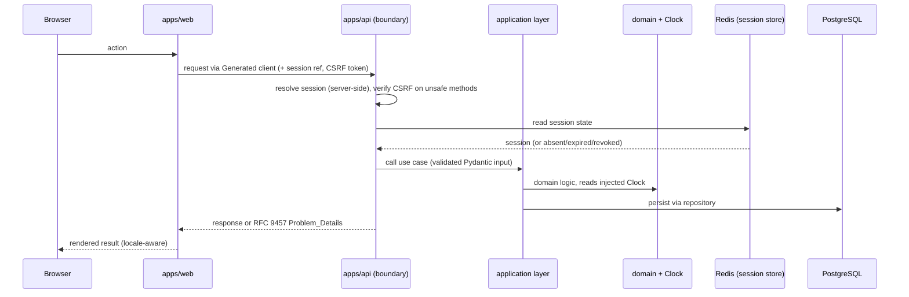
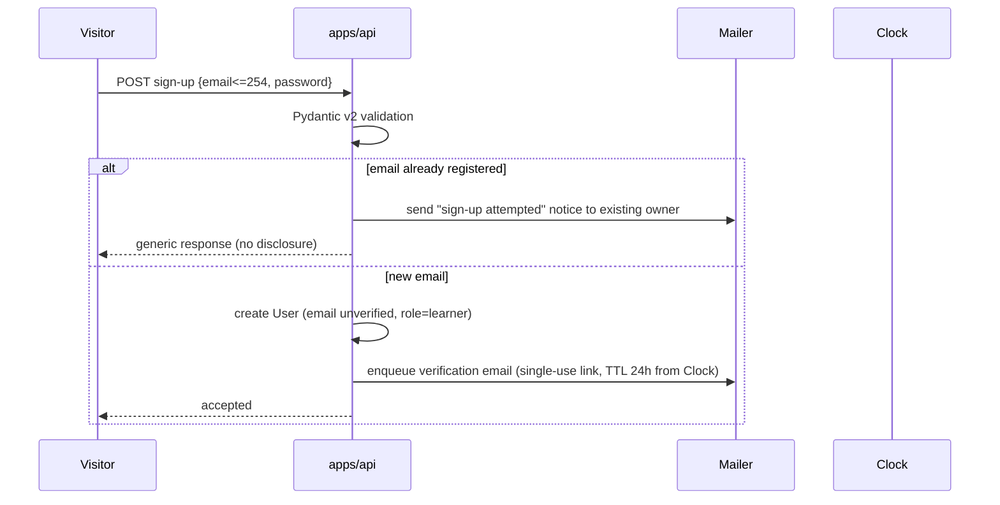
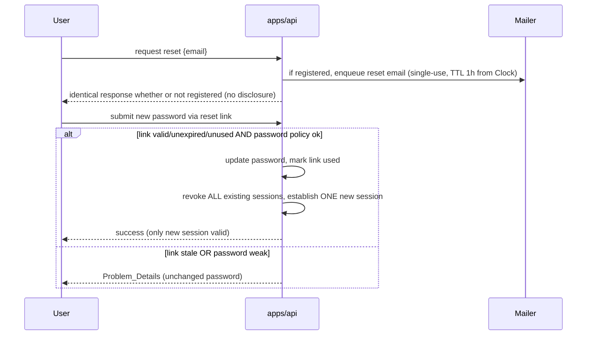
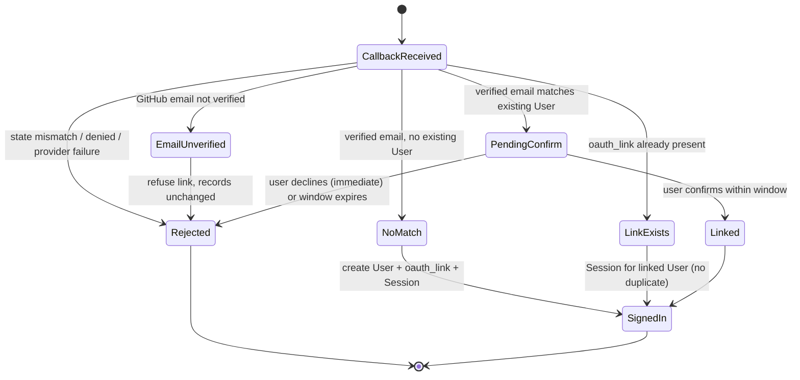

# Design Document

## Overview

This document is the design for the **foundations** phase of EDU-IT: the scaffolding, account
system, and bilingual application shell on which every later learning feature is built. It
realises the 28 requirements in `.kiro/specs/foundations/requirements.md` across Milestone A
(scaffolding), Milestone B (accounts), Milestone C (bilingual shell), and the cross-cutting
observability, error-format, CI, and failure-scenario requirements.

The authoritative product scope, technology choices, repository layering, API conventions,
authentication and privacy rules, deployment rules, and quality bars live in steering and the
design documents already in the repository. Per the working agreements, this design **references**
those rules through `#[[file:.kiro/steering/<file>.md]]` includes rather than restating them:

- Product scope and principles: #[[file:.kiro/steering/product.md]]
- Technology choices and domain ports: #[[file:.kiro/steering/tech.md]]
- Repository structure and layering: #[[file:.kiro/steering/structure.md]]
- Quality bars and testing: #[[file:.kiro/steering/quality.md]]
- Working agreements and process: #[[file:.kiro/steering/working-agreements.md]]
- Authentication and privacy: #[[file:.kiro/steering/auth-privacy.md]]
- API conventions: #[[file:.kiro/steering/api-conventions.md]]
- Deployment and Kubernetes topology: #[[file:.kiro/steering/deployment.md]]

Companion design documents referenced here: `docs/ARCHITECTURE.md` (D1), `docs/API-CONVENTIONS.md`
(D2), `docs/DATA-MODEL.md` (D3). Pinned decisions are in `docs/adr/0001-versions.md` (A1),
`docs/adr/0002-translation-storage.md` (A2), `docs/adr/0003-task-queue.md` (A3),
`docs/adr/0004-session-storage.md` (A4), `docs/adr/0007-llm-provider-and-data-residency.md` (A7).

### Goals

- Stand up the monorepo with enforced lint, format, typecheck, and test tooling for both the
  TypeScript (`apps/web`) and Python (`apps/api`, `apps/worker`, shared package) code, with pinned
  versions per A1 (Req 1, 2).
- Provide a one-command local Docker Compose stack with atomic all-or-nothing readiness (Req 3).
- Establish the layering (`api → application → domain ← infrastructure`), the domain ports and
  their fakes, and the Test_Clock (Req 5, 6).
- Migrate the complete approved data model with Alembic, preserving the stable_id / internal-id
  separation and supporting apply and rollback (Req 4).
- Deliver the full account system: sign-up and email verification, sign-in/out and server-side
  sessions, password reset, GitHub OAuth and account linking, CSRF, auth rate limiting, roles and
  a privileged-user CLI, and GDPR export/deletion (Req 7–14).
- Deliver the bilingual shell: `/fr` and `/en` routing, saved language preference, key-parity
  test, JSX-literal lint rule, OpenAPI→TypeScript client generation, the app shell and
  foundational pages, and axe-core accessibility (Req 15–17).
- Deliver the cross-cutting concerns: health/readiness and structured logging with request IDs,
  the RFC 9457 error format, and a CI pipeline (Req 18, 19, 21).
- Handle the named failure scenarios (Req 24–28), correct steering fileMatch patterns (Req 22),
  and produce the phase-1 report (Req 23).

### Non-Goals (out of scope — Req 20)

Learning-feature behavior (tracks, modules, lessons, quizzes, mastery, review, decay, placement,
final assessment), hands-on labs and the sandbox/terminal runtime, AI content generation and the
review pipeline beyond providing the `LLMProvider` fake, and all Kubernetes deployment artifacts
(Helm charts, manifests, network policies, node pools) are explicitly out of scope. The data model
is **migrated** in full, but the behavior of the learning, lab, and AI tables is not implemented.

## Architecture

The foundations phase builds three deployable applications plus a shared framework-free Python
package, backed by PostgreSQL and Redis. The component responsibilities and the layering model are
authoritative in #[[file:.kiro/steering/structure.md]] and described with rationale in
`docs/ARCHITECTURE.md` (D1); this design does not restate them.

### Monorepo layout

The foundations phase populates these directories within the existing monorepo layout (per
#[[file:.kiro/steering/structure.md]]):

```
edu-it/
  apps/
    web/                  # Next.js App Router UI (/fr and /en)
    api/                  # FastAPI boundary
    worker/               # task-queue consumer
  packages/
    domain/               # framework-free domain (ports, config, entities)
    application/          # use cases orchestrating domain + ports
    infrastructure/       # concrete port implementations (PG, Redis, SMTP, ...)
  deploy/
    compose/              # local-development docker-compose only (no K8s this phase)
  .env.example            # every env var read by web, api, worker
  docs/                   # design documents, ADRs, reports
  .kiro/                  # specs and steering
```

The shared Python package holds the domain and application layers reused by `apps/api` and
`apps/worker`; the domain imports no web or API framework (Req 1.8). The three deployable apps are
thin boundaries over the shared package.

> Note: `deploy/compose/` holds only the local Docker Compose definition. No Kubernetes artifact
> is produced in this phase (Req 20.4); the Kubernetes topology in #[[file:.kiro/steering/deployment.md]]
> is referenced for connectivity intent only.

### System context (foundations)



In the foundations phase the API handles authentication, sessions, and account endpoints; the
worker is present and healthy (consuming the Redis-backed queue per A3) but carries no
learning-feature job yet. The LLM provider, object storage, and sandbox are present only as ports
with fakes.

### Layering

Dependencies point inward (`api → application → domain ← infrastructure`), per
#[[file:.kiro/steering/structure.md]] and #[[file:.kiro/steering/quality.md]]. The domain receives
time through an injected `Clock` and never reads the wall clock (Req 5.5). Every external system
sits behind a domain port with a fake, so the domain and application layers are tested without any
real infrastructure.



Business numbers for this phase (verification-link TTL of 24 h, reset-link TTL of 1 h, session
duration, OAuth link-confirmation window, sign-in rate-limit threshold and window, password
policy — the 12–128 character rule, which realizes the password-policy acceptance criterion in
Requirement 7, Req 7.2) live in `packages/domain/config.py` (Req 12.3), keeping every tunable
business constant in one framework-free location.

### Request flow for an authenticated endpoint



## Components and Interfaces

### Milestone A — Scaffolding

#### Monorepo tooling (Req 1, 2)

- **TypeScript (`apps/web`)**: a lint command, a format command, a typecheck command, and a test
  command (Req 1.1). The lint config includes the custom JSX-string-literal rule (Req 15.7). All
  framework and tool versions are pinned per A1 (Req 1.3).
- **Python (`apps/api`, `apps/worker`, shared package)**: a lint command, a format command, a
  typecheck command, and a test command (Req 1.2), versions pinned per A1.
- Each command exits non-zero on a violation / type error / test failure and reports the offending
  location, and exits zero when clean (Req 1.4–1.7). A single top-level task runner exposes these
  as uniform commands so CI and pre-commit invoke the same entry points.
- An import-boundary check (lint rule in the Python toolchain) asserts the shared domain package
  imports no web or API framework (Req 1.8).
- **Pre-commit hooks** run lint, format, and typecheck against only the staged files; a non-zero
  hook blocks the commit, leaves changes uncommitted, and names the failing hook; all-zero allows
  the commit (Req 2.1–2.4).
- **`.env.example`** at the repository root enumerates every variable read by web, api, and worker,
  one per line, each with a non-sensitive placeholder and no real secret (Req 2.5, 2.6).

#### Docker Compose stack (Req 3)

- `deploy/compose/docker-compose.yml` defines exactly five services: Web_App, API_Service,
  Worker_Service, PostgreSQL, Redis (Req 3.1).
- A single start command brings all five to the running state; a failure reports which service did
  not start and leaves the remaining services' state unchanged (Req 3.2, 3.3).
- **Atomic all-or-nothing readiness**: a `compose-ready` check polls the Readiness_Endpoints of
  web, api, and worker and passes only when all three report ready within 120 s; the failure of any
  one to become ready within that window fails the whole check regardless of the others, reporting
  which service timed out (Req 3.4, 3.5, 3.6). This is implemented as a dedicated wait script
  (invoked by the phase-1 report command and by CI), not merely as per-container healthchecks, so
  the aggregate semantics are explicit and observable.
- While running, api and worker each establish a connection to PostgreSQL and Redis (Req 3.7),
  consistent with the connectivity intent in #[[file:.kiro/steering/deployment.md]].

#### Domain ports and fakes (Req 5, 6)

The shared domain package defines the `Clock`, `Mailer`, `ObjectStorage`, `TaskQueue`, and
`LLMProvider` ports (Req 5.1), consistent with the port list in #[[file:.kiro/steering/tech.md]].
Each has a fake that implements every method and is substitutable for the production implementation
without changing domain code (Req 5.2).

| Port | Production (prod) | Fake / dev | Notes |
|------|-------------------|------------|-------|
| `Clock` | system clock | `Test_Clock` (test/dev only) | domain reads time only here (Req 5.5) |
| `Mailer` | SMTP | console backend | console writes mail to stdout and retains it in a retrievable record for test inspection (Req 5.3), FR/EN templates per #[[file:.kiro/steering/auth-privacy.md]] |
| `ObjectStorage` | S3 / Azure Blob | in-memory fake | used by GDPR export artifact (Req 14) |
| `TaskQueue` | Redis-backed (A3) | in-memory fake | `enqueue(job_name, payload, dedupe_key)` / `consume(job_name, handler)` per A3 |
| `LLMProvider` | n/a this phase | fake only | dev/test use the fake and make no network call to a real provider (Req 5.4), per A7 |

**Test_Clock (Req 6)** — enabled only in test and development environments:

- `set(instant)` makes `instant` the current time read through the injected `Clock` (Req 6.1, 6.4).
- `advance(duration)` with a non-negative duration moves the current time forward by exactly that
  duration (Req 6.2, 6.4).
- A negative duration or an invalid instant is rejected, the current time is left unchanged, and an
  error indicating the invalid input is raised (Req 6.5).
- In production, neither API_Service nor Worker_Service exposes any interface that sets or advances
  the clock (Req 6.3). This is enforced by wiring: the Test_Clock implementation is only registered
  in the test/dev composition root.

### Milestone B — Accounts

All account endpoints are the `apps/api` FastAPI boundary, validate with Pydantic v2, and return
RFC 9457 Problem_Details on error (per #[[file:.kiro/steering/api-conventions.md]] and D2).

#### Sign-up and email verification (Req 7, 24, 25)



- A well-formed email (≤254 chars) and policy-compliant password create an unverified User and
  enqueue a verification email; the link is single-use and expires 24 h after issuance as measured
  by the Clock (Req 7.1, 7.2). Every self-service User is assigned the learner role (Req 7.8, 13.3).
- Opening a valid, unexpired, unused link verifies the email and invalidates the link; an expired,
  used, or unrecognised link is rejected, leaves verification state unchanged, and returns a link
  invalid/expired response offering to resend (Req 7.3, 7.4, 25.1, 25.2).
- A duplicate-email sign-up does not create a duplicate User, returns a response that does not
  disclose whether the email is registered, and sends a notification to the existing owner (Req
  7.5, 7.6).
- Validation failures return Problem_Details identifying each invalid field and reason, without
  leaking internal representations (Req 7.7).
- If the Mailer fails to deliver the verification email, the User stays unverified, the failure is
  logged, a translated Problem_Details is returned, and the User may request the email again (Req
  24.1, 24.3).

#### Sign-in, sign-out, server-side sessions (Req 8)

Server-side session backing per A4: the client holds only an opaque session reference; the
authoritative session state lives server-side in Redis, and the durable `session` record in
PostgreSQL remains the identity system of record.

- Valid credentials for a verified account create a server-side Session associated with the User,
  expiring after a configured duration measured by the Clock (Req 8.1).
- Sign-out revokes the current Session and returns success even when no active Session is present
  (Req 8.2).
- Unverified account → no Session, translated Problem_Details that the email is not verified (Req
  8.3). Invalid credentials → no Session, translated Problem_Details that does not disclose whether
  the account exists (Req 8.4). An expired or revoked Session is rejected as unauthenticated (Req
  8.5).

#### Password reset (Req 9, 24, 25, 28)



- A reset request for a registered email enqueues a reset email with a single-use link expiring 1 h
  after issuance (Req 9.1). A request for an unregistered email returns a response identical in
  content and status and enqueues no email, so account existence is not disclosed (Req 9.6).
- A valid, unexpired, unused link plus a policy-compliant new password updates the password and
  marks the link used (Req 9.2). A stale link leaves the password unchanged and returns link
  invalid/expired offering to restart (Req 9.3, 25.3); a weak password leaves it unchanged and
  reports the policy failure (Req 9.4).
- On success through an unauthenticated reset link, **all** existing Sessions are revoked and a
  single new Session is established for the device completing the reset, so the only valid Session
  afterward is the new one (Req 9.5). A request presenting a Session revoked by a completed reset
  is rejected as unauthenticated and is not refreshed or reissued (Req 28.1, 28.2).
- Mailer failure during reset makes no password change, logs the failure, returns translated
  Problem_Details, and allows re-request (Req 24.2, 24.3).

#### GitHub OAuth and account linking (Req 10, 26)



- A completed flow with a verified email matching no User creates a User, records the GitHub
  `oauth_link`, and establishes a Session (Req 10.1).
- A verified email matching an existing User presents a link-confirmation step; the link is made
  only after explicit confirmation within a configured window measured by the Clock (Req 10.2,
  26.2). While confirmation is pending, the API establishes a temporary, **unauthenticated** session
  that lets the visitor complete the in-app confirmation but grants no authenticated access to the
  existing User until the link is confirmed (Req 10.7).
- An email unverified at GitHub is refused and leaves the existing User's records unchanged (Req
  10.3, 26.3). An existing `oauth_link` signs in the linked User without creating a duplicate (Req
  10.4). A denied/failed/incomplete flow creates no User, `oauth_link`, or Session and returns a
  translated Problem_Details (Req 10.5, 26.1).
- Active decline refuses the link immediately and invalidates the pending confirmation token/state
  at once; window expiry refuses the link and leaves records unchanged (Req 10.6, 26.4, 26.5). A
  callback whose `state` parameter does not match the issued one is rejected, creating no Session
  and discarding partial authentication state (Req 26.6).

#### CSRF protection (Req 11)

Unsafe mutations (methods classified unsafe per D2 Section 5) require a valid CSRF_Token; a
missing, malformed, or invalid token is rejected with no state change and a Problem_Details
response. Safe, idempotent methods (GET) do not require a token (Req 11.1–11.4).

#### Auth rate limiting (Req 12)

While failed sign-in attempts for an identifier exceed the configured threshold within the
configured window, further attempts are rejected with a translated Problem_Details **without
evaluating the submitted credentials**, and no Session is established even for valid credentials
(Req 12.1, 12.4). When the window elapses (measured by the Clock) attempts are allowed again (Req
12.2). The threshold and window are business constants in `domain/config.py` (Req 12.3). Rate-limit
counters use the Redis store.

#### Roles and privileged-user CLI (Req 13)

The identity model supports learner, reviewer (with per-track expertise recorded as the role
assignment's track scope), author, and admin (Req 13.1), per #[[file:.kiro/steering/auth-privacy.md]].
A CLI command creates or updates a User for a syntactically valid target email, assigns a reviewer
or admin role (with a track scope for reviewer), and exits zero (Req 13.2). Self-service sign-up and
GitHub OAuth assign only the learner role (Req 13.3). An unrecognised role, a missing/invalid email,
or a reviewer role without a track scope exits non-zero, makes no change, and reports the invalid
input (Req 13.4).

#### GDPR export, deletion, and placeholder pages (Req 14)

- **Export**: a signed-in User's export contains all data held for that User across every
  personal-data table in D3 Section 13, including tables with no rows for that User represented as
  empty (Req 14.1). The export artifact is produced via the `ObjectStorage` port.
- **Deletion**: a signed-in User who confirms deletion in a distinct step has personal data removed
  across every personal-data table per #[[file:.kiro/steering/auth-privacy.md]] and D3 Section 13,
  and all Sessions revoked (Req 14.2, 14.3). If deletion fails to remove data from any personal-data
  table, the User's data is left unchanged across all personal-data tables (atomic) and an error is
  returned (Req 14.4). Deletion runs in a single database transaction so partial deletion cannot
  persist.
- **Placeholder pages**: privacy and terms pages are served in FR and EN per the requested locale
  (Req 14.5).

### Milestone C — Bilingual shell

#### Routing and language preference (Req 15)

- `apps/web` serves pages under `/fr` and `/en` route trees via next-intl, supporting exactly `fr`
  and `en` (Req 15.1), per #[[file:.kiro/steering/product.md]].
- The language switcher moves to the other-locale view of the current page, preserving path and
  query parameters (Req 15.2). A signed-in User's selected locale is saved as a preference by the
  API and rendered on the next visit; a save failure leaves the previous preference unchanged and
  returns an error (Req 15.3, 15.4).
- **Translation storage per A2**: UI keys are next-intl message catalogs per locale, owned by and
  shipped with `apps/web`; learner-facing content fields carry both FR and EN on their content
  record keyed by `stable_id`. Only UI catalogs are in scope this phase (no learning content). As
  implementer guidance: the UI message catalogs are the only translation surface exercised this
  phase (no learning content exists yet), and the content-field FR/EN storage keyed by `stable_id`
  described in A2 is migrated as schema only and is not populated this phase.
- **Key-parity test** passes only when every translation key present in either catalog exists in
  both; a key present in only one catalog fails the test and reports the missing key and the
  catalog it is absent from (Req 15.5, 15.6).
- A **JSX-string-literal lint rule** fails, reporting file path and line, when a JSX element
  contains a user-facing string literal instead of a translation key (Req 15.7).

#### OpenAPI → TypeScript client generation (Req 16)

The API publishes exactly one OpenAPI_Document per major version (path-prefixed `/v{major}`, per
D2) (Req 16.1). The `apps/web` build generates the typed client from the OpenAPI document of the
targeted major version **before** compiling application code (Req 16.2); the web app calls the API
exclusively through this generated client (Req 16.3). A missing OpenAPI document fails the build
non-zero, reporting it was not found; a malformed document fails non-zero, produces no client, and
reports the malformation (Req 16.4, 16.5).

#### Application shell and pages (Req 17)

The web app provides an application shell, a landing page, the sign-up / sign-in / email
verification / password-reset pages, and an empty dashboard, each under both `/fr` and `/en` (Req
17.1). Auth pages submit through the generated client (Req 17.2); on failure the page is preserved
with entered values except password fields and an error indication is shown (Req 17.3). The empty
dashboard redirects a visitor with no active Session to sign-in and is reachable only with an
active Session (Req 17.4). Every page built this phase reports no serious or critical axe-core
violation (Req 17.5).

### Cross-cutting

#### Observability (Req 18, 27)

- API_Service and Worker_Service each expose a Health_Endpoint (liveness, independent of external
  dependencies) and a Readiness_Endpoint (ready only when all required dependencies are reachable)
  (Req 18.1, 18.2). If a required dependency is unreachable, readiness reports not-ready (Req 18.3,
  27.1); when PostgreSQL and Redis become reachable again, readiness reports ready again (Req 27.3).
- The API emits structured JSON logs; each request log record includes a Request_ID, generated when
  no inbound Request_ID is present (Req 18.4, 18.5). Internal diagnostics stay in logs; stack
  traces, SQL, and provider errors never appear in responses (Req 18.6), per
  #[[file:.kiro/steering/quality.md]].

#### Error format (Req 19, 27)

Every non-2xx response is an `application/problem+json` Problem_Details document carrying at least
`type`, `title`, `status`, with `status` equal to the HTTP status code (Req 19.1, 19.2), per D2
Section 1. A learner-facing `detail` is rendered in the request locale, falling back to a
configured default locale when the request locale is absent or unsupported (Req 19.3, 19.4).
Pydantic v2 validation failures report one entry per rejected field with its location and reason in
a problem extension member (Req 19.5). No internal representation, stack trace, SQL, or provider
error appears in any member (Req 19.6). If PostgreSQL or Redis becomes unavailable during a
request, the API returns a translated Problem_Details with a server-error status and logs the
failure without exposing stack traces, connection strings, or host identifiers in the body (Req
27.2).

#### Continuous integration (Req 21)

On every push to any branch, the CI pipeline runs lint, typecheck, test, dependency-audit, and
secret-scan steps (Req 21.1); any failing step fails the pipeline non-zero and reports which step
failed, and an all-clean run succeeds zero (Req 21.2, 21.3). The test step runs the end-to-end
authentication tests covering sign-up, email verification, sign-in, sign-out, and password reset
(Req 21.4). The GitHub-OAuth tests run against a mock OAuth_Provider and make no call to an
external provider (Req 21.5). No Kubernetes artifact is produced (Req 20.4).

#### Steering fileMatch path correction (Req 22)

For each Phase-0 steering file carrying a `fileMatchPattern`, the phase verifies whether the pattern
matches a real path introduced this phase, and updates the pattern to match the real path where it
does not (Req 22.1, 22.2). A Phase-0 steering file with no pattern that covers a real path
introduced this phase has a pattern added (Req 22.4). Updates preserve the inclusion keys and retain
parseable YAML front matter (Req 22.3, 22.4), per #[[file:.kiro/steering/working-agreements.md]].
In particular, the `auth-privacy.md` and `api-conventions.md` patterns are checked against the
real `apps/api` auth paths and the `deployment.md` pattern against `deploy/compose/`.

#### Phase report (Req 23)

The phase produces `docs/reports/phase-1.md` recording, for each of the Compose readiness check,
the migration apply-and-rollback check, the authentication end-to-end tests, the key-parity test,
the axe-core check, and the CI steps, the command invoked and its recorded pass-or-fail outcome
(Req 23.1, 23.2). A failing outcome is recorded rather than omitted (Req 23.3), and the manual
GitHub-OAuth-against-real-GitHub check is listed as a manual verification item (Req 23.4).

## Data Models

### Migration strategy (Req 4)

Alembic migrations create exactly one table for each entity in the D3 entity groups and ER diagram,
with no listed entity omitted and no table beyond those entities (Req 4.1). The complete approved
schema is defined in `docs/DATA-MODEL.md` (D3); this design does not restate the schema. The data
model is migrated **in full** this phase even though the learning/lab/AI table behavior is not
implemented (Req 20.1–20.3).

The entity set to migrate (per D3 Section 2) is:

| Group | Entities |
|-------|----------|
| Identity | `user`, `session`, `oauth_link`, `role_assignment` |
| Catalog | `track`, `module`, `lesson`, `lab`, `lab_task`, `lab_check`, `project`, `rubric`, `rubric_criterion`, `quiz`, `question`, `question_option`, `concept`, `prerequisite` |
| Provenance | `content_provenance` |
| Progress | `enrollment`, `module_progress`, `lesson_completion`, `lab_session`, `lab_run`, `lab_task_completion`, `quiz_attempt`, `answer`, `project_submission` |
| Mastery & review | `mastery`, `mastery_event`, `review_schedule`, `review_attempt`, `hint_reveal` |
| AI/review ops | `review_queue_item`, `variant`, `generation_job`, `item_statistic`, `path_recommendation`, `budget_ledger` |
| Assessments | `placement`, `final_assessment` |

**Identity / stable-ID rules** (per D3 Section 1 and D2 Section 4):

- Every row has an internal numeric primary key (`id`) that is never exposed in the API.
- Every API-addressable resource additionally carries an immutable, unique `stable_id` string with
  a unique constraint; internal numeric keys stay unexposed (Req 4.4).

**Apply / rollback semantics** (Req 4.2, 4.3, 4.5, 4.6):

- Applying all migrations to an empty database creates the complete schema including each table's
  primary key, foreign keys, and the unique constraint on each `stable_id`, and exits success.
- Rolling back all applied migrations removes the Data_Model tables in reverse dependency order
  until none remains, and exits success.
- A migration that fails partway is rolled back; the database is left at the last successfully
  committed migration version; the runner exits non-zero and reports the failing migration.
- Running against a database already at the latest version makes no schema change and exits success
  (idempotent).

### Domain entities active this phase

Only the identity-group entities (`user`, `session`, `oauth_link`, `role_assignment`) plus the
transient verification-link and reset-link records carry behavior this phase. Their fields are
defined by D3 Section 4; the behavioral state they carry:

- `user`: `stable_id`, `email`, `display_name`, `locale` (fr/en, saved preference per Req 15.3),
  `status`, `deleted_at`, email-verified flag.
- `session`: a Session is **not** an API-addressable resource in this phase — the client holds only
  an opaque `server_side_ref` (session cookie/handle), so the `session` row carries a
  `server_side_ref` and no API-exposed `stable_id`; the durable `session` record and its
  `expires_at` / `revoked_at` live in PostgreSQL with ephemeral state in Redis per A4. This is
  consistent with Requirement 4.4 because 4.4 requires a `stable_id` only on API-addressable
  resources, and the session is not addressed by the API via a stable id.
- `oauth_link`: `provider` (GitHub), `subject`.
- `role_assignment`: `role` (learner/reviewer/author/admin), `track_scope` (reviewer only).

Verification links, reset links, OAuth link-confirmation tokens, and rate-limit counters are
ephemeral and single-use / time-limited; their TTLs are business constants in `domain/config.py`
and their expiry is measured by the injected `Clock`.

## Correctness Properties

*A property is a characteristic or behavior that should hold true across all valid executions of
a system — essentially, a formal statement about what the system should do. Properties serve as
the bridge between human-readable specifications and machine-verifiable correctness guarantees.*

The foundations phase mixes pure-logic surfaces that are well suited to property-based testing
(link TTL and single-use, session validity and revocation, Test_Clock arithmetic, key parity,
problem-details status equality, aggregate readiness, idempotent/round-trip migrations, rate
limiting, GDPR export/deletion coverage, and dashboard session gating) with structural, integration,
and smoke criteria that are not (tooling wiring, Docker/CI pipelines, page presence, accessibility
scans). Dashboard session gating (Property 25) is treated as a property-style behavioral check —
for any session state the dashboard is reachable if and only if a valid active Session is present —
and is exercised at the web layer with mocked session state, as the Testing Strategy describes; it
is not one of the structural criteria. The properties below cover only the first group; the
structural, integration, and smoke criteria are covered by the unit, integration, and smoke tests
described in the Testing Strategy. The properties are stated
after the redundancy reflection in the prework, so overlapping acceptance criteria are consolidated
into single comprehensive properties.

### Property 1: Links expire exactly at issuance + TTL as measured by the Clock

*For any* verification link (TTL 24 h) or reset link (TTL 1 h) and any observation instant, opening
the link is accepted only when the observation instant is strictly before the issuance instant plus
the link's TTL as read through the injected Clock, and is rejected at or after that instant.

**Validates: Requirements 7.2, 9.1**

### Property 2: Verification and reset links are single-use

*For any* verification or reset link, a first successful use invalidates the link so that every
subsequent use is rejected as already used and produces no further state change.

**Validates: Requirements 7.3, 9.2, 25.1**

### Property 3: Invalid links never change state

*For any* verification or reset link that is expired, already used, or unrecognised, opening it
leaves the User's email-verification state (verification links) or password (reset links) unchanged
and returns an invalid-or-expired response.

**Validates: Requirements 7.4, 9.3**

### Property 4: Valid self-service sign-up creates one unverified learner and one mail

*For any* well-formed email no longer than 254 characters and any password satisfying the
configured policy, submitting the sign-up form for a not-yet-registered email creates exactly one
User with an unverified email whose only role is learner and records exactly one verification email
in the Mailer.

**Validates: Requirements 7.1, 7.8, 13.3**

### Property 5: Duplicate-email sign-up does not disclose and does not duplicate

*For any* email already belonging to an existing User, a repeat sign-up with that email creates no
second User, returns the same non-disclosing response as an accepted sign-up, and records a
notification to the existing owner in the Mailer.

**Validates: Requirements 7.5, 7.6**

### Property 6: Sign-in establishes a session only for valid, verified credentials

*For any* account and credential submission, a server-side Session associated with that User and
expiring at the Clock's current instant plus the configured duration is established if and only if
the account's email is verified and the credentials are valid; an unverified account, invalid
credentials, or an unknown account establishes no Session and returns a translated, non-disclosing
Problem_Details.

**Validates: Requirements 8.1, 8.3, 8.4**

### Property 7: A session authenticates only while active

*For any* Session, a request presenting it is treated as authenticated if and only if the Session
is neither expired (as measured by the Clock) nor revoked; an expired or revoked Session is rejected
as unauthenticated and is never refreshed or reissued.

**Validates: Requirements 8.5, 28.1**

### Property 8: Sign-out revokes the current session and is idempotent

*For any* starting session state, signing out leaves no current Session able to authenticate a
subsequent request and returns success, and signing out again still returns success.

**Validates: Requirements 8.2**

### Property 9: Successful reset leaves exactly the new session valid

*For any* set of pre-existing Sessions for a User, completing a password reset through a valid
unauthenticated reset link with a policy-compliant password updates the password, revokes every
pre-existing Session, and establishes exactly one new Session for the device completing the reset,
so that afterward the only Session able to authenticate is the newly established one.

**Validates: Requirements 9.5, 28.1, 28.2**

### Property 10: Reset rejects weak passwords without changing state

*For any* new password that does not satisfy the configured password policy, submitting it through a
valid reset link leaves the User's existing password unchanged and returns a policy-failure response.

**Validates: Requirements 9.4**

### Property 11: Reset requests do not disclose account existence

*For any* email, the response to a password-reset request is identical in content and status whether
or not the email is registered, and a reset email is recorded in the Mailer if and only if the email
is registered.

**Validates: Requirements 9.6**

### Property 12: Mail-delivery failure leaves a safe state and allows retry

*For any* sign-up or password-reset flow in which the Mailer fails to deliver the email, the User
remains unverified (sign-up) or the password remains unchanged (reset), the delivery failure is
recorded in the logs, a translated Problem_Details is returned, and the User is permitted to request
the email again.

**Validates: Requirements 24.1, 24.2, 24.3**

### Property 13: GitHub OAuth links an existing user only on explicit in-window confirmation

*For any* completed GitHub OAuth flow whose returned verified email matches an existing User, the
GitHub `oauth_link` is created if and only if that User explicitly confirms the link before the
issuance instant plus the configured confirmation window as measured by the Clock; declining
(which invalidates the pending token immediately) or letting the window expire creates no link and
leaves the existing User's records unchanged, and while confirmation is pending the temporary
session grants no authenticated access to the existing User.

**Validates: Requirements 10.2, 10.6, 10.7, 26.2, 26.4, 26.5**

### Property 14: New verified GitHub email creates a single linked account

*For any* completed GitHub OAuth flow whose returned verified email matches no existing User, a
single User, its GitHub `oauth_link`, and a Session are created; and for any flow whose identity
already has an `oauth_link`, a Session is established for the linked User with no additional account
created.

**Validates: Requirements 10.1, 10.4**

### Property 15: Failed, denied, unverified, or state-mismatched OAuth creates nothing

*For any* GitHub OAuth flow that is denied, fails at the provider, is incomplete, returns an email
unverified at GitHub, or returns a `state` parameter that does not match the issued one, no User,
`oauth_link`, or Session is created, any partial authentication state is discarded, and a translated
Problem_Details is returned.

**Validates: Requirements 10.3, 10.5, 26.1, 26.3, 26.6**

### Property 16: CSRF protection gates exactly the unsafe mutations

*For any* request, it is processed if and only if its method is safe (and then no CSRF_Token is
required) or its method is unsafe and it carries a valid CSRF_Token; an unsafe request with a
missing, malformed, or invalid token is rejected with no state change and a Problem_Details response.

**Validates: Requirements 11.1, 11.2, 11.3, 11.4**

### Property 17: Rate limiting blocks over-threshold sign-ins without evaluating credentials

*For any* identifier whose failed sign-in attempts exceed the configured threshold within the
configured window, each further attempt within the window is rejected without evaluating the
submitted credentials and establishes no Session even when the credentials are valid; once the
window elapses as measured by the Clock, attempts for that identifier are allowed again.

**Validates: Requirements 12.1, 12.2, 12.4**

### Property 18: The privileged-user CLI assigns exactly the requested privileged role

*For any* syntactically valid target email with a role of reviewer or admin (and a track scope when
the role is reviewer), running the CLI results in a User for that email carrying exactly the
specified role assignment (with the track scope for a reviewer) and a zero exit; and *for any*
invalid input (unknown role, missing or syntactically invalid email, or a reviewer role without a
track scope) the CLI makes no change to any User, exits non-zero, and reports the invalid input.

**Validates: Requirements 13.2, 13.4**

### Property 19: GDPR export covers exactly the personal-data tables

*For any* User and any arrangement of rows across the personal-data tables, the produced export
contains exactly the personal-data tables listed in `docs/DATA-MODEL.md` Section 13 — including
tables for which the User has no rows, represented as empty — and the rows it contains for a table
are exactly that User's rows in that table.

**Validates: Requirements 14.1**

### Property 20: Account deletion is complete and atomic

*For any* User and any arrangement of rows across the personal-data tables, a confirmed deletion
removes every personal-data row referencing that User across all personal-data tables and leaves no
Session of theirs able to authenticate; and *for any* injected failure deleting from a single
personal-data table, the deletion leaves every personal-data table unchanged and returns an error.

**Validates: Requirements 14.2, 14.3, 14.4**

### Property 21: The language switcher preserves path and query and round-trips

*For any* page path and set of query parameters, activating the language switcher changes only the
locale segment while preserving the path and query parameters, and switching locale twice returns to
the original URL.

**Validates: Requirements 15.2**

### Property 22: A saved locale preference round-trips

*For any* locale selected by a signed-in User, the preference read back on the next visit equals the
selection; and *for any* injected save failure, the previously saved preference is left unchanged
and an error is returned.

**Validates: Requirements 15.3, 15.4**

### Property 23: Key parity holds exactly when the catalogs share key sets

*For any* pair of French and English message catalogs, the key-parity check passes if and only if the
two catalogs have identical key sets; when they differ it fails and reports exactly the keys in the
symmetric difference, each with the catalog it is absent from.

**Validates: Requirements 15.5, 15.6**

### Property 24: Auth-page submission failure preserves non-password fields

*For any* auth-page submission that fails or returns an error, the page is preserved with each
non-password field equal to what the User entered, every password field cleared, and an error
indication shown.

**Validates: Requirements 17.3**

### Property 25: The dashboard is reachable exactly with an active session

*For any* session state, a request for the empty dashboard returns the dashboard if and only if a
valid active Session is present; otherwise it redirects to the sign-in page.

**Validates: Requirements 17.4**

### Property 26: Readiness is ready exactly when all required dependencies are reachable

*For any* assignment of reachable or unreachable to a service's required dependencies, its
Readiness_Endpoint reports ready if and only if every required dependency is reachable, and it
reports ready again once all required dependencies become reachable again; the Health_Endpoint
reports liveness independent of dependency reachability.

**Validates: Requirements 18.2, 18.3, 27.1, 27.3**

### Property 27: Every request log record is JSON and carries a Request_ID

*For any* request, with or without an inbound Request_ID, the emitted request log record parses as
JSON and carries a non-empty Request_ID, and one is generated when none is supplied.

**Validates: Requirements 18.4, 18.5**

### Property 28: Every non-2xx response is a problem document with a consistent status

*For any* request that yields a non-2xx response, the response is served as `application/problem+json`
carrying at least `type`, `title`, and `status`, and the body's `status` member equals the response's
HTTP status code.

**Validates: Requirements 19.1, 19.2**

### Property 29: Validation failures report one problem entry per rejected field

*For any* request whose input fails Pydantic v2 validation, the Problem_Details response reports
exactly one entry per rejected field in a problem extension member, each entry giving that field's
location and the reason it was rejected, with no internal representation.

**Validates: Requirements 7.7, 19.5**

### Property 30: Learner-facing detail follows the request locale with default fallback

*For any* request carrying a learner-facing `detail`, the `detail` is rendered in the request locale
when it is a supported locale (fr or en) and in the configured default locale when the request
locale is absent or unsupported.

**Validates: Requirements 19.3, 19.4**

### Property 31: Error responses never leak internal diagnostics

*For any* request that produces an error response — including when PostgreSQL or Redis is
unavailable during the request — no member of the response body contains a stack trace, SQL, a
provider error, a connection string, a host identifier, or any internal representation; such
diagnostics appear only in the logs.

**Validates: Requirements 18.6, 19.6, 27.2**

### Property 32: Migrating to head is idempotent

*For any* database already at the latest migration version, applying migrations to head again makes
no schema change and exits success, so the schema after a second apply equals the schema after the
first.

**Validates: Requirements 4.6**

### Property 33: Apply-then-rollback round-trips an empty database to empty

*For any* empty database, upgrading to head and then downgrading to base removes every Data_Model
table in reverse dependency order, returning the database to having no Data_Model table, with both
operations exiting success.

**Validates: Requirements 4.3**

### Property 34: Every API-addressable resource has a unique stable_id and hides its internal key

*For any* API-addressable resource in the migrated schema, the table carries an immutable `stable_id`
column under a unique constraint and the resource's serialized API representation omits the internal
numeric primary key.

**Validates: Requirements 4.4**

### Property 35: Compose readiness passes exactly when all three services are ready in time

*For any* assignment of ready-within-120 s or timeout to the Web_App, API_Service, and
Worker_Service Readiness_Endpoints, the aggregate Compose readiness check passes if and only if all
three report ready within 120 s; any single timeout fails the whole check and the failure report
names a service that did not become ready.

**Validates: Requirements 3.4, 3.5, 3.6**

### Property 36: Test_Clock set and advance read back exactly

*For any* instant `t` and any non-negative duration `d`, after setting the Test_Clock to `t` the time
read through the injected Clock equals `t`, and after advancing by `d` it equals `t + d`; *for any*
negative duration or invalid instant, the operation is rejected, the current time is left unchanged,
and an error indicating the invalid input is raised.

**Validates: Requirements 6.1, 6.2, 6.4, 6.5**

### Property 37: Steering fileMatch patterns cover their intended real paths

*For any* Phase-0 steering file intended to cover a path introduced in this phase, every such real
path matches the file's `fileMatchPattern`, and after any pattern update the file's front matter
still parses as YAML with its inclusion keys intact.

**Validates: Requirements 22.1, 22.2, 22.3, 22.4**

## Error Handling

All error responses follow RFC 9457 Problem_Details (`application/problem+json` with `type`,
`title`, `status`, and where useful `detail`, `instance`), per #[[file:.kiro/steering/api-conventions.md]]
and `docs/API-CONVENTIONS.md` (D2). Learner-facing `detail` is translated to the request locale with
a default-locale fallback (Req 19.3, 19.4). Internal diagnostics (stack traces, SQL, provider errors,
connection strings, host identifiers) stay in the structured logs and never appear in a response
body (Req 18.6, 19.6, 27.2), per #[[file:.kiro/steering/quality.md]].

Named failure scenarios (Req 24–28) and their handling:

| Scenario | Requirement | Handling |
|----------|-------------|----------|
| Email delivery fails (sign-up) | 24.1, 24.3 | User kept unverified; failure logged; translated Problem_Details; re-request allowed. |
| Email delivery fails (reset) | 24.2, 24.3 | Password unchanged; failure logged; translated Problem_Details; re-request allowed. |
| Expired / used verification link | 25.1, 25.2 | Email not verified; translated Problem_Details offering to resend; single-use enforced. |
| Expired / used reset link | 25.1, 25.3 | Password unchanged; translated Problem_Details offering to restart; single-use enforced. |
| OAuth denied / failed / incomplete | 26.1 | No User/link/Session; partial state discarded; return to sign-in with a translated message. |
| OAuth email conflict (verified email matches a User) | 26.2 | Link only after explicit in-window confirmation. |
| OAuth email unverified at GitHub | 26.3 | Refuse link; existing records unchanged. |
| OAuth link actively declined | 26.4 | Refuse immediately; invalidate pending confirmation token/state at once. |
| OAuth confirmation window expires | 26.5 | Refuse link; existing records unchanged. |
| OAuth state mismatch | 26.6 | Reject callback; create no Session; discard partial state. |
| PostgreSQL / Redis unavailable at startup | 27.1 | Readiness reports not-ready; health continues to report liveness. |
| PostgreSQL / Redis unavailable during a request | 27.2 | Translated Problem_Details with a server-error status; failure logged; no internals in body. |
| PostgreSQL / Redis reachable again | 27.3 | Readiness reports ready again. |
| Session used after a password reset | 28.1, 28.2 | Rejected as unauthenticated; not refreshed or reissued; only the new reset-device Session is valid. |

Migration failures (Req 4.5) roll back the failing migration, leave the database at the last
committed version, exit non-zero, and report the failing migration. GDPR deletion failures (Req
14.4) run in a single transaction so a failure on any personal-data table leaves all personal-data
tables unchanged and returns an error.

## Testing Strategy

The phase uses a dual approach: **property-based tests** verify the universal properties in the
Correctness Properties section across many generated inputs, and **unit, integration, and smoke
tests** cover specific examples, edge cases, tooling wiring, and infrastructure. Both are necessary;
property tests find edge cases through randomization while the other tests pin concrete behavior,
tool wiring, and end-to-end flows.

### Property-based testing

- **Python** (domain, application, infrastructure under fakes): use the pinned property-based
  testing library for Python (per A1), not a hand-rolled framework. Properties 1–20, 26–36 are
  implemented in Python against the domain/application layers with the Test_Clock and the port
  fakes (fake Mailer, in-memory TaskQueue, in-memory ObjectStorage). Migration properties (32–34)
  run against a disposable PostgreSQL via the migration runner.
- **TypeScript** (`apps/web` pure logic): use the pinned property-based testing library for
  TypeScript (per A1). Properties 21 (locale switcher URL algebra), 23 (key parity), and 24 (form
  field preservation logic) are implemented here. Property 25 (dashboard gating) is exercised at the
  web layer with mocked session state.
- Each property-based test runs a **minimum of 100 iterations**.
- Each property-based test is tagged with a comment referencing its design property, using the
  format **Feature: foundations, Property {number}: {property_text}**.
- Each correctness property is implemented by a **single** property-based test.

Generators: valid and invalid email strings (including the 254-character boundary), policy-compliant
and policy-violating passwords, arbitrary instants and non-negative/negative durations for the
Clock, random sets of pre-existing sessions, random sets of personal-data rows per user, random
locale strings (supported and unsupported), random (method, token-validity) pairs for CSRF, random
dependency-reachability assignments for readiness, random per-service compose readiness assignments,
and random FR/EN catalog key sets for parity.

### Unit and example tests

Concrete examples and edge cases that are not universal properties: the import-boundary check (Req
1.8), the five-service compose definition (Req 3.1), the exactly-one-table-per-entity set equality
(Req 4.1), the full-schema constraint introspection (Req 4.2), the mid-migration failure edge case
(Req 4.5), the production clock-wiring absence (Req 6.3), the role enumeration (Req 13.1), the
rate-limit constants location (Req 12.3), the FR/EN privacy/terms placeholders (Req 14.5), routing
presence (Req 15.1), the JSX-literal lint rule fixtures (Req 15.7), OpenAPI document count and
build-order and missing/malformed handling (Req 16.1–16.5), page presence and generated-client usage
(Req 17.1, 17.2), liveness independence (Req 18.1), and the scope-exclusion artifact-absence checks
(Req 20.1–20.4).

### Integration and end-to-end tests

- End-to-end authentication tests covering sign-up, email verification, sign-in, sign-out, and
  password reset, run in CI (Req 21.4).
- GitHub-OAuth tests against a **mock OAuth provider** with no external call (Req 10, 21.5, 26); the
  real-GitHub check is a manual verification item in the phase report (Req 23.4).
- Docker Compose integration: all five services start and reach running (Req 3.2, 3.3), api and
  worker connect to PostgreSQL and Redis (Req 3.7), and the aggregate readiness wait script passes
  within 120 s (Req 3.4–3.6).
- Lint/typecheck/test exit-status behavior (Req 1.4–1.7), pre-commit hook behavior (Req 2.1–2.4),
  and the CI pipeline steps including dependency audit and secret scan (Req 21.1–21.3).

### Accessibility testing

Each page built this phase is scanned with axe-core and must report no serious or critical violation
(Req 17.5). Full WCAG conformance also requires manual assistive-technology testing and expert
review, which is noted as out of automated scope.

### Verification and reporting

The phase-1 report (`docs/reports/phase-1.md`, Req 23) records, for each of the Compose readiness
check, the migration apply-and-rollback check, the authentication end-to-end tests, the key-parity
test, the axe-core check, and the CI steps, the exact command invoked and its recorded pass-or-fail
outcome, recording failures rather than omitting them, and lists the manual GitHub-OAuth check.

## Related Steering and Documents

- Product scope and principles: #[[file:.kiro/steering/product.md]]
- Technology choices and domain ports: #[[file:.kiro/steering/tech.md]]
- Repository structure and layering: #[[file:.kiro/steering/structure.md]]
- Quality bars and testing: #[[file:.kiro/steering/quality.md]]
- Working agreements and process: #[[file:.kiro/steering/working-agreements.md]]
- Authentication and privacy: #[[file:.kiro/steering/auth-privacy.md]]
- API conventions: #[[file:.kiro/steering/api-conventions.md]]
- Deployment and Kubernetes topology: #[[file:.kiro/steering/deployment.md]]
- Architecture (D1): `docs/ARCHITECTURE.md`
- API conventions (D2): `docs/API-CONVENTIONS.md`
- Data model (D3): `docs/DATA-MODEL.md`
- ADRs: `docs/adr/0001-versions.md` (A1), `docs/adr/0002-translation-storage.md` (A2),
  `docs/adr/0003-task-queue.md` (A3), `docs/adr/0004-session-storage.md` (A4),
  `docs/adr/0007-llm-provider-and-data-residency.md` (A7)
