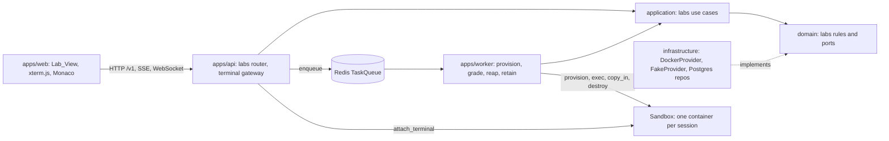
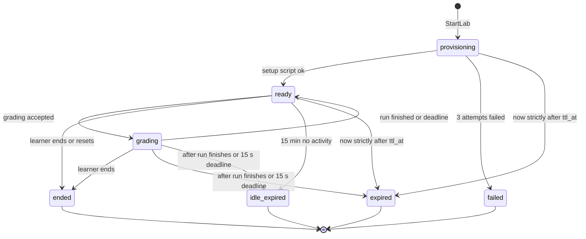
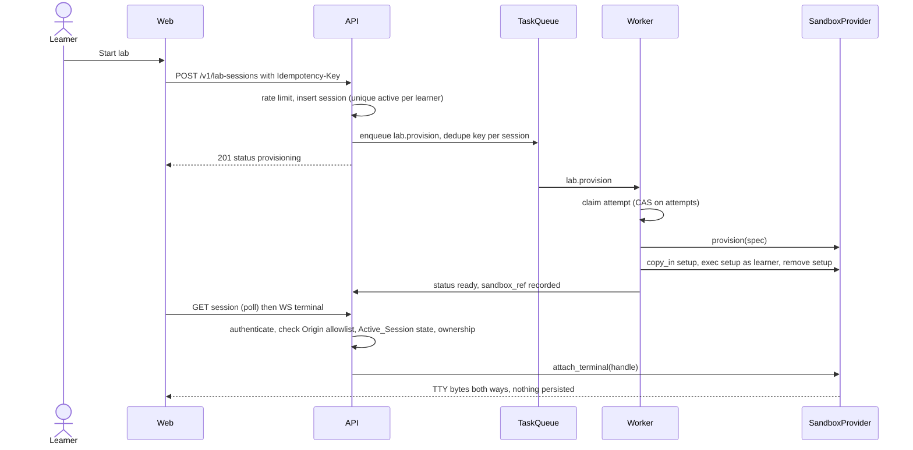
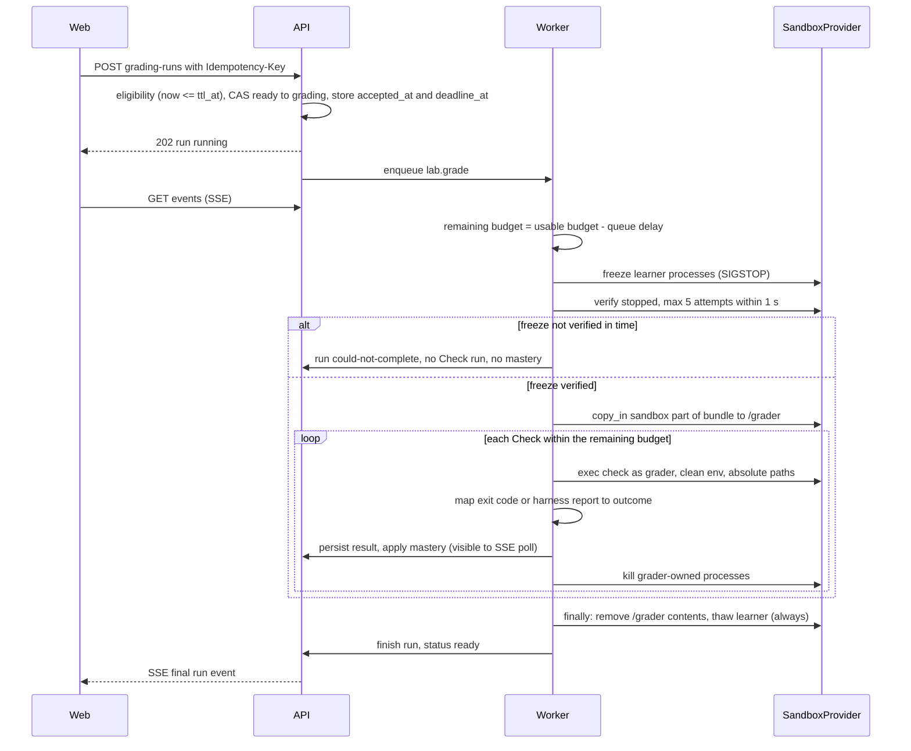

# Design Document

## Overview

This design realizes the `hands-on-labs` requirements: sandboxed terminals, graded code exercises,
and two seed labs, wired into progression and mastery, running locally. It builds on the
learning-core phase (`docs/reports/phase-2.md`), where labs were only a "coming soon" placeholder
and the `LabCheck` port was backed by a fake. Authoritative rules stay in steering and are linked,
not restated: labs and sandbox (#[[file:.kiro/steering/labs.md]]), domain rules
(#[[file:.kiro/steering/domain-rules.md]]), layering (#[[file:.kiro/steering/structure.md]]),
quality and testing (#[[file:.kiro/steering/quality.md]]), API conventions
(#[[file:.kiro/steering/api-conventions.md]]), auth and privacy
(#[[file:.kiro/steering/auth-privacy.md]]), content (#[[file:.kiro/steering/content.md]]), and
process (#[[file:.kiro/steering/working-agreements.md]]). The `SandboxProvider` signatures come
from `docs/LABS-DESIGN.md` (D4), the tables from `docs/DATA-MODEL.md` (D3), and ADRs 0001
(versions), 0003 (Redis task queue), and 0004 (server-side sessions) apply.

### Design goals

- All sandbox technology sits behind the `SandboxProvider` port. Docker (dev only) and a fake are
  built here; the port stays implementable by a Kubernetes provider later.
- Learner code is hostile. It runs only inside a Sandbox, never in the api or worker process, and
  grading integrity does not depend on anything the learner can touch.
- Every rule is a pure, framework-free domain function where possible (deadlines, grading
  eligibility, scheduling, outcome sanitization, mastery application). That keeps almost all
  behavior testable with the fake provider and the fake `Clock`, and makes it property-testable.
- Business numbers live in `edu_it_domain/config.py` and time comes only from the injected `Clock`.

### Research findings that shaped the design

| Question | Finding | Design consequence |
|---|---|---|
| Can Docker enforce a 256 MiB writable-disk quota on any host? | `--storage-opt size=` only works for overlay2 on XFS with `pquota` ([moby #46823](https://github.com/moby/moby/issues/46823)), which Docker Desktop on Windows does not provide. | The quota is enforced with a read-only root filesystem plus size-limited `tmpfs` mounts. |
| Does tmpfs cost memory? | tmpfs usage counts against the container's memory cgroup limit ([Docker tmpfs docs](https://docs.docker.com/engine/storage/tmpfs)). | The 256 MiB quota sits inside the 512 MiB memory limit. The disk-fill and memory tests account for it. |
| Can `docker cp` / `put_archive` write into a tmpfs mount? | `docker cp` sees the underlying directory, not the tmpfs content ([moby #22020](https://github.com/moby/moby/issues/22020)). | `copy_in`/`copy_out` stream a tar through an internal `exec` (`tar -x` / `tar -c`) and never use `put_archive`. The provider contract suite proves it. |
| What does uvicorn do with open WebSockets on SIGTERM? | It closes them with code 1012 before application shutdown hooks run ([uvicorn #2552](https://github.com/encode/uvicorn/discussions/2552)). | A lifespan hook is too late to send the reconnect message. The API runs a small `uvicorn.Server` subclass that drains the terminal registry first (Requirement 12.8). |
| How can a Monaco user leave the editor with the keyboard? | Monaco toggles Tab focus mode with Ctrl+M (Ctrl+Shift+M on macOS) ([Monaco accessibility guide](https://github.com/microsoft/monaco-editor/wiki/Monaco-Editor-Accessibility-Guide)). | The documented exit shortcut uses the same chord in the editor and the terminal. |

Content was rephrased for compliance with licensing restrictions.

### Decisions to confirm at review

These are choices where the requirements leave room or where a requirement and the platform pull in
different directions. Each is reflected in the design below.

1. **Group `devs` is baked into the Lab_Image** (the learner user is a member). The root filesystem
   is read-only, so a setup script cannot edit `/etc/group`. The setup script verifies membership
   and creates the planted files, which still satisfies Requirement 21.5 (usable without root).
2. **Disk quota by tmpfs**, not `--storage-opt` (see research). Writable areas are `/workspace`,
   `/home/learner`, `/tmp`, and a small root-owned `/grader` area, summing to the quota.
3. **Code-lab expected values never enter the Sandbox.** The Check_Bundle has a `sandbox/` part
   (copied in at grading time) and an `expected/` part read by the worker from the read-only
   repository source. The in-sandbox harness runs as the Grader_User, executes the learner program
   as a hardened subprocess, and reports observed output as data. The worker compares it.
   Requirement 14.5 is met ("expected values held in the Check_Bundle") and a learner program can
   never read the answers.
4. **Additive D4 amendments** (the D4 document is updated in the same change, per
   #[[file:.kiro/steering/working-agreements.md]]): `list_sandboxes()` (needed for orphan
   detection, Requirement 8.3), an optional `timeout_s` on `exec`, an optional `as_user` on
   `copy_in`, a defined `ExecResult`, and a synchronous `TerminalChannel`.
5. **Exit shortcut:** Ctrl+M (Ctrl+Shift+M on macOS) in editor and terminal. In a terminal Ctrl+M
   is the same byte as Enter, so the terminal pane swallows that chord. Enter itself is unaffected.
6. **New initial Config values** proposed by this design: a 1 s freeze verification bound with 5
   attempts, a 2 s grading teardown reserve (hence a 12 s Usable_Run_Budget), a 10 s Docker
   operation timeout, a lab task mastery gain of 15, a 90-day lab-data retention, a 5 s
   provisioning sweep interval, and in-sandbox program limits (128 MiB, 32 processes). All are
   listed in the Config table.
7. **"At most one live terminal connection at all times"** is guaranteed per API process by an
   in-process registry. Across several API replicas a stale connection can overlap for at most one
   status-poll interval (2 s), closed by an epoch fence stored on the session row.
8. **Strict image scanning (Requirement 4.6)** fails on any finding, including unfixed ones. The
   images therefore use Alpine bases pinned by digest, which carry few findings. The scan runs in
   its own workflow, on changes under `lab-images/` and on a weekly schedule, and is not a gate on
   any other path (Requirement 4.7). A newly published CVE turns the scheduled run red until the
   digest is bumped (procedure in `docs/LABS.md`, Requirement 4.9), which is the intended signal.
   There is no waiver, allowlist, or ignore file (Requirement 4.10).
9. **Lab-check gate semantics:** the gate for a concept is satisfied when at least one lab covering
   it has every required task completed. A zero-delta `mastery_event` with source `lab_passed` is
   written at that moment so retention of `lab_task_completion` rows (Requirement 9.1) never
   regresses a Mastered concept.
10. **Learner-initiated end** runs the `EndSession` use case in the api process (so "Reset lab" can
    start a fresh session immediately). The worker always performs the `destroy` and sets every
    system-initiated terminal status.
11. **Grading deadline** is 15 s measured from the accepted instant (stored as `accepted_at` and
    `deadline_at` on the run) and splits as freeze verification bound (1 s) + Usable_Run_Budget
    (12 s) + teardown reserve (2 s). Queue delay before the Grading_Job starts is deducted from the
    Usable_Run_Budget, so queueing never pushes the run past 15 s (Requirement 11.8).
12. **Freeze during grading, fail-closed:** learner processes are stopped (SIGSTOP) and verified
    stopped before the bundle is copied in or any Check runs. If verification fails within the
    bound, no Check runs, the run is could-not-complete, no mastery is granted, and the learner
    processes are always resumed in a `finally`. The terminal is unresponsive during a run.
13. **Retention of 90 days** stays a proposed Config value (`LAB_RETENTION_PERIOD`); steering
    requires retention but sets no period. Please confirm or change it.
14. **Time budget values** (freeze bound 1 s, teardown reserve 2 s, hence Usable_Run_Budget 12 s)
    are proposals. They are tied together by the startup rule that bound plus reserve must be
    below the 15 s deadline.
15. **Docker operation timeout** (`SANDBOX_OPERATION_TIMEOUT`, 10 s) bounds every call to the
    daemon, so an unreachable daemon returns provider-unavailable within 10 s (Requirement 1.9).
16. **Pending-review mode:** the CI validator runs with `--allow-pending`, tolerating only
    `ai-reviewer-present` for labs listed in `content/linux-fundamentals/pending-review.json`.
    The list is emptied when the reviewer is recorded, after which validation is strict.
17. **Performance re-measurement policy:** 3 warm-up samples discarded, idle machine, at most one
    logged full re-measurement, and the final measurement is the one that counts (Requirement
    31.7, 31.8).

## Architecture

### Layering and package map

The layering is unchanged: `api -> application -> domain <- infrastructure`
(#[[file:.kiro/steering/structure.md]]). New code lands in these places.

| Layer | New location | Contents |
|---|---|---|
| Domain | `packages/domain/edu_it_domain/labs/` | Models, `SandboxSpec` and quota split, session rules (deadlines, eligibility, reap decision, rate limit, retry decision), grading scheduling and outcome sanitization, lab progression, file caps, `TokenBucket`, heartbeat tracker. |
| Domain ports | `packages/domain/edu_it_domain/ports/` | `sandbox.py` (`SandboxProvider`, `TerminalChannel`, value types), `lab_sessions.py` (`LabSessionRepository`, `GradingRunRepository`), `lab_catalog.py` (`LabCatalog`). `LabCheck` stays and gets a real adapter. |
| Domain config | `edu_it_domain/config.py` | Lab, sandbox, terminal, grading and retention constants (table below). |
| Application | `packages/application/edu_it_application/labs/` | `StartLab`, `EndSession`, `GetSession`, `SaveFiles`, `RequestGrading`, `RevealLabHint`, `ListSessions`, `AuthorizeTerminal`, `TerminalGatewayCore`, and the job logic `ProvisionSandbox`, `GradeRun`, `ReapSessions`, `PurgeLabData`, `RecordCheckResult`. |
| Infrastructure | `packages/infrastructure/edu_it_infrastructure/` | `sandbox/docker_provider.py` and the pure `docker_spec.py` translator, `fakes/sandbox_provider.py`, Postgres and in-memory lab repositories, `Content_LabCatalog`, the real `LabCheck` adapter. |
| API | `apps/api/edu_it_api/` | `labs.py` router, `labs_schemas.py`, `terminal.py` WebSocket, `errors/labs.py`, `serve.py` (draining server). |
| Worker | `apps/worker/edu_it_worker/labs/` | Job handlers, periodic scheduler, consumer wiring. |
| Web | `apps/web/src/` | Lab_View page and components, `lab-state.ts`, `lab-api.ts`. |
| Content | `packages/content/`, `content/linux-fundamentals/` | Extended lab schemas, new validation rules, seed labs and bundles. |
| Images | `lab-images/` | `linux-base`, `python`, bake file, README. |



### Runtime topology (local)

- `apps/api` hosts REST, SSE and the terminal WebSocket. It never executes learner content.
- `apps/worker` consumes `lab.provision`, `lab.grade`, `lab.destroy`, `lab.reap`, `lab.retain`, and
  `lab.sweep` jobs through `TaskQueue.consume`, one consumer thread per job name. A small
  `Scheduler` thread enqueues the periodic jobs on `Clock` ticks with a per-tick dedupe key, so
  several workers never double-run a tick (ADR 0003).
- One container per Lab_Session, labelled `edu-it.managed=1` and `edu-it.session=<stable_id>`.
  The Docker provider talks to the local daemon through the Docker SDK for Python (works over the
  Windows named pipe, unlike a raw PTY through the CLI).

### Session state machine



Persisted status strings are `provisioning`, `ready`, `grading`, `ended`, `expired`,
`idle-expired`, `failed`. Active_Session means `provisioning`, `ready`, or `grading`. Every
transition is a compare-and-set on `(id, expected status)` so concurrent workers and requests
cannot both win.

The `ttl_at` boundary is asymmetric on purpose. A grading request received at `now <= ttl_at` is
accepted (Requirement 7.8, 27.7) and is rejected only when `now > ttl_at`. The reaper expires a
session only when `now > ttl_at`, so at exactly `ttl_at` the session is neither rejected for
grading nor reaped. A run accepted at or before `ttl_at` is processed even if it finishes after
`ttl_at`; the reaper then defers destruction until the run finishes or its `deadline_at` passes.

### Sequence: start, provision, terminal



### Sequence: grading



## Components and Interfaces

### Domain ports

`SandboxProvider` follows D4 with the additive amendments of decision 4. Types are frozen
dataclasses in `ports/sandbox.py`.

```python
@dataclass(frozen=True, slots=True)
class SandboxHandle:
    sandbox_id: str            # provider-specific id, opaque to callers
    session_stable_id: str     # owning Lab_Session
    provider: str              # "docker" | "fake" | later "kubernetes"

@dataclass(frozen=True, slots=True)
class ExecResult:
    exit_code: int | None      # None when the process was killed by timeout
    stdout: bytes              # DATA ONLY: never forwarded to learners
    stderr: bytes
    timed_out: bool

class SandboxProvider(Protocol):
    def provision(self, spec: SandboxSpec) -> SandboxHandle: ...
    def exec(self, handle, command: Sequence[str], *, as_user: str,
             env: Mapping[str, str], cwd: str, timeout_s: float | None = None) -> ExecResult: ...
    def attach_terminal(self, handle) -> TerminalChannel: ...
    def copy_in(self, handle, source_ro: Path, dest: str, *, as_user: str = "root") -> None: ...
    def copy_out(self, handle, source: str, dest: Path) -> None: ...
    def destroy(self, handle) -> None: ...                # idempotent
    def health(self, handle) -> HealthStatus: ...
    def list_sandboxes(self) -> Sequence[SandboxHandle]: ...   # D4 amendment, orphan sweep

class TerminalChannel(Protocol):
    def read(self, max_bytes: int, timeout_s: float) -> bytes | None: ...   # None means closed
    def write(self, data: bytes) -> None: ...
    def resize(self, rows: int, cols: int) -> None: ...
    def close(self) -> None: ...
```

Contract notes:

- `provision` raises `ProvisionError(partial_handle=...)` or `ProvisionTimeout`. It must clean up
  what it can itself, and reports any handle it could not clean so the caller destroys it.
- `destroy` succeeds on an already destroyed handle. `exec`/`attach_terminal` on a destroyed handle
  raise `SandboxGone`.
- `exec` enforces `timeout_s` by wrapping the command in `timeout -s KILL <seconds>` and a
  client-side backstop. The Alpine images ship BusyBox applets (and, where installed, GNU or
  procps variants), and flag support differs between them, so the provider and harness use only
  the flag subset confirmed by the flag-compatibility spike (below). `timeout` is not relied on
  to kill a process group: after a timeout the provider also runs `kill -s KILL -1` as the same
  user, which terminates every process that user started.
- Every call to the Docker daemon is bounded by `SANDBOX_OPERATION_TIMEOUT` (10 s). An
  unreachable daemon yields `ProviderUnavailable` within that bound and changes no session or
  sandbox state (Requirement 1.9).

**Flag-compatibility spike (Requirement 4.15, 4.16).** Before the harness, setup scripts, or the
provider are written against them, a spike task runs `ps`, `kill`, `timeout`, and `tar` inside the
built `linux-base` and `python` images and records, in `lab-images/README.md`, the exact absolute
path and argv forms that work (for example whether `ps -o user,stat,pid` is accepted, whether
`kill -s STOP -1` and `kill -s KILL -1` signal all of the user's processes, whether `timeout`
takes `-s SIG SECS CMD`, and `tar -x -C` / `tar -c -C` as used by `copy_in` and `copy_out`). Only
those forms are used in code. A Docker-marked test, `tests/labs/test_image_commands.py`, asserts
against the built images that each command exists at the recorded path and accepts every flag the
code uses, so a base-image digest bump that changes an applet fails the test.
- A warm pool is a `WarmPool` protocol with `acquire(spec) -> SandboxHandle | None`, consulted by
  the provisioning use case when one is configured. No implementation ships (Requirement 1.5).
- `Fake_SandboxProvider` models sandboxes in memory (users, a simple file map, running "processes"
  as data), advances an injected `Test_Clock` by a configurable virtual duration per call, and can
  be configured to fail, hang (raise `ProvisionTimeout`), or partially create. It imports no
  subprocess, socket or Docker module (Requirement 1.3).

`ports/lab_sessions.py`:

```python
class LabSessionRepository(Protocol):
    def add_if_no_active(self, session: LabSession) -> None          # raises ActiveSessionExists
    def get(self, session_id) -> LabSession | None
    def get_for_owner(self, session_id, user_id) -> LabSession | None   # None if absent or foreign
    def get_active_for_user(self, user_id) -> LabSession | None
    def transition(self, session_id, *, expected: set[str], to: str, **fields) -> bool   # CAS
    def try_accept_grading(self, session_id, *, now, min_interval) -> bool               # CAS
    def claim_provision_attempt(self, session_id, *, expected_attempts, now) -> bool
    def touch_activity(self, session_id, at) -> None
    def count_started_since(self, user_id, since) -> int
    def list_for_user_page(self, user_id, *, limit, after) -> Page[LabSession]
    def list_active(self) -> Sequence[LabSession]
    def list_ended_before(self, cutoff) -> Sequence[LabSession]
    def delete_session_data(self, session_ids) -> int

class GradingRunRepository(Protocol):
    def add(self, run: GradingRun) -> None
    def get(self, run_id) -> GradingRun | None
    def append_result(self, run_id, result: CheckResult) -> None      # ordered, idempotent per check
    def finish(self, run_id, *, status, graded_at) -> bool
    def list_running(self) -> Sequence[GradingRun]
    def first_pass_exists(self, user_id, task_id) -> bool
    def add_task_completions(self, run_id, rows: Sequence[TaskCompletion]) -> None
```

`ports/lab_catalog.py` exposes `LabDefinition` (id, kind, image, covered concept ids, tasks with
`required` flag, checks with timeout, outcomes, bundle paths, localized text by locale) and
`labs_covering(concept_id)`. The existing `LabCheck` port is implemented by
`Repository_LabCheck(catalog, repositories)`: `covers` is true when a non-archived lab lists the
concept; `passed` is true when some covering lab has every required task completed for the user, or
a `lab_passed` marker event exists for that concept (decision 9).

### Domain pure functions (`edu_it_domain/labs/`)

| Module | Function | Purpose |
|---|---|---|
| `sandbox_spec.py` | `build_sandbox_spec(lab, session_id, config) -> SandboxSpec` | Image, non-root user, no network, four limits from Config, drop all capabilities, `no_new_privileges`, no host mounts, tmpfs mounts. |
| | `split_writable_quota(total_bytes) -> WritableMounts` | Partition the quota across `/workspace`, `/home/learner`, `/tmp`, `/grader`; parts sum exactly to the total. |
| `config_rules.py` | `validate_lab_config(config) -> None` | Startup check run by api and worker composition before any provider is used. Raises `LabConfigError` naming the offending keys when any lab Config value is missing or not positive (including the allowed web origin list being empty and every `LAB_RECONNECT_BACKOFF` element), or when freeze bound + teardown reserve >= run deadline (names the three keys). Pure, no I/O. |
| `session_rules.py` | `deadlines(session, config) -> Deadlines` | `ttl_at`, idle deadline, remaining times. |
| | `last_activity(events) -> datetime` | Max over learner-activity events only (terminal input, file save, grading request). Sandbox output is not activity. |
| | `reap_decision(session, now, run, config) -> ReapAction` | `KEEP`, `EXPIRE`, `IDLE_EXPIRE`, `DEFER`, `DESTROY_ONLY`. `EXPIRE` only when `now > ttl_at` (strictly; at exactly `ttl_at` the session is kept). `IDLE_EXPIRE` when `now >= idle deadline`. `DEFER` while a run is `running` and `now <= run.deadline_at`; once `now > deadline_at` the run is closed as could-not-complete and the decision proceeds. |
| | `grading_eligibility(session, now, config) -> Eligible \| Rejected(reason, retry_after)` | Owner is checked by the repository. Accepts iff status is `ready`, `now <= ttl_at` (rejected only when `now > ttl_at`), and no accepted request within 10 s (`now - last > 10 s`). |
| | `provision_rate_decision(starts, now, config)` | Allowed iff fewer than 5 starts in the trailing 10 minutes; reports `retry_after`. |
| | `provision_retry_decision(session, now, config)` | Next attempt allowed iff attempts < 3 and `now >= last_attempt + 10 s`; otherwise `FAIL` or `WAIT`. |
| `grading.py` | `remaining_budget(accepted_at, job_started_at, spent_on_checks, config) -> timedelta` | `usable_run_budget - (job_started_at - accepted_at) - spent_on_checks`, where `usable_run_budget = run_deadline - freeze_bound - teardown_reserve` (initially 15 - 1 - 2 = 12 s). Queue delay is therefore deducted. |
| | `effective_timeout(check_timeout, remaining)` | `min(check_timeout, remaining)`; a non-positive result means "do not run". |
| | `learner_all_stopped(ps_rows) -> bool` | True iff no learner-owned process is in a running state in the listing (stopped or zombie states count as stopped). |
| | `map_exit_code(check, exit_code, timed_out) -> CheckOutcome` | Unknown code, signal, or timeout all become `could_not_complete`. Reserved code 90 (unsafe path: symlink, FIFO, device in place of an inspected path) also maps to `could_not_complete`. |
| | `aggregate_run(results, abort) -> RunStatus` | `passed` iff every Check passed; any failure or could-not-complete Check gives `failed`. A run is `could_not_complete` when `abort` is set: the Sandbox vanished, the freeze could not be verified, or a declared learner file was unsafe. |
| | `to_learner_view(result, lab, locale) -> CheckResultView` | The only shape that leaves the worker: ids, outcome, `feedback_key`, translated message. |
| `progression.py` | `apply_lab_results(...)` | Mastery events from first passes, hint multiplier, durable `lab_passed` marker. |
| `files.py` | `validate_learner_files(files, allowed, config)` | Count and size caps, allowed names, no path traversal or separators. |
| `limits.py` | `TokenBucket`, `HeartbeatTracker` | Message size/rate limiting and missed-pong counting, both over `Clock`. |

### Application layer

- **`StartLab`** (api): checks the provisioning rate limit through the repository count, inserts
  the session with `add_if_no_active` (a partial unique index enforces one Active_Session per
  learner even under concurrent starts), enqueues `lab.provision` with dedupe key
  `provision:<session_id>`, and honors `Idempotency-Key` through the existing `IdempotencyStore`.
- **`EndSession`**: CAS to `ended`, enqueue `lab.destroy`. Used by DELETE and by "Reset lab"
  (end, then `StartLab` for the same lab; completions are untouched).
- **`SaveFiles` / `RequestGrading`**: validate caps, `copy_in` learner files as the learner user,
  record activity; grading runs `grading_eligibility`, then `try_accept_grading` (CAS), creates the
  `GradingRun` with `accepted_at = Clock.now()` and `deadline_at = accepted_at + 15 s`, and
  enqueues `lab.grade`. A repeat `Idempotency-Key` returns the stored run.
- **`ProvisionSandbox`** (worker): claims an attempt by CAS on `provision_attempts`, builds the
  spec, calls the provider under `LAB_PROVISION_TIMEOUT`, copies in and runs the setup script,
  then CAS `provisioning -> ready` and records `sandbox_ref`. On failure it destroys any partial
  handle and sets `next_provision_at = now + 10 s`; after the third failed attempt it sets
  `failed`. A duplicate delivery finds a different `provision_attempts` or a non-`provisioning`
  status and exits.
- **`GradeRun`** (worker): the grading orchestration described below.
- **`ReapSessions`** (worker, every 30 s): for each active session apply `reap_decision`; destroy
  sandboxes of terminal sessions; destroy orphans found through `list_sandboxes()` with no session
  row; thaw and close stale `running` runs past the deadline as `could_not_complete`. Destroy
  failures are logged and retried on the next tick.
- **`PurgeLabData`** (worker, daily): delete ended sessions, their runs, and completions older than
  the retention period, in a single transaction, leaving mastery tables alone.
- **`AuthorizeTerminal` + `TerminalGatewayCore`**: the core takes a `SocketPort` (`receive`, `send`,
  `close`) and a `TerminalChannel`, so heartbeats, limits, the one-connection registry, resize,
  expiry messages and draining are testable without an ASGI server.

### Grading orchestration (the integrity-critical part)

`GradeRun` performs these steps. The learner can influence none of the arguments to any call.

The 15 s deadline is `freeze verification bound (1 s) + Usable_Run_Budget (12 s) + teardown
reserve (2 s)`, all from Config, measured from the accepted instant. The whole body below runs in
a `try` whose `finally` always thaws the learner processes (step 7).

1. **Budget.** Read `accepted_at` and `deadline_at` from the run row. On start compute
   `remaining = remaining_budget(accepted_at, now, 0, config)`. Queue delay is thereby deducted.
   If `remaining <= 0`, start no Check: record every Check `could_not_complete` and go to step 7
   without freezing or copying anything (Requirement 11.8).
2. **Freeze, verified, fail-closed.** Up to `LAB_GRADING_FREEZE_ATTEMPTS` (5) times, within
   `LAB_GRADING_FREEZE_BOUND` (1 s on the injected `Clock`): `exec(["/bin/kill", "-s", "STOP",
   "-1"], as_user="learner", ...)`, then `exec` a `ps` listing (busybox-compatible columns,
   argv fixed by the flag-compatibility spike) and test it with `learner_all_stopped`. Stopped
   processes cannot modify state, print forged results, or race the Checks (Requirements 10.7,
   29.6). Verification happens before step 3 and before any Check. If it does not succeed within
   the attempts and bound, the run **fails closed**: copy nothing in, run no Check, record the
   run `could_not_complete` with every Check `could_not_complete`, grant no mastery (Requirement
   10.8, 28.8), and continue to step 7. The freeze bound is excluded from the Usable_Run_Budget.
3. **Copy in.** `copy_in(handle, bundle/sandbox, "/grader", as_user="root")` from the read-only
   repository path. `/grader` is a root-owned tmpfs the learner cannot write (Requirement 10.1).
   The archive also creates `/grader/run`, owned by the Grader_User with mode 0700, as the
   working directory and the home of the learner-file copies (step 4, Code Check).
4. For each Check, compute `effective_timeout(check_timeout, remaining)`, where `remaining`
   shrinks by the time spent on earlier Checks; if it is not positive, record `could_not_complete`
   without running it. Otherwise run it as the Grader_User:
   - Shell Check: `exec(["/bin/sh", "/grader/checks/<id>.sh"], as_user="grader", env=CLEAN_ENV,
     cwd="/grader/run", timeout_s=...)`. `CLEAN_ENV` is `{PATH: "/usr/bin:/bin", LANG: "C", ...}`
     built only from the bundle and Config. The exit code is the result channel and is mapped by
     `map_exit_code`. Stdout and stderr are discarded. A script that finds a symlink, FIFO, or
     device node where it expects a directory or regular file exits with the reserved code 90
     (`could_not_complete`, outcome code `unsafe-path`) without reading it, so it never blocks
     on a FIFO and never follows a link (Requirement 29.9).
   - Code Check: `exec(["/usr/bin/python3", "-I", "/grader/harness/run_cases.py", <check id>], as_user="grader", ...)`.
     **Learner file intake (Requirements 14.10, 14.11, 29.9).** Before running anything, the
     harness opens `/workspace` once with `O_DIRECTORY | O_NOFOLLOW` and, for each declared learner
     file name (flat names only, validated by `validate_learner_files`), calls `openat` with
     `O_RDONLY | O_NOFOLLOW | O_NONBLOCK` so a symlink fails with `ELOOP` and a FIFO never
     blocks. It then `fstat`s the opened descriptor and accepts only `S_ISREG` files within
     `LAB_FILE_MAX_BYTES`, reads the bytes from that descriptor, and writes them into
     `/grader/run/learner/` (Grader_User-owned, mode 0700, not writable by the learner). A
     symlink, FIFO, device node, socket, directory, missing or oversized file is rejected:
     the harness reports `unsafe-learner-file`, executes nothing, and the worker aborts the run as
     `could_not_complete` with no mastery. Only the copy is ever executed; because the check
     opens and reads one descriptor, there is no check-then-use gap on the original path, and the
     learner is frozen anyway. The harness reads only `/grader` and these copies, runs the learner program
     in a new session with closed file descriptors, a clean environment, `RLIMIT_CPU`,
     `RLIMIT_AS` (128 MiB) and `RLIMIT_NPROC` (32), after setting itself non-dumpable
     (`PR_SET_DUMPABLE=0`) so a same-user child cannot ptrace it or read its memory. The harness
     writes one JSON report to its own stdout. The learner's output is embedded as base64 data
     fields, so a forged "result line" is just data (Requirement 29.7). The worker parses the
     report with a strict schema and compares observed output with `expected/` from the
     read-only source.
   - After each Check, `/bin/kill -s KILL -1` as `grader` removes every process the Check started
     (Requirement 28.1). `RLIMIT_NPROC` keeps the learner program from exhausting the container's
     PID budget, so this kill can always be spawned.
5. Persist each `CheckResult` immediately (`append_result`), then apply mastery for that task if it
   just became fully passing. This is what makes the SSE stream incremental and lets modules
   unlock mid-lab (Requirements 11.6, 19.6).
6. If the Sandbox is gone (`SandboxGone`), the remaining Checks and the run are recorded
   `could_not_complete` and no mastery is granted for unfinished tasks (Requirement 27.4).
7. **Teardown, always (`finally`).** Remove `/grader` contents (best effort, then verified), and
   in a nested `finally` thaw the learner with `SIGCONT` so a failure in the removal can never
   leave the learner frozen. Thaw is attempted in every outcome: success, freeze failure,
   exhausted budget, exception, or vanished Sandbox. Then finish the run and CAS
   `grading -> ready`. The teardown reserve (2 s) covers this step.

Why not run the learner program as a third user? With all capabilities dropped (Requirement 3.4) a
process cannot change uid, and `docker exec -u` is the only way to switch users. The non-dumpable
harness plus per-Check process cleanup gives equivalent protection for the result channel.

### Docker provider mapping (`docker_spec.py`, pure)

`to_container_kwargs(spec) -> dict` is a pure function so the isolation settings are property
tested without a daemon.

| Spec field | Docker setting |
|---|---|
| user | `user="1000:1000"` (learner); exec users `grader` (1001) and `root` by name |
| network | `network_mode="none"` |
| CPU | `nano_cpus = cpu * 1e9` |
| memory | `mem_limit`, `memswap_limit` equal (no swap) |
| PIDs | `pids_limit` |
| writable disk | `read_only=True` plus `tmpfs={"/workspace": "size=...,uid=1000,gid=1000,mode=0755,nosuid,nodev", "/home/learner": ..., "/tmp": ..., "/grader": "size=...,mode=0755"}` |
| privileges | `cap_drop=["ALL"]`, `security_opt=["no-new-privileges:true"]`, `privileged=False`, `init=True` |
| host access | no `binds`, no `volumes`, no `devices`, no socket, private IPC and PID namespaces |
| identity | labels `edu-it.managed`, `edu-it.session` |

Startup: composition first calls `validate_lab_config()` (Requirement 1.8, 1.11) and creates no
Sandbox if it raises. The provider logs the dev-only warning (Requirement 2.1) and composition
refuses `docker` with `EDU_IT_ENV=production` (Requirement 2.2). The Docker SDK client is built
with `timeout=SANDBOX_OPERATION_TIMEOUT`, so an unreachable daemon returns
`ProviderUnavailable` within 10 s (Requirement 1.9). The memory limit includes tmpfs usage,
so a disk-fill loop first hits the 256 MiB tmpfs size limit (`ENOSPC`) and never reaches the
cgroup limit as long as the other writable areas are mostly empty.

### API surface (`/v1`, all by `stable_id`)

| Method and path | Purpose |
|---|---|
| `GET /labs/{lab_id}?locale=` | Lab instructions, tasks, starter file names, hint count (hint text withheld). |
| `POST /lab-sessions` | Start (needs `Idempotency-Key`); `201` with status `provisioning`. |
| `GET /lab-sessions/{id}` | Status, `server_now`, `ttl_at`, `idle_deadline`, `grading_available_at`, current run, translated error for `failed`. |
| `GET /lab-sessions` | Cursor-paginated past sessions of the caller. |
| `DELETE /lab-sessions/{id}` | End (idempotent). |
| `POST /lab-sessions/{id}/reset` | End and start a fresh session for the same lab. |
| `PUT /lab-sessions/{id}/files` | Save learner files (caps enforced, RFC 9457 on violation). |
| `POST /lab-sessions/{id}/grading-runs` | Request grading (needs `Idempotency-Key`); `202`. |
| `GET /lab-sessions/{id}/grading-runs/{run_id}` | Run state and per-Check views so far. |
| `GET /lab-sessions/{id}/grading-runs/{run_id}/events` | Server-Sent Events: one `result` event per Check, then `run`. Resumable with `Last-Event-ID`. |
| `POST /lab-sessions/{id}/hints` | Reveal the next hint level of a task; records a `hint_reveal`. |
| `WS /lab-sessions/{id}/terminal` | Terminal gateway. |

Notes:

- SSE uses Starlette `StreamingResponse` with `text/event-stream` and polls the run repository
  every 500 ms (Config), so there is no new dependency and a second API replica works.
- The WebSocket handshake runs the connect checks in the order given under "Terminal gateway
  details" (authentication, origin allowlist from Config, Active_Session state, ownership). The
  CSRF middleware only guards unsafe HTTP methods, so the origin check is done by the gateway.
  The Lab_View learns the real status from `GET /lab-sessions/{id}`. The CSRF middleware must pass
  `websocket` scopes through; a test asserts it.
- No lab response (body, header, cursor, or SSE payload) exposes an internal numeric key, and every
  lab route is registered under `/v1` (Requirements 17.1, 17.2). Property 37 and a route
  enumeration test verify this.
- Frames: binary frames carry terminal bytes; text frames carry JSON control messages
  (`resize`, `ping`/`pong`, `reconnect`, `status` with a translated message).
- `GET /v1/progress` gains a `labs` array (completed tasks, lab-derived mastery), and the lesson
  view gains `lab_ids` so the web app can link to the Lab_View.
- Lab errors reuse the RFC 9457 machinery in `errors/` with a new `errors/labs.py` mapping typed
  application errors to translated problem types (see Error Handling).

### Terminal gateway details

- **Connect checks, in this order (Requirements 12.1, 12.2, 12.10, 12.11):**
  1. *Authentication:* resolve the cookie session through `SessionStore`. No session: refuse.
  2. *Origin:* compare the `Origin` header with the allowed web origin list in Config
     (`LAB_ALLOWED_WEB_ORIGINS`). Not listed: refuse.
  3. *Active_Session state:* load the session by `stable_id` and require status
     `provisioning`, `ready`, or `grading`.
  4. *Ownership:* the session's owner must equal the authenticated user. This is the only
     authorization decision on connect.
  Steps 3 and 4 share one refusal (same close code, same reason, no body that varies), so a
  nonexistent, ended, and foreign session are indistinguishable. Steps 1 and 2 do not depend on
  the target session, so they reveal nothing about it. Message limits and heartbeats apply only
  after the connection is accepted. Then `attach_terminal`. A new accepted connection closes any
  earlier one for that session (registry, plus an epoch increment checked every status poll).
  Reconnects run the same four checks.
- **Pumps:** one thread-backed reader (`channel.read` in `asyncio.to_thread`) and one writer loop.
  Input goes through `TokenBucket` (64 KiB, 1000 messages/s); a violation closes with code 1009
  or 1008.
- **Heartbeat:** a ping every 20 s; two consecutive missed pongs close with 4408.
- **Activity:** terminal input calls `touch_activity`, throttled to one write per 5 s.
- **Status watcher:** every 2 s the gateway re-reads the session; if it is no longer Active it
  sends a translated `status` frame (expired, idle-expired, ended, failed) and then closes.
- **Draining:** `serve.py` subclasses `uvicorn.Server` and overrides `handle_exit` to call
  `registry.drain()` first. It sends `{"type":"reconnect"}` to every open socket and closes with
  1012, then lets uvicorn continue its normal shutdown. A spike task confirms the ordering on the
  pinned uvicorn.
- Nothing from terminal frames is logged or stored. Logging at `INFO` records only session id,
  byte counts and close codes.

### Web (`apps/web`)

- Route `src/app/[locale]/labs/[labId]/page.tsx` (server) loads the lab and renders the client
  `LabView`. `LabPlaceholder` is removed; lesson pages link to the Lab_View when `lab_ids` is
  non-empty.
- `TerminalPane` loads `@xterm/xterm` and its fit addon with a client-only dynamic import and
  forwards resize. `CodeEditor` uses Monaco, self-hosted: a build script copies Monaco's `min/vs`
  assets to `public/monaco` and the loader is configured to that path, so there is no CDN request.
  Exact versions are pinned in ADR 0001 and `package.json` (Requirements 4.12, 4.13).
- `lab-state.ts` holds the pure client rules: `canCheckWork`, `timeRemaining`, `warningActive`,
  `reconnectDelays`, and a reducer for the view state (ready, grading, results, error,
  reconnecting). It uses `server_now` from the API to compute an offset, so client clock skew
  does not affect the 10 s button rule or the timer.
- Accessibility: live regions (`role="status"`, polite) announce Check results, timer warnings,
  and reconnect status; the timer itself is not announced every second. The exit shortcut moves
  focus to the "Check my work" button, is shown in the view, and is documented in `docs/LABS.md`.
- i18n: a `Labs` namespace in `messages/en.json` and `messages/fr.json` (the existing key-parity
  property test covers both). Check messages come from the API in the request locale.

### Content and validator extensions

Schemas (`packages/content/.../schemas.py`) gain fields, all validated by Pydantic v2 with the
existing `Localized` type:

| Item | New fields |
|---|---|
| `Lab` | `kind` (`terminal` or `code`), `image`, `concept_stable_ids`, `instructions: Localized`, `setup_script`, `check_bundle`, `check_bundle_dest` (default `/grader`), `learner_files`, `starter_files`. |
| `LabTask` | `description: Localized`, `required: bool = True`, `hints: list[Localized]`. |
| `LabCheck` | `timeout_seconds`, `script`, `outcomes: list[Outcome]` where `Outcome = {code, exit_code or None, feedback_key, message: Localized}` (code `pass` is mandatory). |

New validator rules, reported in the existing `[rule] stable_id: detail` format and aggregated by
`validate_content`: `lab-reference` (image under `lab-images/`, concepts, bundle and setup files
exist), `lab-check-timeout` (a timeout is present), `check-timeouts-fit-budget` (each Check's
timeout is at most the Usable_Run_Budget, and the sum of a lab's Check timeouts is at most the
Usable_Run_Budget, initially 12 s; the budget is computed from Config as deadline - freeze bound -
reserve; the per-Check failure names the Check `stable_id`, the sum failure names the lab
`stable_id`), `lab-feedback-complete` (every outcome has a key with both translations; every key
unique within the lab), and `lab-bundle-location` (`check_bundle_dest` is not under `/workspace`,
`/home`, `/tmp`, `/var/tmp`, `/dev/shm`). The existing `ai-reviewer-present` and bilingual rules
already cover `Lab`. Sync stays generic by `stable_id`; archive and orphan semantics follow the
existing sync, and new lab columns are filled by the SQL store.

**Pending_Review_List.** `content/linux-fundamentals/pending-review.json` is a committed file
`{"stable_ids": ["<seed lab 1 stable_id>", "<seed lab 2 stable_id>"]}` (the real `stable_id`s of
the Seed_Labs). It is the single record of labs awaiting the Requirement 23 review.

| Mode | Command | Behavior |
|---|---|---|
| Strict (default) | `edu-it content validate` | Every rule applies. An unreviewed AI lab fails with exactly `ai-reviewer-present` (Requirement 20.9), which is the expected pre-review state when run locally. |
| Pending | `edu-it content validate --allow-pending` | Runs every rule, then drops only `ai-reviewer-present` failures whose lab `stable_id` is in the Pending_Review_List. Any other rule failure, and any unreviewed lab not listed, still fails (Requirement 20.13). CI runs this mode. |

After approval the Content_Sync records the reviewer, and the workflow removes the labs from the
list (Requirement 23.8); from then on CI validation of them is strict with no tolerated failure.
`content sync` is unchanged and refuses an unreviewed `ai` lab whether or not it is listed
(Requirement 23.7), so listing a lab never lets it be served.

Seed content lives in `content/linux-fundamentals/` as `labs.json`, `lab_tasks.json`,
`lab_checks.json`, and bundles under `content/linux-fundamentals/lab-bundles/<lab-slug>/`
(`setup/`, `sandbox/`, `expected/`).

### Seed labs

**Lab 1, "Fix the shared folder"** (terminal, covers `concept.changing-permissions`). Setup runs
as the learner user (no capabilities needed): create `/workspace/team`, plant a world-writable
`shared-notes.txt` with fixed content, and verify `id -nG` includes `devs`; it is idempotent.

| Task | Check (exit code mapping) | Failure keys |
|---|---|---|
| 1 Create `docs` and `scripts` | `dirs-exist` | `missing-docs` (11), `missing-scripts` (12), `not-a-directory` (13) |
| 2 Group `devs` and setgid | `group-setgid` | `wrong-group` (21), `setgid-missing` (22), `team-not-directory` (23) |
| 3 Remove world-write, keep the file | `no-world-writable`, `planted-intact` | `world-writable-remains` (31); `planted-missing` (41), `planted-changed` (42) |

Check scripts use only absolute `/usr/bin` tools, never follow symlinks (`stat` without `-L`), and
test the file type with `stat` before reading anything. A symlink, FIFO, or device node in place of
an inspected directory or regular file makes the script exit with reserved code 90, which maps to
`could_not_complete` (outcome code `unsafe-path`) instead of a pass or a read that could block, so
swapping a path for a link cannot turn a failing state into a passing one (Requirements 29.5,
29.9).

**Lab 2, "World-writable entries"** (code, covers `concept.reading-permissions`). A starter
`solution.py` reads `ls -l` output on stdin and prints names of world-writable entries in order.
The rule: a symlink is never reported; a directory with the sticky bit and world-write
(`drwxrwxrwt`) is reported; a sticky entry without world-write is not; the `total` line is
ignored; names may contain spaces. Task 1 covers regular files, directories, and symlinks; task 2
covers sticky entries, the `total` header, spaces in names, and empty input. Each category has at
least one reported and one not-reported case. Outcomes are symbolic (`pass`, `wrong-output`,
`crashed`, `no-output`), each with its own translated key that never includes expected output. The
user confirms the symlink and sticky classification at the review checkpoint (Requirement 23.1).
The learner's `solution.py` is never executed in place: the harness copies it with `O_NOFOLLOW`,
as a regular file only, into the Grader_User-owned `/grader/run/learner/` and runs the copy. If
`solution.py` has been replaced by a symlink, FIFO, or device node, the harness rejects it,
executes nothing, and the run is recorded `could_not_complete` (Requirements 14.10, 14.11, 29.9;
see "Grading orchestration").

### Images and CI

`lab-images/linux-base` is `alpine@sha256:<digest>` plus `bash`, `coreutils`, `findutils`, `tar`,
and `procps`. Every command the harness, setup scripts, and Checks run inside a Sandbox (`ps`,
`kill`, `timeout`, `tar`) is invoked with a BusyBox-compatible flag subset at an absolute path
recorded by the flag-compatibility spike, and a Docker-marked test verifies each in the built
images (Requirements 4.15, 4.16); `python3` is added only in `lab-images/python`. Users: `learner` (1000), `grader`
(1001); group `devs` with the learner as member; no setuid binaries; `USER learner`. The Python
image builds on the base through a `docker-bake.hcl` named context, so every external `FROM` is
digest-pinned and the internal one is resolved by the bake target. Docker integration tests run
in CI on the Linux runner and locally through Docker Desktop.

**Image scan job.** A dedicated workflow `.github/workflows/lab-images.yml` builds both images and
scans them with a vulnerability scanner configured to fail on any finding of any severity,
fixable or not. Its triggers are `push` and `pull_request` with `paths: ["lab-images/**"]` plus a
weekly `schedule`. Because it is a separate workflow with a path filter, it is not a gate on
changes outside `lab-images/`. A scheduled run that finds a vulnerability is simply a failed CI
run (Requirement 4.8). There is no waiver mechanism: the repository holds no scanner ignore file,
allowlist, or severity threshold, and a workflow test fails if one appears (Requirement 4.10).
The procedure to bump a base-image digest is documented in `docs/LABS.md` (Requirement 4.9).

**Dependency pinning.** ADR 0001 gains the exact version of each dependency this spec introduces
(xterm.js and its fit addon, Monaco editor, the Docker SDK for Python, the WebSocket library used
by uvicorn, the vulnerability scanner) in the same change as, or an earlier change than, the one
that adds it to a manifest (Requirement 4.13). `tools/tests/test_labs_adr_pins.py` holds the list
of dependencies introduced by this spec, reads the web and Python manifests, and fails when any of
them is present in a manifest without an exact version in ADR 0001 (Requirement 4.14). The
existing generic ADR-sync check still covers the rest.

### Config additions (`edu_it_domain/config.py`)

Fixed by steering or requirements are marked (fixed); the rest are initial values for review.

| Name | Initial value |
|---|---|
| `LAB_SESSION_TTL` | 60 min |
| `LAB_IDLE_TIMEOUT` | 15 min (fixed) |
| `LAB_GRADING_MIN_INTERVAL` | 10 s (fixed) |
| `LAB_GRADING_RUN_DEADLINE` | 15 s (fixed) |
| `LAB_GRADING_FREEZE_BOUND` | 1 s (new, proposed): total time allowed to verify the freeze |
| `LAB_GRADING_FREEZE_ATTEMPTS` | 5 (new, proposed): freeze verification attempts within the bound |
| `LAB_GRADING_TEARDOWN_RESERVE` | 2 s |
| Usable_Run_Budget | Derived, not stored: `LAB_GRADING_RUN_DEADLINE - LAB_GRADING_FREEZE_BOUND - LAB_GRADING_TEARDOWN_RESERVE` = 12 s |
| `SANDBOX_OPERATION_TIMEOUT` | 10 s (new, proposed): bound on every Docker daemon call |
| `LAB_ALLOWED_WEB_ORIGINS` | Defaults to the existing configured web origin; must be non-empty. Used by the terminal origin check |
| `LAB_CHECK_TIMEOUT_DEFAULT` | 5 s |
| `LAB_PROVISION_MAX_RETRIES` | 2 (fixed), attempts 3 |
| `LAB_PROVISION_MIN_INTERVAL` | 10 s (fixed) |
| `LAB_PROVISION_TIMEOUT` | 30 s per attempt |
| `LAB_PROVISION_READY_TARGET` | 20 s |
| `LAB_PROVISION_RATE_LIMIT` | 5 per 10 min |
| `SANDBOX_CPU_LIMIT` / `SANDBOX_MEMORY_LIMIT` / `SANDBOX_PID_LIMIT` | 1 CPU / 512 MiB / 128 |
| `SANDBOX_WRITABLE_QUOTA` | 256 MiB, split 160 / 32 / 32 / 32 MiB |
| `LAB_PROGRAM_MEMORY_LIMIT` / `LAB_PROGRAM_PROC_LIMIT` | 128 MiB / 32 |
| `LAB_REAPER_INTERVAL` | 30 s |
| `LAB_SWEEP_INTERVAL` | 5 s |
| `LAB_RETENTION_PERIOD` / `LAB_RETENTION_INTERVAL` | 90 days (proposed, to confirm) / 24 h |
| `TERMINAL_PING_INTERVAL` / `TERMINAL_MAX_MISSED_PONGS` | 20 s / 2 |
| `TERMINAL_MAX_MESSAGE_BYTES` / `TERMINAL_MAX_MESSAGES_PER_SECOND` | 64 KiB / 1000 |
| `TERMINAL_STATUS_POLL_INTERVAL` / `LAB_ACTIVITY_WRITE_INTERVAL` | 2 s / 5 s |
| `LAB_RECONNECT_BACKOFF` | 1, 2, 4, 8 s then 8 s, up to 60 s |
| `LAB_FILE_MAX_COUNT` / `LAB_FILE_MAX_BYTES` | 10 / 64 KiB |
| `LAB_WARNING_THRESHOLD` | 2 min |
| `LAB_TASK_MASTERY_GAIN` | 15 per task per covered concept (hint multiplier reuses `HINT_MULTIPLIER`) |
| `LAB_RESULT_POLL_INTERVAL` | 500 ms |

**Startup validation.** `validate_lab_config()` (domain, pure) runs when the api and worker
compose their dependencies, before any provider call. It fails with an error that names the
offending keys when (a) any lab Config value above is missing or not positive, including an
empty `LAB_ALLOWED_WEB_ORIGINS` and any non-positive element of `LAB_RECONNECT_BACKOFF`, or (b)
`LAB_GRADING_FREEZE_BOUND + LAB_GRADING_TEARDOWN_RESERVE >= LAB_GRADING_RUN_DEADLINE`, in which
case the error names those three keys (Requirements 1.8, 1.11). No Sandbox is created after a
failure. `docs/LABS.md` documents every key and initial value (Requirement 34.4).

## Data Models

One additive Alembic revision (`0002_labs_runtime`) uses `op.add_column` and index creation only.
It does not use `metadata.create_all`, and `metadata.py` is updated to match so the existing
set-equality and rollback migration tests keep passing. Lab tables are already in
`PERSONAL_DATA_TABLES`, so no new personal-data table is introduced (Requirement 24.5).

| Table | Added columns and constraints |
|---|---|
| `lab` | `kind`, `image`, `concept_stable_ids` (JSON text, like `question`), `archived_at`. |
| `lab_task` | `required` (bool). |
| `lab_check` | `timeout_seconds`, `script`. |
| `lab_session` | `sandbox_ref`, `last_activity_at`, `last_grading_accepted_at`, `ended_at`, `provision_attempts` (default 0), `next_provision_at`, `terminal_epoch` (default 0). Partial unique index on `user_id` where `status in ('provisioning','ready','grading')`. |
| `lab_run` | `stable_id` (unique), `accepted_at` (the instant the request was accepted, from the `Clock`), `deadline_at` (`accepted_at` + 15 s), `started_at` (nullable, when the Grading_Job began), `results` (JSON text of ordered `CheckResult`). Status values `running`, `passed`, `failed`, `could-not-complete`. |
| `lab_task_completion` | `counted_for_mastery` (bool), mirroring `answer.counted_for_mastery`. |
| `hint_reveal` | `lab_task_id` nullable FK; `question_id` becomes nullable; a check constraint requires exactly one of the two. |

`CheckResult` (stored inside `lab_run.results`) has `check_id`, `task_id`, `outcome`
(`passed`, `failed`, `could_not_complete`), `outcome_code`, and `feedback_key`. It never holds
output, exit codes, or paths. Learner file contents are never stored by the platform
(Requirement 14.9); they live only in the Sandbox.

`HintRevealRecord` gains `lab_task_id: StableId | None = None` and `question_id` becomes optional;
the existing quiz hint path keeps working because it always sets `question_id`.

Mastery wiring: the first passing Check outcome that completes a task writes the completion with
`counted_for_mastery=True` and one `mastery_event` (source `lab`) per covered concept, with delta
`tempered_gain(LAB_TASK_MASTERY_GAIN, hint_revealed_before_submission=...)` where the hint test is
"a `hint_reveal` for this task exists before the first passing time". Later passes insert rows with
`counted_for_mastery=False` and change no mastery. Failed and could-not-complete outcomes never
write negative deltas. When the last required task of a lab completes, a zero-delta event with
source `lab_passed` is written per covered concept. Module unlocking remains a pure function of
current mastery (`is_module_unlocked`), so persisting mastery per Check result unlocks dependent
modules as soon as prerequisites reach Practiced, even mid-lab.

## Correctness Properties

*A property is a characteristic or behavior that should hold true across all valid executions of a system-essentially, a formal statement about what the system should do. Properties serve as the bridge between human-readable specifications and machine-verifiable correctness guarantees.*

Properties are checked with Hypothesis (Python) and fast-check (web) over the fake provider, the
fake `Clock`, and in-memory repositories. Behavior that depends on a real kernel or Docker daemon
(resource limits, network, tamper resistance, permissions) is covered by integration tests in the
Testing Strategy instead.

### Property 1: Sandbox specifications are always locked down

For any lab definition and any Config values, `build_sandbox_spec` yields a spec whose container
translation (`to_container_kwargs`) runs a non-root user, uses no network other than loopback,
carries exactly the four Config limits (CPU, memory, PIDs, writable quota), drops all
capabilities, sets no-new-privileges, is unprivileged, has no host mounts, devices or Docker
socket, and whose writable tmpfs sizes sum exactly to the quota.

**Validates: Requirements 1.6, 2.3, 3.1, 3.2, 3.3, 3.4, 3.5**

### Property 2: Provider lifecycle model, destroy is idempotent

For any sequence of provision, exec, copy_in, copy_out, health, destroy, and list operations on
the fake provider, `destroy` of an already destroyed handle succeeds, a destroyed handle is never
listed and reports not alive, operations on it raise `SandboxGone`, and every handle ever returned
by `provision` is either listed or destroyed.

**Validates: Requirements 1.2, 8.4**

### Property 3: At most one Active_Session per learner

For any interleaving of start, end, reset, fail, expire, and concurrent start requests by any set
of learners, no learner ever has more than one Active_Session; a start while one is active is
rejected and leaves the existing session and its status unchanged; failed sessions are not
Active; and a successful start sets `ttl_at` to `started_at` plus the Session_TTL.

**Validates: Requirements 6.1, 7.1, 7.7, 15.7, 25.6, 30.1, 30.2**

### Property 4: Deadlines are derived from learner activity and the TTL only

For any session, any set of activity events (terminal input, file saves, grading requests) and
sandbox-output events, and any instant, the idle deadline equals the latest learner-activity
instant plus 15 minutes (output never counts), remaining TTL and idle time equal their
differences from now floored at zero, and a session is idle-expired iff now is at or past its
idle deadline.

**Validates: Requirements 6.4, 7.2, 12.6**

### Property 5: Reaper leaves no resources behind and respects deferral

For any set of sessions (all statuses, TTLs, activity times, optional running runs) and sandboxes
(including orphans) in the fake provider, and any clock advance, after a reaper run every sandbox
of an ended, failed, expired, idle-expired, or orphaned session is destroyed; sandboxes of live
sessions inside their deadlines survive (with or without a connected terminal); a session whose
run is still within its 15 s deadline is deferred and never destroyed mid-run; a run that
finishes first records normally; a second reaper run changes nothing.

**Validates: Requirements 6.5, 7.3, 8.2, 8.3, 8.6, 13.1, 25.5, 27.2, 27.3**

### Property 6: Grading is accepted exactly when the rule says so

For any session state, owner, requester, request instant, and previous accepted-request instant,
the grading request is accepted iff the requester owns the session, status is `ready`,
`now <= ttl_at` (a request at exactly `ttl_at` is accepted, one strictly after is rejected), and
the gap since the previous accepted request is strictly more than 10 s (exactly 10 s is
rejected); every other request is rejected with a reason and `retry_after`, creates no
Grading_Run, and for a non-owner is indistinguishable from a missing session; an accepted request
creates exactly one Grading_Run in status `running` with `accepted_at = now` and
`deadline_at = now + 15 s`. Symmetrically, the reaper's `reap_decision` returns `EXPIRE` iff
`now > ttl_at`, so at exactly `ttl_at` a session is neither rejected for grading nor expired.

**Validates: Requirements 7.3, 7.4, 7.8, 11.1, 11.5, 27.5, 27.7, 30.4, 30.5, 30.6**

### Property 7: Grading request sequences stay throttled and idempotent

For any sequence of grading requests with timestamps, idempotency keys (including repeats), and
run completions, the accepted requests are pairwise more than 10 s apart, at most one run is
running at a time, and a repeated `Idempotency-Key` returns the original run without creating
another.

**Validates: Requirements 17.4**

### Property 8: Provisioning is bounded, spaced, and creates at most one sandbox

For any sequence of provisioning outcomes (success, failure, timeout, partial creation) and any
duplicate job deliveries, there are at most three attempts per session, consecutive attempts are at
least 10 s apart, at most one sandbox is ever alive for the session, every partially created handle
is destroyed, the session ends `ready` iff some attempt succeeded and otherwise `failed`, and a
`failed` session has no sandbox after the next reaper run.

**Validates: Requirements 6.2, 6.6, 7.6, 25.1, 25.2, 25.3, 25.7**

### Property 9: Provisioning rate limit

For any sequence of start request instants for one learner, the decision is "allowed" iff fewer
than 5 starts occurred in the trailing 10 minutes, and a rejection carries a positive
`retry_after` equal to the time until the oldest counted start leaves the window.

**Validates: Requirements 1.6, 7.5, 30.3**

### Property 10: Learner-facing check results carry no raw output

For any raw Check execution (arbitrary stdout and stderr bytes containing a planted marker,
arbitrary exit code, timeout flag, resource kill), the learner-facing view and every API response
or stream payload built from it contain only the task id, check id, outcome, feedback key and
translated message; the marker never appears; an unmapped exit code, a signal, a timeout and a
resource abuse all produce the identical `could_not_complete` view; and no feedback message
contains the expected output of its case.

**Validates: Requirements 5.3, 18.3, 18.6, 22.9, 28.2, 28.7, 28.8**

### Property 11: Grading run scheduling and aggregation

For any list of Checks with timeouts, any acceptance instant, any Grading_Job start delay after
acceptance (queue delay), and any simulated execution durations, the remaining budget at start
equals the Usable_Run_Budget (run deadline minus freeze bound minus teardown reserve) minus the
queue delay; no Check starts when that budget is zero or less and every Check is then
`could_not_complete`; every executed Check runs with a timeout no larger than its own timeout and
the remaining budget; the sum of executed durations never exceeds the Usable_Run_Budget minus the
queue delay, so queue delay + freeze bound + executed durations + teardown reserve never exceeds
the 15 s deadline; Checks not reached are `could_not_complete`; a timed-out Check does not stop
later Checks while budget remains; the run is `passed` iff every Check passed; any failed or
could-not-complete Check makes the run `failed`; and a run whose Sandbox vanished is
`could_not_complete` with no mastery for unfinished tasks.

**Validates: Requirements 11.2, 11.3, 11.4, 11.7, 11.8, 11.9, 27.4, 28.1, 28.3, 28.4, 28.5**

### Property 12: Lab results change mastery once, monotonically, and tempered by hints

For any sequence of grading results (passed, failed, could-not-complete per task, across several
runs, with hints revealed at arbitrary times), each task's first passing Check writes exactly one
counted completion and one `lab` mastery event per covered concept with delta
`LAB_TASK_MASTERY_GAIN`, multiplied by the Config hint multiplier iff a hint for that task was
revealed before that first pass; later passes add no gain and keep the earlier completion; failed
and could-not-complete results never lower mastery; expiry keeps all completions; and a module
whose prerequisites reach Practiced is unlocked from that result on and never relocked by later
results.

**Validates: Requirements 11.4, 19.1, 19.2, 19.4, 19.5, 19.6, 19.8, 27.6**

### Property 13: The lab-check gate follows completed labs

For any catalog of labs, covered concepts, required and optional tasks, and learner completions,
`covers(concept)` is true iff a non-archived lab lists the concept, and `passed(concept, user)` is
true iff some covering lab has every required task completed by the user (or a `lab_passed`
marker exists); optional tasks never affect it.

**Validates: Requirements 19.3**

### Property 14: Terminal connections are authorized and exclusive

For any set of sessions, owners, requesting users, authentication states, and any sequence of
connects and reconnects, and any request origin, a connection is accepted iff the user is
authenticated, the origin is in the Config allowlist, the session is an Active_Session, and the
user owns it; the checks are evaluated in that order (authentication, origin, Active_Session
state, ownership) and the first failing check decides the refusal; refusals for a nonexistent, a
non-active, and a foreign session are identical to each other; ownership is re-verified on every
reconnect; no authorization decision other than ownership is made on connect; and after every step
at most one connection per session is live, namely the most recently accepted one.

**Validates: Requirements 12.1, 12.2, 12.10, 12.11, 13.2, 13.5, 26.2, 26.7**

### Property 15: Message limits

For any sequence of terminal messages with sizes and arrival times, a message larger than 64 KiB
is never accepted, and the accepted messages follow the token-bucket guarantee: a burst of up to
the configured rate, then a sustained rate, so over any span of w seconds the number of accepted
messages never exceeds RATE + RATE * w.

**Validates: Requirements 12.9**

### Property 16: Heartbeat closes after consecutive missed pongs

For any pattern of answered and unanswered pings, the connection is closed exactly when the
second consecutive pong is missed, and any answered ping resets the count.

**Validates: Requirements 12.5**

### Property 17: No terminal I/O or learner file content is persisted

For any terminal traffic and file saves containing a unique marker, no repository row, log record,
export payload, or queue payload produced by the system contains the marker, including after a
socket drop.

**Validates: Requirements 12.7, 14.9, 24.3, 26.6**

### Property 18: Reconnect backoff schedule

For any attempt index, the reconnect delay is `min(2^k, 8)` seconds, and the sequence of delays
stops once their cumulative total reaches 60 seconds.

**Validates: Requirements 13.4**

### Property 19: Lab_View derived state

For any server time, last accepted grading time, run status, `ttl_at` and idle deadline,
"Check my work" is enabled iff no run is running and more than 10 s have passed since the last
accepted request, and the timer warning is active iff the smaller of TTL remaining and idle
remaining is below the 2 minute threshold.

**Validates: Requirements 15.5, 15.6, 15.8**

### Property 20: Hints are revealed progressively

For any hint list and any sequence of reveal requests for a task, level k is granted only after
level k-1 was revealed, each newly granted level records exactly one `hint_reveal`, and repeating
or skipping a level records nothing.

**Validates: Requirements 15.3**

### Property 21: Learner file caps and path safety

For any set of learner files, the save is accepted iff there are at most 10 files, each at most
64 KiB, every name is in the lab's allowed list and contains no path separator or traversal; a
rejected request returns a problem-details error and copies nothing into the Sandbox.

**Validates: Requirements 14.2, 14.6, 14.7**

### Property 22: Lab content validation reports each defect

For any valid lab content set and any single mutation (remove a translation, break an image,
concept or bundle reference, drop a Check timeout, exceed the Usable_Run_Budget with one Check
timeout or with the sum of a lab's Check timeouts, remove an outcome's feedback key or
translation, place the bundle destination under a learner-writable path, remove the reviewer from
an AI lab), the validator reports the matching rule naming the item (`check-timeouts-fit-budget`
names the Check or the lab `stable_id`) and exits non-zero; the unmutated set reports nothing. For
any set of labs, any subset of them unreviewed, and any Pending_Review_List, strict mode fails
for every unreviewed lab with exactly `ai-reviewer-present`, and `--allow-pending` mode passes iff
every failure is `ai-reviewer-present` for a lab named in the list: any other rule failure on any
lab, or an unreviewed lab not in the list, still fails; and once a lab has a reviewer and is
removed from the list it is validated strictly.

**Validates: Requirements 18.4, 20.1, 20.2, 20.3, 20.4, 20.5, 20.6, 20.7, 20.8, 20.9, 20.13, 23.6, 23.8**

### Property 23: Lab content sync is idempotent and preserves progress

For any lab content set and sequence of edits and removals, syncing twice makes no change the
second time, edits keep every existing `lab_task_completion`, removed labs are archived rather
than deleted, and progress records tied to a changed or removed item are preserved as orphaned
data; and a lab with `origin` `ai` and no recorded reviewer is never synced, whether or not it is
named in the Pending_Review_List.

**Validates: Requirements 20.10, 20.11, 23.7**

### Property 24: Retention deletes only old ended lab data, idempotently

For any dataset of lab sessions, runs and completions with arbitrary ages and statuses and any
instant, after the retention job exactly the data of ended sessions older than the retention
period is gone, active or younger data is untouched, mastery and `mastery_event` rows are
untouched, and running the job again at the same instant changes nothing.

**Validates: Requirements 9.1, 9.2, 9.3, 9.4**

### Property 25: Lab data export and deletion are complete

For any learner with lab sessions, runs and completions, the export contains every such row and no
other learner's rows, deletion removes all of them atomically and destroys any Active_Session
Sandbox, and every personal-data table introduced by this spec appears in the export, deletion,
and retention coverage lists.

**Validates: Requirements 24.1, 24.2, 24.5**

### Property 26: Grading calls never depend on learner-controlled state

For any learner-controlled sandbox state (environment variables, `PATH`, aliases, files named like
Check scripts, planted executables, symlinks, background processes), the sequence of provider
calls issued by `GradeRun` is identical to the sequence issued against an untampered sandbox: the
bundle is copied from the read-only source into a root-owned directory and removed afterwards even
on failure, every Check runs as the Grader_User with an explicit working directory, a clean
environment built only from the bundle and Config, absolute command paths, and a fixed `PATH`, and
no command path lies under a learner-writable location.

This property verifies call logic only. It is not security evidence: tamper resistance is
evidenced by the Docker_Provider tamper tests (Requirements 10.12, 29.11), which run the real
kernel, users, and file permissions.

**Validates: Requirements 10.1, 10.2, 10.3, 10.4, 10.5, 10.6, 14.3, 14.4, 29.1, 29.2, 29.3, 29.4**

### Property 27: Harness reports are data, comparison is strict

For any harness report whose embedded learner output contains arbitrary bytes, including lines that
imitate the report format, the parsed verdict equals the verdict computed from a strict comparison
of observed output and exit status with the expected values; malformed or missing reports yield
`could_not_complete`; and a verdict never changes because of learner-supplied text.

**Validates: Requirements 10.9, 14.5, 29.7**

### Property 28: The seed program classifies entries by the stated rule

For any generated `ls -l` listing (regular files, directories, symlinks, sticky entries, `total`
header, names with spaces, empty input), the reference solution prints exactly the names of
entries that are not symlinks and have the world-write bit, in input order, including
world-writable sticky directories and excluding sticky entries without world-write.

**Validates: Requirements 22.2, 22.4, 22.5**

### Property 29: Session lists page without gaps or repeats

For any set of a learner's past sessions and any page size, following cursors returns every session
exactly once in the stable sort order, and an expired or malformed cursor is rejected.

**Validates: Requirements 17.5**

### Property 30: Lab errors are translated problem documents without leaks

For any lab error kind, locale, and error message containing a planted marker, the response is
`application/problem+json` with `status` equal to the HTTP status, a translated actionable
`detail`, no marker, path or stack trace, a `Retry-After` header on throttling and rate-limit
rejections, and a `detail` that names the running lab for active-session conflicts.

**Validates: Requirements 14.7, 17.3, 25.2, 27.5, 30.1, 30.3, 30.4, 30.5**

### Property 31: Graceful shutdown drains every terminal

For any set of open terminal connections, draining sends each one the reconnect message and then
closes it, and none is closed first.

**Validates: Requirements 12.8, 26.5**

### Property 32: Nearest-rank percentile

For any non-empty list of samples and any percentile p in (0, 100], the nearest-rank value is a
member of the list, at least `ceil(p/100 * n)` samples are less than or equal to it, and it is
monotone in p.

**Validates: Requirements 31.4, 31.6**

### Property 33: Every lab Config value is documented

For any Config name introduced by this spec, `docs/LABS.md` contains the name and its initial
value.

**Validates: Requirements 34.4**

### Property 34: Lab Config validation names every offending key

For any lab Config (each value independently valid, zero, negative, or missing; the allowed web
origin list empty or not; any freeze bound, teardown reserve, and run deadline), `validate_lab_config`
raises iff some value is missing or not positive or the freeze bound plus the teardown reserve is
greater than or equal to the run deadline; the error names exactly the offending keys (for the
sum rule, the freeze bound, teardown reserve, and run deadline keys); a valid Config returns
without error and yields a positive Usable_Run_Budget equal to deadline minus bound minus reserve.

**Validates: Requirements 1.8, 1.11**

### Property 35: Freeze failure is fail-closed

For any sequence of freeze-verification outcomes (verified on attempt k of at most 5, or never
verified within the bound, including `ps` listings that keep showing a running learner process,
slow calls that exhaust the 1 s bound on the fake `Clock`, and exec errors), if the freeze is not
verified within the attempts and bound then `GradeRun` issues no `copy_in` and no Check
`exec`, records the run `could_not_complete` with every Check `could_not_complete`, grants no
mastery, and calls the thaw (`SIGCONT`) exactly once; and for every outcome of `GradeRun`,
including success, exhausted budget, an exception at any step, and a vanished Sandbox, thaw is
attempted after the last Check and `/grader` removal, and no Check starts before a verified
freeze.

**Validates: Requirements 10.7, 10.8, 10.11, 28.8**

### Property 36: Unsafe learner files are rejected and never executed

For any declared learner file whose path is a symlink (to a file, a directory, or a missing
target), FIFO, device node, socket, directory, missing, or larger than the file cap, the harness
intake rejects it, reports `unsafe-learner-file`, never invokes the learner-program runner, and the
worker records the run `could_not_complete` with no mastery; and for any regular file within the
cap, the copy under `/grader/run/learner/` is byte-identical to the source and the path handed to
the runner is the copy, never the original path. The harness unit tests run on Linux (the CI runner
or inside the Python Lab_Image locally through the `docker` marker) because they need
`O_NOFOLLOW`, FIFOs, and symlinks.

**Validates: Requirements 14.10, 14.11, 29.9**

### Property 37: Lab responses expose no internal key

For any lab entities carrying arbitrary internal numeric keys (planted in a range that cannot
collide with other numeric fields) and any lab endpoint (success, error, paginated list with
cursors, and each SSE payload), the serialized body, headers, cursor, and stream payload contain
no internal numeric key, and every entity is addressed by its `stable_id`.

**Validates: Requirements 17.1, 17.6**

### Property 38: Performance measurement protocol

For any sequence of measurement attempts, each with raw samples, and any targets, the counted
samples of an attempt are the raw samples after discarding the first 3; an attempt is valid only
with at least 30 counted start-to-ready samples and at least 200 counted keystroke samples; at
most one full re-measurement follows a miss; every attempt (including the failed one) appears in
the verification log; the decision uses only the final attempt; and the report writer produces a
report iff the final attempt meets every target and otherwise halts and writes none.

**Validates: Requirements 31.4, 31.5, 31.6, 31.7, 31.8, 35.3, 35.4**

## Error Handling

Failures are typed application errors mapped to RFC 9457 problem types in `errors/labs.py`, with
French and English `title` and `detail`. Diagnostics (provider errors, paths, stack traces) go to
logs only. The `detail` never contains raw sandbox output.

| Situation | Behavior | Status and type slug |
|---|---|---|
| Start with an Active_Session (same or different lab) | Reject, keep existing session, detail names the running lab and offers to end it | `409` `lab-session-active` |
| Provisioning rate exceeded | Reject, create nothing | `429` `lab-provision-rate-limited`, `Retry-After` |
| Grading within 10 s of the last accepted request | Reject, create no run | `429` `lab-grading-throttled`, `Retry-After` |
| Grading while a run is running | Reject, no second run | `409` `lab-grading-in-progress` |
| Grading after `ttl_at` | Reject | `409` `lab-session-expired` |
| Grading or files when session not `ready` | Reject | `409` `lab-session-not-ready` |
| Unknown or foreign session (REST and WebSocket) | Identical response, no existence leak | `404` `lab-session-not-found` |
| Learner files over caps or with bad names | Reject, copy nothing | `422` `lab-files-invalid` |
| Idempotency key reused with a different body | Reject | `409` (existing `idempotency-key-conflict`) |
| Sandbox provider unavailable at request time | Reject, no session created | `503` `lab-sandbox-unavailable` |

Operational failure handling:

- **Provisioning failure or slowness.** Up to 3 attempts, at least 10 s apart, each under 30 s.
  Every failure destroys any partial handle. After the last failure the session is `failed`, is
  not Active, and `GET /lab-sessions/{id}` returns a translated error body. The Lab_View shows a
  distinct slow-provisioning message once 20 s pass while still provisioning and keeps waiting.
  The reaper destroys anything left over.
- **WebSocket drop or refresh.** The Sandbox stays alive. The Lab_View shows a reconnect
  indication and retries with the bounded backoff. Reconnect re-runs the full ownership check. If
  the session ended meanwhile, the view shows a translated message and offers a new session.
- **Timer expiry.** The terminal receives a translated `status` frame before closing. If a run is
  in flight, destruction waits for the run or the 15 s deadline. If the Sandbox disappears first,
  the run is `could_not_complete` and earlier completions stay.
- **Check timeout or abuse.** The Check and all grader-owned processes are killed, the Check is
  `could_not_complete` (identical for timeout, fork bomb, memory abuse), later Checks still run
  while budget remains, and the run is `failed`.
- **Worker crash mid-grading.** At-least-once delivery may re-run `lab.grade`; results are
  appended per Check id idempotently. The reaper closes stale `running` runs past the deadline
  and thaws the learner processes.
- **Freeze not verified.** No bundle copy, no Check, the run is `could_not_complete` with the
  translated "could not complete" feedback and no raw output, no mastery, and the learner is
  thawed in the `finally`. If the thaw itself fails, the failure is logged and the reaper retries
  the thaw while closing stale `running` runs.
- **Unsafe learner file or inspected path.** A symlink, FIFO, device, or oversized declared learner
  file aborts the Code_Exercise run as `could_not_complete`; a shell Check that meets one exits
  with reserved code 90 and that Check is `could_not_complete`. Nothing is executed from it.
- **Destroy failure.** Logged and retried on the next reaper tick; destroy is idempotent.
- **Unknown Docker state at startup.** The Docker provider's dev-only warning is logged, and
  production composition refuses it.

## Testing Strategy

Property-based testing applies here: the core of the feature is pure domain logic (deadlines,
eligibility, scheduling, sanitization, mastery application, parsing, limits) with large input
spaces. The I/O boundaries (Docker, kernel limits, browser behavior) use example-based and
integration tests.

### Property tests

- Python uses Hypothesis (already pinned in ADR 0001), web uses fast-check. Neither is
  reimplemented.
- Every property runs at least 100 iterations (`@settings(max_examples=100)` or higher; fast-check
  `numRuns: 100`).
- Each property is a single test, tagged in a comment:
  `Feature: hands-on-labs, Property N: <property text>`.
- Tests use `Fake_SandboxProvider`, `Test_Clock`, in-memory repositories, and the existing fake
  `TaskQueue`. Stateful properties (2, 3, 5, 7, 8, 14, 35) use Hypothesis rule-based state machines.
- Properties 18, 19, and the web half of 4 are fast-check tests in `apps/web/src/lab-state.*`.
- **Evidence classes.** Property 26 and every other Fake_Provider test verify call logic only.
  They are not security evidence. Tamper resistance and grading isolation are evidenced by the
  Docker_Provider tamper tests (Requirements 10.12, 29.11). The test documentation says so, and
  the Docker tamper tests (below) are the tests mapped to the security rules in the traceability
  suite.

### Unit and example tests

Specific scenarios: Docker provider warning and production refusal; setup script runs before
`ready`; reaper retries a failed destroy; SSE ordering of per-Check results; Lab_View states
(ready, grading, results, error, reconnecting, slow provisioning); keyboard operation; seed lab
manifests (categories covered, one Check per requirement, distinct feedback keys); approval flow
(reviewer recorded, Golden_Set only after confirmation, nothing synced when not approved, failing
recording adds nothing); `docs/LABS.md` contains the production warning and the exit shortcut as
two independent assertions; the report writer refuses to write on any failed or unrun check.

### Provider contract suite and Docker integration tests

- One contract suite runs against both providers (Requirement 1.4). The Docker leg uses a
  `docker` pytest marker and runs in CI and locally when a daemon is available.
- Docker-only tests: non-root `id -u`; no network (outbound connect fails); fork bomb contained by
  the PID limit; memory loop contained; disk-fill fails with `ENOSPC` at the tmpfs size; CPU spin
  held to the CPU limit; capabilities and no-new-privileges visible in `/proc/self/status`; no
  Docker socket; `copy_in` lands root-owned in `/grader` and is invisible to `docker cp`
  assumptions; `copy_out` round trip.
- Grading and tamper tests against both seed labs (Requirement 29.10): modified or deleted
  check-named files, prepended `PATH`, aliases and the listed environment variables, a fake `ls`,
  `stat`, `id`, `python3` or `find` in a writable directory, a symlink swap, a background process
  writing files or printing a fake result, a program printing a forged report line, and an
  unreadable or writable fixture directory. Each compares results with an untampered run. The
  symlink/FIFO/device replacement of a declared learner file (lab 2) or an inspected path (lab 1)
  is the exception: its expected result is `could_not_complete`, not a pass and not equal to the
  untampered run (Requirements 14.12, 29.9). The harness never blocks on the FIFO.
- Freeze-failure test (Requirement 10.11): a learner process that ignores or escapes `SIGSTOP`
  (for example, one that keeps respawning) so the freeze cannot be verified; assert no Check ran,
  the run is `could_not_complete`, no mastery, and the learner processes run again afterwards. A
  Fake_Provider counterpart covers call logic (Property 35).
- Image command test (Requirement 4.16): `tests/labs/test_image_commands.py` runs in each built
  image and checks `ps`, `kill`, `timeout`, `tar` exist at the recorded paths and accept every
  flag the code uses (the flag-compatibility spike records them).
- Timeout tests: infinite loop, fork bomb, and unbounded allocation inside a Check all finish
  within 15 s and record `could_not_complete`.
- Reference and partial solutions: the lab 1 reference passes every Check and each partial
  solution fails the expected Check; lab 2 reference passes and the wrong-solution mutants
  (all `w` bits, symlinks reported, directories ignored, sticky directories ignored) each fail the
  expected Check.
- Canary test (Requirement 5.5): a payload that would write a host marker file if executed in the
  api or worker process; the marker must be absent after a full session and grading flow on both
  providers.

### Static and structural tests

- AST scan over `apps/api` and `apps/worker` fails on `eval`, `exec`, `compile`, `subprocess`,
  `os.system`, or dynamic imports outside the Docker adapter (Requirement 5.4). The same style of
  check covers the fake provider (no subprocess or socket) and domain/application labs code (no
  wall-clock reads).
- Domain boundary check (`tools/check_domain_boundary.py`) already covers the new domain modules.
- Dockerfile parsing: digest pins, non-root `USER`, no secrets or bundles in the built image
  (Requirement 4.11); workflow YAML checks for the `lab-images.yml` build and fail-on-any-finding
  scan steps, triggers limited to `lab-images/**` plus the weekly schedule, no scanner ignore
  file, allowlist, or waiver key, and `docs/LABS.md` containing the digest-bump procedure
  (Requirements 4.5 to 4.10).
- ADR pin test (`test_labs_adr_pins.py`, Requirement 4.14): fails when a manifest dependency
  introduced by this spec has no exact pinned version in ADR 0001.
- Route enumeration test (Requirement 17.7): fails when any registered lab route is outside
  `/v1`. With Property 37 it covers Requirement 17.1 and 17.6 (every endpoint, including
  success, error, pagination, and stream responses).
- Startup test (Requirements 1.8, 1.9, 1.11): composition with an invalid Config creates no
  Sandbox and names the keys; the Docker provider with an unreachable daemon returns
  provider-unavailable within `SANDBOX_OPERATION_TIMEOUT` and leaves state unchanged (also run
  against the Fake_Provider).
- Queue-delay test (Requirement 11.9): with the fake `Clock`, delay the Grading_Job start by (a)
  less than the Usable_Run_Budget (Checks run only within the reduced budget) and (b) at least
  the Usable_Run_Budget (no Check runs, all `could_not_complete`).
- Pending-review tests (Requirement 20.14, 23.9): a listed lab with only the reviewer missing
  passes `--allow-pending`, a listed lab with any other failure fails, an unlisted unreviewed lab
  fails, strict mode reports exactly `ai-reviewer-present` before review, and the Seed_Labs
  validate strictly after the reviewer is recorded and the list is emptied.
- CSRF middleware passes WebSocket scopes through.

### Web tests

- Vitest component tests for the Lab_View states and for `lab-state.ts`.
- Playwright with axe-core against the deterministic mock API for page-level accessibility in
  `/fr` and `/en` across ready, grading, results, error and reconnecting states (Requirement 16),
  extending `apps/web/e2e/mock-api.mjs`.
- Playwright end-to-end tests against the real Docker provider, worker, API and web app: the
  refresh test (create a file, refresh, file still exists), both seed labs passing with
  translated feedback in `/fr` and `/en`, and the full journey ending with module "Processes"
  unlocked (Requirement 32).

### Performance tests

Measured on the local setup with nearest-rank percentiles (Property 32): at least 30 counted
samples for "start to ready" (p95 under 20 s), at least 200 counted keystroke round trips (p95
under 150 ms), and every shell Check run under 15 s.

**Protocol (Requirements 31.6 to 31.8, 35.4).** The harness (`tools/perf/lab_perf.py`, with the
pure protocol logic in `tools/perf/protocol.py`) works as follows:

1. The run starts on an otherwise idle machine. The harness logs a pre-run CPU and memory
   snapshot and the machine setup (CPU, RAM, OS, Docker version) so an unidle machine is visible
   in the record.
2. For each target it collects the first 3 samples as warm-up and discards them, then collects the
   minimum counted samples: 30 for start-to-ready, 200 for keystrokes, so at least 33 and 203 raw
   samples.
3. It computes the nearest-rank p95 and compares it with the target.
4. If any target is missed, the harness may perform one full re-measurement (all targets, same
   protocol). It never performs more than one. Every attempt, including the failed one, is
   written to the verification output with its sample counts and values.
5. The final attempt is the one that counts. If it still misses a target, the final task halts and
   the report writer writes no `docs/reports/phase-3.md` (Requirements 31.5, 35.3).

The report writer takes the attempt log, refuses to write when the final attempt missed a target,
any acceptance check failed, or any check did not run, and otherwise writes the sample count, the
method (nearest-rank percentile), the measured values of the final attempt, and the machine setup
for each target (Requirement 31.4). Property 38 covers the protocol and the writer decision.

### Traceability and reporting

`tools/tests/test_labs_verification_suite.py` follows the phase-2 `RULE_MAP` pattern: each rule in
`labs.md`, the Labs section of `domain-rules.md`, and `docs/LABS-DESIGN.md` section 4 maps to
requirement ids and `(test file, needle)` pairs, and the test fails when a rule is unmapped or a
needle is missing from the named test file (Requirement 33). The existing phase-2 entry
"Grading is bounded" (currently out of scope) is re-mapped to Requirements 7.4, 11 and 28. The
aggregate runner `tools/run_verification.py` gains the labs commands, and the final task writes
`docs/reports/phase-3.md` only when every acceptance check ran and passed.
