# Design Document: kubernetes-deployment

## Overview

This design makes EDU-IT production-ready on Kubernetes (EKS, AKS and on-premise) using standard Kubernetes APIs only, with every provider difference isolated in Helm values. The topology, namespaces, node pools, network policies, RBAC and ingress path are defined in `docs/DEPLOYMENT-DESIGN.md` (D5). The sandbox port and the lab lifecycle are defined in `docs/LABS-DESIGN.md` (D4). This document does not restate those rules. It links the steering files that own them and adds the concrete design for the three milestones.

Steering that governs this design (single source of truth, not copied here):

- #[[file:.kiro/steering/deployment.md]]
- #[[file:.kiro/steering/labs.md]]
- #[[file:.kiro/steering/tech.md]]
- #[[file:.kiro/steering/structure.md]]
- #[[file:.kiro/steering/quality.md]]
- #[[file:.kiro/steering/working-agreements.md]]

### Milestones

| Milestone | Delivers | Main locations |
|-----------|----------|----------------|
| A: Kubernetes sandbox provider | `KubernetesSandboxProvider`, pod builder, error classification, capacity handling, infrastructure-loss handling, runtime guard | `packages/domain`, `packages/infrastructure/.../sandbox`, `packages/application`, `apps/worker`, `apps/api` |
| B: Helm and images | Chart `deploy/helm/edu-it`, four values files, `values.schema.json`, platform and labs NetworkPolicies, production images | `deploy/helm/edu-it`, `deploy/images` (Dockerfiles) |
| C: operations and CI | Metrics, traces, JSON logs, drain, startup secret check, CI workflows, kind test harness, load test, `docs/DEPLOYMENT.md`, README, `docs/reports/phase-5.md` | `apps/*`, `.github/workflows`, `tools`, `docs` |

### Key design decisions

| # | Decision | Rationale |
|---|----------|-----------|
| D1 | One Lab_Pod per session with a deterministic name `lab-<first 20 hex of sha256(session_stable_id)>`. | Makes provisioning idempotent: a re-run after a Worker restart gets `409 AlreadyExists`, adopts the pod, and never creates a second one (Req 20.5). |
| D2 | All pod interaction (exec, copy, terminal) uses the Kubernetes `pods/exec` subresource through the API server. No agent runs inside the lab image. | Standard API only (Req 1.8), no extra listening port in a learner-controlled pod, and the RBAC grant is the access control. See OQ-1. |
| D3 | Baseline Pod_Layout is layout B: the Lab_Pod has three containers (`learner`, `grader`, `owner`) with distinct non-root UIDs and **no shared process namespace** (`shareProcessNamespace: false`). `as_user` selects the container to exec into. The freeze of learner processes runs inside the `learner` container through `exec`. Helper identities for the grading bundle are separate containers (or exec identities) only where the spike proves they work with all capabilities dropped. Layout A (three UIDs plus a shared process namespace) is the documented alternative and the fallback if the spike shows B cannot satisfy the isolation suites. | The restricted PSA profile forbids root (Req 2.1, 2.2), but grading needs three identities (learner, grader, bundle owner). Without a shared process namespace, learner processes cannot see or signal helper processes (Req 16.10), and the freeze does not need cross-UID signalling or `CAP_KILL` (Req 16.12 prefers this). The layout is confirmed or replaced by the day-one spike in risk R1 and recorded in ADR 0009. The pod builder, the `as_user` table and Property 2 follow the layout recorded in ADR 0009. See OQ-2. |
| D4 | The pod builder, error classifier and all decision rules are pure functions in the domain or infrastructure layer. The Kubernetes client is a thin adapter around them. | Keeps the logic property-testable without a cluster and keeps the domain framework-free (see #[[file:.kiro/steering/structure.md]]). |
| D5 | Quota rejection is a distinct domain error `ProvisionCapacityError` (subclass of `ProvisionError`). | Lets the Worker apply capacity-specific behavior (requeue, no retry penalty, own metric) without parsing messages outside the classifier (Req 22). |
| D6 | Secrets are mounted as optional volume files and read by a `SecretSource`. They are never injected as environment variables. | Mounted secret files refresh without a restart (Req 23.6) and a missing key can be reported by name at startup (Req 23.2). |
| D7 | Drain is triggered by a `preStop` HTTP hook on an admin port, and also by a SIGTERM handler. Both call the same idempotent `DrainCoordinator`. The hook first fails readiness, then waits the preStop delay (default 5 s), then starts the drain. | Guarantees readiness fails before the drain starts (Req 14.1) and that endpoint removal propagates first (Req 14.12), with a distroless image that has no shell. |
| D8 | Images are referenced as `repository` plus `digest` values and composed as `repository@sha256:<64 hex>`. | Meets the immutable-digest rule (Req 7.11, 12.11) and lets the schema validate the digest by pattern. |
| D9 | The kind harness uses Calico as the CNI and a local registry. | The default kind CNI is not assumed to enforce NetworkPolicy (Req 16.3), and the Chart needs a digest, which a local registry provides before any real push. |

### Decision log (former open questions OQ-1 to OQ-8)

Status: all eight resolutions are accepted and folded into the amended requirements. The table is kept as a decision log, so the reasoning stays traceable. The last column shows where each decision now lives.

| ID | Status | Folded into |
|----|--------|-------------|
| OQ-1 | Accepted | Req 4.7, 4.8, 11.5, 11.13 |
| OQ-2 | Accepted | Req 5.1, 5.4, 16.10 |
| OQ-3 | Accepted | Req 19.6, 19.8 |
| OQ-4 | Accepted | Req 11.4 (monitoring ingress option) |
| OQ-5 | Accepted | Req 1.5, 6.2 |
| OQ-6 | Accepted | Req 2.6 |
| OQ-7 | Accepted | Req 14.5, 20.1 |
| OQ-8 | Accepted | Glossary (Web), Req 8.1, 9.1, 9.2 |

Original conflicts and the resolutions adopted:

| ID | Conflict | Resolution adopted in this design |
|----|----------|-----------------------------------|
| OQ-1 | Req 11.5 limits Api egress to a "Labs_Namespace terminal port", PostgreSQL, Redis, object storage and DNS. Req 4.7 gives the Api an RBAC grant to attach terminals. Req 3.2 allows lab pod ingress from Api and Worker pods. With `pods/exec` the Api must reach the Kubernetes API, and no pod-network traffic reaches a lab pod. | The Api uses `pods/exec` (Role in `labs`: `get` on `pods`, `create` on `pods/exec`). The "terminal port" in Req 11.5 is read as the Kubernetes API server endpoint. The Labs_Allowlist ingress rules of Req 3.2 are still rendered, but they are defense in depth only. Req 11.5 needs an amendment to name the Kubernetes API. |
| OQ-2 | Req 2.2 requires non-root containers, while Req 5.1 and the existing `GradeRun` use a root identity to own the grading bundle. Req 5.4 says the provider freezes processes, but freezing is done by `GradeRun` through `exec`. | The "root" identity maps to the `owner` container (UID 10002, non-root). `GradeRun` is reused unchanged and the provider only supplies `exec`. The freeze runs inside the `learner` container through `exec` (layout B, no shared process namespace, Req 16.12). The shared isolation suites decide whether the `GradeRun` housekeeping commands work under the non-root identities. Any gap is fixed in the pod layout, not in the grading semantics. Req 5.1 and 5.4 should be reworded to "owned by an identity the learner cannot write as". |
| OQ-3 | Req 19.6 and 19.8 need the Worker to know that a node is draining, but Req 4.3 forbids any cluster-scoped grant, so the Worker cannot read nodes. | Drain protection renders a PodDisruptionBudget (`maxUnavailable: 0`) on lab pods. The drain wait limit is a value that the Deployment_Guide uses as `kubectl drain --timeout`. When the operator force-removes the pod after that limit, the Worker sees the pod disappear and applies the infrastructure-loss path. The Worker does not time the drain itself. |
| OQ-4 | Req 11.4 allows only the ingress controller to reach the Api and no other Api port, but Req 13.3 and 13.5 need Prometheus to scrape a metrics port. | A value-driven ingress rule allows the monitoring namespace to reach only the metrics port. It is off by default and on when ServiceMonitor mode or scrape-annotation mode is selected. Req 11.4 needs an amendment. |
| OQ-5 | Req 1.5 says a pod must be running within 60 seconds. Req 6.2 uses the provisioning timeout in `domain/config.py` (`LAB_PROVISION_TIMEOUT`, 30 seconds). | The provider waits `min(LAB_PROVISION_TIMEOUT, K8S_READY_CEILING)` where `K8S_READY_CEILING` is 60 seconds. Both criteria hold, and 60 seconds is the hard ceiling. |
| OQ-6 | Req 2.6 asks for a PID limit on the Lab_Pod, but the Kubernetes pod API has no per-pod PID field. | The pod carries the annotation `edu-it.io/pid-limit` with the Docker value (`SANDBOX_PID_LIMIT`). The limit is enforced by the lab node pool kubelet setting `podPidsLimit`. That setting is a Go_Live_Checklist item and is proven by a fork-bomb case in the isolation suite on kind. I did not check the newest Kubernetes release notes for a per-pod PID field. |
| OQ-7 | Req 14.5 (cap of 30 s, 10 attempts) and Req 20.1 (interval of at most 5 s for 60 s) describe different client reconnect schedules. The existing `LAB_RECONNECT_BACKOFF` is a third one. | Two named schedules: `drain` (after a reconnect message) and `restart` (after an abrupt close). See the Reconnect schedules section. |
| OQ-8 | The Platform_Namespace glossary lists only Api, Worker and Migration_Job, but Req 9 routes to a web Service. | The Chart also renders a `web` Deployment and Service in `platform`. It has the same probes, PDB, HPA and security context as the Api. |

Remaining risks that the accepted decisions leave open are listed in Risks and early validation. OQ-2 and OQ-6 are the two that depend on a spike (risk R1). The spike result is recorded in ADR 0009 (Req 16.12), and the pod builder, the `as_user` table and Property 2 follow the layout recorded there.

### Optional prerequisites

Kyverno (the Image_Policy_Engine) is a cluster-scoped, operator-installed optional prerequisite. The Chart does not install it. The Chart renders its `ClusterPolicy` only when `imagePolicy.enabled` is true (default false). See risk R6 and the values contract.

## Architecture

### Runtime topology

The topology is the one in D5. The diagram adds the code that realizes each element.

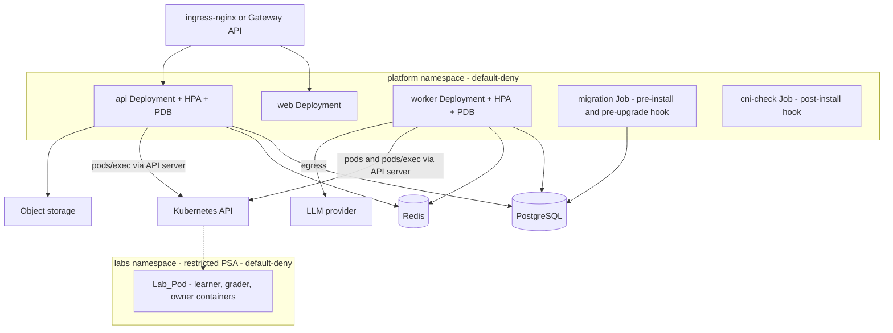

### Layering

The new code follows `api -> application -> domain <- infrastructure`.

| Layer | New or changed code |
|-------|---------------------|
| `packages/domain` | `ProvisionCapacityError` in `ports/sandbox.py`. `SessionStatus.ENDED_BY_INFRASTRUCTURE`. New rules in `labs/` (capacity decision, runtime guard, infrastructure-loss transition, reaper selection, reconnect schedules). New constants in `config.py`. |
| `packages/infrastructure` | `sandbox/kubernetes_provider.py`, `sandbox/k8s_pod_spec.py` (pure builder), `sandbox/k8s_errors.py` (pure classifier), `sandbox/k8s_exec.py` (exec and terminal adapter), `secrets/secret_source.py`, `telemetry/` (metrics, tracing, JSON logging). `SandboxBackend.KUBERNETES` and its branch in `build_sandbox_provider`. |
| `packages/application` | Capacity handling in the provisioning use case, infrastructure-loss use case, reaper extension (evicted pods), startup secret check. |
| `apps/api` | `DrainCoordinator`, admin and metrics ports, request id middleware, node-loss close in the terminal gateway. |
| `apps/worker` | Pod watcher job, SIGTERM handling, runtime guard at startup, metrics port. |
| `apps/web` | Reconnect behavior (two schedules) and translated errors. |

### Sequence: provision a Lab_Pod

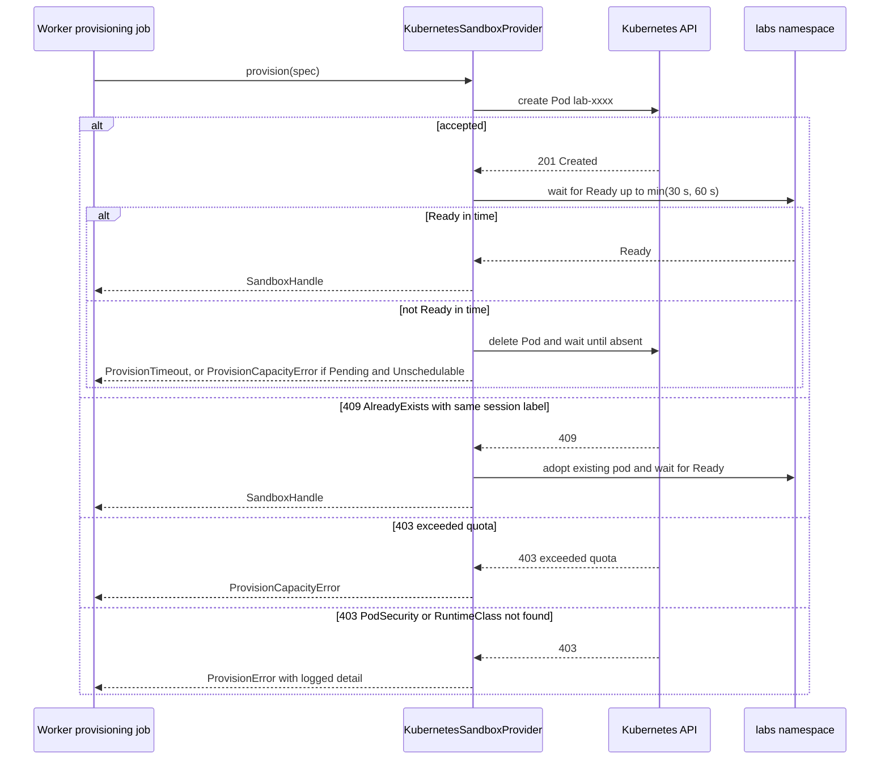

### Lab_Pod lifecycle

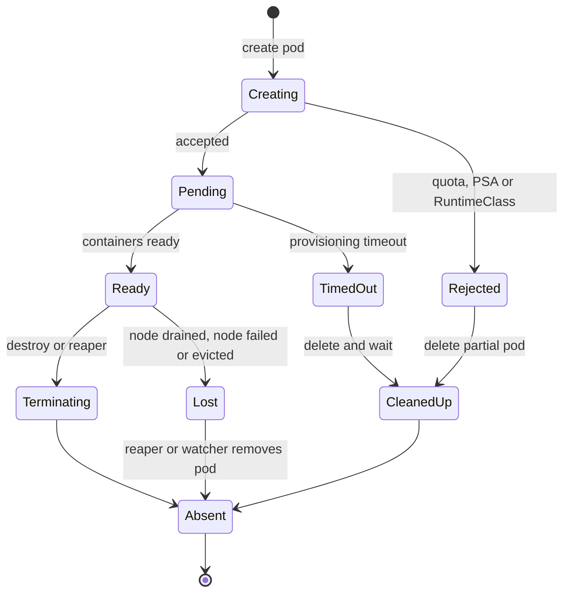

## Components and Interfaces

### Milestone A: KubernetesSandboxProvider

`KubernetesSandboxProvider` implements the existing `SandboxProvider` protocol in `edu_it_domain.ports.sandbox` without changing it. Names, parameter lists and result types match `DockerSandboxProvider` (Req 1.1). It uses the official `kubernetes` Python client. The exact version is pinned by the versions ADR (see #[[file:.kiro/steering/tech.md]]).

#### Provider selection (Req 1.2, 1.3)

`SandboxBackend` gains `KUBERNETES = "kubernetes"`. `build_sandbox_provider` already raises `ProviderSelectionError` for a production Docker setting. A new pure function `parse_sandbox_backend(value: str) -> SandboxBackend` raises `ProviderSelectionError` for any other value. The message names the invalid value and lists the supported values `docker`, `kubernetes`, `fake`. Api and Worker call it at startup before they serve or consume.

#### Pod layout

The pod builder is `build_lab_pod(spec: SandboxSpec, settings: K8sSettings) -> dict`. It is pure and returns a manifest dictionary.

The baseline is layout B: three containers, three distinct non-root UIDs, `shareProcessNamespace: false`. The freeze of learner processes runs inside the `learner` container through `exec` as the learner UID. The helper containers (`grader`, `owner`) exist only for the grading bundle identities, and are kept only where the spike proves they work with all capabilities dropped. Layout A (shared process namespace) is the documented alternative and the fallback (see risk R1). The pod builder, the `as_user` table and Property 2 follow the layout recorded in ADR 0009 by the day-one spike (Req 16.12). If the spike selects another layout, the three of them change together before any provider code is built.

| Item | Value |
|------|-------|
| Name | `lab-` + first 20 hex characters of `sha256(session_stable_id)` |
| Labels | Every pair in `spec.labels` (`edu-it.managed=1`, `edu-it.session=<id>`) |
| Namespace | `settings.namespace` (the Labs_Namespace) |
| `runtimeClassName` | `settings.runtime_class_name`, omitted only when the runtime kind is `runc` with an empty name |
| `nodeSelector`, `tolerations` | From `settings`, plus tolerations for `node.kubernetes.io/unreachable` and `not-ready` with `tolerationSeconds = settings.node_loss_toleration_seconds` |
| `activeDeadlineSeconds` | `LAB_SESSION_TTL` in seconds |
| `automountServiceAccountToken` | `false` |
| `hostNetwork`, `hostPID`, `hostIPC` | `false`. `shareProcessNamespace` is `false` (layout B). No `hostPath` volume. |
| `restartPolicy` | `Never` |
| `securityContext` (pod) | `runAsNonRoot: true`, `fsGroup` set to the grader group ID, `seccompProfile: RuntimeDefault` |
| Annotations | `edu-it.io/pid-limit` with `spec.pid_limit` (see OQ-6) |

Containers:

| Container | UID | Mounts | Resources |
|-----------|-----|--------|-----------|
| `learner` | 10000 | `/workspace`, `/home/learner`, `/tmp` | CPU, memory, ephemeral-storage from `spec` (same values as the Docker provider), requests equal to limits |
| `grader` | 10001 | `/workspace` (read-only), `/grader` | `K8S_HELPER_CPU_MILLI`, `K8S_HELPER_MEMORY_BYTES`, requests equal to limits |
| `owner` | 10002 | `/grader` | same as `grader` |

Every container sets `runAsNonRoot: true`, a UID above 0, `allowPrivilegeEscalation: false`, `capabilities.drop: [ALL]`, `readOnlyRootFilesystem: spec.read_only_root`, and `seccompProfile: RuntimeDefault`. Writable paths are `emptyDir` volumes (the `/grader` volume uses `medium: Memory`) with `sizeLimit` taken from `spec.tmpfs_mounts`. The main command of each container is `tail -f /dev/null`. The learner never mounts `/grader`, and with no shared process namespace the learner cannot see `/proc` entries of the `grader` or `owner` processes, so the bundle and helper processes are invisible to learner processes by construction.

`as_user` maps to a container (layout B): `learner` to `learner`, `grader` to `grader`, `root` to `owner`. The mapping is a constant table that follows the layout recorded in ADR 0009. An unknown `as_user` raises `SandboxError`.

Freeze (layout B): the freeze command that `GradeRun` issues through `exec` with `as_user` equal to `learner` runs inside the `learner` container as the learner UID. It stops every learner process except itself (`kill -STOP` on the process group list from `/proc`), and `GradeRun` verifies the stop by reading the process state `T` within the freeze bound. SIGSTOP cannot be caught, and a same-UID signal needs no capability. The freeze helper binary ships in the learner image. The grader and owner containers take no part in the freeze.

Requirement 2.6 compares limits with the Docker provider. The comparison is made on the `learner` container. The two helper containers add a small fixed amount, which is part of the Session_Cost in the Deployment_Guide.

#### Provisioning behavior (Req 1.4 to 1.6, 2.11, 2.12, 6.1 to 6.3, 22.1, 22.8)

1. Build the manifest and call `create_namespaced_pod`.
2. On `409` with a pod that has the same session label, adopt the pod and go to step 4. A `409` with a different session label is a `ProvisionError`.
3. On any other rejection, call `classify_create_rejection(status, reason, message)` and raise the matching error. No pod exists, so no cleanup is needed.
4. Wait for the Ready condition for `min(LAB_PROVISION_TIMEOUT, K8S_READY_CEILING)`, using a watch with a polling fallback.
5. On timeout, read the pod. If it is `Pending` with `PodScheduled=False` and reason `Unschedulable`, the error is `ProvisionCapacityError`. Otherwise it is `ProvisionTimeout`.
6. Before raising any error from step 5 or from a failure after creation, call `destroy` and wait until the pod is absent. If the wait fails, raise the error with `partial_handle` set so the caller and the reaper finish the cleanup.

`ProvisionCapacityError(ProvisionError)` is the only new port type. Existing callers that catch `ProvisionError` still work.

#### Rejection classification (Req 2.11, 2.12, 3.8, 22.1)

`classify_create_rejection` is a pure function that returns one of `Capacity`, `PodSecurityViolation`, `RuntimeClassMissing`, `AlreadyExists`, `Other`.

| Input pattern | Result |
|---------------|--------|
| status 403 and message contains `exceeded quota` | `Capacity` |
| status 403 and message contains `violates PodSecurity` | `PodSecurityViolation` |
| status 403 or 422 and message names a RuntimeClass that is not found | `RuntimeClassMissing` |
| status 409 and reason `AlreadyExists` | `AlreadyExists` |
| anything else | `Other` |

No non-quota input can produce `Capacity`. The detail text is logged by the provider and is never placed in the exception message that the Worker shows to a learner.

#### Exec, copy and terminal (Req 1.10 to 1.12, 5.1, 5.2, 5.6)

| Operation | Implementation |
|-----------|----------------|
| `exec` | `connect_get_namespaced_pod_exec` stream on the mapped container. The command is wrapped so it runs in its own process group. On `timeout_s` expiry the provider runs a second exec that kills the whole group, and returns `ExecResult(exit_code=137, timed_out=True)`. This is the same strategy as the Docker provider. |
| `copy_in` | A tar stream written to `tar -x` over exec stdin in the `owner` container, so the files are owned by the owner UID. When `as_user` is given, the files are made available to that identity by the group on `/grader`. The source is read from the host path read-only. |
| `copy_out` | `tar -c` over exec stdout from the `learner` container. |
| `attach_terminal` | An exec stream with `tty=True` running `/bin/bash -l` in the `learner` container. Wrapped in a `TerminalChannel` with `read`, `write` (channel 0), `resize` (channel 4) and `close`. |
| `health` | Read the pod. Healthy only when `phase == Running` and every container is ready. |
| `destroy` | Delete the pod with grace period 0, then poll until the pod is absent, up to `LAB_DESTROY_TIMEOUT`. A `404` is success. If the pod is still present at the timeout, raise `SandboxError("destroy timeout")` and label the pod `edu-it.io/destroy=pending` so the reaper deletes it. |
| `list_sandboxes` | List pods with label selector `edu-it.managed=1` and map each to a `SandboxHandle`. |

Error mapping is pure: `map_api_exception(exc) -> SandboxError`. A `404` or a closed stream on `read`, `write`, `resize` or `attach_terminal` becomes `SandboxGone`. A connection failure to the API server becomes `ProviderUnavailable`.

#### Runtime guard (Req 2.9, 2.10)

`runtime_guard(runtime_kind, environment) -> Ok | Warn | Refuse` is a pure function. `runc` in a non-production environment returns `Warn`. `runc` in production returns `Refuse`. Any other kind returns `Ok`. The Worker calls it before it consumes its first job. On `Warn` it logs the Runc_Warning once. On `Refuse` it logs the reason and exits with a non-zero status. The runtime kind comes from the Chart value `labs.runtimeClass.kind` (`gvisor`, `kata` or `runc`), because the Worker cannot read the cluster-scoped RuntimeClass.

#### Grading and limits (Req 5)

The grading use case `GradeRun`, the session rules and the rate rules are provider-independent and are reused unchanged. Requirement 5 is met by running the existing isolation, grading isolation, tamper-resistance and check-abuse suites with the Kubernetes provider substituted. Skips are not allowed for that run.

#### New domain constants (`domain/config.py`)

| Constant | Value | Used by |
|----------|-------|---------|
| `LAB_DESTROY_TIMEOUT` | 30 s | Req 6.3, 6.4 |
| `LAB_PROVISION_CAPACITY_BACKOFF` | 10 s | Req 22.6 (must be at least `LAB_PROVISION_MIN_INTERVAL`) |
| `K8S_READY_CEILING` | 60 s | Req 1.5 |
| `K8S_HELPER_CPU_MILLI` | 10 | pod builder |
| `K8S_HELPER_MEMORY_BYTES` | 16 MiB | pod builder |
| `LAB_NODE_LOSS_TERMINAL_CLOSE_BOUND` | 10 s | Req 19.1 |
| `LAB_INFRA_LOSS_MARK_BOUND` | 30 s | Req 19.2, 19.3 |
| `LAB_EVICTED_POD_REMOVAL_BOUND` | 60 s | Req 19.5 |
| `TERMINAL_DRAIN_RECONNECT_*`, `TERMINAL_RESTART_RECONNECT_*` | see Reconnect schedules | Req 14.5, 20.1 |

The existing `validate_lab_config` checks the new constants (positive values, backoff at least the minimum interval, ready ceiling at least the provisioning timeout).

### Worker and application behavior

**Capacity handling (Req 22).** The provisioning use case catches `ProvisionCapacityError` before `ProvisionError`. `capacity_decision(elapsed, provision_timeout, backoff) -> Requeue(delay) | Fail` is pure. Below the timeout it requeues with `LAB_PROVISION_CAPACITY_BACKOFF`. At or above the timeout it marks the request failed with reason `capacity`. In both cases the learner sees the translated message key `labs.capacity`, the retry allowance is unchanged, and `edu_it_lab_quota_rejections_total` is incremented once per rejected attempt.

**Infrastructure loss (Req 19).** A new job `watch_lab_pods` runs a Kubernetes watch on managed pods in the Labs_Namespace. It reconnects with backoff on failure. The existing reaper tick (`LAB_REAPER_INTERVAL`, 30 s) is the fallback: it compares `list_sandboxes()` with session rows. For a session that is not terminal and whose pod is absent, `Failed` with reason `Evicted`, `NodeLost`, `Shutdown` or `Terminated`, or deleted without a Worker request, the use case `end_by_infrastructure(session)` runs the transition in `infra_loss_transition`. Evicted pod objects are deleted by the same job.

**Reaper (Req 6.6, 6.7, 19.5, 20.3, 20.7).** `reap_decision` is extended into `select_reaper_actions(sessions, pods, now) -> ReaperActions`. It takes only persisted rows and the provider listing, so it holds no in-memory state. Active sessions are never selected.

**Startup secret check (Req 23.2).** `check_required_secrets(source, required_keys) -> MissingKeys` reads each key through the `SecretSource`. The Api and Worker log one record per missing key (key name only) and exit non-zero within 30 seconds of start when the result is not empty. This runs before readiness can become true.

**Secret refresh (Req 23.6).** `SecretHolder` wraps a `SecretSource`. `refresh()` replaces the cached value only on success. A failed refresh keeps the last value, logs a warning without the value, and does not raise.

### Api behavior

**Drain (Req 14).** `DrainCoordinator` is created in the application lifespan and has one idempotent method `start_drain()`.

1. Set `draining = True`. The readiness endpoint returns `503` from this moment.
2. Wait the preStop delay (`api.preStopDelaySeconds`, default 5), so the removal of the Api endpoint from the ingress propagates before new connections stop (Req 14.12). The drain never starts before readiness first reports not-ready (Req 14.1).
3. Reject new terminal WebSocket upgrades with a close code and the reconnect message.
4. Send the reconnect message on every open terminal socket and close each one.
5. After `drain_period_seconds` (default 30, range 5 to 300), force-close any socket that is still open. The Lab_Session stays active and reattachable, because the Lab_Pod is not touched.

The Chart sets a `preStop` `httpGet` to `/internal/drain` on the admin port, and the process also installs a SIGTERM handler that calls `start_drain()`. The call is idempotent, so the preStop hook and SIGTERM never run the sequence twice. `terminationGracePeriodSeconds` must be at least `drain_period_seconds + preStop_delay_seconds + 10` (Req 14.4). The pure function `min_termination_grace(drain, prestop)` returns that sum and the Chart validation uses the same rule. Terminal I/O is not persisted at any point.

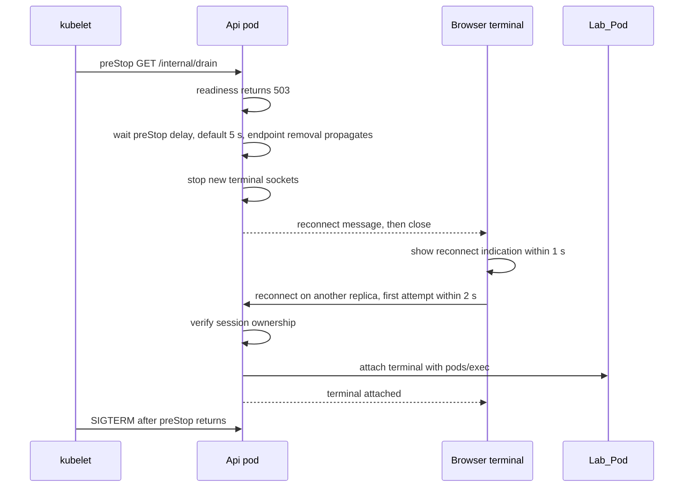

**Terminal reconnect ownership (Req 14.7, 14.8, 20.4).** The existing terminal gateway already re-verifies ownership and expiry on every connect. It is reused, and the new tests assert it for the reconnect path.

**Request id and trace context (Req 13.8 to 13.10).** A middleware reads `X-Request-ID`. If it is absent it generates a UUID4. The id is bound to the log context and the trace, and is written into the payload envelope of every job the request enqueues. The Worker reads it from the envelope and binds it before the handler runs.

### Reconnect schedules (Req 14.5, 14.6, 20.1, 20.2)

`reconnect_delays(kind)` is a pure function used by the web client (a TypeScript port tested against shared JSON vectors) and by the tests.

| Schedule | When used | Delays (seconds) | Limit |
|----------|-----------|------------------|-------|
| `drain` | A reconnect message was received | 1, 2, 4, 8, 16, 30, 30, 30, 30, 30 | At most 10 attempts, never above 30 s, first attempt within 2 s |
| `restart` | The socket closed with no reconnect message | 1, 2, 4, 5, 5, 5 ... | At most 5 s between attempts, stops after 60 s in total |

When a schedule ends, the client shows the translated error (FR or EN) with a manual retry action and leaves the Lab_Session unchanged.

### Milestone B: Helm chart

#### Layout

```
deploy/helm/edu-it/
  Chart.yaml
  values.yaml                  # defaults only, no secret values
  values-dev.yaml
  values-eks.yaml
  values-aks.yaml
  values-onprem.yaml
  values.schema.json
  README.md                    # namespace and PSA label instructions for operator-managed mode
  templates/
    _helpers.tpl               # fail helpers, image helper, validation helpers
    namespaces.yaml
    priorityclass.yaml         # Platform_Priority_Class, above lab pod priority
    dev-datastores.yaml        # dev-only bundled PostgreSQL and Redis, rendered only when devDatastores.enabled
    serviceaccounts.yaml
    rbac-labs.yaml             # Worker Role + RoleBinding, Api Role + RoleBinding
    deployment-api.yaml
    deployment-worker.yaml
    deployment-web.yaml
    services.yaml
    hpa.yaml
    pdb.yaml
    job-migration.yaml
    job-cni-check.yaml
    ingress.yaml               # mode ingress-nginx
    gateway-route.yaml         # mode gateway-api
    networkpolicy-labs.yaml
    networkpolicy-platform.yaml
    resourcequota-limitrange.yaml
    runtimeclass.yaml
    externalsecrets.yaml
    secrets-dev.yaml
    servicemonitor.yaml
    prometheusrule.yaml
    image-policy.yaml
    NOTES.txt
```

#### Values contract

Provider-specific settings exist only in values. Templates branch only on these keys, never on a Target name, a cloud API probe or a Kubernetes version string (Req 7.4).

| Key | Type and rule | Used by |
|-----|---------------|---------|
| `environment` | `production`, `staging` or `development` | Runtime guard, dev Secrets |
| `devSecrets.enabled` | boolean. True only in `values-dev.yaml`. | Req 10.9, 10.4, 10.6 |
| `namespaces.manage` | `create` or `operator-managed` | Req 7.9, 7.10 |
| `images.<web,api,worker,migrations>.repository` and `.digest` | digest matches `^sha256:[a-f0-9]{64}$` | Req 7.11, 7.12 |
| `labs.sessionTtlSeconds` | integer. A unit test asserts it equals `LAB_SESSION_TTL`. | Req 2.5, 9.4 |
| `labs.runtimeClass.{name,kind,create,handler}` | `kind` is `gvisor`, `kata` or `runc` | Req 2.7, 2.9, 2.10 |
| `labs.nodePool.{nodeSelector,tolerations}` | maps and lists | Req 2.8 |
| `labs.nodeLossTolerationSeconds` | integer, default 30 | Req 19 |
| `labs.quota.*` and `labs.limitRange.*` | numeric caps and defaults | Req 3.3 to 3.5 |
| `labs.dnsEgress` | boolean, default false | Req 3.7 |
| `labs.drainProtection.{enabled,waitLimitSeconds}` | boolean and integer | Req 19.6 |
| `api.drainPeriodSeconds` | integer 5 to 300, default 30 | Req 14.2, 14.4 |
| `api.preStopDelaySeconds` | integer, default 5 | Req 14.12 |
| `api.terminationGracePeriodSeconds` | integer, at least `drainPeriodSeconds + preStopDelaySeconds + 10` | Req 14.4 |
| `{api,worker,web}.{probes,hpa,pdb,resources}` | bounds in the schema. `web` has the same keys and bounds as `api`. | Req 8.1, 8.2, 8.4, 8.5 |
| `priorityClass.{name,value}` | `value` is an integer above `labs.podPriorityValue`. Applied to Api, Worker and Web. | Req 8.12 |
| `labs.podPriorityValue` | integer, default 0. Lab pods use a lower or equal value. | Req 8.12 |
| `networkPolicy.kubernetesApi.cidrs` | non-empty list of CIDRs (or endpoint addresses) of the API server, used as `ipBlock` egress for Api and Worker. Required whenever NetworkPolicy objects render. | Req 11.5, 11.13, 11.14 |
| `devDatastores.enabled` | boolean. True only in `values-dev.yaml`. Renders bundled non-production PostgreSQL and Redis. | Req 16.9 |
| `kindTest.sessionTtlSeconds` | optional override. Allowed only in the kind test values file, never in the four production Values_Files. | Req 16.11 |
| `worker.hpa.metric` | `cpu` or `queueDepth` (the latter needs `metricsAdapter.enabled`) | Req 8.10, 8.11 |
| `migration.{backoffLimit,activeDeadlineSeconds}` | `backoffLimit` integer 0 to 6 (default 0). `activeDeadlineSeconds` integer 30 to 3600 (default 600). | Req 8.8, 21.4 |
| `ingress.{mode,host,tls.secretName,websocket.readTimeoutSeconds,websocket.sendTimeoutSeconds}` | mode is `ingress-nginx` or `gateway-api` | Req 9 |
| `externalSecrets.{storeName,storeKind,remoteKeys.*}` | `storeKind` is `SecretStore` or `ClusterSecretStore` | Req 10.1, 10.2 |
| `llm.{provider,model,region,endpoint}` | region checked against the EU list of ADR 0007 | Req 10.5, 10.6 |
| `objectStorage.{type,bucket,endpoint}` | `s3` or `azureblob` | Req 10.7 |
| `workloadIdentity.{type,annotations}` | `irsa`, `azure` or `none` | Req 10.8 |
| `observability.{collectorEndpoint,scrapeMode}` | `scrapeMode` is `serviceMonitor` or `annotations` | Req 13.1, 13.5 to 13.7 |
| `networkPolicy.{enforcementRequired,monitoringNamespaceSelector}` | boolean and selector | Req 11.9 to 11.11, OQ-4 |
| `imagePolicy.enabled` | boolean, default false. When true, the Chart renders a cluster-scoped Kyverno `ClusterPolicy`. Kyverno is an operator-installed optional prerequisite that the Chart does not install. | Req 12.10, 17.2 |
| `prometheusRules.{enabled,quotaRejection.*,externalSecret.*}` | numbers | Req 22.9, 23.5 |

#### Validation

`values.schema.json` declares every required key and its type, enums, numeric ranges and the digest pattern. A missing or mistyped key fails `helm lint` and `helm template` with an error that names the key path and renders nothing (Req 7.7, 7.8, 7.12). Rules that cross keys are written as `fail` calls in `_helpers.tpl`, each naming the offending values:

| Rule | Requirement |
|------|-------------|
| `maxReplicas >= minReplicas` for the Api and the Worker | 8.3 |
| `ingress.mode` is one of the two allowed values | 9.3 |
| WebSocket read and send timeouts are at least `labs.sessionTtlSeconds` | 9.5 |
| `ingress.tls.secretName` is not empty | 9.9 |
| `api.terminationGracePeriodSeconds >= api.drainPeriodSeconds + api.preStopDelaySeconds + 10` | 14.4 |
| `migration.backoffLimit` in 0 to 6 and `migration.activeDeadlineSeconds` in 30 to 3600 | 8.8, 21.4 |
| `networkPolicy.kubernetesApi.cidrs` is not empty when NetworkPolicy objects render; the error names the key | 11.13, 11.14 |
| `priorityClass.value > labs.podPriorityValue` | 8.12 |
| `kindTest.sessionTtlSeconds` is absent from `values-eks.yaml`, `values-aks.yaml`, `values-onprem.yaml` and `values-dev.yaml`; `labs.sessionTtlSeconds` equals `LAB_SESSION_TTL` there | 16.11 |
| ExternalSecret store name and remote keys are not empty unless `devSecrets.enabled` | 10.4 |
| `llm.region` is in the EU list unless `devSecrets.enabled` | 10.6 |
| `observability.scrapeMode` is one of the two allowed values | 13.7 |
| every probe has `timeoutSeconds <= periodSeconds` | 8.1 |

#### Rendered kinds

Allowed kinds: `Namespace`, `PriorityClass`, `StatefulSet` and `PersistentVolumeClaim` (dev bundled datastores only), `ServiceAccount`, `Role`, `RoleBinding`, `Deployment`, `Service`, `HorizontalPodAutoscaler`, `PodDisruptionBudget`, `Job`, `NetworkPolicy`, `ResourceQuota`, `LimitRange`, `RuntimeClass`, `Ingress`, `Secret` (dev only), `ConfigMap`. Named extension kinds: `ExternalSecret` and `SecretStore` (External Secrets), `Gateway` reference and `HTTPRoute` (Gateway API), `ServiceMonitor` and `PrometheusRule` (Prometheus Operator, only when enabled), and the image admission policy (a Kyverno `ClusterPolicy` with `verifyImages`, only when `imagePolicy.enabled`). The last one is the only kind added to satisfy Req 12.10, because signature verification is not available in upstream admission. A kind allowlist test fails on any other kind.

#### Workload settings

- The `PriorityClass` from `priorityclass.yaml` is set as `priorityClassName` on the Api, Worker and web pods. Its value is higher than the priority of lab pods, so node or quota pressure evicts lab pods first (Req 8.12).
- The web Deployment gets the same treatment as the Api: three probes, resources, security context, HPA, PDB, priority class and its own ServiceAccount with no token. Requirement 8.1 to 8.6 and 8.12 apply to it, and the chart tests iterate over `api`, `worker` and `web`.
- Api, Worker and web Deployments have liveness, readiness and startup probes, resource requests and limits (limit at least request), a topology spread constraint on `kubernetes.io/hostname` with `maxSkew: 1` for the Api, and `strategy.rollingUpdate` with `maxUnavailable: 0` and `maxSurge: 1`. The Api default is 2 replicas (Req 25.6).
- Every platform container runs as non-root with a read-only root filesystem, all capabilities dropped, no privilege escalation, and the `RuntimeDefault` seccomp profile.
- The Api, Worker and Migration_Job have one ServiceAccount each. `automountServiceAccountToken` is `false` on every ServiceAccount, and set `true` in the pod spec only for the Api and the Worker, which call the Kubernetes API.
- Secrets are mounted as `optional: true` volumes at `/var/run/secrets/edu-it/<name>/`. The Api and Worker read them through `SecretSource`.
- Bootstrap resources that the pre-install migration hook needs (the Migration_Job ServiceAccount, the database Secret or ExternalSecret and the ConfigMap with non-secret settings) are rendered as `pre-install,pre-upgrade` hooks with weight `-10` and `hook-delete-policy: before-hook-creation`. The Job itself has weight `0`. Their ExternalSecret uses `creationPolicy: Orphan`, so deleting and recreating the hook resource never removes the synced Secret. See risk R7.
- Dev bundled PostgreSQL and Redis (`dev-datastores.yaml`) render only when `devDatastores.enabled` is true. A guard in `_helpers.tpl` fails rendering if `devDatastores.enabled` is true while `environment` is `production`.
- The migration Job is a `pre-install,pre-upgrade` hook with `backoffLimit` and `activeDeadlineSeconds` from values. A failed hook makes Helm stop before it touches the Deployments.

#### RBAC

| Subject | Where | Rules |
|---------|-------|-------|
| Worker ServiceAccount | One `Role` and one `RoleBinding` in `labs` | `pods`: `create`, `get`, `list`, `watch`, `delete`. `pods/exec`: `create`, `get`. No wildcard, no `resourceNames`. |
| Api ServiceAccount | One `Role` and one `RoleBinding` in `labs` | `pods`: `get`. `pods/exec`: `create`. No pod `create`, `update`, `patch`, `delete` or `deletecollection`. |
| Migration_Job ServiceAccount | none | No Kubernetes API access. |
| cni-check ServiceAccount | One `Role` in `platform` | `pods` and `networkpolicies`: `create`, `get`, `delete`. |

There is no `ClusterRole` or `ClusterRoleBinding` for any platform ServiceAccount (Req 4.3).

#### Network policies

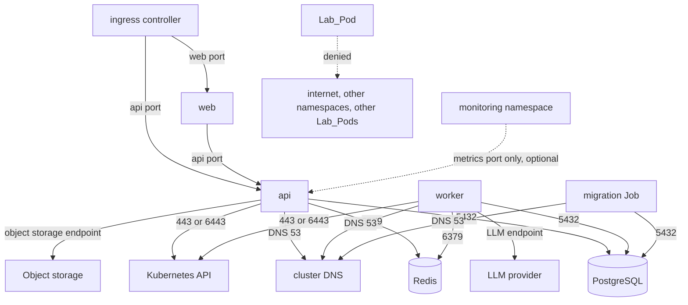

The Kubernetes API arrow is an `ipBlock` egress rule built from `networkPolicy.kubernetesApi.cidrs`, because a pod selector cannot match the API server. Rendering fails with an error naming that key when the list is empty (Req 11.13, 11.14). See risk R3.

`platform`: one default-deny policy selects all pods and denies all ingress and egress. Allow policies add only the arrows in the diagram. Only pods labeled `app.kubernetes.io/component` equal to `api` or `worker` can reach the PostgreSQL and Redis ports. LLM egress is rendered for the Worker only (Req 10.10). The `web` egress to the Api and the monitoring ingress (OQ-4) are the two rules that extend Req 11.

`labs`: one default-deny policy selects all pods and denies all ingress and egress. Allow policies permit ingress to lab pods from Api pods and from Worker pods (Req 3.2, defense in depth, see OQ-1). When `labs.dnsEgress` is true, one more rule permits egress to the cluster DNS on port 53 over UDP and TCP. There is no other egress rule.

#### Post-install CNI check (Req 11.9 to 11.12)

The `cni-check` hook Job (`post-install`, `activeDeadlineSeconds: 120`) creates two probe pods in `platform`, `probe-allowed` and `probe-denied`. A NetworkPolicy permits the Job to reach only `probe-allowed`. The Job tries to connect to both. The outcome is computed by the pure function `cni_check_outcome(allowed_reachable, denied_blocked, timed_out, required) -> Pass | Warn | Fail`:

- Enforced means `allowed_reachable and denied_blocked and not timed_out`. It returns `Pass`.
- Anything else (denied pod reachable, both blocked, or timeout) counts as enforcement absent. It returns `Fail` if `required` is true, and `Warn` otherwise.

`Fail` exits non-zero, so a Helm install with `--wait` fails with the message "NetworkPolicy enforcement is absent". `Warn` exits zero and writes the warning to the Job log and to `NOTES.txt`.

### Production images (Req 12)

| Image | Base of final stage | Notes |
|-------|--------------------|-------|
| `web` | Distroless Node `nonroot` | Next.js standalone output |
| `api` | Distroless Python `nonroot` | Dependencies installed into a virtual environment in a builder stage |
| `worker` | Distroless Python `nonroot` | Same builder pattern |
| `migrations` | Same as `api` | A separate tag and entrypoint (`python -m edu_it_infrastructure.migrate`), built from the same Dockerfile target |

The final stages contain no shell and no package manager. `USER` is a numeric ID above 0. A CI check inspects each built image config and layer file list for forbidden binaries (`sh`, `bash`, `apk`, `apt`, `apt-get`, `dnf`, `yum`, `pip`). Dockerfiles live in `deploy/images/<name>/Dockerfile`. The base image versions are pinned by the versions ADR.

### Observability (Req 13)

| Concern | Design |
|---------|--------|
| Traces | OpenTelemetry SDK with an OTLP exporter configured only when `OTEL_EXPORTER_OTLP_ENDPOINT` is set. A `BatchSpanProcessor` with a bounded queue. An export is tried at most 3 times, then the spans are dropped. Export runs on a background thread, so request and job latency are not affected. |
| Metrics | `prometheus_client` served on a metrics port that is separate from the traffic port, in both the Api and the Worker. |
| Logs | A JSON formatter writes one object per line. Request-scoped records carry `request_id`. Lab-scoped records carry `lab_session_id`. A redaction filter removes terminal data, secrets and learner personal data. |

Lab_Metrics (label names come from a closed allowlist: `reason`, `result`, `provider`; no learner identifier is ever a label):

| Metric | Type |
|--------|------|
| `edu_it_lab_active_sessions` | gauge |
| `edu_it_lab_provision_duration_seconds` | histogram |
| `edu_it_lab_provision_failures_total{reason}` | counter |
| `edu_it_lab_grading_duration_seconds` | histogram |
| `edu_it_lab_reaper_deletions_total{reason}` | counter (`expired`, `orphan`, `evicted`) |
| `edu_it_lab_quota_rejections_total` | counter |
| `edu_it_lab_infrastructure_loss_total` | counter |

### Milestone C: CI, tests and documents

**Workflow** `.github/workflows/deployment.yml` (the existing `ci.yml` and `lab-images.yml` stay). Every third-party action is pinned to a full 40-character commit SHA.

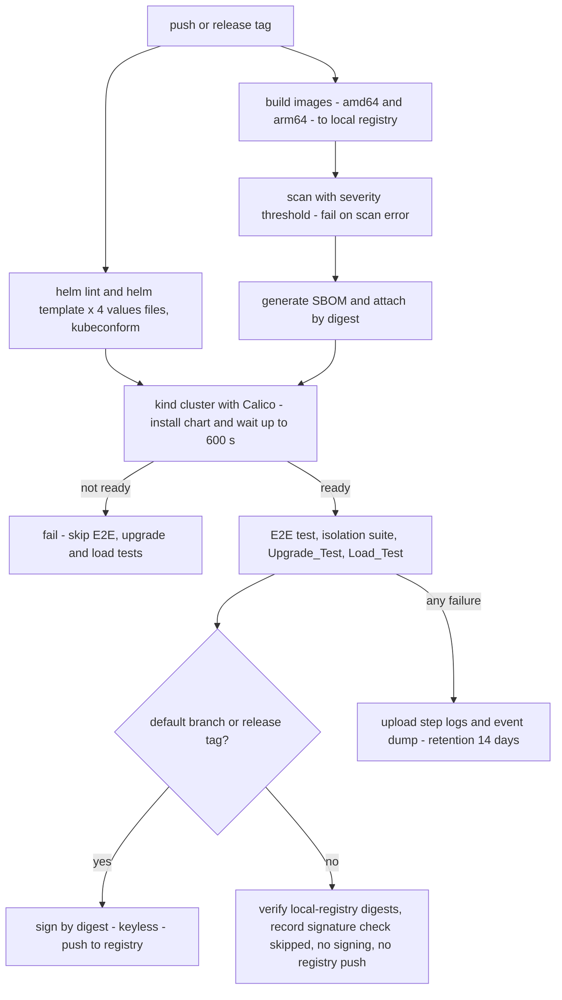

Workflow permissions are least privilege: the top-level `permissions` block is `contents: read`, and `id-token: write` (plus `packages: write` for the push) is set only on the signing job, which runs only on the default branch and release tags (Req 12.12). The signing job signs by digest with OIDC keyless signing and attaches a provenance attestation by digest (Req 12.13). The kind install and the Upgrade_Test run `cosign verify` on every image digest before installing and fail the step on a missing or invalid signature (Req 12.14). Because pull-request runs cannot sign, they verify against the local-registry digests only and skip signature verification, and the run output records that signature verification was skipped (Req 15.8).

Images are built once and pushed to a local registry (`localhost:5001`) for the kind run, so the Chart receives a real digest. Only the default branch and release tags push to the real registry and sign. Pull-request and other branch runs verify the images against the local-registry digests, record in the run output that signature verification was skipped, and neither sign nor push to a registry (Req 15.8). Load_Test results are uploaded on every run, or the run output records that none were produced (Req 15.10).

**Kind harness prerequisites (Req 16.9).** The harness installs metrics-server (for the HPAs), ingress-nginx, and the CRDs for each of `ExternalSecret`, Gateway API and `ServiceMonitor` that the Chart renders. PostgreSQL and Redis come from the dev-only `dev-datastores.yaml` template, which `values-dev.yaml` enables. The harness preloads the lab images into the node containerd store (`kind load image-archive`), so the Sandbox_Ready_Time excludes registry pulls.

**Kind harness.** `deploy/kind/kind-config.yaml` has one control-plane node and two workers. One worker carries the label `edu-it.io/pool=labs` and the taint `edu-it.io/labs=true:NoSchedule`. The default CNI is disabled and Calico is installed. `values-dev.yaml` selects `runc` as the runtime kind, so the Runc_Warning is emitted and the Phase_5_Report records the fallback.

**Tests and tools.**

| Item | Location | Purpose |
|------|----------|---------|
| Isolation suite (kind) | `tests/k8s/test_isolation_kind.py` | Req 16.3 to 16.5, 16.7, 16.8. First asserts that a deny-all policy blocks a probe, then runs the Lab_Pod and Platform_Policies assertions. |
| E2E test | `tests/k8s/test_e2e_kind.py` | Req 16.1, 16.2 |
| Upgrade test | `tests/k8s/test_upgrade_kind.py` | Req 25, 21. The previous release is the chart and image digests of the most recent release tag, or of the base commit when no tag exists (Req 25.8). After the upgrade checks it runs `helm rollback` and verifies the sessions stay active (Req 25.9). |
| Real-API contract test | `tests/k8s/test_provider_contract_kind.py` | Runs the same scenarios against `FakeK8sApi` and the kind API server (risk R2) |
| Layout spike | `tests/k8s/spike_pod_layout_kind.py` | Day-one proof for risk R1 |
| Values consistency | `tests/chart/test_values_consistency.py` | Property 33, Property 34 and the kind-override rule (Req 16.11) |
| Load test | `tools/perf/lab_load_k8s.py` | Req 24. Uses `nearest_rank_percentile` and `evaluate_targets`. Reports image pull time separately from Sandbox_Ready_Time (risk R4). |
| Chart tests | `tests/chart/` | `helm template` with PyYAML, kind allowlist, RBAC and policy assertions |
| Traceability | `tools/check_traceability.py` | Extended with this spec. Uses `compute_traceability_gaps`. |
| Phase report | `tools/phase_report.py` | Extended for phase 5. Uses `report_status`. |
| CI checks | `tools/check_ci_pins.py`, `tools/check_image_refs.py` | Req 15.11, 12.11 |
| Migration lint | `tools/check_migrations_compat.py` | Req 21.6. Fails on a drop or rename in the same release. |

The final implementation task writes `docs/reports/phase-5.md` (Req 26.8).

**Documents.** `docs/DEPLOYMENT.md` has the sections required by Req 17 and 23.7 (prerequisites per Target with verification commands, ordered install, upgrade and rollback, autoscaling table, Session_Cost with a worked example, Go_Live_Checklist, `ExternalSecret` diagnosis, out-of-scope list). The README is rewritten per Req 18, with one French section of at most 300 words. A docs check verifies required headings, checklist items, link resolution and the French word count.

### Decisions to record as ADRs

Per #[[file:.kiro/steering/working-agreements.md]], decisions flow into ADRs and steering in the same change as the implementation. The implementation tasks create these records under `docs/adr/`:

- ADR 0009: Kubernetes sandbox provider (exec through the API server, three-container identity model, deterministic pod name).
- ADR 0010: Helm chart conventions (values contract, hooks and bootstrap resources, extension kinds).
- ADR 0011: Image supply chain (distroless bases, scanner, SBOM, keyless signing, admission policy).

`deployment.md` and `labs.md` get the matching rules in the same change.

## Risks and early validation

Each risk has an owner decision point. R1 and R2 are the two that can change the provider design, so they are validated first.

### R1: Pod layout under PSA restricted

The baseline is layout B: three containers (`learner` 10000, `grader` 10001, `owner` 10002) with `shareProcessNamespace: false`, and the freeze run inside the `learner` container through `exec`. It is chosen as the baseline because layout A (shared process namespace) has two known weaknesses:

- With all capabilities dropped and distinct UIDs, a `grader` or `owner` container cannot send `SIGSTOP` to learner processes. `kill(2)` needs the same real or effective UID, or `CAP_KILL`. The existing `GradeRun` freezes learner processes through `exec`, so a cross-container freeze may fail (Req 5.4, 5.5).
- A shared process namespace exposes `/proc/<pid>` metadata (command lines, and file descriptors where UIDs match) across containers. The learner must not read grader or owner process data (Req 16.10).

Layout B removes both: the freeze is a same-UID signal inside the learner container, and no process of another container is visible. What B must still prove is that the helper identities for the grading bundle (`grader`, `owner`) work with all capabilities dropped. Where the spike shows a helper container does not work, that identity is replaced by an exec identity or by layout D, and only that part changes.

Day-one spike (`tests/k8s/spike_pod_layout_kind.py`, run on kind with PSA restricted enforced), before any provider code is written (Req 16.12). It proves, for the candidate layout, starting with B:

1. Freeze: the freeze command used by `GradeRun` stops every learner process and the stop is verified within the freeze bound, with all capabilities dropped.
2. Bundle invisibility: a learner process cannot list, read or stat the `/grader` mount, and cannot read `/proc/<pid>/environ`, `cmdline` or `fd` of grader or owner processes.
3. Exec RBAC: the Worker ServiceAccount can `exec` into each of the three containers with only `create` and `get` on `pods/exec`, and the Api ServiceAccount can exec only into `learner`.
4. Timeout kill: a command killed on `timeout_s` leaves no process in its group.

Decision rule: layout B is the baseline. If B passes all four checks and the shared isolation suites (labs isolation, grading isolation, tamper-resistance, check-abuse) can run on it, B is chosen. Otherwise the first fallback in the table below that passes is chosen. The result is recorded in ADR 0009 before the provider is built (Req 16.12).

| Layout | Description | Freeze mechanism | Trade-off |
|--------|-------------|------------------|-----------|
| B (baseline) | Three containers (`learner`, `grader`, `owner`), three UIDs, `shareProcessNamespace: false`. Helper containers are kept only where the spike proves they work with all capabilities dropped. | The freeze runs inside the `learner` container through `exec` as the learner UID, excluding the freeze helper itself, verified by reading `/proc/<pid>/stat` state `T` | No cross-container `/proc` exposure and no cross-UID signalling needed. SIGSTOP cannot be caught, so a learner process cannot refuse it. Requires the freeze helper binary in the learner image. Open point for the spike: the helper containers' roles under all capabilities dropped |
| A (documented alternative, first fallback) | Three containers, three UIDs, `shareProcessNamespace: true` | Signal from the `grader` or `owner` container | Expected to fail the freeze check with all capabilities dropped (no `CAP_KILL`, different UID), and to fail the `/proc` check unless hidepid-like hardening is proven. Used only if the spike shows B cannot satisfy the isolation suites, and then only if it passes all four checks |
| C | Cgroup freezer | Write `1` to `cgroup.freeze` of the learner container cgroup | Needs a writable cgroup from outside the pod. Not available under PSA restricted without privileged access, so it is a last resort and probably unusable |
| D | Single-UID pod (`learner`) with separate `emptyDir` volumes | `exec` as the same UID freezes everything. The bundle is copied into an `emptyDir` that is mounted only into a short-lived `exec` of the checker, ownership separated by `fsGroup` and mode `0700` | Bundle invisibility relies on file modes and timing, not on UID separation. Weaker against tamper tests |

Order of preference: B, then A (only if B fails the isolation suites and A passes all four checks), then D. Layout C is recorded but not planned. In every case the grading semantics stay unchanged (Req 16.10), and the pod builder, the `as_user` table and Property 2 follow the layout recorded in ADR 0009 and are updated to it before the provider tasks start (Req 16.12).

### R2: FakeK8sApi drift

`FakeK8sApi` backs the provider properties (6 to 10), so a fake that behaves differently from a real API server gives false confidence. Mitigation: a contract test (`test_provider_contract_kind.py`) defines scenarios once (create accepted, 409 adopt, quota 403, PSA 403, missing RuntimeClass, Unschedulable Pending, delete with delay, exec stream close, 404 on gone pod) and runs each of them against `FakeK8sApi` and against the kind API server through the same adapter interface. Both runs must give the same classification, exception type and final pod set. A scenario that differs fails the build, and the fix goes to the fake. The real-API run is part of the walking skeleton CI, not only the late kind suites.

### R3: NetworkPolicy cannot select the API server

Pod selectors do not match the API server, so Api and Worker egress to the Kubernetes API uses an `ipBlock` rule from `networkPolicy.kubernetesApi.cidrs` per Target (Req 11.13, 11.14). The Deployment_Guide gives the command to find the value for each Target (`kubectl get endpoints kubernetes -n default`, plus the managed control plane CIDR on EKS and AKS). An empty list fails rendering. The kind values file takes the address from the harness at install time.

### R4: Image pulls dominate Sandbox_Ready_Time

A cold lab image pull takes longer than the pod start. On kind the harness preloads the lab images so the measured p95 is the scheduling and start time (Req 16.9). The Load_Test reports pull time separately: it reads `Pulling` and `Pulled` events per pod and records `image_pull_seconds` next to `sandbox_ready_seconds`. The Go_Live_Checklist item for a real Target requires image pre-pull on the Lab_Node_Pool (DaemonSet or node image cache), which is documented but not built here.

### R5: Kind prerequisites and dev datastores

The Chart assumes metrics-server, an ingress controller and CRDs that kind does not ship. The harness installs them in a fixed order (Calico, metrics-server, ingress-nginx, CRDs, local registry, image preload, Chart). PostgreSQL and Redis for `values-dev.yaml` come from `dev-datastores.yaml`, which renders only when `devDatastores.enabled` is true and is refused in production environments. It uses small StatefulSets with `emptyDir` or a small PVC, and is never listed in the Target prerequisites.

### R6: Kyverno is a cluster-scoped add-on

The image policy uses Kyverno `ClusterPolicy` with `verifyImages`. Kyverno is cluster-scoped and is an optional prerequisite that the operator installs; the Chart never installs it. The policy is rendered only when `imagePolicy.enabled` is true, and that key is off by default (`imagePolicy.enabled: false`). When enabled, the policy is scoped to the `platform` and `labs` namespaces by a match rule, and the Deployment_Guide lists Kyverno as an optional prerequisite with its verification command. It is the only cluster-scoped object the Chart can render, and it is not bound to any platform ServiceAccount (Req 4.3 still holds).

### R7: Hook ordering on first install

A `pre-install` hook runs before the normal release resources exist, so the Migration_Job cannot find its ServiceAccount, database Secret or ConfigMap on a first install. Mitigation: those three resources are rendered as `pre-install,pre-upgrade` hooks with weight `-10` and `hook-delete-policy: before-hook-creation`, and the Job has weight `0`. The ExternalSecret that feeds the database Secret uses `creationPolicy: Orphan`, so the synced Secret survives hook cleanup. A kind test installs on an empty cluster to prove the order, and a second test upgrades to prove the hook resources are replaced cleanly.

### R8: Shortened TTL only for kind tests

The kind suites need a short TTL to test expiry in under a minute (Req 16.4, 16.11). The override lives only in a separate kind test values file (`deploy/helm/edu-it/ci/values-kind-test.yaml`) under `kindTest.sessionTtlSeconds`. The schema rejects that key in the four Values_Files. Property 33 asserts that every production Values_File has `labs.sessionTtlSeconds` equal to `LAB_SESSION_TTL` from `domain/config.py`.

### R9: Previous-release baseline for the Upgrade_Test

The "previous release" must be reproducible. The test script resolves it as the most recent release tag (chart and image digests), or the base commit when no tag exists (Req 25.8), checks out that chart into a temporary directory, installs it, upgrades to the candidate and then runs `helm rollback` to the baseline revision (Req 25.9). The revision number and the active session count are asserted before and after each step.

### R10: CI permissions and supply chain

The workflow default is `contents: read`. Only the signing job gets `id-token: write`, and only on the default branch and release tags. Signing is keyless by digest, followed by a provenance attestation. Deploy and Upgrade_Test steps verify the signature of every image before installing. A third-party action pinned by tag fails `check_ci_pins.py`. Fork pull requests get no token and no signing.

## Delivery sequence

The recommended order puts the decisions that can change the design first and gets a thin end-to-end slice running early.

Gating rule. Checkpoints are review points, not gates. Task dependencies, not checkpoints, gate the work. After the spike (step 1) records the layout in ADR 0009, work packages that do not depend on each other proceed in parallel. For example, the pure logic that does not depend on the layout (classifier, runtime guard, schedules, decisions, `min_termination_grace`, `cni_check_outcome`, `is_pinned_image_ref`), the chart skeleton and values schema, the Dockerfiles, the observability code and the CI workflow skeleton can start as soon as their own inputs exist. Only the pod builder, the `as_user` table, Property 2 and the provider depend on the layout. The flowchart below shows the main order of review, and the dependency table lists what each step needs.

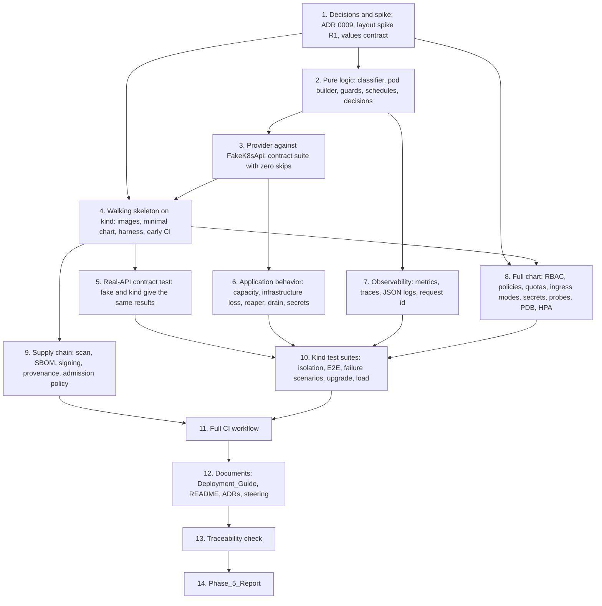

Steps 6, 7, 8 and 9 do not depend on each other, so they can run in parallel once their inputs exist. Steps 2 (the layout-independent functions), the Dockerfiles of step 9, the chart schema of step 8 and the CI skeleton of step 11 can also start right after step 1 begins, because only `build_lab_pod`, the `as_user` table, Property 2 and the provider need the layout from ADR 0009.

Each exit condition is a review point. A review point does not block a step that does not depend on it; only the dependencies in the graph above do.

| Step | Content | Exit condition |
|------|---------|----------------|
| 1 | ADR 0009 draft, layout spike (R1) starting with layout B and the chosen layout recorded, values contract and schema skeleton | Spike passes on kind for one layout (B unless it fails the isolation suites), and the layout is written into ADR 0009 (Req 16.12) |
| 2 | Pure functions (`build_lab_pod` and the `as_user` table follow the layout in ADR 0009; the others do not depend on it): `parse_sandbox_backend`, `build_lab_pod`, `classify_create_rejection`, `map_api_exception`, `runtime_guard`, `capacity_decision`, `infra_loss_transition`, `select_reaper_actions`, `reconnect_delays`, `min_termination_grace`, `cni_check_outcome`, `is_pinned_image_ref` | Properties 1 to 5, 11 to 15, 17, 24, 25, 33, 34 pass |
| 3 | `KubernetesSandboxProvider` and `FakeK8sApi`, `ProvisionCapacityError`, constants and `validate_lab_config` | Shared contract suite passes with zero skips, Properties 6 to 10 pass |
| 4 | Production images for api and worker, minimal chart (Deployments, Services, Migration_Job hooks, RBAC, labs namespace), kind harness, a first CI job that builds, installs and runs a provisioning smoke test | Install on kind succeeds and one Lab_Pod is provisioned and destroyed |
| 5 | `test_provider_contract_kind.py` against the real API server (R2) | Fake and real server agree on every scenario |
| 6 | Capacity handling, infrastructure loss, reaper extension, `DrainCoordinator`, secret check and holder, request id, Worker shutdown | Properties 16, 18, 19, 22, 23 pass |
| 7 | Metrics, tracing and JSON logging | Properties 20, 21 pass |
| 8 | Remaining chart templates, web Deployment, PriorityClass, policies, quotas, ingress modes, ExternalSecrets, dev datastores, CNI check, prometheus rules | `helm lint` and `helm template` pass for the four Values_Files, chart tests pass |
| 9 | Distroless Dockerfiles, scan, SBOM, signing, provenance, Kyverno policy | Image checks and `check_ci_pins.py` pass (Properties 25, 26) |
| 10 | Isolation, E2E, five failure scenarios, Upgrade_Test, Load_Test | All kind suites pass, substituted labs suites have zero extra skips |
| 11 | Full `deployment.yml` workflow with artifacts and gating | A run on a branch and a run on a release tag behave as in the flow diagram |
| 12 | `docs/DEPLOYMENT.md`, README, ADRs 0009 to 0011, steering updates | Docs check passes |
| 13 | `tools/check_traceability.py` extended | Zero unclaimed or unknown ids (Property 30) |
| 14 | `docs/reports/phase-5.md` as the final task | Status computed by Property 31 logic |

## Data Models

### Domain

```python
class SessionStatus(str, Enum):
    ...
    ENDED_BY_INFRASTRUCTURE = "ended-by-infrastructure"   # new; terminal state

class ProvisionCapacityError(ProvisionError):             # new; in ports/sandbox.py
    """Quota rejection or unschedulable pod at the provisioning timeout."""

@dataclass(frozen=True, slots=True)
class K8sSettings:
    namespace: str
    runtime_class_name: str | None
    runtime_kind: Literal["gvisor", "kata", "runc"]
    node_selector: Mapping[str, str]
    tolerations: tuple[Toleration, ...]
    node_loss_toleration_seconds: int
    grader_gid: int

class RejectionKind(Enum):
    CAPACITY; POD_SECURITY_VIOLATION; RUNTIME_CLASS_MISSING; ALREADY_EXISTS; OTHER

class CapacityDecision: Requeue(delay: timedelta) | Fail(reason="capacity")
class RuntimeDecision: OK | WARN | REFUSE
class CniOutcome: PASS | WARN | FAIL
```

The `lab_session.status` column is stored as text. The migration that adds `ended-by-infrastructure` is additive. The previous release must tolerate an unknown status on read, which the Upgrade_Test verifies (Req 21.6). The new value is written only by the new release.

Counters for retry accounting live in the existing provisioning attempt record. A capacity failure records an attempt with kind `capacity`, and the retry allowance counts only attempts of other kinds.

### Pod manifest (abridged)

```yaml
apiVersion: v1
kind: Pod
metadata:
  name: lab-3f9a1c7e5b2d4a6c8e01
  namespace: labs
  labels: {edu-it.managed: "1", edu-it.session: "<session id>"}
  annotations: {edu-it.io/pid-limit: "128"}
spec:
  automountServiceAccountToken: false
  restartPolicy: Never
  shareProcessNamespace: false   # layout B baseline; layout A would set true
  activeDeadlineSeconds: 3600
  runtimeClassName: gvisor
  securityContext: {runAsNonRoot: true, fsGroup: 10001, seccompProfile: {type: RuntimeDefault}}
  containers:
    - name: learner
      command: [tail, -f, /dev/null]
      securityContext: {runAsUser: 10000, runAsNonRoot: true, allowPrivilegeEscalation: false,
                        readOnlyRootFilesystem: true, capabilities: {drop: [ALL]},
                        seccompProfile: {type: RuntimeDefault}}
      resources: {limits: {cpu: "1", memory: 512Mi, ephemeral-storage: 256Mi},
                  requests: {cpu: "1", memory: 512Mi, ephemeral-storage: 256Mi}}
    # grader (10001) and owner (10002) follow the same pattern with helper resources
```

### Chart values (abridged)

```yaml
environment: production
devSecrets: {enabled: false}
namespaces: {manage: operator-managed}
images:
  api: {repository: registry.example/edu-it/api, digest: "sha256:<64 hex>"}
labs:
  sessionTtlSeconds: 3600
  runtimeClass: {name: gvisor, kind: gvisor, create: false}
  nodeSelector: {edu-it.io/pool: labs}
  dnsEgress: false
ingress:
  mode: ingress-nginx
  host: learn.example.org
  tls: {secretName: edu-it-tls}
  websocket: {readTimeoutSeconds: 3600, sendTimeoutSeconds: 3600}
externalSecrets: {storeName: aws-secrets, storeKind: ClusterSecretStore}
```

### Per-Target differences

| Concern | `values-eks.yaml` | `values-aks.yaml` | `values-onprem.yaml` | `values-dev.yaml` |
|---------|------------------|-------------------|----------------------|-------------------|
| Workload identity | `irsa` | `azure` | `none` | `none` |
| Secret store | AWS Secrets Manager | Azure Key Vault | self-managed store | plain Secrets |
| Object storage | `s3` | `azureblob` | `s3` (S3-compatible endpoint) | `s3` (local) |
| Ingress mode | either | either | either | `ingress-nginx` |
| Runtime kind | `gvisor` or `kata` | `gvisor` or `kata` | `gvisor` or `kata` | `runc` |
| Node pool selector | EKS managed node group labels | AKS node pool labels | node group labels | kind worker label |

## Failure Scenario Behaviors

Each behavior below has a matching IF/THEN requirement. The three lab scenarios of D4 (sandbox provisioning failure, WebSocket drop, grading check timeout) keep the behavior in `docs/LABS-DESIGN.md` and are realized on Kubernetes by the sections above (rejection classification, the Drain and Reconnect sections, and the reused `GradeRun` timeout).

### Lab node drained or failed (Requirement 19)

Detection has two paths. A node that fails unreachable keeps its pods until the toleration for `node.kubernetes.io/unreachable` expires, and the default of 300 seconds is too long, so the pod builder sets `tolerationSeconds` to `labs.nodeLossTolerationSeconds` (default 30). The Worker then sees the pod deleted or `Failed` through its watch, or through the reaper tick at most 30 seconds later.

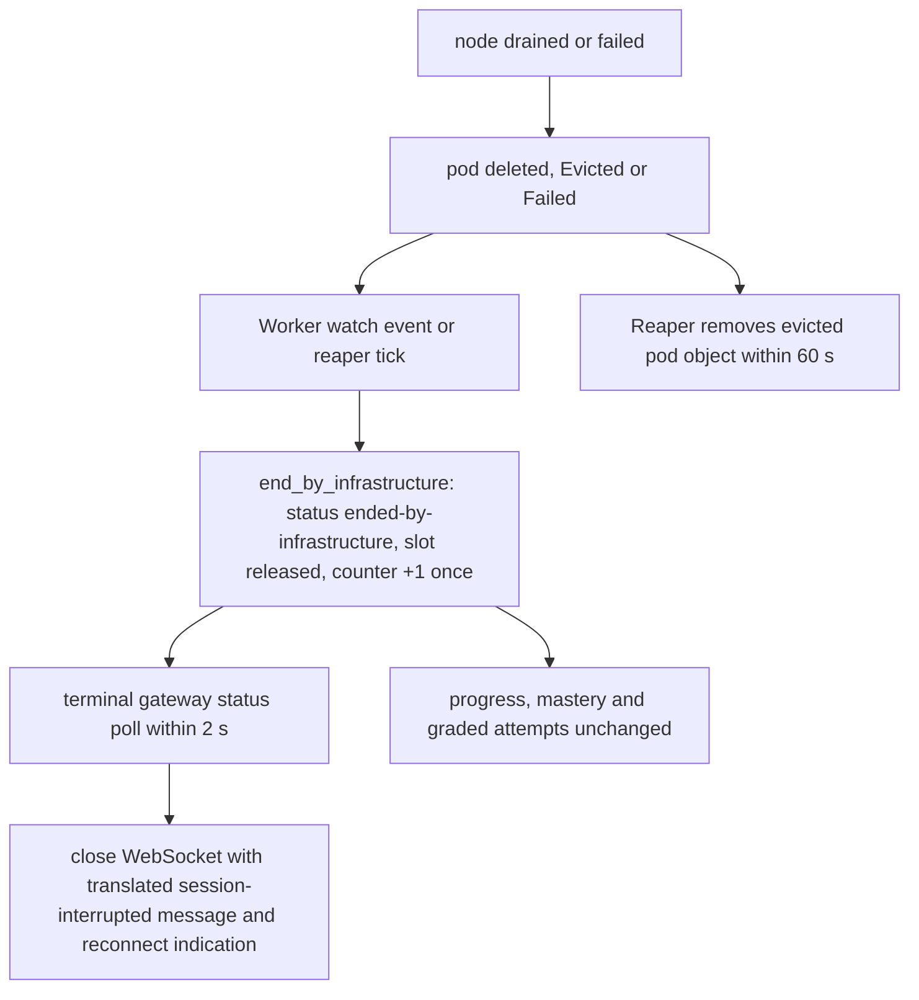

- The terminal gateway already polls session status every `TERMINAL_STATUS_POLL_INTERVAL` (2 s). It also closes at once when the exec stream ends and the pod is gone. The close message is a translated key (`labs.session_interrupted`) and contains no infrastructure detail. This meets the 10 second bound.
- `infra_loss_transition(session, learner_stats)` is a pure function. It sets the status, clears the learner's active-session slot, leaves attempts and mastery unchanged, and returns `counter_delta = 1` only if the session was not already `ended-by-infrastructure`. Repeated detections give a delta of 0.
- The loss is not recorded as a failed grading attempt and does not use up an attempt.
- Drain protection: when `labs.drainProtection.enabled`, the Chart renders a PodDisruptionBudget with `maxUnavailable: 0` for lab pods, so a planned drain waits. The Deployment_Guide tells the operator to run `kubectl drain --timeout=<waitLimitSeconds>`. After the limit, the operator forces removal and the same loss path applies (see OQ-3).

### Api or Worker pod restart during active terminal sessions (Requirement 20)

- Api restarted with a drain: the reconnect message and the `drain` schedule apply (Drain section). Without a drain (killed), the browser uses the `restart` schedule: first retry within 2 s, at most 5 s between tries, up to 60 s. On reconnect the Api re-verifies ownership and re-attaches within 5 s. If ownership fails, the Api closes the socket and leaves the pod unchanged. If the browser gives up, it shows the translated error with a manual retry, and the Lab_Pod keeps running until the TTL or idle timeout.
- The reaper never selects an active session, so an unclean Api stop cannot delete a pod.
- Worker restarted during provisioning: the job is re-run with the same deterministic pod name, so the second run adopts the first pod. Exactly one pod exists after it completes.
- Worker restarted during grading: on start, the existing interrupted-run logic marks the run failed with the "could not complete" feedback, removes the bundle, and does not re-run it.
- Worker restarted: the reaper reads only persisted sessions and the provider listing, so it resumes within one `LAB_REAPER_INTERVAL` of the Worker becoming ready (inside the 60 second bound).
- The Api and Worker PodDisruptionBudgets keep at least one replica during voluntary disruption.

### Migration fails during Helm upgrade (Requirement 21)

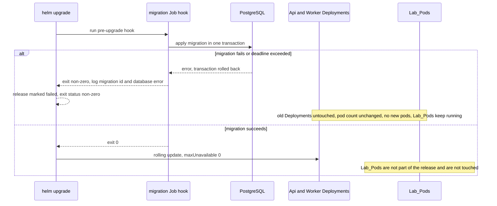

- The migration runner applies each migration in a transaction on PostgreSQL (transactional DDL), so a failure leaves the schema as it was.
- The runner logs the failing migration id and the database error text to the Job log. The Job is kept after failure (`hook-delete-policy: before-hook-creation` only), so the log stays available for at least 24 hours, until the next upgrade removes it.
- Because the hook fails before Helm applies the new templates, the Deployments are not changed.
- Migrations are backward compatible for one release: add-only changes, and a drop or rename is allowed only in the following release. `check_migrations_compat.py` enforces this. The Upgrade_Test runs the previous release's Api against the candidate schema.
- Lab_Pods are created by the Worker, not by the release, so neither a successful nor a failed upgrade terminates a Lab_Session (Req 21.8, 25.7).
- The Deployment_Guide gives `helm rollback`, the revision check, and the active-session count check.

### Labs namespace hits its ResourceQuota (Requirement 22)

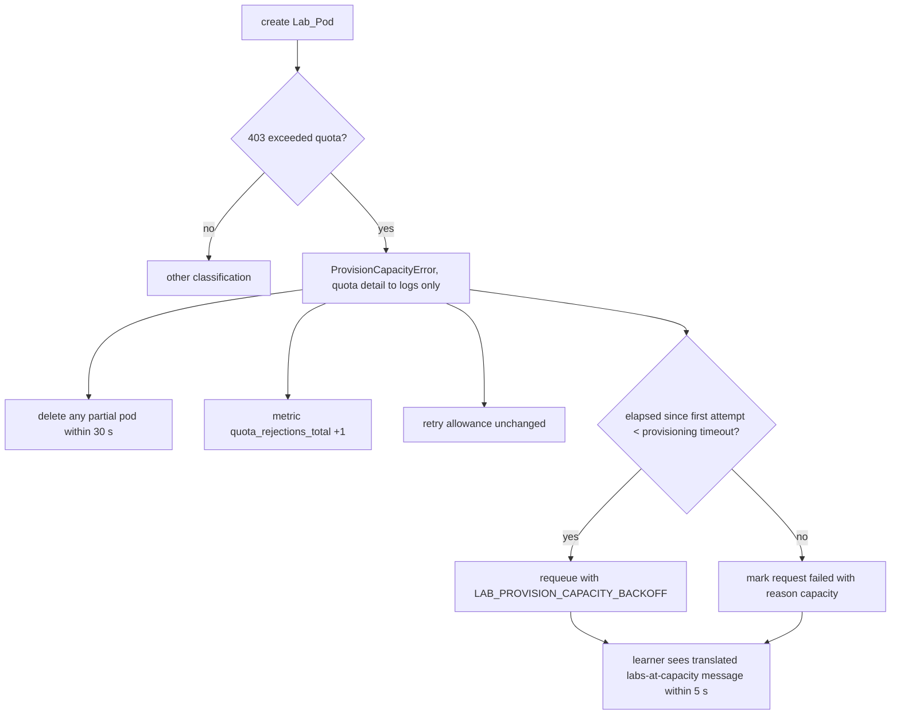

- A pod that stays `Pending` and `Unschedulable` because the lab node pool is full is treated the same way when the provisioning timeout expires: the pod is deleted and `ProvisionCapacityError` is raised.
- Existing Lab_Pods are not changed by a rejection, because the API rejects the create request only.
- The message key is `labs.capacity` in FR and EN. The text does not include any Kubernetes output.
- When `prometheusRules.enabled`, the Chart renders an alert that fires when `increase(edu_it_lab_quota_rejections_total[window]) > threshold` holds across the configured sustained period. Window, threshold and period are values.

### External Secrets cannot fetch a secret at startup (Requirement 23)

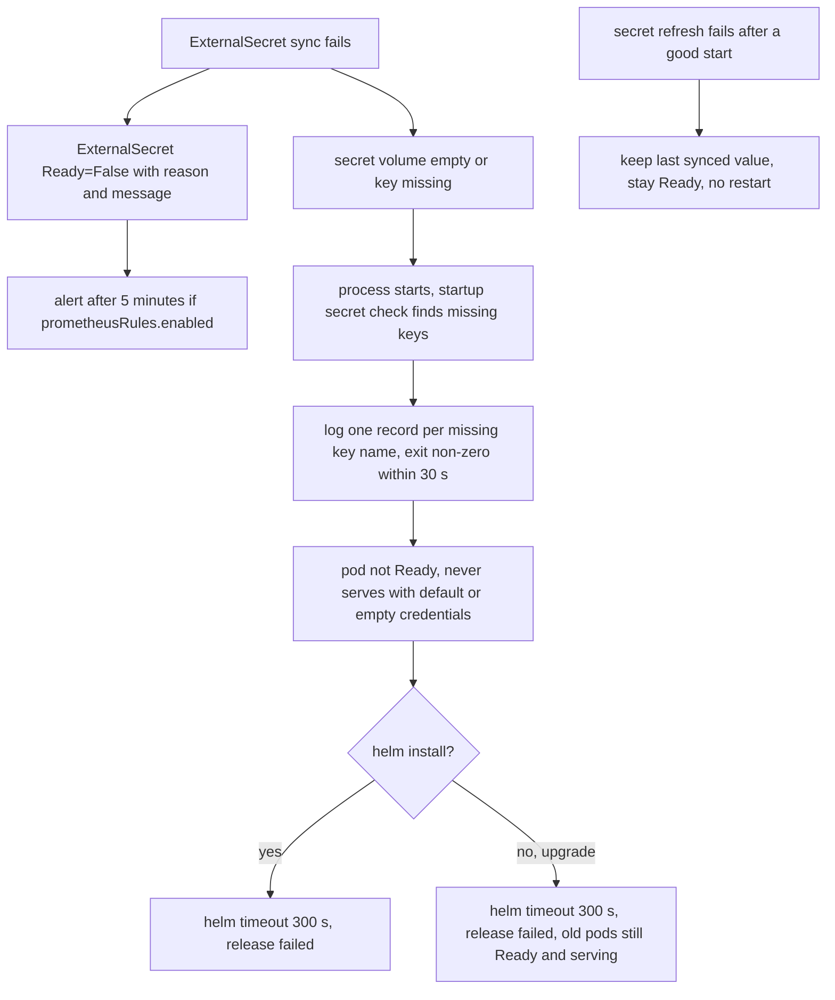

- Secret volumes are `optional: true`, so a missing Secret does not block the container. The process then starts and the startup check reports the missing keys. The readiness probe is false until all required secrets are loaded.
- On upgrade, the rolling update uses `maxUnavailable: 0`, so the old ReplicaSet keeps serving while the new pods fail. At least one pod per Deployment stays available.
- A failed refresh is handled by `SecretHolder`: the last good value stays in use and nothing restarts.
- On EKS, ADR 0007 rotates the LLM key in AWS Secrets Manager. The External Secrets refresh interval brings it into the pod as a file, and the Worker re-reads the file once on a 401 or 403. The Worker does not call Secrets Manager directly, because Req 11.3 limits its egress.
- The Deployment_Guide section for Req 23.7 shows how to read the `ExternalSecret` Ready condition and the pod log, and the corrective action for each cause.

## Correctness Properties

*A property is a characteristic or behavior that should hold true across all valid executions of a system-essentially, a formal statement about what the system should do. Properties serve as the bridge between human-readable specifications and machine-verifiable correctness guarantees.*

Scope. These properties cover the pure logic and the provider logic over a fake Kubernetes API. The Helm chart, the Dockerfiles, the CI workflows and the cluster behavior are not covered by properties. They use rendered-manifest checks, policy checks and kind tests (see Testing Strategy). A property reflection removed overlap: pod hardening and the isolation items share Property 2, and the retry accounting and the metric count share Property 14.

### Property 1: Sandbox backend selection

*For any* string setting, `parse_sandbox_backend` returns a backend when the string is one of `docker`, `kubernetes`, `fake`, and otherwise raises `ProviderSelectionError` whose message contains the invalid value and all three supported values.

**Validates: Requirements 1.2, 1.3**

### Property 2: Pod manifest satisfies the hardening and placement rules

*For any* valid `SandboxSpec` and `K8sSettings`, the manifest from `build_lab_pod` has on every container `runAsNonRoot` true, a UID above 0, `allowPrivilegeEscalation` false, all capabilities dropped and the `RuntimeDefault` seccomp profile. It has `automountServiceAccountToken` false, no true `hostNetwork`, `hostPID` or `hostIPC`, no `hostPath` volume, `activeDeadlineSeconds` equal to the Session_TTL in seconds, the runtime class, node selector and tolerations from the settings, and the `learner` container limits equal to the limits derived from the same spec for the Docker provider. With layout B (baseline), the manifest also has `shareProcessNamespace` false. This property follows the layout recorded in ADR 0009; if the spike selects another layout, the layout-specific assertion changes with it and the other assertions stay.

**Validates: Requirements 2.2, 2.3, 2.4, 2.5, 2.6, 2.7, 2.8, 16.12**

### Property 3: Pod identity is one per session

*For any* two session ids, `build_lab_pod` gives the same pod name for equal ids and different pod names for different ids, and every manifest carries the managed label and the label with its own session id.

**Validates: Requirements 1.4, 1.6, 20.5**

### Property 4: Create-rejection classification

*For any* status code, reason and message, `classify_create_rejection` returns `Capacity` if and only if the status is 403 and the message reports an exceeded quota. A message that reports a PodSecurity violation or a missing RuntimeClass never returns `Capacity`, and each of those is classified as its own kind.

**Validates: Requirements 2.11, 2.12, 3.8, 22.1**

### Property 5: Learner messages are translated and carry no raw detail

*For any* locale in French and English and any raw Kubernetes message text, the learner-facing message for a capacity failure, a provisioning failure or an infrastructure loss is the fixed translation for that locale and contains no part of the raw text.

**Validates: Requirements 6.8, 19.1, 22.2**

### Property 6: A failed provisioning leaves no pod

*For any* fake-API failure point (create rejected, pod never Ready, pod Pending and Unschedulable, delete slow) and any starting set of other pods, `provision` raises an error of the matching type and afterwards no pod exists for that session, and the other pods are unchanged.

**Validates: Requirements 1.5, 2.11, 2.12, 6.2, 22.3, 22.8**

### Property 7: Provisioning is idempotent

*For any* number of repeated `provision` calls for the same session, including a call that starts after an earlier call crashed after creating the pod, exactly one pod exists for that session and every call that succeeds returns the same handle.

**Validates: Requirements 20.5**

### Property 8: Listing returns only managed pods

*For any* mix of managed and unmanaged pods in the fake API, `list_sandboxes` returns exactly the handles of the managed pods, and an empty list when none is managed.

**Validates: Requirements 1.7**

### Property 9: Destroy is bounded and idempotent

*For any* fake-API behavior (pod removed at once, removed after a delay shorter than the destroy timeout, never removed, already absent), `destroy` succeeds when the pod is absent within `LAB_DESTROY_TIMEOUT`, raises a destroy failure and marks the pod for the reaper when it is not, and a second `destroy` on an absent pod succeeds.

**Validates: Requirements 6.3, 6.4, 6.5**

### Property 10: API errors map to sandbox errors

*For any* API exception, `map_api_exception` returns `SandboxGone` for a 404 or a closed stream and `ProviderUnavailable` for a connection failure, and a closed channel raises `SandboxGone` from `read`, `write` and `resize`.

**Validates: Requirements 1.11, 1.12**

### Property 11: Runtime guard decision

*For any* runtime kind and environment, `runtime_guard` returns `Refuse` for `runc` in production, `Warn` for `runc` otherwise, and `Ok` for `gvisor` and `kata`.

**Validates: Requirements 2.9, 2.10**

### Property 12: Reaper selection

*For any* set of session rows, pod listing and current time, the pods selected for deletion are exactly the pods of expired sessions, the orphaned pods with no session row, and the evicted or failed pods. A pod of an active session is never selected, and the result is the same whatever the earlier calls were.

**Validates: Requirements 6.6, 6.7, 19.5, 20.3, 20.7**

### Property 13: Capacity requeue decision

*For any* elapsed time, provisioning timeout and backoff, `capacity_decision` returns `Requeue(backoff)` when elapsed is below the timeout and `Fail` with reason `capacity` otherwise.

**Validates: Requirements 22.6, 22.7**

### Property 14: Capacity failures do not consume the retry allowance

*For any* sequence of provisioning outcomes, the retry allowance used equals the number of non-capacity failures in the sequence, and `edu_it_lab_quota_rejections_total` equals the number of capacity failures.

**Validates: Requirements 22.4, 22.5**

### Property 15: Infrastructure loss transition

*For any* non-terminal session, learner statistics and number of repeated detections, the final session status is `ended-by-infrastructure`, the learner's active-session slot is free, graded attempts, remaining attempts and mastery are unchanged, and the total counter increase is exactly 1.

**Validates: Requirements 19.2, 19.3, 19.4, 19.7, 19.8**

### Property 16: Drain closes or force-closes every socket

*For any* set of open terminal sockets, any subset that closes slowly, and any drain period, after `start_drain` every socket received the reconnect message, new upgrades are rejected, readiness is false from the first call, sockets still open at the deadline are force-closed, and the Lab_Pods are untouched.

**Validates: Requirements 14.1, 14.2, 14.3**

### Property 17: Reconnect schedules

*For any* attempt index, `reconnect_delays("drain")` gives at most 10 attempts with non-decreasing delays, none above 30 s and the first at most 2 s, and `reconnect_delays("restart")` gives delays of at most 5 s that sum to at most 60 s.

**Validates: Requirements 14.5, 20.1**

### Property 18: Worker shutdown requeues unfinished jobs

*For any* set of in-flight jobs with their remaining durations and any grace period, jobs that finish before `grace - 5 s` are acknowledged, every other job is requeued with its attempt count unchanged, and no job is lost or left running.

**Validates: Requirements 14.10, 14.11**

### Property 19: Request id propagation

*For any* inbound request with or without an `X-Request-ID` header, the request has a non-empty id (the header value, or a new one when absent), the id appears in every log record of the request and in every job envelope the request enqueues, and the Worker log records for that job carry the same id.

**Validates: Requirements 13.8, 13.9, 13.10**

### Property 20: Logs and metrics exclude personal data

*For any* log record, the formatted output is a single-line JSON object that contains no secret value and no terminal data, and *for any* Lab_Metric the label names are a subset of the allowed set (`reason`, `result`, `provider`).

**Validates: Requirements 13.8, 13.11, 13.12**

### Property 21: Telemetry export is bounded

*For any* sequence of exporter failures, a span batch is attempted at most 3 times and then dropped, and the traced operation completes with the same result as with no exporter.

**Validates: Requirements 13.2**

### Property 22: Startup secret check

*For any* set of required keys and any subset that is missing, `check_required_secrets` returns exactly the missing keys, the logs contain one record per missing key with the key name only, no secret value appears in any record, and the process is told to exit non-zero if and only if the missing set is not empty.

**Validates: Requirements 23.2**

### Property 23: Secret refresh keeps the last good value

*For any* sequence of refresh successes and failures, the value held by `SecretHolder` equals the value of the most recent successful refresh, and `refresh` never raises.

**Validates: Requirements 23.6**

### Property 24: CNI check outcome

*For any* combination of reachable, blocked, timed-out and required flags, `cni_check_outcome` returns `Pass` only when the allowed probe is reachable, the denied probe is blocked and there was no timeout. Otherwise it returns `Fail` when enforcement is required and `Warn` when it is not.

**Validates: Requirements 11.9, 11.10, 11.11, 11.12**

### Property 25: Image references use a sha256 digest

*For any* string, `is_pinned_image_ref` accepts it if and only if it has the form `repository@sha256:` followed by exactly 64 lowercase hexadecimal characters, and a reference with only a tag is rejected.

**Validates: Requirements 7.11, 7.12, 12.11**

### Property 26: Workflow actions are pinned by SHA

*For any* generated workflow text, `check_ci_pins` reports every `uses:` reference to a third-party action that is not a 40-character hexadecimal commit SHA, and reports nothing for local actions or pinned ones.

**Validates: Requirements 15.11**

### Property 27: LLM region check

*For any* region string and Target flag, `check_llm_region` accepts the region if and only if it is in the EU list of ADR 0007 or the dev flag is set, and a rejection names the region.

**Validates: Requirements 10.6**

### Property 28: Nearest-rank percentile

*For any* non-empty list of samples and any percentile, the nearest-rank value is an element of the list, at least that percentage of the samples are less than or equal to it, and shuffling the list does not change it.

**Validates: Requirements 24.1, 24.5**

### Property 29: Load test target evaluation

*For any* measurements and thresholds, `evaluate_targets` names exactly the targets whose measured value misses its threshold, together with the measured value and the threshold, and the run fails if and only if at least one target is missed.

**Validates: Requirements 24.6**

### Property 30: Traceability gaps

*For any* set of acceptance criterion ids and set of claims, `compute_traceability_gaps` returns the unclaimed ids as the set difference and the unknown claimed ids as the reverse difference, and the check exits non-zero if and only if either set is not empty.

**Validates: Requirements 26.1, 26.2**

### Property 31: Report status

*For any* list of required checks with outcomes `passed`, `failed` or `not run`, the report status is passing if and only if every check passed, and every check that was not run appears in the Not verified section.

**Validates: Requirements 26.4, 26.5, 26.6**

### Property 32: Failed migration leaves the schema unchanged

*For any* generated migration made of valid statements with one failing statement at any position, the PostgreSQL schema after the run is identical to the schema before it, and the failure record names the migration id.

**Validates: Requirements 21.2, 21.3**

### Property 33: Production TTL values match the domain constant

*For any* Values_File among the four production files and *for any* `LAB_SESSION_TTL` value in `domain/config.py`, `check_values_consistency` accepts the file if and only if `labs.sessionTtlSeconds` equals the constant and the file contains no `kindTest.sessionTtlSeconds` key. The WebSocket read and send timeouts it declares are each at least that constant.

**Validates: Requirements 9.4, 9.5, 16.11, 2.5**

### Property 34: Termination grace arithmetic

*For any* drain period in 5 to 300, any preStop delay of 0 or more and any grace period, `min_termination_grace(drain, prestop)` equals `drain + prestop + 10`, and `check_termination_grace` accepts the combination if and only if the grace period is at least that sum. A rejection names the three values.

**Validates: Requirements 14.2, 14.4, 14.12**

## Error Handling

| Condition | Detection | Behavior | Requirements |
|-----------|-----------|----------|--------------|
| Invalid sandbox setting | `parse_sandbox_backend` | Startup fails, nothing is served or consumed | 1.3 |
| Pod create rejected (PSA, RuntimeClass) | Classifier | `ProvisionError`, detail in logs, no fallback runtime, no pod left | 2.11, 2.12 |
| Quota exceeded | Classifier | `ProvisionCapacityError`, requeue or fail by `capacity_decision` | 22 |
| Pod not Ready in time | Wait timeout | Delete, wait for absence, `ProvisionTimeout` or capacity error | 1.5, 6.2, 22.8 |
| Destroy timeout | Poll | `SandboxError`, pod marked for the reaper | 6.4 |
| Pod or node lost | Watch, reaper, stream close | `end_by_infrastructure`, translated close, metric | 19 |
| Exec stream closed | Adapter | `SandboxGone` | 1.11, 1.12 |
| API server unreachable | Adapter | `ProviderUnavailable`, no session state change | 1.1 |
| Grading timeout or freeze failure | Reused `GradeRun` | Fail closed, translated "could not complete", `lab_run` failed | 5.3, 5.5, 5.11 |
| Runc in production | `runtime_guard` | Worker logs the reason and exits non-zero | 2.10 |
| Missing secret key | `check_required_secrets` | Exit non-zero within 30 s, key names logged | 23.2 |
| Secret refresh failure | `SecretHolder` | Keep last value, stay Ready | 23.6 |
| Invalid values | Schema and `fail` helpers | No manifests, error names the key or value | 7.7, 8.3, 8.8, 9.3, 9.5, 9.9, 10.4, 10.6, 11.14, 13.7, 14.4, 21.4 |
| Empty Kubernetes API endpoint list | `fail` helper | No manifests, error names `networkPolicy.kubernetesApi.cidrs` | 11.13, 11.14 |
| Fake and real API disagree | Real-API contract test | Build fails, fake is corrected | 1.9 |
| Migration failure | Job exit status | Helm stops, Deployments unchanged | 21 |
| CNI does not enforce | `cni_check_outcome` | Install fails or warns by `enforcementRequired` | 11.10, 11.11 |
| Telemetry endpoint down | Exporter | Drop spans after 3 attempts, no effect on requests | 13.2 |
| Image scan or signing failure | CI | Build fails, nothing published | 12.2, 12.6, 12.9 |

Problem details for Api errors follow the RFC 9457 format in #[[file:.kiro/steering/api-conventions.md]]. Learner-facing text is translated. Details stay in logs.

## Testing Strategy

### Dual approach

- **Property tests** use Hypothesis (already used by the repository) for Properties 1 to 34. Each runs at least 100 examples (`settings(max_examples=100)`). Each test carries the tag comment `Feature: kubernetes-deployment, Property <n>: <title>`. Each property is implemented by exactly one property test. No property-testing library is written from scratch.
- **Fake Kubernetes API.** A `FakeK8sApi` in `packages/infrastructure/.../fakes/` models pods, quota, PSA, RuntimeClass, scheduling and delays on the injected `Clock`. It backs Properties 6 to 10 and the Kubernetes provider contract suite. The Fake and Docker providers already run that contract suite. The Kubernetes provider joins it with zero skips (Req 1.9).
- **Unit tests** cover concrete cases: the classifier on real API server messages, the pod manifest golden file, the exec timeout wrapper, the quota alert expression, and the `preStop` wiring.
- **Property 32** runs against a PostgreSQL test container with a schema reset per example.
- **Properties 33 and 34** run on parsed values dictionaries and integers, with no cluster. The chart tests also render the four Values_Files and assert that the rendered `terminationGracePeriodSeconds` satisfies Property 34.
- **Real-API contract test.** The scenarios in risk R2 run against `FakeK8sApi` and kind, so the fake cannot drift unnoticed.
- **Layout spike.** Risk R1 is a kind test that runs before provider code, and stays in the suite as a regression check.
- Chart edge cases added: empty `networkPolicy.kubernetesApi.cidrs`, migration `backoffLimit` 7 and `activeDeadlineSeconds` 29 and 3601, PriorityClass value not above lab pods, `devDatastores.enabled` in production, and first-install hook ordering on an empty cluster.

### Why some parts have no properties

The Chart, the Dockerfiles, the CI workflows, the network policies and the cluster behavior are declarative configuration or depend on external systems. Running them 100 times finds nothing new, so they use these tests:

| Area | Test type | Tool |
|------|-----------|------|
| Chart structure, kinds, RBAC, policies, probes, resources, security contexts, ingress modes | Rendered-manifest checks across all four values files (`pytest` with PyYAML) and a kind allowlist | `helm template` |
| Chart validity | `helm lint` (zero errors and zero warnings) and schema validation of every object | `helm lint`, `kubeconform` |
| Invalid values and cross-key rules | Parametrized edge cases that mutate one key at a time and assert the error names it | `helm template` |
| Secret scan | Zero findings on rendered manifests and values files | existing gitleaks configuration |
| Image contents | Inspect config and file list for forbidden binaries, numeric non-root user | CI script |
| Kubernetes behavior (RBAC denial, network isolation, TTL deletion, PSA, quota, migration failure, upgrade, secret failure) | Integration on kind | `pytest -m kind` |
| Documents | Required headings, checklist items, link resolution, French word count | `tools` script |

### Integration on kind

- **Isolation suite.** Starts with a deny-all control test. Then it checks the Lab_Pod rules (non-root, no token, no internet within 10 s, no other namespace within 10 s, deletion within 60 s of TTL), the Worker denial for one read and one create outside `labs` (Forbidden), the Api denial for pod create and delete, and every Platform_Policies path that is not listed (connection blocked within 10 s). It includes a fork-bomb case for the PID limit (OQ-6).
- **Substituted suites.** The labs isolation, grading isolation, tamper-resistance and check-abuse suites run with the Kubernetes provider and zero extra skips (Req 5.7).
- **Failure scenarios on kind.** One test per named scenario: cordon, drain and delete a lab node; kill an Api pod and a Worker pod during an active terminal and a provisioning job; run `helm upgrade` with a failing migration; fill the Labs quota; install and upgrade with an unsyncable `ExternalSecret`.
- **Upgrade_Test.** Installs the previous release, starts 3 Lab_Sessions, upgrades with one migration, and checks the same pod identity, terminal command output, schema version, readiness and client reconnect within 30 s.
- **Load_Test.** 10 concurrent sessions held for 60 s, at least 20 readiness samples for the p95, grading latency at most 15 s, runner CPU and memory sampled every 5 s or less, and cleanup of all pods within 60 s, also after a failure.

### What stays unverified without a real cluster

Requirement 17.7 needs the Lab_RuntimeClass checked on a real Target. Kind cannot run gVisor in this setup, so the Phase_5_Report lists the real-target RuntimeClass check and the gVisor fallback under Not verified (Req 26.4). Cloud-specific values (IRSA, Azure Workload Identity, load balancers) are checked only by rendering.

## Requirement Coverage

| Requirements | Design sections |
|--------------|-----------------|
| 1, 2, 5, 6 | KubernetesSandboxProvider (selection, pod layout, provisioning, exec and terminal, runtime guard), Worker and application behavior |
| 3, 4, 11 | RBAC, Network policies, Post-install CNI check |
| 7, 8, 9, 10 | Chart layout, Values contract, Validation, Rendered kinds, Workload settings |
| 12, 15, 16 | Production images, Milestone C workflow, Kind harness |
| 13 | Observability, Api behavior (request id) |
| 14 | Api behavior (drain), Reconnect schedules |
| 17, 18, 26 | Milestone C documents, tests and tools |
| 19 | Failure scenario: Lab node drained or failed |
| 20 | Failure scenario: Api or Worker pod restart during active terminal sessions |
| 21 | Failure scenario: Migration fails during Helm upgrade |
| 22 | Failure scenario: Labs namespace hits its ResourceQuota |
| 23 | Failure scenario: External Secrets cannot fetch a secret at startup |
| 24, 25 | Milestone C tests (Load_Test, Upgrade_Test) |
| 8.12 | Chart layout (`priorityclass.yaml`), Values contract (`priorityClass`), Workload settings |
| 11.13, 11.14 | Values contract (`networkPolicy.kubernetesApi.cidrs`), Validation table, Network policies, risk R3 |
| 12.12, 12.13, 12.14 | Milestone C workflow permissions and signing flow, risk R10 |
| 14.12 | Api behavior (drain steps and sequence with preStop delay), Property 34 |
| 16.9 | Kind harness prerequisites, `dev-datastores.yaml`, risks R4 and R5 |
| 16.10 | Risk R1 (layout spike), Isolation suite |
| 16.11 | Values contract (`kindTest.sessionTtlSeconds`), risk R8, Property 33 |
| 16.12 | Decision D3, Pod layout section (layout B baseline), risk R1 (spike, fallback table, ADR 0009), Delivery sequence step 1, Property 2 |
| 15.8 | Milestone C workflow (PR runs verify local-registry digests and record that signature verification was skipped) |
| 12.10, 17.2 | Optional prerequisites, Values contract (`imagePolicy.enabled`), risk R6 |
| 25.8, 25.9 | Milestone C tests table (Upgrade test row), risk R9 |
