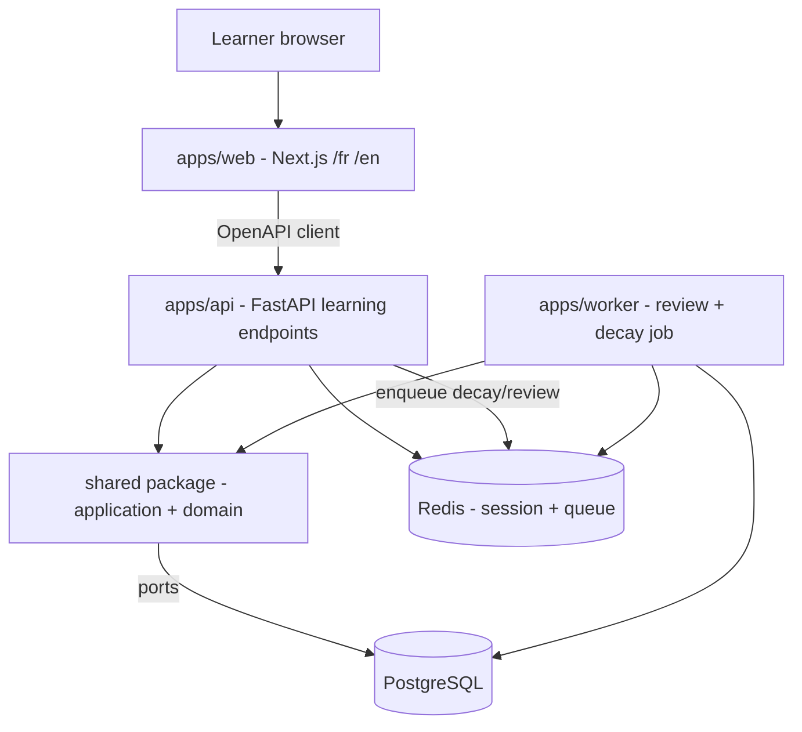
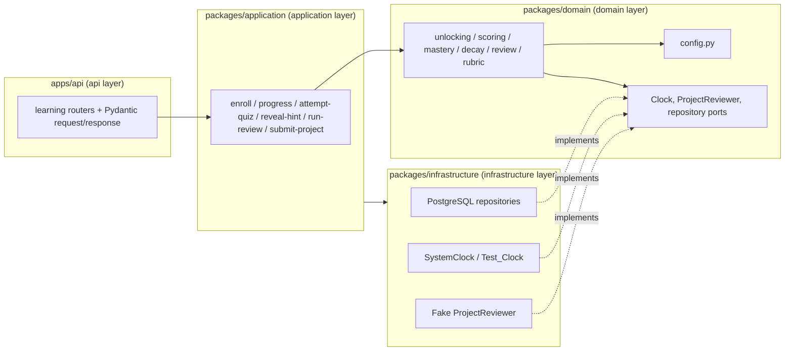

# Design Document

## Overview

This design implements the **learning core** of EDU-IT: the framework-free domain engine
(Milestone A), the content pipeline (Milestone B), and the learner-facing learning experience
(Milestone C) — **without labs** and **without AI runtime features**. It satisfies the 31
requirements in `requirements.md` by building on the foundations already in the repository
(`packages/domain`, `packages/application`, `packages/infrastructure`, `apps/api`, `apps/web`,
`apps/worker`) and the authoritative rules in steering.

Steering is the single source of truth. This document references rules rather than restating
their values, and every business number (thresholds, points, intervals, timeouts) lives in
`domain/config.py` — concretely `packages/domain/edu_it_domain/config.py`, which already exists
and is extended here (#[[file:.kiro/steering/structure.md]], #[[file:.kiro/steering/quality.md]]).

The design honors the existing architecture end to end:

- **Layering** `api → application → domain ← infrastructure`. The domain imports no framework and
  reads time only through the injected `Clock` port (#[[file:.kiro/steering/structure.md]],
  `docs/ARCHITECTURE.md`).
- **Ports with fakes.** Every external system sits behind a domain port with a fake, matching the
  existing `packages/domain/edu_it_domain/ports/` + `packages/infrastructure/.../fakes/` pattern.
  Labs and AI stay as ports with fakes; this phase surfaces no runnable lab and no AI runtime
  (#[[file:.kiro/steering/tech.md]]).
- **Tech stack from `tech.md`.** Python shared packages (domain/application), FastAPI + Pydantic
  v2 in `apps/api`, Next.js App Router + next-intl + Zod + MDX allowlist in `apps/web`, PostgreSQL
  system of record, Redis for session/ephemeral state. No new stack is introduced
  (#[[file:.kiro/steering/tech.md]], `docs/ARCHITECTURE.md`).

The authoritative schema is `docs/DATA-MODEL.md` (D3); the worked mastery example and open
questions are `docs/RULES-REVIEW.md` (D7); ADRs A2 (translation storage), A4 (session storage),
A5 (MDX rendering), and A6 (decay computation) apply.

### How milestones map to requirements

| Milestone | Scope | Requirements |
|-----------|-------|--------------|
| A — Domain engine | Framework-free pure services for unlocking/completion, quiz scoring + shuffle + answer matching, cooldown, mastery states, 24-hour anti-farming, hint multipliers, decay, review scheduling + selection, rubric threshold; `Clock`, config, `ProjectReviewer`, labs lab-check path, fakes | 1–11, 28 |
| B — Content pipeline | Pydantic v2 content schemas + provenance + bilingual fields, `edu-it content validate`, idempotent `edu-it content sync`, CI content step, expert review + golden set | 12–16, 25, 26, 27 |
| C — Learning experience | FastAPI learning endpoints (idempotent), RFC 9457 errors, stable-id addressing, cursor pagination; `apps/web` pages under `/fr`/`/en`; locale fallback; placement/final-assessment interfaces only; GDPR export/deletion | 17–24, 29, 30, 31 |

Requirements 30 (verification checks) and 31 (phase-2 report) are the acceptance artifacts the
Testing Strategy and the final report task produce.

## Architecture

### System context (reused from D1)

The runtime shape is unchanged from `docs/ARCHITECTURE.md`. This phase adds learning endpoints to
`apps/api`, learner pages to `apps/web`, the spaced-review and decay computation to `apps/worker`,
and the domain learning services to the shared package. Labs and the LLM provider stay behind
their ports with fakes and are not exercised by any learner-facing surface.



### Layering within the learning core

Learning logic is placed by layer so the dependency rule `api → application → domain ← infrastructure`
holds. The domain contains only pure computation over domain types and ports; the application
orchestrates use cases (load state via repository ports, call domain, persist results); the api
layer validates HTTP and translates problems; infrastructure implements the ports.



An import-boundary lint rule already guards the domain (see `make lint` in CI); the new domain
modules add no framework import and are covered by that same rule.

### Quiz-attempt sequence (idempotent, version-pinned)

This sequence shows how the api, application, domain, and infrastructure layers cooperate on a
quiz submission, covering idempotency (Req 18.1, 18.2, 23), cooldown (Req 24), version pinning
(Req 25.1), and the 24-hour window (Req 6).

```mermaid
sequenceDiagram
    participant W as apps/web
    participant A as apps/api router
    participant U as application: AttemptQuiz
    participant I as infrastructure: idempotency + repos
    participant D as domain: scoring + mastery
    participant C as Clock

    W->>A: POST /v1/quiz-attempts (Idempotency-Key, body)
    A->>U: submit(attempt, key)
    U->>I: lookup(key)
    alt key seen, same body
        I-->>U: stored result
        U-->>A: stored result
        A-->>W: 200 stored attempt
    else key seen, conflicting body
        I-->>U: conflict
        U-->>A: ProblemError(409)
        A-->>W: 409 problem+json
    else new key
        U->>I: load quiz at pinned content_version, last attempt time
        U->>C: now()
        U->>D: in_cooldown? / score / mastery delta (24h window, hint multiplier)
        alt in cooldown
            D-->>U: cooldown until T
            U-->>A: ProblemError(cooldown)
            A-->>W: 4xx problem+json (detail: attemptable at T)
        else scored
            U->>I: persist quiz_attempt + answers + mastery_event; store key->result
            U-->>A: result
            A-->>W: 201 attempt
        end
    end
```

## Components and Interfaces

### Milestone A — Domain engine (`packages/domain/edu_it_domain`)

The learning domain adds a `learning/` subpackage of pure services plus new ports, all
framework-free and reading time only through `Clock`. Business numbers are read from `config.py`
(extended, never hardcoded in the services).

#### Domain services (pure functions / stateless services)

| Module | Responsibility | Requirements |
|--------|----------------|--------------|
| `learning/unlocking.py` | Compute module lock/unlock from prerequisite concepts' mastery states; completion recording decisions; decay never relocks | 2 |
| `learning/scoring.py` | Score a quiz attempt 0–100 (unanswered = incorrect); deterministic option shuffle by seed; map shuffled position back to original option identity; reject answers referencing foreign options; mixed types incl. command-output; best-attempt selection (tie → most recent) | 3 |
| `learning/cooldown.py` | Report cooldown state from last-attempt time + Clock + Config interval | 4 |
| `learning/mastery.py` | Apply mastery deltas; derive states/thresholds; cap 0–100; append `mastery_event`; decay state transitions; floor-30-once-Practiced | 5, 8 |
| `learning/antifarming.py` | Decide `counted_for_mastery` from the 24h window (`first_answered_at + 24h`, Clock) | 6 |
| `learning/hints.py` | Apply the Config hint multiplier when a hint was revealed before the attempt was submitted; never retroactively | 7 |
| `learning/decay.py` | Deterministic `-1/day overdue` from Clock + schedule state; idempotent per instant; re-queue not relock (per ADR A6) | 8 |
| `learning/review.py` | Create one schedule entry on first Practiced; resume-on-re-practice; due/overdue computation; interval change on pass/fail; eligible-question selection incl. empty pool and <3 minimum | 9, 28 |
| `learning/rubric.py` | Evaluate weighted criteria vs `max_points`; pass/fail at Config threshold; outcome only after `ProjectReviewer` completes | 10 |
| `config.py` | All thresholds, points, intervals, timeouts, multipliers, minimums (extended) | 1, 3–10, 28 |

Key behaviors called out in the requirements:

- **Deterministic shuffle (Req 3.2, 3.3).** `shuffle_options(options, seed)` performs a seeded
  permutation (Python `random.Random(seed)` applied to a copy of the option list, or an equivalent
  pure Fisher–Yates over the seed). The same `(seed, option set)` always yields the same order; the
  function returns a permutation — no option added, removed, or duplicated. Each presented position
  carries the original `question_option` identity, so judging maps the selected position back to
  its original option before checking `is_correct`. Shuffling therefore never changes which answer
  is correct.
- **Best-attempt selection (Req 3.6, 6.3).** `select_best(attempts)` picks the highest `score`;
  ties break in favor of the most recent attempt (latest attempt instant). Completion is evaluated
  against this best attempt, independent of the 24-hour window and idempotency dedupe.
- **Decay idempotency (Req 8.4, ADR A6).** Decay is a pure function of the Clock reading and the
  review-schedule state: `decay(schedule, mastery, now) -> (new_mastery, events)`. Running it
  repeatedly for the same instant and schedule state yields the identical result and emits no
  additional reduction — the `days_overdue` is derived from `due_at` and `now`, and the applied
  decrement equals that derived overdue count, not an accumulation per run.
- **Review resume-on-re-practice (Req 9.2).** When a concept re-reaches Practiced after a decay
  dip and a `review_schedule` already exists, no second entry is created; the existing entry
  resumes from its current interval and review history rather than resetting to the initial
  interval.
- **Labs lab-check path (Req 1.4, 5.6).** The Mastered gate calls a `LabCheck` extension path:
  `is_lab_check_satisfied(concept, user)` returns `True` when no lab covers the concept, and
  otherwise consults the lab-covered result. A fake drives lab-covered mastery in tests while the
  api and web surfaces expose no runnable lab.

#### New domain ports

Following the existing `ports/` Protocol pattern (`@runtime_checkable`, framework-free):

```python
# ports/project_reviewer.py
@runtime_checkable
class ProjectReviewer(Protocol):
    def review(self, submission: ProjectSubmissionRef, rubric: Rubric) -> RubricScore | None:
        """Return a completed rubric score, or None while review is pending.
        A `review_outcome` is recorded only once this returns a completed score (Req 10.5)."""
        ...

# ports/lab_check.py
@runtime_checkable
class LabCheck(Protocol):
    def covers(self, concept_id: StableId) -> bool: ...
    def passed(self, concept_id: StableId, user_id: StableId) -> bool: ...
```

Repository ports for learning state (content catalog, enrollment, progress, mastery, review,
attempts) follow the existing `ports/repository.py` style and are implemented by PostgreSQL
adapters in infrastructure and by in-memory fakes under `fakes/` for tests. The `Clock` port
already exists and is reused unchanged.

#### Fakes (infrastructure `fakes/`)

- `fakes/project_reviewer.py` — `Fake_ProjectReviewer`: returns a configurable rubric score, and
  can report "pending" to exercise Req 10.5.
- `fakes/lab_check.py` — `Fake_LabCheck`: configurable coverage + pass result to exercise the
  Mastered gate (Req 5.6) without a runnable lab.
- In-memory learning repositories mirroring `fakes/repositories.py`.
- `Test_Clock` (already present) drives all time-dependent behavior (Req 11.4).

### Milestone B — Content pipeline

#### Content schemas (`packages/<content>/edu_it_content/schemas.py`, Pydantic v2)

A new framework-light package (Pydantic only — not a web framework, consistent with existing
Pydantic use in `apps/api`) defines one Pydantic v2 model per content type: `track`, `module`,
`lesson`, `lab`, `lab_task`, `lab_check`, `project`, `rubric`, `rubric_criterion`, `quiz`,
`question`, `question_option`, `concept`, `prerequisite` (Req 12.1). A shared `Provenance` model
carries `origin`, `model`, `prompt_id`, `prompt_version`, `generation_date`, `reviewed_by`,
`reviewed_at`, `content_version`, `stable_id` (Req 12.2, D3 §5). A reusable `Localized` type
requires both `fr` and `en` for every learner-facing field (Req 12.3, ADR A2). These schemas are
the single definition that will validate AI output in a later phase (Req 12.4).

#### `edu-it content validate` (CLI, Req 13, 27)

A `edu-it` CLI (invoked in CI and locally) with a `content validate` subcommand that loads authored
content and runs ordered checks, exiting zero only when all pass (Req 13.1):

| Check | Failure | Req |
|-------|---------|-----|
| Schema validation per item | Pydantic validation error → non-zero | 13.1 |
| Bilingual completeness | missing `fr`/`en` on a learner-facing field → missing-translation error | 13.2 |
| Reference resolution | reference to a non-existent item → broken-reference error | 13.3 |
| Prerequisite acyclicity | cycle in `prerequisite` graph → prerequisite-cycle error | 13.4 |
| MDX allowlist | component outside the allowlist → unknown-component error (ADR A5) | 13.5 |
| AI reviewer present | `origin == ai` with no `reviewed_by` → missing-reviewer error | 13.6 |

Each failure is reported with the offending item's `stable_id` and the rule name; the command
exits non-zero on any error. CI names the step `content` so a failure names the failing step
(Req 27.1); all-valid exits zero (Req 27.2).

#### `edu-it content sync` (CLI, Req 14, 26)

`content sync` performs an idempotent upsert keyed by `stable_id` (Req 14.1, D3 §10):

- Upsert by `stable_id`; bump `content_version` when content changed; never insert a duplicate.
- Running twice over unchanged content makes no changes the second time (Req 14.2).
- Preserve `lesson_completion` and other completion records; reset all **other** learner state tied
  to an edited item (bookmarks, in-progress attempt scores, notes) (Req 14.3).
- Removal transitions the item to `archived` status rather than hard-deleting (Req 14.4).
- During active use, defer archiving a removed item until active sessions referencing its
  `stable_id` complete; never hard-delete (Req 26.2). In-flight attempts stay pinned to the
  `content_version` they started under (Req 26.3, 25.1).

Sync is transactional per item so a partial run leaves no half-applied item.

#### Expert review + golden set (Req 15, 16)

The workflow authors `Seed_Content` (origin `ai`) for the "Linux Fundamentals" track, then
**stops and asks the user to review** before any further content step (Req 16.1). On approval,
`content sync` records the approving user as `reviewed_by`/`reviewed_at` in provenance (Req 16.2)
and marks the content as the `Golden_Set` for Phase 4 evals (Req 16.3). If not approved, nothing is
synced, served, marked golden, or attributed to a reviewer (Req 16.4). The seed content is authored
only after approval is captured; `apps/web` renders any lab reference as a "coming soon" placeholder
with no lab details, preview, or link (Req 15.7, 19.7).

### Milestone C — Learning experience

#### FastAPI learning endpoints (`apps/api/edu_it_api/learning/`)

Routers mounted under `/v1` (Req per `api-conventions` §3), addressing every resource by
`stable_id` (Req 17.4), validating with Pydantic v2, returning RFC 9457 problem details on failure
through the existing `errors/` machinery (Req 18.6, `api-conventions` §1):

| Endpoint | Behavior | Req |
|----------|----------|-----|
| `POST /v1/enrollments` | enroll learner in a track; record `enrollment` | 17.1 |
| `GET /v1/progress` | module lock states, lesson completions, per-concept mastery; cursor pagination | 17.2, 17.5 |
| `GET /v1/lessons/{stable_id}` | serve MDX for locale, falling back to English when no translation exists | 17.3 |
| `POST /v1/quiz-attempts` | `Idempotency-Key`; record `quiz_attempt`; dedupe; cooldown + 24h handling | 18.1, 18.2, 23, 24 |
| `POST /v1/hints` | record `hint_reveal`; return next progressive hint | 18.3 |
| `GET/POST /v1/reviews` | return due review; accept result; decline when pool < minimum | 18.4, 28 |
| `POST /v1/project-submissions` | validate rubric self-assessment + evidence; route through `ProjectReviewer`; pending status | 18.5, 20 |

List endpoints use cursor-based keyset pagination over a stable sort key tie-broken by `stable_id`
(Req 17.5, `api-conventions` §2). The `GET /v1/lessons` locale fallback serves English rather than
erroring (Req 17.3, ADR A5/A2).

#### apps/web learner pages (`apps/web/src/app/[locale]/...`)

Next.js App Router pages under the existing `[locale]` segment (so every page exists under `/fr`
and `/en` via next-intl, Req 19.6), calling the API through the generated OpenAPI client and
validating forms with Zod:

- `dashboard/` — progress + concepts due/overdue (Req 19.1).
- `tracks/[trackId]/` and `tracks/[trackId]/modules/[moduleId]/` — module lock states (Req 19.2).
- `.../lessons/[lessonId]/` — MDX reader through the component allowlist (Req 19.3, ADR A5).
- `.../quizzes/[quizId]/` — quiz player with feedback + progressive hints (Req 19.4).
- `.../reviews/[conceptId]/` — review session (Req 19.5).
- `.../projects/[projectId]/` — project submission with rubric self-assessment + required evidence
  (Req 19.5, 20).

Any lab reference on a page is replaced entirely by a "coming soon" placeholder exposing no lab
details, preview, or link (Req 19.7, 15.7).

#### Placement and final assessment (interfaces only, Req 21)

Pydantic schemas and interface signatures for `placement` and `final_assessment` are defined,
backed by the existing `placement`/`final_assessment` tables (D3 §12). Grading behavior is a TODO;
no grading is implemented this phase. The domain records `tested_out` on `module_progress` where a
learner tests out at placement (Req 21.3).

#### GDPR export/deletion (`packages/application/edu_it_application/gdpr.py`, extended)

The existing GDPR application service is extended so export and deletion cover the learning
personal-data tables — quiz attempts, mastery (+events), reviews (schedule + attempts), hint
reveals, project submissions, enrollment/progress/completions — i.e. every personal-data table this
phase produces, under export, deletion, and retention (Req 22, D3 §13,
#[[file:.kiro/steering/auth-privacy.md]]).

## Data Models

The authoritative schema is `docs/DATA-MODEL.md` (D3) and the migration
`packages/infrastructure/.../migrations/versions/20240101_0001_create_data_model.py`. This phase
populates and reads the catalog, progress, mastery/review, and assessment groups already defined
there; it does not redefine the schema. The domain works over **domain types** (framework-free
dataclasses) that mirror the relevant D3 tables; infrastructure repositories map between those and
PostgreSQL rows.

### Domain types (framework-free, `learning/models.py`)

```python
@dataclass(frozen=True, slots=True)
class MasteryState(Enum): ...   # Unseen, Introduced, Practiced, Proficient, Mastered

@dataclass(frozen=True, slots=True)
class Mastery:          # mirrors D3 `mastery`
    user_id: StableId; concept_id: StableId; score: int; state: MasteryState

@dataclass(frozen=True, slots=True)
class MasteryEvent:     # mirrors D3 `mastery_event` (append-only)
    delta: int; source: str; occurred_at: datetime

@dataclass(frozen=True, slots=True)
class ReviewSchedule:   # mirrors D3 `review_schedule`
    user_id: StableId; concept_id: StableId; due_at: datetime
    interval: timedelta; history: tuple[ReviewAttempt, ...]

@dataclass(frozen=True, slots=True)
class QuestionOption:   # mirrors D3 `question_option`
    id: int; is_correct: bool

@dataclass(frozen=True, slots=True)
class Answer:           # mirrors D3 `answer`
    question_id: StableId; first_answered_at: datetime; counted_for_mastery: bool

@dataclass(frozen=True, slots=True)
class QuizAttempt:      # mirrors D3 `quiz_attempt`
    stable_id: StableId; quiz_id: StableId; score: int; is_best: bool
    attempted_at: datetime
```

Mastery scale, states, thresholds, decay rate/floor, review entry, content identity, and the
failure-scenario fields are exactly those in D3 §7, §9, §10 and §14 — not restated here.

### Content schema ↔ data model

The Pydantic content schemas are the authoring/validation contract; `content sync` maps each
validated item to its D3 catalog row keyed by `stable_id` with its `content_version` hash, and to
the shared `content_provenance` record (D3 §5). The `stable_id` + `content_version` pair is the
identity model for the idempotent upsert (D3 §1.2, §10).

### Version pinning for in-flight attempts

An in-progress `quiz_attempt`/`answer` records the `content_version` in effect at attempt start, so
a mid-attempt content edit does not change the active attempt (Req 25.1); a new attempt after a
change is evaluated against the new `content_version` (Req 25.2); existing progress rows stay intact
(Req 25.3, D3 §10).

## Correctness Properties

*A property is a characteristic or behavior that should hold true across all valid executions of a
system — essentially, a formal statement about what the system should do. Properties serve as the
bridge between human-readable specifications and machine-verifiable correctness guarantees.*

These properties target the framework-free domain engine (Milestone A) and the deterministic
pipeline and idempotency behaviors (Milestones B/C). Each is implemented by a single property-based
test driven by the fake `Clock`, with a minimum of 100 iterations. Business numbers are read from
`domain/config.py`, never hardcoded in the property. UI rendering (Req 19), performance (Req 29),
and process/coverage (Req 11, 30, 31) are verified by integration, Playwright+axe, and CI checks in
the Testing Strategy rather than by properties.

### Property 1: Module lock reflects prerequisite mastery

*For any* prerequisite graph and any assignment of mastery states, a module is reported locked if
and only if at least one of its prerequisite concepts has not reached the required mastery state,
and unlocked exactly when every prerequisite concept has.

**Validates: Requirements 2.1, 2.2**

### Property 2: Decay never relocks and only re-queues review

*For any* already-unlocked module and any decay applied to its concepts, the module remains unlocked
and the only effect on scheduling is that the decayed concept is re-queued for review.

**Validates: Requirements 2.5, 8.3**

### Property 3: Quiz score equals the percentage of correct answers

*For any* quiz and any (possibly partial) set of submitted answers, the score is an integer in
0–100 equal to the percentage of the quiz's questions answered correctly against each question's
`question_option.is_correct`, counting every unanswered question as incorrect.

**Validates: Requirements 3.1, 3.5**

### Property 4: Option shuffle is a deterministic permutation preserving correctness

*For any* option set and any seed, shuffling produces the same order for the same seed and option
set, the result is a permutation of the input (no option added, removed, or duplicated), and judging
a selected position after mapping it back to its original `question_option` identity yields the same
correctness verdict as judging the originally-identified option.

**Validates: Requirements 3.2, 3.3**

### Property 5: Best attempt is the highest score, ties broken by recency

*For any* set of quiz attempts, the attempt marked `is_best` has the maximum score, with ties broken
in favor of the most recent attempt, and completion is evaluated against that attempt regardless of
the 24-hour window or idempotency dedupe.

**Validates: Requirements 3.6, 6.3**

### Property 6: Cooldown holds exactly until the interval elapses

*For any* last-attempt instant and any Clock reading, the quiz is reported in cooldown if and only if
the Clock reading is strictly before the last-attempt instant plus the Config cooldown interval.

**Validates: Requirements 4.1, 4.2**

### Property 7: Mastery stays within 0–100

*For any* sequence of mastery deltas applied to a concept, the stored mastery value is always an
integer in the inclusive range 0–100 (over-100 results capped at 100, below-0 results floored at 0).

**Validates: Requirements 5.1, 5.8**

### Property 8: Mastery state matches its threshold band and gate

*For any* mastery value and gate conditions, the derived state matches the Config threshold band, and
the Mastered state holds only when mastery is at least the Mastered threshold, a review has passed,
and — where a lab covers the concept — the lab check has passed.

**Validates: Requirements 5.2, 5.3, 5.5, 5.6**

### Property 9: Every mastery change appends exactly one event

*For any* applied mastery change, exactly one `mastery_event` is appended recording the delta, the
source, and the occurrence instant read from the injected Clock.

**Validates: Requirements 5.7**

### Property 10: One review entry on first Practiced, resumed on re-practice

*For any* mastery trajectory that reaches Practiced one or more times (including after decay dips),
exactly one `review_schedule` entry is created — on the first crossing — and a later re-crossing
resumes the existing entry from its current interval and history rather than creating a second entry
or resetting to the initial interval.

**Validates: Requirements 5.4, 9.1, 9.2**

### Property 11: Decay below a threshold once Practiced never falls below Practiced or 30

*For any* concept at Mastered or Proficient, decay that lowers mastery below a band threshold
transitions it exactly one band down (Mastered→Proficient below the Mastered threshold,
Proficient→Practiced below the Proficient threshold), never below Practiced, and never below a
mastery of 30 once the concept has reached Practiced.

**Validates: Requirements 5.9, 5.10, 5.11, 8.2, 8.5**

### Property 12: Re-answers inside the 24-hour window earn no additional mastery

*For any* re-answer of the same question at or after `first_answered_at` and strictly before
`first_answered_at` plus 24 hours (measured by the Clock), the re-answer grants zero additional
mastery and is recorded with `counted_for_mastery` false; at or after 24 hours it is evaluated under
the standard mastery rules with `counted_for_mastery` true.

**Validates: Requirements 6.1, 6.2, 6.4, 6.5**

### Property 13: Hint multiplier applies only to pre-submission reveals

*For any* attempt, when a hint for its question was revealed before the attempt was submitted the
computed mastery gain is tempered by the Config hint multiplier relative to the same answer with no
hint, and a hint revealed only after submission leaves that attempt's gain unchanged.

**Validates: Requirements 7.2, 7.4**

### Property 14: Decay is a deterministic, idempotent function of the clock and schedule

*For any* review-schedule state and any Clock reading, the mastery reduction equals one point per
complete 24-hour day the review is overdue, and applying the decay computation any number of times
for the same Clock reading and schedule state yields the identical mastery value and schedule state
with no additional reduction beyond the first computation.

**Validates: Requirements 8.1, 8.4**

### Property 15: Review selection draws only from the eligible pool

*For any* concept and its eligible question pool, a review selection is a subset of that pool, and an
empty eligible pool yields an empty selection without error.

**Validates: Requirements 9.3**

### Property 16: Passing lengthens and failing shortens the review interval

*For any* current review interval, a passed review sets the next interval to the Config
passed-review interval which is greater than the current interval, and a failed review sets it to the
Config failed-review interval which is less than the current interval.

**Validates: Requirements 9.4, 9.5**

### Property 17: Due and overdue derive purely from the clock

*For any* `review_schedule.due_at` and any Clock reading, the concept is due exactly when the Clock
reading is at or after `due_at`, and the overdue-day count equals the whole number of days by which
the Clock reading exceeds `due_at`.

**Validates: Requirements 9.6**

### Property 18: Rubric outcome follows the weighted score against the threshold

*For any* submission and rubric, the score is the weighted sum of its criteria bounded by
`max_points`, and the recorded outcome is passing if and only if that score meets or exceeds the
Config pass threshold — and no outcome is recorded while the `ProjectReviewer` evaluation is pending.

**Validates: Requirements 10.1, 10.2, 10.3, 10.5**

### Property 19: Reviews below the minimum eligible pool are declined without scheduling

*For any* review request whose concept has fewer than the Config minimum eligible questions, the
review is declined and no review-schedule entry is created or advanced for that request.

**Validates: Requirements 28.1, 28.2, 28.3**

### Property 20: The prerequisite graph is acyclic or the cycle is reported

*For any* prerequisite graph, `content validate` reports a prerequisite-cycle error if and only if
the graph contains a cycle.

**Validates: Requirements 13.4**

### Property 21: Content sync is an idempotent upsert that preserves completions

*For any* set of content items and any sequence of edits, `content sync` upserts by `stable_id`
without ever creating a duplicate, makes no changes on a second run over unchanged content, preserves
existing completion records, and archives (never hard-deletes) removed items.

**Validates: Requirements 14.1, 14.2, 14.3, 14.4, 26.1**

### Property 22: Idempotency-Key makes a submission take effect at most once

*For any* number of quiz submissions (including concurrent ones) carrying the same `Idempotency-Key`
with the same body, exactly one `quiz_attempt` is recorded and every response returns the stored
result of the first processing, while the same key with a conflicting body is rejected with a 409
problem-details response.

**Validates: Requirements 18.1, 18.2, 23.1, 23.2, 23.3**

### Property 23: Submissions during cooldown are rejected without recording

*For any* quiz submission made while the quiz is in cooldown, the submission is rejected with an RFC
9457 problem-details response whose translated detail states when the quiz is attemptable again, and
no new attempt is recorded.

**Validates: Requirements 24.1, 24.2**

### Property 24: An active attempt stays pinned to its content version

*For any* content change that occurs mid-attempt, the active attempt remains evaluated against the
`content_version` it started under, a new attempt started after the change is evaluated against the
new `content_version`, and existing progress rows are left intact.

**Validates: Requirements 25.1, 25.2, 25.3, 26.3**

### Property 25: Removed items are archived only after active sessions complete

*For any* sync that removes an item while sessions reference its `stable_id`, the item is archived
rather than hard-deleted, and archiving is deferred until those active sessions complete so in-flight
learners keep valid references.

**Validates: Requirements 26.2**

### Property 26: Lesson requests fall back to English

*For any* lesson requested in a locale for which no MDX translation exists, the lesson is served in
English rather than returning an error.

**Validates: Requirements 17.3**

### Property 27: Resources are addressed only by stable id

*For any* resource returned by the Learning API, its exposed identifier is the resource's `stable_id`
and no internal numeric key appears in the response.

**Validates: Requirements 17.4**

### Property 28: Cursor pagination covers the full set exactly once

*For any* list of resources and any page size, paging through with the returned cursors yields the
complete ordered set over the stable sort key tie-broken by `stable_id`, with no item skipped or
duplicated.

**Validates: Requirements 17.5**

### Property 29: Export and deletion cover all learning personal data

*For any* learner's state across the personal-data tables this phase produces, export includes every
such record and deletion removes every such record.

**Validates: Requirements 22.1, 22.2, 22.3**

## Error Handling

All learner-facing failures are returned as RFC 9457 problem details
(`application/problem+json`) through the existing `apps/api/edu_it_api/errors/` machinery
(`problem.py`, `handlers.py`, `catalog.py`, `locale.py`). The learner-facing `detail` is translated
to the request locale and actionable; diagnostics (stack traces, SQL, internal ids) stay in logs
(#[[file:.kiro/steering/api-conventions.md]] §1, #[[file:.kiro/steering/auth-privacy.md]]).

| Condition | HTTP | Problem type / detail | Req |
|-----------|------|-----------------------|-----|
| Pydantic request validation failure | 422/400 | validation problem with field extension, no internals leaked | 18.6 |
| Duplicate submission, same key + body | 200 | stored result returned (no new attempt) | 18.2, 23.1 |
| Reused key, conflicting body | 409 | `duplicate-submission` conflict | 23.3 |
| Concurrent same-key submissions | — | processed at most once, same stored result to both | 23.2 |
| Submission during cooldown | 4xx | translated detail includes when attemptable again; no attempt recorded | 24.1, 24.2 |
| Answer references a foreign option | 4xx | rejected; no `quiz_attempt`/`answer` persisted | 3.4 |
| Project submission missing self-assessment or not covering every criterion | 4xx | rejected; no `project_submission` | 20.1 |
| Project submission missing required evidence | 4xx | rejected; no `project_submission` | 20.2 |
| Review requested with pool below the Config minimum | 4xx | declined; schedule not created/advanced | 28.1, 28.2 |
| Lesson requested in a locale lacking a translation | 200 | English fallback served (not an error) | 17.3 |
| Expired/malformed pagination cursor | 400 | cursor problem | 17.5 (`api-conventions` §2) |
| `content validate` failure (any check) | CLI non-zero | failing check named with the item `stable_id`; CI step `content` fails | 13.*, 27.1 |

Idempotency, cooldown, and content-version pinning are enforced in the application layer before any
side effect, so a rejected request records nothing. The domain services raise typed domain errors
(e.g. `ForeignOptionError`, `CooldownActiveError`, `InsufficientReviewPoolError`) that the api layer
maps to problem types; the domain never constructs HTTP responses.

## Testing Strategy

Testing follows the existing repository discipline: `pytest` + `hypothesis` for Python
(property-based where a universal statement holds, example-based for specific scenarios and edge
cases), `vitest` for `apps/web` logic, and Playwright + axe-core for accessibility. All suites run
through the `make test` task that CI already invokes, and the domain reads time only through the
fake `Clock` (Req 11.4).

### Rules-first domain tests (Req 11)

The domain test suite is authored **from the rules in #[[file:.kiro/steering/domain-rules.md]] before**
the corresponding implementation (Req 11.1), includes at least one test per rule across unlocking,
scoring/shuffle/matching, cooldown, mastery, the 24-hour rule, hints, decay, review, and rubric
(Req 11.2), and must reach at least 90% statement coverage of the domain package, enforced as a
coverage gate in CI (Req 11.3). The `Test_Clock` fake drives every time-dependent test (Req 11.4).

### Property-based tests (domain engine)

Each correctness property above maps to exactly one property-based test using Hypothesis, configured
for a minimum of 100 iterations, tagged with a comment of the form
`Feature: learning-core, Property {n}: {property text}`. A property-based testing library is used
(Hypothesis, already a workspace dependency); properties are never implemented from scratch. Business
numbers are read from `domain/config.py` inside the generators and assertions so a config change does
not silently break a property. Generators cover edge cases explicitly: empty option sets and empty
review pools, deltas overshooting 100 and undershooting 0, re-answer offsets exactly at the 24-hour
boundary, overdue counts at exact day boundaries, and prerequisite graphs with and without cycles.

### Unit / example tests

Example-based tests cover specific scenarios that are not universal: a hint reveal records one
`hint_reveal` and one `mastery_event` (Req 7.1); a valid content item parses and an item missing a
locale or provenance fails schema validation (Req 12); each `content validate` check has one failing
fixture and the all-valid case exits zero (Req 13, 27); approval records the reviewer and marks the
golden set while rejection syncs nothing (Req 15, 16). The worked example in `docs/RULES-REVIEW.md`
(D7 §9) is encoded as an end-to-end example test using the fake Clock to confirm the mastery
trajectory, the hint temper, and the overdue-review decay.

### Integration tests

Integration tests exercise the application + infrastructure layers against real repositories (and
the Redis-backed idempotency/session adapters already present): enrollment → progress → lesson →
quiz attempt → hint → review → project submission, including the version-pinning and deferred-archive
behaviors (Req 25, 26) and the end-to-end review lifecycle (due, passed, failed with the expected
interval changes) driven by the test Clock (Req 30.6). GDPR export/deletion coverage is tested across
every personal-data table this phase produces (Req 22, 30.8).

### Web and accessibility tests

`apps/web` logic (lock-state derivation, lab "coming soon" replacement, locale handling, Zod form
validation) is covered by `vitest` component/logic tests. Playwright with axe-core runs on the
dashboard, track, module, lesson reader, quiz player, review session, and project submission pages
under both `/fr` and `/en`, asserting no accessibility violations (Req 19, 30.9). Snapshot/component
tests confirm MDX renders only allowlisted components and that lab references show the placeholder
with no lab details, preview, or link (Req 19.3, 19.7).

### Performance (Req 29)

A local load measurement runs the enrollment, progress, lesson, quiz-attempt, hint, review, and
project-submission endpoints against the `Seed_Content` and asserts p95 latency under 300 ms. Because
the LLM provider is never on the learner request path (#[[file:.kiro/steering/quality.md]]) and the
domain is pure in-memory computation, the latency budget is dominated by repository queries; progress
and list endpoints use the keyset pagination and `stable_id`-indexed lookups to stay within budget.
The measured p95 is recorded in `docs/reports/phase-2.md` (Req 29.2, 31.3).

### Verification suite and phase-2 report (Req 30, 31)

A verification suite aggregates the above into the checks named in Req 30 (rule→requirement→test
mapping and ≥90% coverage; the five `content validate` failures; sync idempotence + progress
preservation; both-language lesson completion and lock lifting; shuffle/matching/cooldown/
anti-farming/hints; the Clock-driven review lifecycle; duplicate submission counted once; export and
deletion coverage; Playwright+axe on all pages; golden-set approval). The final task writes
`docs/reports/phase-2.md` recording, for each check, the command invoked and its pass-or-fail
outcome — recording failures rather than omitting them — plus the p95 measurement
(Req 31.1, 31.2, 31.3).

## Failure-Scenario Handling

Each failure scenario has a documented behavior here and a matching IF/THEN requirement, per
#[[file:.kiro/steering/working-agreements.md]].

- **Duplicate / concurrent submission (Req 23).** The application layer looks up the
  `Idempotency-Key` before any side effect. Same key + same body returns the stored first result and
  records exactly one `quiz_attempt`; concurrent same-key submissions are made at most once by the
  idempotency store itself — via an atomic insert / unique constraint on the `Idempotency-Key` (or an
  equivalent row lock) so the guarantee holds across worker processes, NOT via an in-process lock —
  and both callers get the same stored result; a reused key with a conflicting body returns 409
  problem details (`api-conventions` §5/§6, D3 §9).
- **Submission during cooldown (Req 24).** The domain `cooldown` service reports cooldown from the
  last-attempt time and the Clock; the application rejects the submission with a problem-details
  response whose translated detail states when the quiz is attemptable again, recording no attempt.
- **Content change mid-attempt (Req 25).** Attempts record the `content_version` in effect at start;
  a mid-attempt edit (which bumps `content_version`) leaves the active attempt pinned to its original
  version, a new attempt uses the new version, and existing progress rows are untouched (D3 §10).
- **Sync during active use (Req 26).** `content sync` is an idempotent upsert by `stable_id` that
  keeps completions and leaves progress unchanged; a removed item is archived — not hard-deleted —
  and archiving is deferred until active sessions referencing its `stable_id` complete; in-flight
  attempts stay pinned to their version (D3 §10).
- **CI validation failure (Req 27).** The CI `content` step runs `edu-it content validate`; any error
  fails the step non-zero and names it, while all-valid exits zero.
- **Review with < 3 eligible questions (Req 28).** The review endpoint declines to start a review when
  the eligible pool is below the Config minimum (value 3), returning problem details, and the domain
  does not create or advance a schedule entry for that request.
