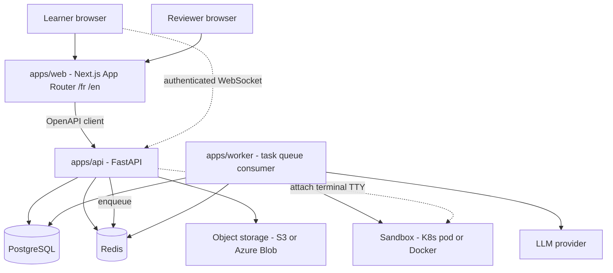
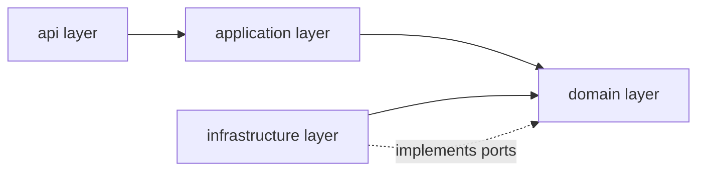
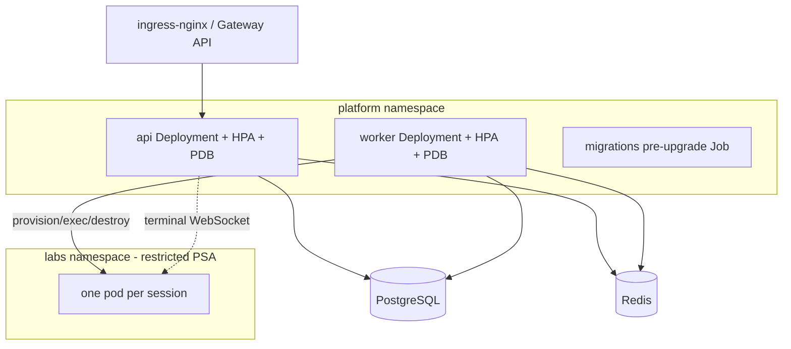
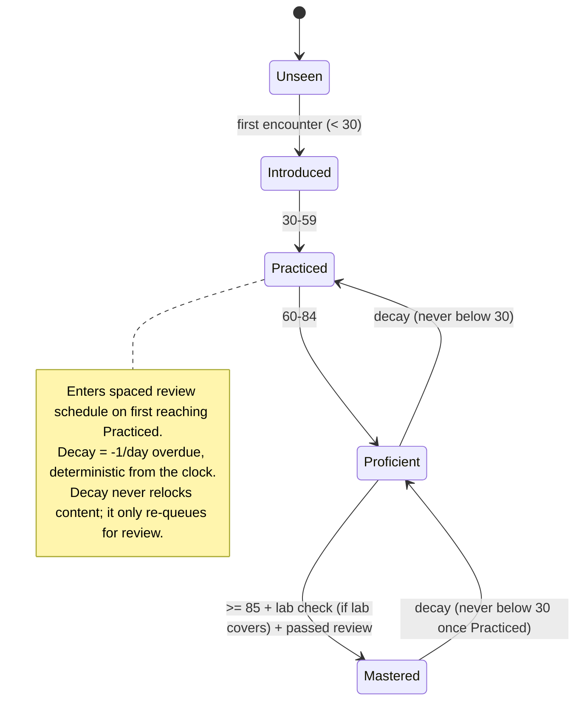
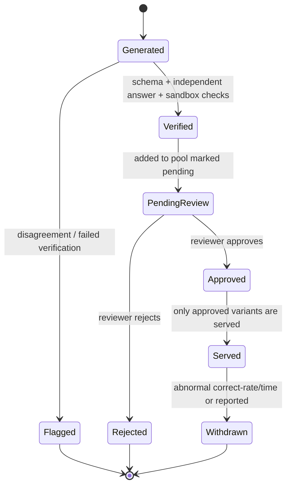

# Design Document: EDU-IT Platform Design Foundation

## Overview

EDU-IT is a bilingual (French/English) re-learning platform for IT professionals who are
losing hands-on skills as AI agents take over technical work. Learners rebuild skills step by
step and advance only by proving mastery through quizzes, hands-on labs (real terminals, graded
code) and projects. Content is drafted by AI and approved by experts. The platform runs on
Kubernetes (EKS, AKS or on-premise).

This spec is a **design-foundation (meta) spec**. Its deliverables are **steering files and
design documents only** — no application source code is produced here. The purpose is to turn
the project rules into durable, machine-referenced steering, to capture the high-level and
low-level technical design across documents and ADRs, to prove every rule was transcribed
faithfully through a traceability table, and to document the behavior of every failure scenario.

The design below describes both a **high-level view** (component map, layering, Kubernetes
topology, state and sequence diagrams) and a **low-level view** (interface signatures for every
external-system port, the full data model, and API conventions). It then orchestrates the
production of the concrete artifacts: the steering files, the `docs/` design documents, the
ADRs, and the phase-0 report.

Per working-agreements.md, this document references steering through
`#[[file:.kiro/steering/<file>.md]]` includes rather than copying rule content. The steering
files are themselves deliverables of this spec; the tasks phase will author them, after which
these references resolve.

## Steering References

The authoritative rules live in steering files. This design does not restate them; it links
them so downstream specs and design documents inherit a single source of truth.

- Product scope and principles: #[[file:.kiro/steering/product.md]]
- Technology choices: #[[file:.kiro/steering/tech.md]]
- Repository structure and layering: #[[file:.kiro/steering/structure.md]]
- Domain rules (unlocking, quizzes, labs, projects, mastery, review, hints, placement): #[[file:.kiro/steering/domain-rules.md]]
- Content pipeline and localization: #[[file:.kiro/steering/content.md]]
- Labs, sandboxes and terminal: #[[file:.kiro/steering/labs.md]]
- Deployment and Kubernetes topology: #[[file:.kiro/steering/deployment.md]]
- Authentication and privacy: #[[file:.kiro/steering/auth-privacy.md]]
- AI content generation and review: #[[file:.kiro/steering/ai-content.md]]
- Quality bars and testing: #[[file:.kiro/steering/quality.md]]
- Working agreements and process: #[[file:.kiro/steering/working-agreements.md]]
- API conventions (added after this design): #[[file:.kiro/steering/api-conventions.md]]

## Deliverables Map

Every artifact this spec produces, and the acceptance criterion it satisfies.

| # | Artifact | Type | Satisfies |
|---|----------|------|-----------|
| S1 | `.kiro/steering/product.md` | steering (always) | steering exists with valid front matter |
| S2 | `.kiro/steering/tech.md` | steering (always) | steering exists with valid front matter |
| S3 | `.kiro/steering/structure.md` | steering (always) | steering exists with valid front matter |
| S4 | `.kiro/steering/domain-rules.md` | steering (fileMatch) | steering exists with valid front matter |
| S5 | `.kiro/steering/content.md` | steering (fileMatch) | steering exists with valid front matter |
| S6 | `.kiro/steering/labs.md` | steering (fileMatch) | steering exists with valid front matter |
| S7 | `.kiro/steering/deployment.md` | steering (fileMatch) | steering exists with valid front matter |
| S8 | `.kiro/steering/auth-privacy.md` | steering (fileMatch) | steering exists with valid front matter |
| S9 | `.kiro/steering/ai-content.md` | steering (fileMatch) | steering exists with valid front matter |
| S10 | `.kiro/steering/quality.md` | steering (always) | steering exists with valid front matter |
| S11 | `.kiro/steering/working-agreements.md` | steering (always) | steering exists with valid front matter |
| S12 | `.kiro/steering/api-conventions.md` | steering (fileMatch) | added after design |
| D1 | `docs/ARCHITECTURE.md` | design doc | repo structure, components, layering (Mermaid) |
| D2 | `docs/API-CONVENTIONS.md` | design doc | error format, pagination, versioning, IDs, idempotency |
| D3 | `docs/DATA-MODEL.md` | design doc | full schema as Mermaid ER diagram |
| D4 | `docs/LABS-DESIGN.md` | design doc | provider signatures, sequence diagrams, security model |
| D5 | `docs/DEPLOYMENT-DESIGN.md` | design doc | k8s topology per target, network policies, RBAC, ingress |
| D6 | `docs/AI-CONTENT-DESIGN.md` | design doc | LLMProvider signatures, review gates, variant lifecycle, advisor |
| D7 | `docs/RULES-REVIEW.md` | design doc | confirm/challenge each rule + worked mastery example |
| D8 | `docs/RISKS.md` | design doc | ranked risks and open questions |
| A1–A8 | `docs/adr/0001..0008-*.md` | ADR | each ADR has context, decision, consequences |
| R1 | `docs/reports/phase-0.md` | report | traceability table; deviations; gaps; open questions |

## Directory Layout Produced by This Spec

```
edu-it/
  .kiro/
    specs/platform-design/        # this spec (design.md, requirements.md, tasks.md)
    steering/                     # S1..S12
  docs/
    ARCHITECTURE.md               # D1
    API-CONVENTIONS.md            # D2
    DATA-MODEL.md                 # D3
    LABS-DESIGN.md                # D4
    DEPLOYMENT-DESIGN.md          # D5
    AI-CONTENT-DESIGN.md          # D6
    RULES-REVIEW.md               # D7
    RISKS.md                      # D8
    adr/                          # A1..A8
    reports/phase-0.md            # R1
```

No `apps/`, `lab-images/`, `content/`, `prompts/`, `evals/`, or `deploy/` source is created in
this spec. Those directories are described in the design documents and will be populated by
later phase specs.

---

## Architecture

This section gives the high-level view: system context, component responsibilities, layering,
Kubernetes topology, and the key state machines. Low-level detail (interface signatures, data
model, API conventions) follows in "Components and Interfaces" and "Data Models".

### System Context



### Component Responsibilities

| Component | Responsibility |
|-----------|----------------|
| `apps/web` | Next.js App Router UI, `/fr` and `/en` routes via next-intl, xterm.js terminal, Monaco editor, renders MDX with an allowlist of components, forms validated with Zod. |
| `apps/api` | FastAPI boundary: authentication and sessions, learning endpoints, serves MDX source per locale, hosts the authenticated terminal WebSocket, enqueues jobs. Validates with Pydantic v2. |
| `apps/worker` | Task-queue consumer: lab provisioning and grading orchestration, AI generation jobs, variant-pool refill, spaced-review and decay computation, reaper for expired sessions. |
| shared Python package | Domain and application code reused by api and worker; framework-free domain. |
| PostgreSQL | System of record for learners, content, progress, mastery, reviews, variants, statistics, recommendations, assessments. |
| Redis | Task queue backing and ephemeral/session state (final queue choice is an ADR). |
| Object storage | Behind `ObjectStorage`: lab artifacts, exports. |
| LLM provider | Behind `LLMProvider`: ahead-of-time content generation only, never on a learner's request path. |
| Sandbox | Behind `SandboxProvider`: Docker (dev only), Kubernetes (prod), fake (tests). |

### Layering

Dependencies point inward. The domain imports no framework and receives time through an
injected `Clock`. Every external system sits behind an interface with a fake.



- `api → application → domain ← infrastructure`.
- Business numbers live in `domain/config.py` (thresholds, points, intervals, timeouts).
- Ports defined in the domain: `SandboxProvider`, `Mailer`, `ObjectStorage`, `Clock`,
  `TaskQueue`, `LLMProvider`, and the `ProjectReviewer` extension point. Each has a fake.

Detail and rationale are captured in `docs/ARCHITECTURE.md` (D1); rules are in
#[[file:.kiro/steering/structure.md]].

### Kubernetes Topology (high level)

Portable across EKS, AKS and on-premise using standard Kubernetes APIs only; provider
differences live in Helm values. Full per-target topology is in `docs/DEPLOYMENT-DESIGN.md` (D5).



- Default-deny NetworkPolicy in `labs`; default-deny in `platform` so only api and worker reach
  PostgreSQL and Redis; worker egress limited to the LLM provider and the Kubernetes API.
- Dedicated lab node pool with taints/tolerations; configurable RuntimeClass (gVisor or Kata;
  plain runc dev-only with a startup warning).
- Graceful shutdown drains terminal WebSockets with a reconnect message.

### Mastery State Machine (high level)



### Variant Lifecycle (high level)



Full gates and advisor flow are in `docs/AI-CONTENT-DESIGN.md` (D6); rules in
#[[file:.kiro/steering/ai-content.md]].

---

## Components and Interfaces

This section gives the low-level view of the external-system ports and the API conventions. The
authoritative versions live in the named design documents; no implementation is produced here.

### External-System Ports (interface signatures)

These signatures seed the low-level design documents. They are illustrative pseudocode
expressed in Python-style typed signatures; the authoritative versions live in the design
documents noted per port. No implementation is produced in this spec.

```pascal
INTERFACE Clock
  FUNCTION now() RETURNS Instant        // injected; domain never reads wall clock directly
END INTERFACE

INTERFACE SandboxProvider              // see docs/LABS-DESIGN.md (D4)
  FUNCTION provision(spec) RETURNS SandboxHandle
  FUNCTION exec(handle, command, as_user, env, cwd) RETURNS ExecResult
  FUNCTION attach_terminal(handle) RETURNS TerminalChannel
  FUNCTION copy_in(handle, source_ro, dest) RETURNS Void    // read-only source for grading
  FUNCTION copy_out(handle, source, dest) RETURNS Void
  FUNCTION destroy(handle) RETURNS Void
  FUNCTION health(handle) RETURNS HealthStatus
  // Implementations: Docker (dev only), Kubernetes (prod), Fake (tests). Warm-pool extension point.
END INTERFACE

INTERFACE Mailer                       // see docs/AI-CONTENT-DESIGN.md context + auth-privacy
  FUNCTION send(to, template_id, locale, data) RETURNS Void  // console dev, SMTP prod; FR/EN templates
END INTERFACE

INTERFACE ObjectStorage
  FUNCTION put(key, bytes, content_type) RETURNS Void
  FUNCTION get(key) RETURNS Bytes
  FUNCTION presign_get(key, ttl) RETURNS Url
  FUNCTION delete(key) RETURNS Void
END INTERFACE

INTERFACE TaskQueue                    // concrete backing chosen in ADR
  FUNCTION enqueue(job_name, payload, dedupe_key) RETURNS JobId
  FUNCTION consume(job_name, handler) RETURNS Void
END INTERFACE

INTERFACE LLMProvider                  // see docs/AI-CONTENT-DESIGN.md (D6)
  FUNCTION complete(prompt_version, input, schema, max_retries) RETURNS StructuredOutput
  // structured output validated against content schemas; bounded retries; records model, tokens, cost
END INTERFACE

INTERFACE ProjectReviewer              // extension point: mentor, peer or AI-assisted review
  FUNCTION review(project_submission) RETURNS ReviewOutcome
END INTERFACE
```

### API Conventions (low level)

Produced in `docs/API-CONVENTIONS.md` (D2) and mirrored as steering `api-conventions.md` (S12,
fileMatch on API code), added **after** this design per the acceptance criteria:

- Error format: RFC 9457 problem details (`type`, `title`, `status`, `detail`, `instance`).
- Pagination strategy, API versioning scheme, stable ID format, idempotency keys for mutations.
- Learner-facing errors are translated and actionable; details stay in logs
  (#[[file:.kiro/steering/quality.md]]).

---

## Data Models

The full schema is produced as a Mermaid ER diagram in `docs/DATA-MODEL.md` (D3). It must
include at least these entity groups, and every table holding personal data must be covered by
export, deletion and retention (per #[[file:.kiro/steering/auth-privacy.md]]):

- Identity: `user`, `session`, `oauth_link`, `role_assignment` (learner, reviewer with
  per-track expertise, author, admin).
- Catalog: `track`, `module`, `lesson`, `lab`, `lab_task`, `lab_check`, `project`, `rubric`,
  `rubric_criterion`, `quiz`, `question`, `question_option`, `concept`, `prerequisite`.
- Provenance (on every content item): `origin`, `model`, `prompt_id`, `prompt_version`,
  `generation_date`, `reviewed_by`, `reviewed_at`; plus `content_version` hash and
  `stable_id`.
- Progress: `enrollment`, `module_progress` (incl. `tested_out`), `lesson_completion`,
  `lab_session`, `lab_run`, `lab_task_completion`, `quiz_attempt`, `answer`, `project_submission`.
- Mastery and review: `mastery` (0–100 per user × concept), `mastery_event`, `review_schedule`,
  `review_attempt`, `hint_reveal`.
- AI/review ops: `review_queue_item`, `variant`, `generation_job`, `item_statistic`,
  `path_recommendation`, `budget_ledger`.
- Assessments: `placement`, `final_assessment` (schema and interfaces only for now).

---

## Correctness Properties

These properties must hold for the deliverables of this spec. They are stated as universal
assertions the phase-0 verification checks confirm.

Requirement references below point to the requirement IDs the requirements phase of this
Design-First workflow will create; they are the acceptance criteria each property verifies.

### Property 1: Rule traceability is total and faithful
For every rule line in the spec request, there exists exactly one target steering file, and its
transcription changes no numbers and no normative wording.
**Validates: Requirements 1.1, 1.2**

### Property 2: Steering front matter is valid
For every steering file S1–S11, valid front matter is present; files with `fileMatch` rules
carry a `fileMatch` pattern; `api-conventions.md` (S12) exists only after this design.
**Validates: Requirements 1.1, 1.3**

### Property 3: Every diagram renders
For every Mermaid block in every deliverable, the block renders without error.
**Validates: Requirements 2.1**

### Property 4: Every ADR is complete
For every ADR A1–A8, a context, a decision and a consequences section are all present.
**Validates: Requirements 3.1**

### Property 5: Every failure scenario is documented and required
For every failure scenario listed below, a documented behavior exists in the named design
document and a matching IF/THEN requirement exists in requirements.md.
**Validates: Requirements 4.1, 4.2, 4.3, 4.4, 4.5, 4.6**

### Property 6: Every steering reference resolves
For every `#[[file:.kiro/steering/<file>.md]]` reference, the target file exists.
**Validates: Requirements 2.2**

### Property 7: No application code is produced
No file exists under `apps/`, `lab-images/`, `content/`, `prompts/`, `evals/`, or `deploy/` as a
result of this spec.
**Validates: Requirements 5.1**

---

## Error Handling

### Failure Scenarios (documented behavior)

Each scenario must have a documented behavior in the design document named, and a corresponding
IF/THEN EARS requirement in requirements.md.

| Scenario | Documented in | Behavior summary |
|----------|---------------|------------------|
| Sandbox provisioning failure | `docs/LABS-DESIGN.md` (D4) | Surface a translated error; no partial session left running; reaper cleans orphans; provisioning is rate-limited and retried within policy. |
| WebSocket drop | `docs/LABS-DESIGN.md` (D4) | Ownership re-checked on reconnect; reconnect message shown; graceful shutdown drains sockets; terminal I/O is not recorded. |
| Grading check timeout | `docs/LABS-DESIGN.md` (D4) | Grading bounded (results within 15 s target, at most once per 10 s per session); timeout yields a translated "could not complete" feedback, not raw output; run recorded as failed. |
| LLM timeout or invalid output | `docs/AI-CONTENT-DESIGN.md` (D6) | Bounded retries; invalid output never auto-fixed; item flagged; path advisor falls back to rule-based order; job cost/tokens still recorded. |
| Content sync during active use | `docs/AI-CONTENT-DESIGN.md` (D6) + `docs/DATA-MODEL.md` (D3) | Idempotent upsert by stable ID; edits never reset progress; existing completions kept; new attempts use new version; removed items archived not deleted. |
| Duplicate quiz submission | `docs/API-CONVENTIONS.md` (D2) + `docs/DATA-MODEL.md` (D3) | Idempotency key dedupes; re-answering the same question within 24 h yields no mastery gain; best attempt still counts for completion. |

---

## ADRs to Produce

Each ADR (A1–A8) has context, decision and consequences, under `docs/adr/`:

1. Versions — pin current stable versions of all frameworks and test tools.
2. Translation storage — how FR/EN learner-facing fields and UI keys are stored.
3. Task queue — concrete choice behind `TaskQueue`.
4. Session storage — server-side session backing.
5. MDX rendering — allowlisted component rendering approach.
6. Decay computation — deterministic clock-based decay strategy.
7. LLM provider and data residency — provider behind `LLMProvider`, DPA and EU residency.
8. Reserved — always produced as a reserved record with context/decision/consequences; context states the topic is reserved for future use, decision states no decision is recorded yet.

ADRs 1–7 map directly to the spec request list; ADR 8 is always produced as a reserved ADR
record carrying the same three sections as every other ADR — its context section states the
topic is reserved for future use and its decision section states that no decision is recorded
yet. Decisions recorded here flow back into the relevant steering file in the same change
(#[[file:.kiro/steering/working-agreements.md]]).

---

## Validation and Acceptance

The tasks phase and the phase-0 report must demonstrate:

- Every steering file (S1–S11) exists with valid front matter; `api-conventions.md` (S12) added
  after this design.
- A traceability table in `docs/reports/phase-0.md` maps every rule in the spec request to its
  steering file and shows it was transcribed without changes (numbers unchanged; a one-line
  reason added only where a rule is not self-explanatory).
- Every Mermaid diagram renders.
- Every ADR has context, decision and consequences.
- Each failure scenario above has a documented behavior in the relevant design document.
- No application code is written.

## Testing Strategy

Because this spec produces documents, "tests" are verification checks run and recorded in
`docs/reports/phase-0.md`:

- Front-matter check: each steering file parses and carries valid front matter (and a
  `fileMatch` where the rules require one).
- Mermaid render check: each diagram block is validated (e.g. with the Mermaid CLI) so it
  renders without error.
- Traceability completeness: every rule line in the spec request appears in the table with its
  target steering file.
- Link integrity: every `#[[file:.kiro/steering/<file>.md]]` reference resolves to an existing
  file.
- ADR completeness: each ADR contains context, decision and consequences sections.
- No-code check: confirm no files were created under `apps/`, `lab-images/`, `content/`,
  `prompts/`, `evals/`, or `deploy/`.

## Dependencies

- Mermaid rendering/validation tooling (for the diagram render check).
- A YAML front-matter parser (for the steering front-matter check).
- No runtime application dependencies are introduced by this spec.
