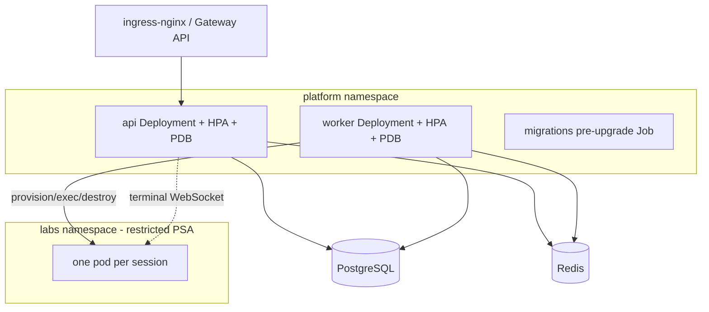

# Deployment and Kubernetes Topology

This steering file is the single source of truth for the EDU-IT deployment and
Kubernetes-topology rules. It is included conditionally (fileMatch inclusion) for deployment
manifests, Dockerfiles, and CI/CD configuration. The deployment and Kubernetes-topology rules
below are transcribed verbatim from the project rules; all names, numbers, and normative wording
are preserved unchanged. Where a rule is not self-explanatory, a one-line reason is added and
marked `Reason:`.

## Platform Target and Portability

- The platform runs on Kubernetes (EKS, AKS or on-premise).
- Portable across EKS, AKS and on-premise using standard Kubernetes APIs only; provider
  differences live in Helm values.
  Reason: provider-specific configuration is isolated to Helm values so the manifests stay
  portable.

## Deployment Layout

- `deploy/` holds Helm charts and Kubernetes manifests.

## Kubernetes Topology

- `platform` namespace holds the api Deployment (+ HPA + PDB), the worker Deployment
  (+ HPA + PDB), and the migrations pre-upgrade Job.
- `labs` namespace — restricted PSA; one pod per session.
- Ingress is ingress-nginx / Gateway API and routes to the api Deployment.
- The api reaches PostgreSQL and Redis; the worker reaches PostgreSQL and Redis.
- The worker provisions, executes and destroys the per-session pool.
- The api attaches the terminal WebSocket to the per-session pool.

## Network Policies

- Default-deny NetworkPolicy in `labs`; default-deny in `platform` so only api and worker reach
  PostgreSQL and Redis; worker egress limited to the LLM provider and the Kubernetes API.

## Node Pools and Runtime

- Dedicated lab node pool with taints/tolerations; configurable RuntimeClass (gVisor or Kata;
  plain runc dev-only with a startup warning).

## Graceful Shutdown

- Graceful shutdown drains terminal WebSockets with a reconnect message.
