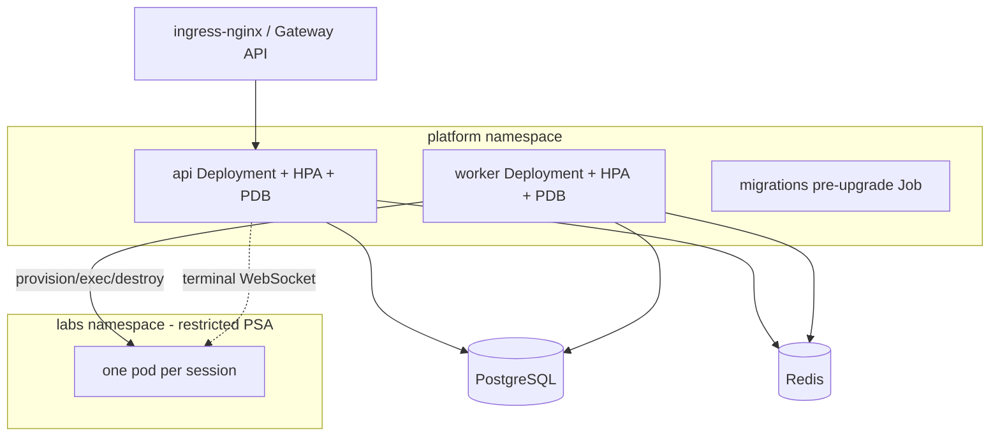

# Deployment and Kubernetes Topology

This steering file is the single source of truth for the EDU-IT deployment and
Kubernetes-topology rules. It is included conditionally (fileMatch inclusion) for deployment
manifests, Dockerfiles, and CI/CD configuration. The deployment and Kubernetes-topology rules
below are transcribed verbatim from the project rules; all names, numbers, and normative wording
are preserved unchanged. Where a rule is not self-explanatory, a one-line reason is added and
marked `Reason:`.

## Platform Target and Portability

- The platform runs on Kubernetes (EKS, AKS or on-premise).
- Portable across EKS, AKS and on-premise using standard Kubernetes APIs only; provider
  differences live in Helm values.
  Reason: provider-specific configuration is isolated to Helm values so the manifests stay
  portable.

## Deployment Layout

- `deploy/` holds Helm charts and Kubernetes manifests.

## Kubernetes Topology

- `platform` namespace holds the api Deployment (+ HPA + PDB), the worker Deployment
  (+ HPA + PDB), and the migrations pre-upgrade Job.
- `labs` namespace — restricted PSA; one pod per session.
- Ingress is ingress-nginx / Gateway API and routes to the api Deployment.
- The api reaches PostgreSQL and Redis; the worker reaches PostgreSQL and Redis.
- The worker provisions, executes and destroys the per-session pool.
- The api attaches the terminal WebSocket to the per-session pool.

## Network Policies

- Default-deny NetworkPolicy in `labs`; default-deny in `platform` so only api and worker reach
  PostgreSQL and Redis; worker egress limited to the LLM provider and the Kubernetes API.

## Node Pools and Runtime

- Dedicated lab node pool with taints/tolerations; configurable RuntimeClass (gVisor or Kata;
  plain runc dev-only with a startup warning).
- Lab node pool kubelet settings (ADR 0009, Go_Live_Checklist items; the kind cluster sets both):
  `podPidsLimit` equal to `SANDBOX_PID_LIMIT` (128), the pod-level fork-bomb ceiling, and
  `singleProcessOOMKill: true`, so a memory OOM kills the offending process and not every process
  of the learner container.

## Graceful Shutdown

- Graceful shutdown drains terminal WebSockets with a reconnect message.

## Helm Chart Conventions (ADR 0010)

Final rules from `docs/adr/0010-helm-chart-conventions.md` (status Accepted, finalized in task 12.15
of the `kubernetes-deployment` spec). The ADR holds the full validation-rule list and the secret
catalog; this file links them instead of copying them.

- The chart is `deploy/helm/edu-it` with exactly four Values_Files: `values-dev.yaml`,
  `values-eks.yaml`, `values-aks.yaml` and `values-onprem.yaml`.
- Templates branch only on Values_File keys, never on a Target name, a cloud API probe or a
  Kubernetes version string.
- `values.schema.json` declares every required key; a missing or mistyped key fails `helm lint`
  and `helm template` with an error naming the key path. Cross-key rules are `fail` calls in
  `templates/_validation.tpl` (entry point `edu-it.validate`), `_validation-networkpolicy.tpl`,
  `validate-priorityclass.yaml` and the inline production guard in `dev-datastores.yaml`; each
  message starts with the offending key and a failing render emits no manifest. See ADR 0010 for
  the rule list.
- Secrets are never in values. `edu-it.secretCatalog` in `_helpers.tpl` is the single list from
  which the optional secret volumes and the ExternalSecrets are generated (`database`, `redis`,
  `session`, `llm`, `object-storage`); plain `Secret` objects render only when
  `devSecrets.enabled`.
- Images are referenced as `repository` plus `digest` (`^sha256:[a-f0-9]{64}$`), composed as
  `repository@sha256:<64 hex>`. No mutable tag alone.
- The migration Job is a `pre-install,pre-upgrade` hook (`backoffLimit` 0 to 6, default 0;
  `activeDeadlineSeconds` 30 to 3600, default 600). Its bootstrap resources are hooks with weight
  `-10` and `hook-delete-policy: before-hook-creation` (the `migration` ServiceAccount, the
  migration ConfigMap, the database ExternalSecret, or the dev database Secret); the Job has weight
  `0`; the database ExternalSecret uses `creationPolicy: Orphan`. The `cni-check` Job is a
  `post-install` hook (120 s). Namespaces and the bundled dev datastores are not hooks, so a first
  install that creates them uses the two-phase procedure of the kind smoke test (ADR 0010).
- Allowed extension kinds beyond upstream: `ExternalSecret` and `SecretStore`, `Gateway` reference
  and `HTTPRoute`, `ServiceMonitor` and `PrometheusRule` (only when enabled), and a Kyverno
  `ClusterPolicy` (only when `imagePolicy.enabled`, default false). A kind allowlist test fails on
  any other kind.
- Drain protection renders a PodDisruptionBudget (`maxUnavailable: 0`) on lab pods; the Worker does
  not read nodes and there is no cluster-scoped grant. The wait limit is the value used as
  `kubectl drain --timeout`.
- A monitoring ingress rule reaches only the Api and Worker metrics ports, off by default
  (`networkPolicy.monitoringIngress.enabled`).
- The chart renders a `web` Deployment and Service in `platform` with the same probes, HPA,
  priority class and security context as the Api; it uses the default ServiceAccount with
  `automountServiceAccountToken: false`.
- The Api and Worker ServiceAccounts set `automountServiceAccountToken: false`; only the Api and
  Worker pod specs set it to `true` and project a 600 s token (`_kube-api-access.tpl`).
- `priorityClass.value` must exceed `labs.podPriorityValue`; `kindTest.sessionTtlSeconds` is allowed
  only in `ci/values-kind-test.yaml`.
- Api and Worker egress to the Kubernetes API is an `ipBlock` rule from
  `networkPolicy.kubernetesApi.cidrs`; rendering fails when the list is empty.
  Reason: pod selectors cannot match the API server.
- Api exec admission policy (ADR 0009, ADR 0010): RBAC cannot scope `pods/exec` by container, so a
  `ValidatingAdmissionPolicy` and a `ValidatingAdmissionPolicyBinding` (`Deny` mode,
  scoped to the `labs` namespace) on `CONNECT` of `pods/exec` and `pods/attach` are required. The
  chart does not render them (cluster-scoped); the operator applies them as a prerequisite listed
  in the Deployment_Guide, and the spike file defines them. The policy
  restricts the Api ServiceAccount (matched through `request.userInfo.username`) to the container
  `learner` (`object.container == 'learner'`) and leaves the Worker unaffected. `failurePolicy` is
  `Fail`. These are cluster-scoped admission resources, not a `ClusterRole`; no platform
  ServiceAccount gets a `ClusterRole` or `ClusterRoleBinding`.
  Reason: an unavailable policy must deny rather than allow Api exec into `grader` or `owner`.
- Lab pod layout (ADR 0009): layout B is chosen and spike-proven, with three containers `learner`
  (10000), `grader` (10001) and `owner` (10002), `shareProcessNamespace: false` and all
  capabilities dropped. The lab image entrypoint must be a reaping init: the `learner` container
  PID 1 runs no learner code, survives its children being stopped and reaps orphans.

## Image Supply Chain (ADR 0011)

Final rules from `docs/adr/0011-image-supply-chain.md` (status Accepted, finalized in task 13.5 of
the `kubernetes-deployment` spec). The pipeline is `.github/workflows/deployment.yml`.

- Final image stages are distroless `nonroot` bases with no shell and no package manager, and a
  numeric `USER` above 0. Dockerfiles live in `deploy/images/<name>/Dockerfile`.
- Images are built for `linux/amd64` and `linux/arm64` and published as one multi-architecture
  manifest. The `build` job runs per image and platform and never pushes; `publish` needs every
  build job, so a failed build publishes nothing.
- CI scans every image and platform and fails on CRITICAL or HIGH findings with a fix available
  (`SCAN_SEVERITY_CUTOFF: high` with `only-fixed`); a scan that cannot complete fails the build and
  publishes nothing.
- CI generates an SBOM per platform image and attaches it to the manifest by digest with `oras`;
  failure of SBOM, signing or signature publication fails the build and the image is not marked
  released.
- Images are signed by digest with OIDC keyless signing (`cosign`) and carry a SLSA provenance
  attestation. `id-token: write` is set only on the `sign` job, which runs only on a push to the
  default branch or a `v*` tag after every verification job passed. A `release-gate` job records
  whether the images were released or why not. Third-party actions are pinned to a full 40-character commit SHA.
- Deploy and upgrade steps run `cosign verify` on every image digest through
  `tools/verify_image_signatures.py`; with `--pull-request` (kind job, pull-request and other
  branch runs) it verifies local-registry digests only, runs no `cosign` command and records that
  signature verification was skipped.
- Where `imagePolicy.enabled` is true the chart renders a Kyverno `ClusterPolicy` with
  `verifyImages` that admits only signed images. Kyverno is an operator-installed optional
  prerequisite.
