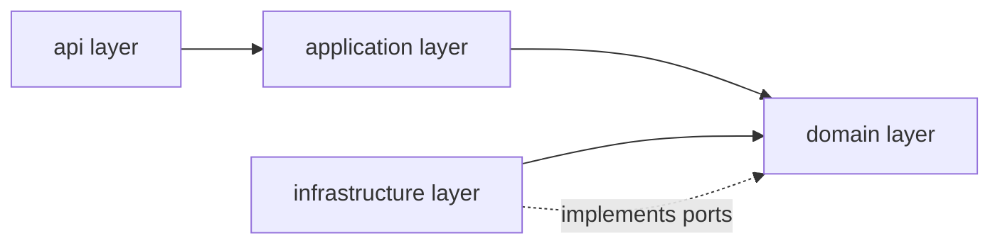

# Repository Structure and Layering

This steering file is the single source of truth for the EDU-IT repository structure and the
layering rules. The repository-structure and layering rules below are transcribed verbatim from
the project rules; all numbers and normative wording are preserved. A one-line reason is added
only where a rule is not self-explanatory.

## Repository Structure

The EDU-IT repository is a monorepo with the following top-level layout:

```
edu-it/
  apps/
    web/                  # Next.js App Router UI (/fr and /en)
    api/                  # FastAPI boundary
    worker/               # task-queue consumer
  lab-images/             # lab sandbox image definitions
  content/                # authored learning content (MDX per locale)
  prompts/                # LLM prompt definitions (versioned)
  evals/                  # evaluation suites for generated content
  deploy/                 # Helm charts and Kubernetes manifests
  docs/                   # design documents, ADRs, reports
  .kiro/
    specs/                # specs
    steering/             # steering files
```

- `apps/web` — Next.js App Router UI, `/fr` and `/en` routes via next-intl, xterm.js terminal,
  Monaco editor, renders MDX with an allowlist of components, forms validated with Zod.
- `apps/api` — FastAPI boundary: authentication and sessions, learning endpoints, serves MDX
  source per locale, hosts the authenticated terminal WebSocket, enqueues jobs. Validates with
  Pydantic v2.
- `apps/worker` — Task-queue consumer: lab provisioning and grading orchestration, AI generation
  jobs, variant-pool refill, spaced-review and decay computation, reaper for expired sessions.
- shared Python package — Domain and application code reused by api and worker; framework-free
  domain.

## Component Responsibilities

| Component | Responsibility |
|-----------|----------------|
| `apps/web` | Next.js App Router UI, `/fr` and `/en` routes via next-intl, xterm.js terminal, Monaco editor, renders MDX with an allowlist of components, forms validated with Zod. |
| `apps/api` | FastAPI boundary: authentication and sessions, learning endpoints, serves MDX source per locale, hosts the authenticated terminal WebSocket, enqueues jobs. Validates with Pydantic v2. |
| `apps/worker` | Task-queue consumer: lab provisioning and grading orchestration, AI generation jobs, variant-pool refill, spaced-review and decay computation, reaper for expired sessions. |
| shared Python package | Domain and application code reused by api and worker; framework-free domain. |
| PostgreSQL | System of record for learners, content, progress, mastery, reviews, variants, statistics, recommendations, assessments. |
| Redis | Task queue backing and ephemeral/session state (final queue choice is an ADR). |
| Object storage | Behind `ObjectStorage`: lab artifacts, exports. |
| LLM provider | Behind `LLMProvider`: ahead-of-time content generation only, never on a learner's request path. |
| Sandbox | Behind `SandboxProvider`: Docker (dev only), Kubernetes (prod), fake (tests). |

## Layering

Dependencies point inward. The domain imports no framework and receives time through an
injected `Clock`. Every external system sits behind an interface with a fake.



- `api → application → domain ← infrastructure`.
- Business numbers live in `domain/config.py` (thresholds, points, intervals, timeouts).
  <!-- Reason: keeps every tunable business constant in one framework-free location so the domain stays pure. -->
- Ports defined in the domain: `SandboxProvider`, `Mailer`, `ObjectStorage`, `Clock`,
  `TaskQueue`, `LLMProvider`, and the `ProjectReviewer` extension point. Each has a fake.
