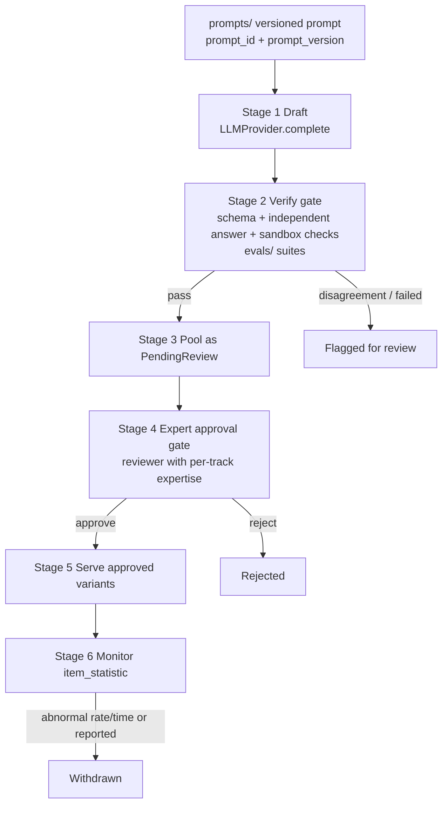
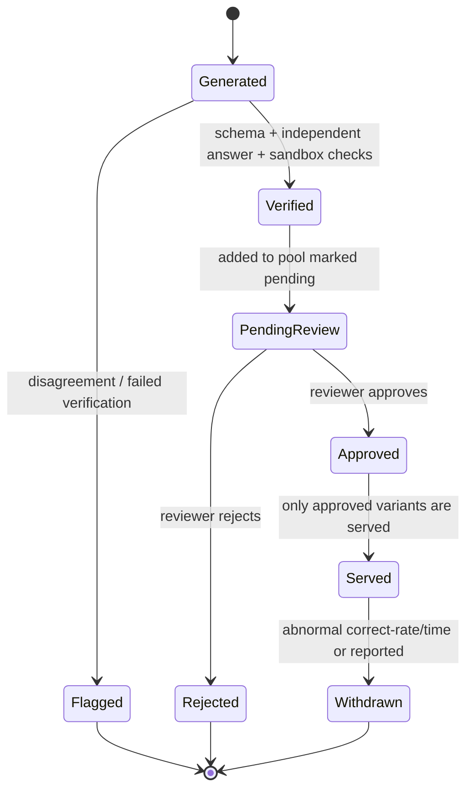
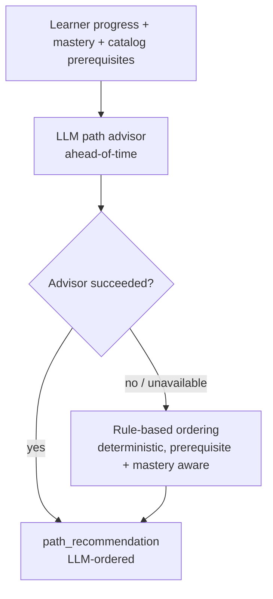
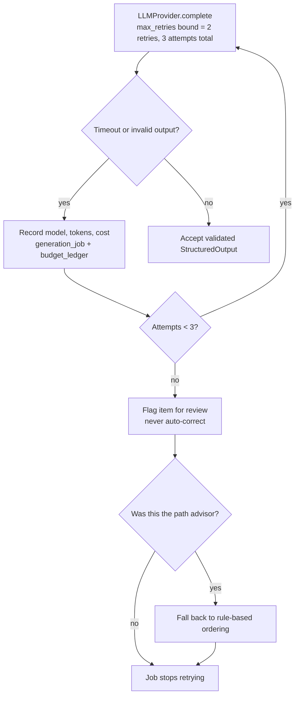
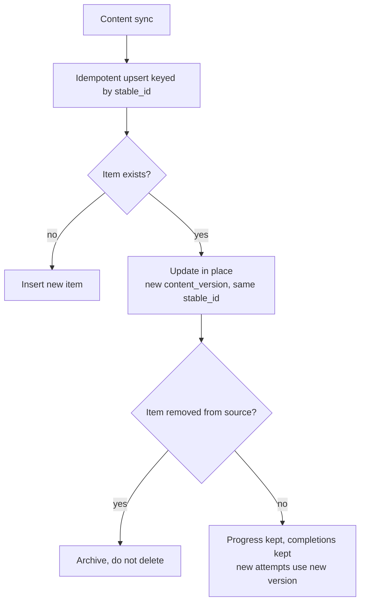

# AI-Content Design (D6)

This document (D6) is the authoritative source for the EDU-IT AI content generation and review
design. It documents the `LLMProvider` interface signatures, the generation stages and their
review gates, the variant-lifecycle state machine, the path-advisor input/output and its
fallback, and the data that is allowed in LLM requests. It also documents failure scenario 4.4
(LLM timeout or invalid output) and — in coordination with `docs/DATA-MODEL.md` (D3) — failure
scenario 4.5 (content sync during active use).

The normative AI content generation and review rules live in steering and are not restated here;
this document links them so there is a single source of truth:

#[[file:.kiro/steering/ai-content.md]]

Where this document and the steering file describe the same rule, the steering file is
authoritative. This document adds signatures, diagrams, stage/gate detail, and cross-references
for reviewers. All numbers and normative wording are preserved from the steering source.

## Scope

EDU-IT is a bilingual (French/English) re-learning platform for IT professionals. Content is
drafted by AI and approved by experts. This document covers the AI side of that pipeline: how
content and quiz variants are generated ahead of time, verified, reviewed, approved, and served;
how the path advisor recommends an ordering and what it falls back to; and how the two AI-related
failure scenarios behave.

The single most important invariant, transcribed from steering, frames everything below:

> The LLM provider is used for ahead-of-time content generation only, never on a learner's
> request path.

Every stage in this document runs in `apps/worker` as an ahead-of-time job. Nothing a learner
does triggers a synchronous LLM call. This keeps the learner experience independent of LLM
latency and availability.

Low-level and sibling design detail lives in:

- Architecture and layering — `docs/ARCHITECTURE.md` (D1)
- Data model (provenance, variants, generation jobs, statistics, recommendations, budget) —
  `docs/DATA-MODEL.md` (D3)
- API conventions (idempotent upsert keyed by stable ID, failure 4.6) — `docs/API-CONVENTIONS.md`
  (D2)

---

## 1. The `LLMProvider` Port

The LLM provider sits behind the `LLMProvider` domain port. Per the layering model in
`docs/ARCHITECTURE.md` (D1), the domain defines the port and the infrastructure layer provides
the concrete implementation and a fake for tests. The domain never calls a provider SDK directly.

### Interface signatures

The authoritative interface is the illustrative typed pseudocode below; the concrete
implementation is produced by a later phase spec, not here.

```pascal
INTERFACE LLMProvider                  // ahead-of-time content generation only, never on a learner's request path
  FUNCTION complete(prompt_version, input, schema, max_retries) RETURNS StructuredOutput
  // structured output validated against content schemas; bounded retries; records model, tokens, cost
END INTERFACE
```

### Parameter and return semantics

| Element       | Meaning |
|---------------|---------|
| `prompt_version` | Identifies the exact versioned prompt from `prompts/` used for this call. It pins both `prompt_id` and `prompt_version` so every generated item is reproducible and attributable. |
| `input`       | The task-specific input for the prompt. Only data allowed in LLM requests (Section 6) may be placed here. |
| `schema`      | The content schema the output must satisfy. The returned `StructuredOutput` is validated against this schema before it is accepted. |
| `max_retries` | The bound on retries. Retries are bounded by the maximum stated in this document (Section 5). |
| `StructuredOutput` | The structured result, validated against the content schema. On every call the provider records the `model`, token counts, and cost (Section 7, `generation_job` and `budget_ledger` in D3). |

### Rules carried from steering

- The provider performs ahead-of-time content generation only, never on a learner's request path.
- Structured output is validated against content schemas; retries are bounded; the call records
  model, tokens, and cost.
- The provider choice and data residency (provider behind `LLMProvider`, DPA and EU residency)
  are recorded in the ADR for LLM provider and data residency.

---

## 2. Generation Pipeline and Stages

Generation is a sequence of ahead-of-time stages, each running as a `generation_job` in
`apps/worker`. `prompts/` holds the versioned prompt definitions and `evals/` holds the
evaluation suites that gate generated content. No stage is on a learner's request path.

| Stage | Where | What happens |
|-------|-------|--------------|
| 1. Draft | `apps/worker` + `LLMProvider.complete(...)` | A versioned prompt (`prompt_version` from `prompts/`) drives the LLM to draft content or a quiz variant. The output is structured and validated against the content `schema`. Provenance (`origin`, `model`, `prompt_id`, `prompt_version`, `generation_date`) is recorded on the item. |
| 2. Verify (automated gate) | `apps/worker` + `evals/` | The draft is verified: schema validation + an independent answer check + sandbox checks (for items with executable checks). `evals/` evaluation suites gate the generated content. A draft that passes becomes `Verified`; a draft that fails verification or disagrees is `Flagged`. |
| 3. Pool as pending | `apps/worker` | A `Verified` variant is added to the pool marked pending (`PendingReview`). |
| 4. Expert review (human gate) | Reviewer browser | A reviewer with per-track expertise approves or rejects the pending variant. Only approved variants are ever served. |
| 5. Serve | `apps/api` | Approved variants are served to learners from the pool. Serving reads already-approved content; it never calls the LLM. |
| 6. Monitor and withdraw | `apps/worker` + `item_statistic` | Served variants are monitored; a variant is withdrawn on abnormal correct-rate/time or when reported. |

The two gates are explicit: an **automated verification gate** (stage 2, schema + independent
answer + sandbox checks, backed by `evals/`) and a **human expert-approval gate** (stage 4). A
variant is served only after it is Verified **and** Approved; these gates are modeled exactly by
the variant lifecycle in Section 3.



---

## 3. Variant Lifecycle

A quiz variant moves through a fixed set of states. The states and transitions below are
transcribed from steering (#[[file:.kiro/steering/ai-content.md]]); the invariant is that a
variant is served only after it is Verified (schema + independent answer + sandbox checks) and
Approved by a reviewer, and that only approved variants are served.

### States and transitions

- `Generated` → `Verified`: schema + independent answer + sandbox checks.
- `Generated` → `Flagged`: disagreement / failed verification.
- `Verified` → `PendingReview`: added to pool marked pending.
- `PendingReview` → `Approved`: reviewer approves.
- `PendingReview` → `Rejected`: reviewer rejects.
- `Approved` → `Served`: only approved variants are served.
- `Served` → `Withdrawn`: abnormal correct-rate/time or reported.

### State diagram



`Flagged`, `Rejected`, and `Withdrawn` are terminal. A `Flagged` variant is never served; it
waits for review disposition. A `Withdrawn` variant was previously `Served` but is pulled from
the pool on abnormal correct-rate/time or when reported. The variant pool is refilled ahead of
time by `apps/worker` (variant-pool refill) so there is always a supply of approved variants to
serve without a learner-time LLM call.

---

## 4. Path Advisor

The path advisor recommends an ordering of learning items for a learner. Like every other AI
stage it runs ahead of time and its result is persisted as a `path_recommendation` (see D3); the
learner reads a stored recommendation, never a synchronous LLM call.

### Input / output

| Direction | Contents |
|-----------|----------|
| Input     | The learner's progress and mastery signals (per-concept mastery, completions, review schedule state) and the catalog structure (concepts and prerequisites). Only data allowed in LLM requests (Section 6) may be sent to the provider. |
| Output    | A `path_recommendation`: an ordered list of next items for the learner, persisted for the learner to read. |

### Fallback

The path advisor falls back to rule-based ordering. When the LLM path advisor is unavailable or
fails (including the LLM timeout / invalid output scenario in Section 5), path recommendation
degrades to a deterministic rule-based order. The rule-based order respects prerequisites and
mastery so the learner always receives a usable ordering even when the advisor cannot produce
one.



---

## 5. Failure Scenario 4.4 — LLM Timeout or Invalid Output

**Condition:** an LLM request times out or returns invalid output.

**Documented behavior (normative):**

1. **Retries are bounded by the maximum stated in this document.** The `max_retries` parameter of
   `LLMProvider.complete(...)` bounds retries. The maximum number of attempts per generation job
   is **3** (one initial attempt plus at most **2** retries). Retries never exceed this maximum;
   once the bound is reached the job stops retrying.
2. **Invalid output is never auto-corrected.** Output that fails schema validation or the
   verification gate is never silently fixed, patched, or coerced into a valid shape.
3. **The item is flagged for review.** The affected item is marked `Flagged` (Section 3) so a
   reviewer dispositions it; it is never served while flagged.
4. **The path advisor falls back to rule-based ordering.** If the failing call is a path-advisor
   call, path recommendation degrades to the deterministic rule-based order (Section 4).
5. **Job cost and tokens are still recorded.** Even on timeout or invalid output, the
   `generation_job` records the model, token counts, and cost consumed (written to the
   `budget_ledger`; see D3). Failed attempts are not free, so their cost is still accounted for.



---

## 6. Data Allowed in LLM Requests

The AI-content design specifies which data may be included in LLM requests so personal data is
not sent to the provider beyond what is allowed. This is the data-minimization boundary for the
`input` parameter of `LLMProvider.complete(...)` and for path-advisor calls.

**Allowed in LLM requests:**

- Catalog and content material needed to draft or verify an item: concepts, prerequisites, lesson
  and lab context, rubrics, and the versioned prompt itself (`prompt_id`, `prompt_version`).
- De-identified learning signals needed by the path advisor: per-concept mastery values,
  completion state, and review-schedule state, referenced by non-identifying internal handles
  rather than by personal identity.

**Never sent to the LLM provider:**

- Personal data and identity attributes of learners (names, email addresses, OAuth identities,
  account identifiers, session data). The `user`, `session`, and `oauth_link` data described in
  D3 and governed by #[[file:.kiro/steering/auth-privacy.md]] are out of scope for LLM requests.
- Raw terminal I/O or any learner free-text beyond what a specific generation or verification
  task strictly requires.

Provider choice, the data-processing agreement (DPA), and EU data residency are recorded in the
ADR for LLM provider and data residency; this document's data-minimization boundary holds
regardless of which provider that ADR selects.

---

## 7. Provenance, Prompt Versioning, and Cost Accounting

Every generated item is reproducible and attributable through provenance recorded at generation
time, and every LLM call is accounted for.

### Prompt versioning (`prompts/`)

- `prompts/` holds versioned LLM prompt definitions. Every call pins a `prompt_version`, so the
  exact prompt that produced an item is known.
- Provenance recorded on every content item: `origin`, `model`, `prompt_id`, `prompt_version`,
  `generation_date`, `reviewed_by`, `reviewed_at`; plus a `content_version` hash and a
  `stable_id`. The authoritative schema for these fields is in `docs/DATA-MODEL.md` (D3).

### Evaluation gating (`evals/`)

- `evals/` holds the evaluation suites that gate generated content. The verification gate
  (Section 2, stage 2) uses these suites; content that does not pass is `Flagged`, not served.

### Cost and token accounting

- Each `generation_job` records the model, token counts, and cost; the `budget_ledger` aggregates
  cost. These are recorded on every call, including failed calls (Section 5, item 5). The
  authoritative schema for `generation_job`, `item_statistic`, `path_recommendation`, and
  `budget_ledger` is in `docs/DATA-MODEL.md` (D3).

---

## 8. Failure Scenario 4.5 — Content Sync During Active Use

**Condition:** content is synced while an item is in active use.

This scenario is documented here (D6) and, at the data level, in `docs/DATA-MODEL.md` (D3). Both
documents describe the same behavior; D3 is authoritative for the table-level schema and this
document frames it from the content-pipeline side.

**Documented behavior (normative):**

1. **The upsert is idempotent, keyed by stable ID.** Content synchronization is an idempotent
   upsert keyed by the `stable_id`: re-syncing the same item updates it in place rather than
   creating a duplicate.
2. **Edits never reset progress.** Editing an item during a content sync never resets a learner's
   progress.
3. **Existing completions are kept.** Completions already recorded against the item are retained.
4. **New attempts use the new version.** After a sync, new attempts use the new content version
   (tracked by the `content_version` hash while the `stable_id` stays fixed).
5. **Removed items are archived rather than deleted.** An item removed by a sync is archived, not
   deleted, so historical progress and completions remain intact.

The idempotent-upsert and stable-ID contract is the same one the API defines for content upserts
(`docs/API-CONVENTIONS.md` (D2), Section 4) and the duplicate-submission scenario (failure 4.6)
builds on; the `stable_id` identity vs. `content_version` hash distinction is shared across D2,
D3, and this document.



---

## 9. Reviewer Roles and Project Review

- Role assignments are `learner`, `reviewer` (with per-track expertise), `author`, and `admin`.
  The expert-approval gate (Section 2, stage 4) is performed by a reviewer with per-track
  expertise.
- Project submissions are reviewed through the `ProjectReviewer` extension point: mentor, peer,
  or AI-assisted review. When the extension point is configured for AI-assisted review, that
  review is still an ahead-of-time, human-approved step, never a learner-request-path LLM call.

---

## Summary of Normative Values

| Topic | Normative value |
|-------|-----------------|
| LLM usage | Ahead-of-time content generation only, never on a learner's request path |
| `LLMProvider.complete` | `(prompt_version, input, schema, max_retries)` → `StructuredOutput`; validated against content schemas; bounded retries; records model, tokens, cost |
| Verification gate | Schema + independent answer + sandbox checks; gated by `evals/` suites |
| Expert gate | Reviewer with per-track expertise approves; only approved variants are served |
| Variant states | Generated, Verified, Flagged, PendingReview, Approved, Rejected, Served, Withdrawn |
| Withdraw trigger | Abnormal correct-rate/time or reported |
| Path advisor | Ahead-of-time `path_recommendation`; falls back to deterministic rule-based ordering on failure/unavailability |
| Failure 4.4 | Retries bounded at max 3 attempts (2 retries); invalid output never auto-corrected; item flagged; advisor falls back to rule-based ordering; job cost and tokens still recorded |
| Failure 4.5 | Idempotent upsert keyed by stable ID; edits never reset progress; completions kept; new attempts use new version; removed items archived not deleted |
| Data minimization | Catalog/content and de-identified learning signals allowed; learner personal data and raw terminal I/O never sent to the provider |

## Related Steering and Documents

- AI content generation and review rules: #[[file:.kiro/steering/ai-content.md]]
- Architecture and layering: `docs/ARCHITECTURE.md` (D1)
- API conventions (idempotent upsert, failure 4.6): `docs/API-CONVENTIONS.md` (D2)
- Data model (provenance, variants, generation jobs, statistics, recommendations, budget;
  failure 4.5 at the data level): `docs/DATA-MODEL.md` (D3)
- Authentication and privacy (personal-data boundary): #[[file:.kiro/steering/auth-privacy.md]]
