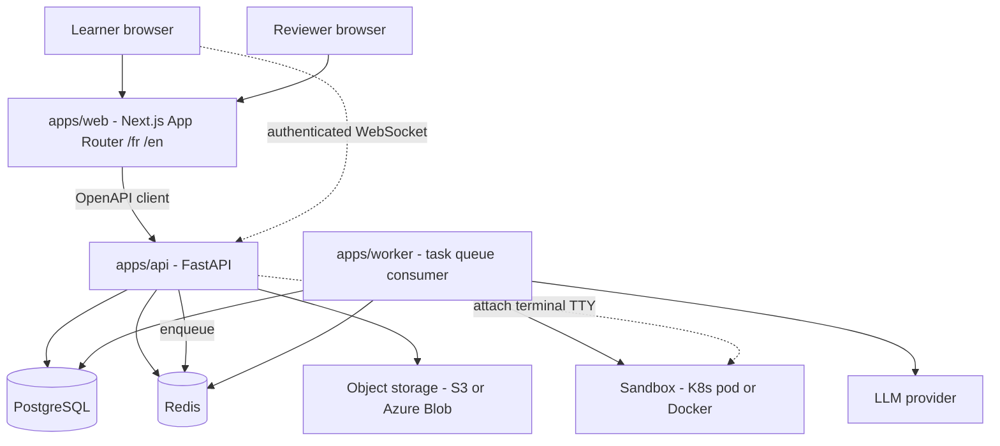
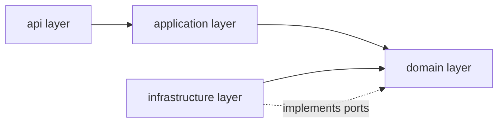
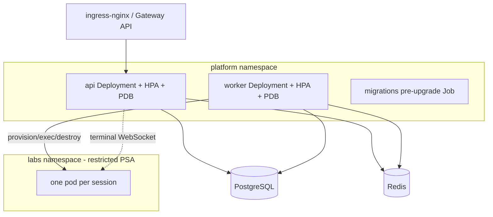

# Architecture (D1)

This document is the high-level architecture reference for the EDU-IT platform. It describes the
repository structure, the responsibility of each component, and the layering model that keeps the
domain pure and every external system behind an interface.

The normative repository-structure and layering rules live in steering and are not restated here;
this document links them so there is a single source of truth:

#[[file:.kiro/steering/structure.md]]

Where this document and the steering file describe the same structure, the steering file is
authoritative. This document adds rationale, diagrams, and cross-references for reviewers.

## Scope

EDU-IT is a bilingual (French/English) re-learning platform for IT professionals. Learners advance
only by proving mastery through quizzes, hands-on labs (real terminals, graded code), and projects.
Content is drafted by AI and approved by experts, and the platform runs on Kubernetes (EKS, AKS, or
on-premise).

This document covers only the architecture: the repository layout, component responsibilities, and
the layering model. Low-level design detail lives in the sibling documents:

- API conventions — `docs/API-CONVENTIONS.md` (D2)
- Data model — `docs/DATA-MODEL.md` (D3)
- Labs design — `docs/LABS-DESIGN.md` (D4)
- Deployment design — `docs/DEPLOYMENT-DESIGN.md` (D5)
- AI-content design — `docs/AI-CONTENT-DESIGN.md` (D6)

## Repository Structure

The repository is a monorepo. The top-level layout, transcribed from the structure steering file,
is:

```
edu-it/
  apps/
    web/                  # Next.js App Router UI (/fr and /en)
    api/                  # FastAPI boundary
    worker/               # task-queue consumer
  lab-images/             # lab sandbox image definitions
  content/                # authored learning content (MDX per locale)
  prompts/                # LLM prompt definitions (versioned)
  evals/                  # evaluation suites for generated content
  deploy/                 # Helm charts and Kubernetes manifests
  docs/                   # design documents, ADRs, reports
  .kiro/
    specs/                # specs
    steering/             # steering files
```

Each top-level directory has a single purpose:

| Directory | Purpose |
|-----------|---------|
| `apps/web` | Next.js App Router UI; `/fr` and `/en` routes via next-intl; xterm.js terminal; Monaco editor; renders MDX with an allowlist of components; forms validated with Zod. |
| `apps/api` | FastAPI boundary: authentication and sessions, learning endpoints, serves MDX source per locale, hosts the authenticated terminal WebSocket, enqueues jobs. Validates with Pydantic v2. |
| `apps/worker` | Task-queue consumer: lab provisioning and grading orchestration, AI generation jobs, variant-pool refill, spaced-review and decay computation, reaper for expired sessions. |
| `lab-images/` | Lab sandbox image definitions used to build the environments learners run inside. |
| `content/` | Authored learning content as MDX, per locale. |
| `prompts/` | Versioned LLM prompt definitions used by ahead-of-time generation. |
| `evals/` | Evaluation suites that gate generated content. |
| `deploy/` | Helm charts and Kubernetes manifests. |
| `docs/` | Design documents, ADRs, and reports. |
| `.kiro/` | Specs and steering files. |

The three deployable applications in `apps/` share a framework-free Python package that holds the
domain and application code reused by both `apps/api` and `apps/worker`.

## Component Responsibilities

The runtime is composed of three deployable applications plus the backing services they depend on.
Responsibilities, transcribed from the structure steering file:

| Component | Responsibility |
|-----------|----------------|
| `apps/web` | Next.js App Router UI, `/fr` and `/en` routes via next-intl, xterm.js terminal, Monaco editor, renders MDX with an allowlist of components, forms validated with Zod. |
| `apps/api` | FastAPI boundary: authentication and sessions, learning endpoints, serves MDX source per locale, hosts the authenticated terminal WebSocket, enqueues jobs. Validates with Pydantic v2. |
| `apps/worker` | Task-queue consumer: lab provisioning and grading orchestration, AI generation jobs, variant-pool refill, spaced-review and decay computation, reaper for expired sessions. |
| shared Python package | Domain and application code reused by api and worker; framework-free domain. |
| PostgreSQL | System of record for learners, content, progress, mastery, reviews, variants, statistics, recommendations, assessments. |
| Redis | Task queue backing and ephemeral/session state (final queue choice is an ADR). |
| Object storage | Behind `ObjectStorage`: lab artifacts, exports. |
| LLM provider | Behind `LLMProvider`: ahead-of-time content generation only, never on a learner's request path. |
| Sandbox | Behind `SandboxProvider`: Docker (dev only), Kubernetes (prod), fake (tests). |

### System Context

The diagram below shows how the actors, applications, and backing services interact. The web app
talks to the API through a generated OpenAPI client; learners also hold an authenticated WebSocket
to the API for the terminal. The API enqueues jobs onto Redis, which the worker consumes; the
worker orchestrates sandboxes and calls the LLM provider for ahead-of-time generation only.



## Layering Model

Dependencies point inward. The domain imports no framework and receives time through an injected
`Clock`. Every external system sits behind an interface that has a fake implementation, so the
domain and application layers can be tested without any real infrastructure.



The layering rules, transcribed from the structure steering file:

- `api → application → domain ← infrastructure`.
- Business numbers live in `domain/config.py` (thresholds, points, intervals, timeouts). This keeps
  every tunable business constant in one framework-free location so the domain stays pure.
- Ports defined in the domain: `SandboxProvider`, `Mailer`, `ObjectStorage`, `Clock`, `TaskQueue`,
  `LLMProvider`, and the `ProjectReviewer` extension point. Each has a fake.

### How the layers map to the applications

- The **domain layer** is the framework-free core in the shared Python package. It owns the
  business rules and the port interfaces, and it never reads the wall clock directly.
- The **application layer** orchestrates use cases over the domain and the ports. It is also part
  of the shared package reused by `apps/api` and `apps/worker`.
- The **api layer** is `apps/api` (and the UI surface in `apps/web`): the boundary that accepts
  requests, authenticates, validates input, and calls into the application layer.
- The **infrastructure layer** provides the concrete port implementations (PostgreSQL, Redis, object
  storage, sandbox providers, the LLM provider, the mailer). It depends inward on the domain and
  implements the domain ports; the domain never depends on it.

Because every external system is reached only through a domain port with a fake, the inward-pointing
dependency rule holds end to end: swapping a sandbox provider (Docker, Kubernetes, fake) or a queue
backing changes only the infrastructure layer, leaving the domain and application layers untouched.

## Deployment Topology (high level)

The platform is portable across EKS, AKS, and on-premise using standard Kubernetes APIs only;
provider differences live in Helm values. The full per-target topology, network policies, RBAC, and
ingress/WebSocket path are documented in `docs/DEPLOYMENT-DESIGN.md` (D5). The high-level shape:



## Related Steering and Documents

- Repository structure and layering rules: #[[file:.kiro/steering/structure.md]]
- API conventions: `docs/API-CONVENTIONS.md` (D2)
- Data model: `docs/DATA-MODEL.md` (D3)
- Labs design: `docs/LABS-DESIGN.md` (D4)
- Deployment design: `docs/DEPLOYMENT-DESIGN.md` (D5)
- AI-content design: `docs/AI-CONTENT-DESIGN.md` (D6)
