# Data Model (D3)

This document (D3) is the authoritative source for the EDU-IT data model. It presents the full
schema as a Mermaid entity-relationship (ER) diagram, grouped into identity, catalog, provenance,
progress, mastery and review, AI/review ops, and assessments. It records which fields carry
mastery, review, and decay state; it fixes the `stable_id` + `content_version` identity model for
content; and it documents, at the data level, failure scenario 4.5 (content sync during active
use) and failure scenario 4.6 (duplicate quiz submission).

The authoritative privacy rules — export, deletion, and retention over every personal-data table —
live in steering and are not restated here; this document links them:

#[[file:.kiro/steering/auth-privacy.md]]

Where this document and the steering file describe the same rule, the steering file is
authoritative. This document adds the schema, the diagram, the per-table personal-data coverage,
and the data-level cross-references for reviewers.

_Related documents:_

- Architecture — `docs/ARCHITECTURE.md` (D1)
- API conventions (stable ID, idempotency, scenario 4.6) — `docs/API-CONVENTIONS.md` (D2)
- AI-content design (scenario 4.5 in coordination with this document) — `docs/AI-CONTENT-DESIGN.md` (D6)

The domain rules this schema encodes (mastery thresholds, review schedule, decay, hints, the
24-hour no-additional-mastery window) are in #[[file:.kiro/steering/domain-rules.md]].

---

## 1. Conventions

A few conventions apply across every entity in the schema.

### 1.1 Internal key vs. stable ID

- Every row has an internal primary key (`id`) that is **never exposed in the API**. It is an
  internal numeric/surrogate key used only for relational joins.
- Every API-addressable resource additionally carries a **stable ID** (`stable_id`): an immutable,
  opaque, prefixed, URL-safe string that never changes for the lifetime of the resource (for
  example `usr_01HZX9…`, `qz_01HZX9…`, `qa_01HZX9…`). The full stable-ID format and rules are in
  `docs/API-CONVENTIONS.md` (D2), Section 4. The `stable_id` is globally unique and is the sort
  tiebreaker for pagination and the identity anchor for idempotent content upserts.

### 1.2 Content identity: `stable_id` + `content_version`

Every content item carries **both**:

- a `stable_id` (identity) that **never changes** across edits and content syncs, and
- a `content_version` hash that **changes whenever the item's content changes**.

This pair is what makes content synchronization an idempotent upsert keyed by the stable ID:
re-syncing the same item updates it in place rather than creating a duplicate, while the
`content_version` records which revision a learner interacted with (see Section 10, failure
scenario 4.5, and `docs/API-CONVENTIONS.md` (D2), Section 4).

### 1.3 Provenance on every content item

Every content item carries provenance fields (`origin`, `model`, `prompt_id`, `prompt_version`,
`generation_date`, `reviewed_by`, `reviewed_at`) plus the `content_version` hash and `stable_id`.
Rather than repeat these columns on every catalog table, the schema factors them into a shared
`content_provenance` record that each content item references one-to-one (Section 4). This keeps
the AI-drafted / expert-approved audit trail uniform across tracks, modules, lessons, labs,
projects, quizzes, questions, and concepts.

### 1.4 Timestamps and the injected clock

Time-bearing fields (`created_at`, `updated_at`, `generation_date`, `reviewed_at`,
`first_answered_at`, `due_at`, `completed_at`, decay computations, and the 24-hour window) are all
derived from the injected `Clock`; the domain never reads the wall clock directly
(#[[file:.kiro/steering/structure.md]]). Decay is therefore deterministic from the clock
(Section 7.3).

---

## 2. Entity Groups at a Glance

| Group | Entities |
|-------|----------|
| Identity | `user`, `session`, `oauth_link`, `role_assignment` |
| Catalog | `track`, `module`, `lesson`, `lab`, `lab_task`, `lab_check`, `project`, `rubric`, `rubric_criterion`, `quiz`, `question`, `question_option`, `concept`, `prerequisite` |
| Provenance | `content_provenance` (shared `origin`/`model`/`prompt_id`/`prompt_version`/`generation_date`/`reviewed_by`/`reviewed_at` + `content_version` + `stable_id`) |
| Progress | `enrollment`, `module_progress` (incl. `tested_out`), `lesson_completion`, `lab_session`, `lab_run`, `lab_task_completion`, `quiz_attempt`, `answer`, `project_submission` |
| Mastery and review | `mastery` (0–100 per user × concept), `mastery_event`, `review_schedule`, `review_attempt`, `hint_reveal` |
| AI/review ops | `review_queue_item`, `variant`, `generation_job`, `item_statistic`, `path_recommendation`, `budget_ledger` |
| Assessments | `placement`, `final_assessment` (schema and interfaces only for now) |

---

## 3. Full Schema — Mermaid ER Diagram

The diagram below is the full schema. Attribute lists show the fields that carry identity,
mastery, review, decay, provenance, and the failure-scenario state discussed in later sections;
routine audit columns (`created_at`, `updated_at`) are implied on every table and omitted from the
diagram for readability.

```mermaid
erDiagram
    user ||--o{ session : has
    user ||--o{ oauth_link : links
    user ||--o{ role_assignment : granted
    user ||--o{ enrollment : enrolls
    user ||--o{ mastery : holds
    user ||--o{ mastery_event : generates
    user ||--o{ review_schedule : scheduled
    user ||--o{ hint_reveal : reveals
    user ||--o{ placement : takes
    user ||--o{ final_assessment : sits

    content_provenance ||--|| track : describes
    content_provenance ||--|| module : describes
    content_provenance ||--|| lesson : describes
    content_provenance ||--|| lab : describes
    content_provenance ||--|| project : describes
    content_provenance ||--|| quiz : describes
    content_provenance ||--|| question : describes
    content_provenance ||--|| concept : describes

    track ||--o{ module : contains
    module ||--o{ lesson : contains
    module ||--o{ module_progress : tracked_by
    lesson ||--o{ lesson_completion : completed_by
    lesson ||--o{ quiz : assesses
    lesson ||--o{ lab : practices

    quiz ||--o{ question : contains
    question ||--o{ question_option : offers
    question ||--o{ variant : varied_by
    question }o--o{ concept : covers

    lab ||--o{ lab_task : contains
    lab_task ||--o{ lab_check : graded_by
    lab ||--o{ lab_session : instantiated_as
    lab }o--o{ concept : covers

    project ||--|| rubric : scored_by
    rubric ||--o{ rubric_criterion : has
    project ||--o{ project_submission : submitted_as
    project }o--o{ concept : covers

    concept ||--o{ prerequisite : requires
    concept ||--o{ mastery : measured_by
    concept ||--o{ review_schedule : reviewed_on
    concept ||--o{ item_statistic : summarized_by

    enrollment ||--o{ module_progress : spans
    module_progress ||--o{ lesson_completion : includes

    lab_session ||--o{ lab_run : produces
    lab_run ||--o{ lab_task_completion : records

    quiz ||--o{ quiz_attempt : attempted_in
    quiz_attempt ||--o{ answer : contains
    question ||--o{ answer : answered_by

    mastery ||--o{ mastery_event : updated_by
    review_schedule ||--o{ review_attempt : attempted_in
    hint_reveal }o--|| question : on

    review_queue_item }o--|| variant : targets
    generation_job ||--o{ variant : produces
    generation_job ||--o{ budget_ledger : charges
    user ||--o{ path_recommendation : recommended_for

    user {
        int id PK
        string stable_id UK
        string email
        string display_name
        string locale
        string status
        datetime deleted_at
    }
    session {
        int id PK
        int user_id FK
        string server_side_ref
        datetime expires_at
        datetime revoked_at
    }
    oauth_link {
        int id PK
        int user_id FK
        string provider
        string subject
    }
    role_assignment {
        int id PK
        int user_id FK
        string role
        string track_scope
    }

    content_provenance {
        int id PK
        string stable_id UK
        string content_version
        string origin
        string model
        string prompt_id
        string prompt_version
        datetime generation_date
        int reviewed_by FK
        datetime reviewed_at
    }

    track {
        int id PK
        string stable_id UK
        int provenance_id FK
        string title_fr
        string title_en
        string status
    }
    module {
        int id PK
        string stable_id UK
        int track_id FK
        int provenance_id FK
        int ordinal
    }
    lesson {
        int id PK
        string stable_id UK
        int module_id FK
        int provenance_id FK
        int ordinal
    }
    lab {
        int id PK
        string stable_id UK
        int lesson_id FK
        int provenance_id FK
    }
    lab_task {
        int id PK
        string stable_id UK
        int lab_id FK
        int ordinal
    }
    lab_check {
        int id PK
        string stable_id UK
        int lab_task_id FK
        string check_kind
    }
    project {
        int id PK
        string stable_id UK
        int provenance_id FK
    }
    rubric {
        int id PK
        string stable_id UK
        int project_id FK
    }
    rubric_criterion {
        int id PK
        int rubric_id FK
        int max_points
    }
    quiz {
        int id PK
        string stable_id UK
        int lesson_id FK
        int provenance_id FK
    }
    question {
        int id PK
        string stable_id UK
        int quiz_id FK
        int provenance_id FK
        string prompt_text
    }
    question_option {
        int id PK
        int question_id FK
        boolean is_correct
    }
    concept {
        int id PK
        string stable_id UK
        int provenance_id FK
        string title_fr
        string title_en
    }
    prerequisite {
        int id PK
        int concept_id FK
        int requires_concept_id FK
    }

    enrollment {
        int id PK
        int user_id FK
        int track_id FK
        datetime enrolled_at
    }
    module_progress {
        int id PK
        int enrollment_id FK
        int module_id FK
        boolean tested_out
        string state
    }
    lesson_completion {
        int id PK
        int module_progress_id FK
        int lesson_id FK
        datetime completed_at
    }
    lab_session {
        int id PK
        string stable_id UK
        int user_id FK
        int lab_id FK
        datetime started_at
        datetime ttl_at
        string status
    }
    lab_run {
        int id PK
        int lab_session_id FK
        string status
        datetime graded_at
    }
    lab_task_completion {
        int id PK
        int lab_run_id FK
        int lab_task_id FK
        boolean passed
    }
    quiz_attempt {
        int id PK
        string stable_id UK
        int user_id FK
        int quiz_id FK
        string idempotency_key UK
        int score
        boolean is_best
    }
    answer {
        int id PK
        int quiz_attempt_id FK
        int question_id FK
        datetime first_answered_at
        boolean counted_for_mastery
    }
    project_submission {
        int id PK
        string stable_id UK
        int user_id FK
        int project_id FK
        string review_outcome
    }

    mastery {
        int id PK
        int user_id FK
        int concept_id FK
        int score
        string state
    }
    mastery_event {
        int id PK
        int mastery_id FK
        int delta
        string source
        datetime occurred_at
    }
    review_schedule {
        int id PK
        int user_id FK
        int concept_id FK
        datetime due_at
        int days_overdue
    }
    review_attempt {
        int id PK
        int review_schedule_id FK
        boolean passed
        datetime attempted_at
    }
    hint_reveal {
        int id PK
        int user_id FK
        int question_id FK
        datetime revealed_at
    }

    review_queue_item {
        int id PK
        int variant_id FK
        string state
        int reviewer_id FK
    }
    variant {
        int id PK
        string stable_id UK
        int question_id FK
        int generation_job_id FK
        string lifecycle_state
    }
    generation_job {
        int id PK
        string status
        string model
        int tokens
        int cost_cents
    }
    item_statistic {
        int id PK
        int concept_id FK
        int variant_id FK
        float correct_rate
        float avg_time_ms
    }
    path_recommendation {
        int id PK
        int user_id FK
        string source
        string ordering
    }
    budget_ledger {
        int id PK
        int generation_job_id FK
        int tokens
        int cost_cents
    }

    placement {
        int id PK
        int user_id FK
        int track_id FK
        string status
    }
    final_assessment {
        int id PK
        int user_id FK
        int track_id FK
        string status
    }
```

---

## 4. Identity Group

| Entity | Purpose | Personal data |
|--------|---------|---------------|
| `user` | The account: `email`, `display_name`, `locale`, `status`, `deleted_at`, plus `stable_id`. | Yes |
| `session` | Server-side session backing (`server_side_ref`, `expires_at`, `revoked_at`). The concrete backing is recorded as an ADR (session storage). | Yes |
| `oauth_link` | Links a `user` to an external identity provider (`provider`, `subject`). | Yes |
| `role_assignment` | Grants a role: learner, reviewer (with per-track expertise via `track_scope`), author, admin. | Yes |

Roles are exactly learner, reviewer with per-track expertise, author, and admin, matching the
identity model in #[[file:.kiro/steering/auth-privacy.md]].

---

## 5. Provenance Group

`content_provenance` is the shared provenance record referenced one-to-one by every content item
(track, module, lesson, lab, project, quiz, question, concept). It carries the provenance fields
required on every content item:

- `origin` — AI-drafted vs. human-authored.
- `model`, `prompt_id`, `prompt_version`, `generation_date` — the AI generation trail.
- `reviewed_by`, `reviewed_at` — the expert-approval trail (content is drafted by AI and approved
  by experts).
- `content_version` — the hash that changes whenever the item's content changes.
- `stable_id` — the immutable identity anchor.

The `stable_id` + `content_version` pair is the backbone of idempotent content sync (Section 10).

---

## 6. Catalog Group

| Entity | Purpose |
|--------|---------|
| `track` | Top-level learning track; bilingual `title_fr`/`title_en`. |
| `module` | Ordered unit within a track (`ordinal`). |
| `lesson` | Ordered unit within a module (`ordinal`). |
| `lab` | Hands-on lab attached to a lesson (real terminals, graded code). |
| `lab_task` | Ordered step within a lab. |
| `lab_check` | A graded check on a lab task (`check_kind`). |
| `project` | A project, scored by exactly one `rubric`. |
| `rubric` / `rubric_criterion` | Scoring rubric and its weighted criteria (`max_points`). |
| `quiz` | Quiz attached to a lesson. |
| `question` / `question_option` | Quiz question and its options (`is_correct`). |
| `concept` | A unit of knowledge mastery is measured against; bilingual titles. |
| `prerequisite` | A directed edge `concept → requires_concept` expressing prerequisites. |

Quizzes, labs, and projects each cover one or more concepts (`question }o--o{ concept`,
`lab }o--o{ concept`, `project }o--o{ concept`). A lab check contributes to reaching `Mastered`
where a lab covers the concept (#[[file:.kiro/steering/domain-rules.md]]).

---

## 7. Mastery and Review Group

### 7.1 Mastery fields

- `mastery` holds the learner's score **0–100 per user × concept** and the derived `state`.
  The states and thresholds (transcribed from the domain rules) are:
  - `Unseen` → `Introduced`: first encounter (< 30).
  - `Introduced` → `Practiced`: 30-59.
  - `Practiced` → `Proficient`: 60-84.
  - `Proficient` → `Mastered`: >= 85 + lab check (if lab covers) + passed review.
  - `Mastered` → `Proficient`: decay (never below 30 once Practiced).
  - `Proficient` → `Practiced`: decay (never below 30).
- `mastery_event` is the append-only audit of every change to a `mastery` row: the `delta`, the
  `source` (quiz answer, lab check, passed review, decay, hint reveal), and `occurred_at`. A hint
  reveal is recorded as a mastery event so hint use is reflected in the learner's progress.

### 7.2 Review fields

- A concept enters the spaced review schedule on **first reaching Practiced**. `review_schedule`
  holds the per-user × concept `due_at` and `days_overdue`.
- `review_attempt` records each attempt against a schedule (`passed`, `attempted_at`). A passed
  review is one of the conditions for reaching `Mastered`.

### 7.3 Decay fields

- Decay is **-1/day overdue, deterministic from the clock**. `review_schedule.days_overdue` is
  computed from `due_at` and the injected clock; the per-day decrement is applied to
  `mastery.score` through a `mastery_event` whose `source` is decay.
- Decay **never relocks content; it only re-queues for review.** There is no field that gates or
  locks catalog access on decay; the only effect is a re-queued `review_schedule` and a bounded
  reduction of `mastery.score`.
- Decay **never drops a score below 30 once the concept has reached Practiced** — the `mastery`
  state floor (`never below 30`) is enforced when the decay `mastery_event` is applied.

### 7.4 Hints

- `hint_reveal` records each hint a learner reveals (`user_id`, `question_id`, `revealed_at`) and
  produces a corresponding `mastery_event`, so a revealed hint is reflected in the worked mastery
  example and in the learner's progress.

---

## 8. Progress Group

| Entity | Purpose |
|--------|---------|
| `enrollment` | A learner enrolled in a track. |
| `module_progress` | Per-module progress; carries `tested_out` so a learner who proves mastery at placement can test out of a module rather than working through it step by step. |
| `lesson_completion` | Records a completed lesson under a module's progress. |
| `lab_session` | A running lab instance with `started_at`, `ttl_at`, and `status` (one sandbox per session). |
| `lab_run` | A single graded run within a lab session (`status`, `graded_at`). |
| `lab_task_completion` | Per-task pass/fail within a run. |
| `quiz_attempt` | A quiz attempt; carries the `idempotency_key`, the `score`, and `is_best`. |
| `answer` | A single answered question within an attempt; carries `first_answered_at` and `counted_for_mastery` (Section 9). |
| `project_submission` | A project submission and its `review_outcome` from the `ProjectReviewer` extension point. |

---

## 9. Failure Scenario 4.6 — Duplicate Quiz Submission (data level)

**Condition:** a duplicate quiz submission is received.

This scenario is documented at the API level in `docs/API-CONVENTIONS.md` (D2), Section 6. At the
data level the schema enforces the same normative behavior:

1. **An idempotency key dedupes the submission.** `quiz_attempt.idempotency_key` is **unique**
   (`UK`). A second submission carrying the same idempotency key for the same operation does not
   create a second `quiz_attempt` row; the stored result of the first processing is returned. The
   idempotency key is retained long enough to cover client retries (D2, Section 5).
2. **Re-answering the same question within 24 hours of the first answer yields no additional
   mastery gain.** `answer.first_answered_at` records when the learner first answered the question.
   When the same question is answered again **within 24 hours** of `first_answered_at`, the repeat
   `answer` is written with `counted_for_mastery = false`, so no additional `mastery_event` with a
   positive `delta` is produced for that re-answer. The 24-hour window is computed from the
   injected clock (Section 1.4). The domain rule is in #[[file:.kiro/steering/domain-rules.md]].
3. **The best attempt still counts for completion.** Across a learner's attempts on a quiz, the
   attempt with the highest `score` carries `is_best = true`; completion is evaluated against the
   best attempt, independent of deduplication and the 24-hour no-additional-mastery window.

---

## 10. Failure Scenario 4.5 — Content Sync During Active Use (data level)

**Condition:** content is synced while an item is in active use.

This scenario is documented in coordination with `docs/AI-CONTENT-DESIGN.md` (D6). At the data
level the schema enforces the following normative behavior:

1. **The upsert is idempotent, keyed by the stable ID.** Content sync matches on `stable_id`
   (Section 1.2). Re-syncing the same item updates the existing row in place and bumps its
   `content_version`; it never inserts a duplicate. This is the same idempotent-upsert-by-stable-ID
   rule stated in `docs/API-CONVENTIONS.md` (D2), Section 4.
2. **Edits never reset progress.** Progress rows (`module_progress`, `lesson_completion`,
   `lab_task_completion`, `quiz_attempt`, `answer`, `mastery`, `mastery_event`, `review_schedule`,
   `review_attempt`) key on the content item's `stable_id`, not its `content_version`. A bumped
   `content_version` therefore leaves every existing progress row intact.
3. **Existing completions are kept.** Rows such as `lesson_completion` and `lab_task_completion`
   already written against the item are retained unchanged when the item is re-synced.
4. **New attempts use the new version.** Attempt-bearing rows record the `content_version` in
   effect at attempt time, so attempts started after a sync are evaluated against the new version
   while prior attempts remain tied to the version they were taken under.
5. **Removed items are archived rather than deleted.** When a sync removes an item, its catalog row
   is transitioned to an archived `status` (for example `track.status`, `module`/`lesson`/`quiz`
   status via their rows) rather than being hard-deleted, so historical progress that references
   the `stable_id` stays valid.

---

## 11. AI / Review Ops Group

| Entity | Purpose |
|--------|---------|
| `review_queue_item` | A variant awaiting reviewer action (`state`, `reviewer_id`). |
| `variant` | A generated question variant with a `lifecycle_state` (Generated → Verified → PendingReview → Approved → Served → Withdrawn, with Flagged/Rejected terminal states). Only approved variants are served. |
| `generation_job` | An AI generation job recording `status`, `model`, `tokens`, and `cost_cents` — recorded even when output is invalid (scenario 4.4, D6). |
| `item_statistic` | Per-concept / per-variant `correct_rate` and `avg_time_ms` used to withdraw variants with abnormal statistics. |
| `path_recommendation` | A learner path recommendation with its `source` (LLM advisor or the rule-based fallback) and the resulting `ordering`. |
| `budget_ledger` | The token/cost ledger charged by each generation job. |

The variant lifecycle and the generation gates are authoritative in
`docs/AI-CONTENT-DESIGN.md` (D6); this group captures only the persisted state.

---

## 12. Assessments Group

| Entity | Purpose |
|--------|---------|
| `placement` | A placement assessment per user × track; schema and interfaces only for now. Feeds `module_progress.tested_out`. |
| `final_assessment` | A final assessment per user × track; schema and interfaces only for now. |

Both are represented at the schema-and-interface level only; their grading behavior is deferred to
a later phase spec.

---

## 13. Personal Data: Export, Deletion, and Retention Coverage

Every table holding personal data is covered by an **export** path, a **deletion** path, and a
**retention** policy, per #[[file:.kiro/steering/auth-privacy.md]]. The table below lists each
personal-data table and confirms its coverage. Catalog, provenance, and AI-ops tables that hold no
personal data are out of scope for export/deletion/retention and are listed as "not personal data".

| Table | Personal data | Export | Deletion | Retention |
|-------|---------------|--------|----------|-----------|
| `user` | Yes (account identity) | ✓ | ✓ | ✓ |
| `session` | Yes (session backing) | ✓ | ✓ | ✓ |
| `oauth_link` | Yes (external identity) | ✓ | ✓ | ✓ |
| `role_assignment` | Yes (per-user role) | ✓ | ✓ | ✓ |
| `enrollment` | Yes | ✓ | ✓ | ✓ |
| `module_progress` | Yes | ✓ | ✓ | ✓ |
| `lesson_completion` | Yes | ✓ | ✓ | ✓ |
| `lab_session` | Yes | ✓ | ✓ | ✓ |
| `lab_run` | Yes | ✓ | ✓ | ✓ |
| `lab_task_completion` | Yes | ✓ | ✓ | ✓ |
| `quiz_attempt` | Yes | ✓ | ✓ | ✓ |
| `answer` | Yes | ✓ | ✓ | ✓ |
| `project_submission` | Yes | ✓ | ✓ | ✓ |
| `mastery` | Yes | ✓ | ✓ | ✓ |
| `mastery_event` | Yes | ✓ | ✓ | ✓ |
| `review_schedule` | Yes | ✓ | ✓ | ✓ |
| `review_attempt` | Yes | ✓ | ✓ | ✓ |
| `hint_reveal` | Yes | ✓ | ✓ | ✓ |
| `path_recommendation` | Yes (per-user recommendation) | ✓ | ✓ | ✓ |
| `placement` | Yes | ✓ | ✓ | ✓ |
| `final_assessment` | Yes | ✓ | ✓ | ✓ |
| `track`, `module`, `lesson`, `lab`, `lab_task`, `lab_check`, `project`, `rubric`, `rubric_criterion`, `quiz`, `question`, `question_option`, `concept`, `prerequisite` | No (catalog) | not personal data | not personal data | not personal data |
| `content_provenance` | No (provenance; `reviewed_by` references a reviewer account, covered via `user`) | not personal data | not personal data | not personal data |
| `review_queue_item`, `variant`, `generation_job`, `item_statistic`, `budget_ledger` | No (AI/review ops) | not personal data | not personal data | not personal data |

Note: content archival on sync (Section 10, item 5) is distinct from personal-data deletion. A
learner deletion follows the deletion path above; a sync that removes a catalog item archives it
rather than deleting it, so progress referencing its `stable_id` stays valid.

---

## 14. Summary of Normative Values

| Topic | Normative value |
|-------|-----------------|
| Mastery scale | `mastery` is 0–100 per user × concept |
| Thresholds | <30 Introduced; 30-59 Practiced; 60-84 Proficient; >=85 + lab check (if lab covers) + passed review → Mastered |
| Decay floor | Decay never drops below 30 once Practiced; decay never relocks content, only re-queues review |
| Decay rate | -1/day overdue, deterministic from the clock |
| Review entry | A concept enters the spaced review schedule on first reaching Practiced |
| Content identity | `stable_id` (immutable) + `content_version` (changes on content change); idempotent upsert keyed by `stable_id` |
| Failure 4.5 | Idempotent upsert by stable ID; edits never reset progress; existing completions kept; new attempts use new version; removed items archived not deleted |
| Failure 4.6 | Idempotency key dedupes; re-answering the same question within **24 hours** yields no additional mastery gain; best attempt still counts for completion |
| Personal data | Every personal-data table covered by export, deletion, and retention |

---

## Related Steering and Documents

- Authentication and privacy (export/deletion/retention, identity model): #[[file:.kiro/steering/auth-privacy.md]]
- Domain rules (mastery, review, decay, hints, 24-hour window): #[[file:.kiro/steering/domain-rules.md]]
- Repository structure and layering (injected clock, ports): #[[file:.kiro/steering/structure.md]]
- Architecture — `docs/ARCHITECTURE.md` (D1)
- API conventions (stable ID, idempotency, scenario 4.6) — `docs/API-CONVENTIONS.md` (D2)
- AI-content design (scenario 4.5) — `docs/AI-CONTENT-DESIGN.md` (D6)
