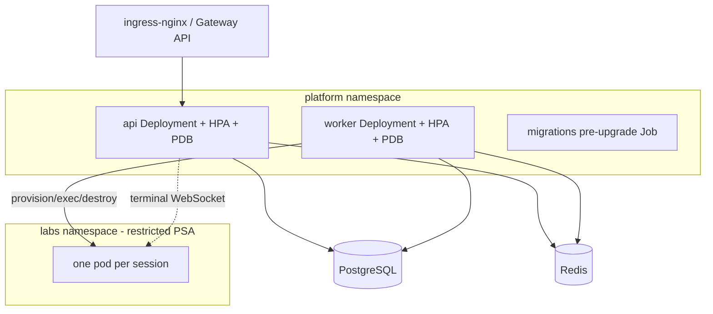
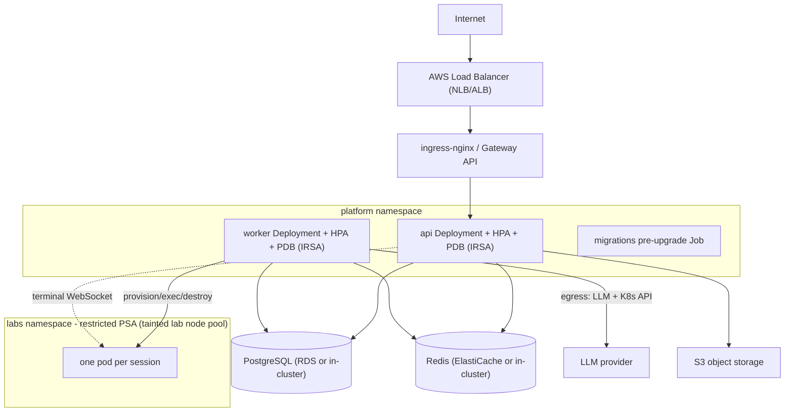
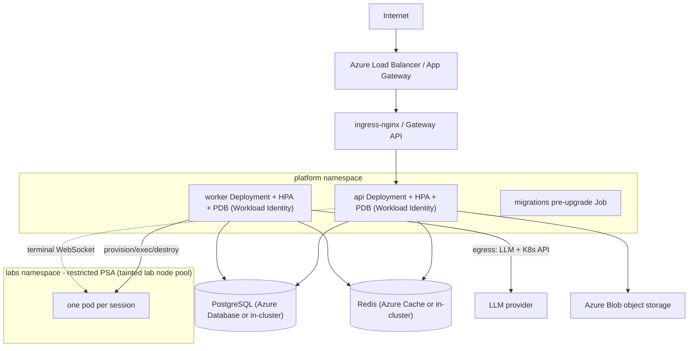
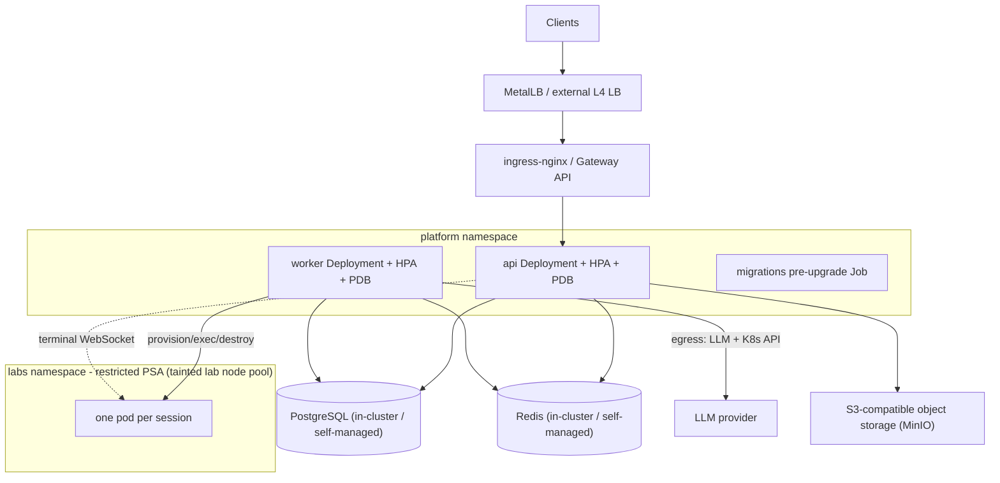
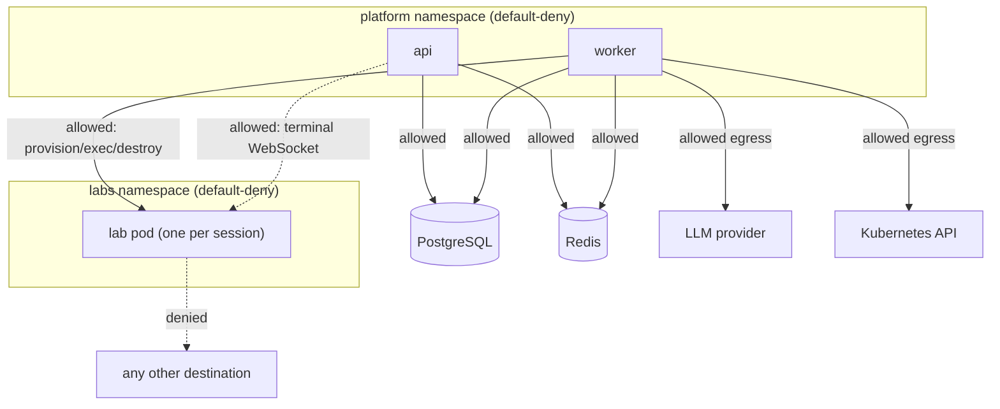
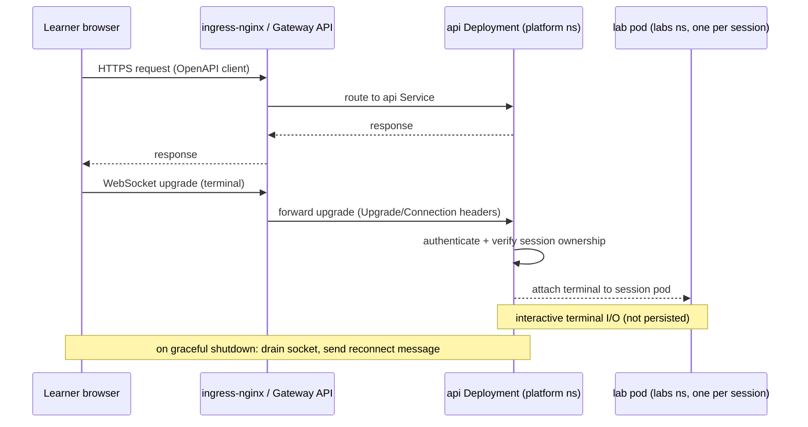
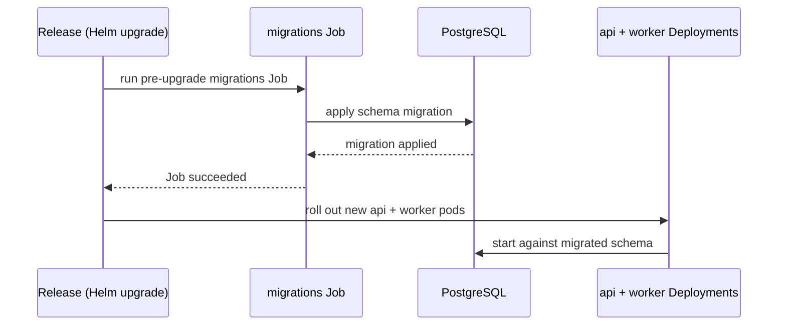

# Deployment Design (D5)

This document (D5) is the authoritative deployment reference for the EDU-IT platform. It
describes the Kubernetes topology per target (EKS, AKS, and on-premise), the namespaces and node
pools, the network policies for the labs and platform workloads, the RBAC model, and the
ingress and WebSocket path. It also records the rollout mechanics that the topology depends on:
the migrations pre-upgrade Job, horizontal autoscaling (HPA), and pod disruption budgets (PDB).

The normative deployment and Kubernetes-topology rules live in steering and are not restated
here; this document links them so there is a single source of truth:

#[[file:.kiro/steering/deployment.md]]

Where this document and the steering file describe the same topology, the steering file is
authoritative. This document adds the per-target detail, rationale, diagrams, and
cross-references for reviewers. The high-level deployment shape is introduced in
`docs/ARCHITECTURE.md` (D1); the lab lifecycle that runs inside the `labs` namespace is
detailed in `docs/LABS-DESIGN.md` (D4).

## Scope

This document covers the deployment topology only: how the EDU-IT applications (`apps/api`,
`apps/worker`, and the `apps/web` UI they serve) and their backing services (PostgreSQL, Redis,
object storage) are arranged on Kubernetes across the three supported targets, and how traffic,
isolation, identity, and rollout are configured. Deploy artifacts themselves — Helm charts and
Kubernetes manifests — live under `deploy/` and are produced by later phase specs; this
design-foundation document defines the topology they must realize and produces no deployment
source.

Related documents:

- Architecture and layering — `docs/ARCHITECTURE.md` (D1)
- Labs design (lab lifecycle, sandbox providers, failure scenarios) — `docs/LABS-DESIGN.md` (D4)

## Portability Principle

The platform runs on Kubernetes (EKS, AKS or on-premise). It is portable across EKS, AKS and
on-premise using standard Kubernetes APIs only; provider differences live in Helm values. The
manifests therefore use only portable, upstream Kubernetes objects — `Deployment`, `Service`,
`Job`, `HorizontalPodAutoscaler`, `PodDisruptionBudget`, `NetworkPolicy`, `ServiceAccount`,
`Role`/`RoleBinding`, `Namespace` with Pod Security Admission labels, `RuntimeClass`, and either
an `Ingress` (ingress-nginx) or the Gateway API — and never a provider-proprietary resource in
the base chart.

Everything that genuinely differs between clouds is isolated into the Helm values file for that
target rather than into the templates:

| Concern | EKS values | AKS values | On-premise values |
|---------|------------|------------|-------------------|
| Managed PostgreSQL / Redis | endpoints for RDS / ElastiCache (or in-cluster) | endpoints for Azure Database / Azure Cache (or in-cluster) | in-cluster or self-managed endpoints |
| Object storage (`ObjectStorage`) | S3 bucket + endpoint | Azure Blob container + endpoint | S3-compatible endpoint (e.g. MinIO) |
| Workload identity for storage/secrets | IRSA (IAM Roles for Service Accounts) | Azure AD Workload Identity | Kubernetes `ServiceAccount` + mounted credentials |
| Ingress / load balancer | AWS Load Balancer Controller in front of ingress-nginx / Gateway API | Azure Load Balancer / Application Gateway in front of ingress-nginx / Gateway API | MetalLB or external L4 LB in front of ingress-nginx / Gateway API |
| Lab node pool | tainted EKS managed node group | tainted AKS node pool | tainted self-managed node group |
| `RuntimeClass` for labs | gVisor or Kata | gVisor or Kata | gVisor or Kata (runc dev-only with a startup warning) |
| StorageClass for persistent volumes | EBS CSI | Azure Disk CSI | on-prem CSI (Ceph, local-path, etc.) |

Because only values change, the same templates render on every target. The topology, the
isolation posture, and the traffic path described below are identical across EKS, AKS, and
on-premise.

## Namespaces

Two namespaces hold the running platform:

- `platform` namespace holds the api Deployment (+ HPA + PDB), the worker Deployment
  (+ HPA + PDB), and the migrations pre-upgrade Job.
- `labs` namespace — restricted PSA; one pod per session.

The `labs` namespace is labelled for the **restricted** Pod Security Admission (PSA) profile, so
every lab pod is admitted only if it satisfies the restricted standard (non-root, no privilege
escalation, dropped capabilities, seccomp runtime-default, read-only root where possible). This
keeps learner-controlled workloads under the strictest baseline the cluster offers. The
`platform` namespace runs trusted first-party workloads and is not labelled restricted, but it is
locked down by network policy and RBAC as described below.

Separating labs from platform by namespace is what makes the per-session pods isolatable: network
policy, PSA, node placement, and RBAC are all scoped per namespace, so the blast radius of a lab
pod is confined to the `labs` namespace.

## Node Pools and Runtime

Lab workloads run on their own nodes, isolated from the platform workloads:

- Dedicated lab node pool with taints/tolerations; configurable RuntimeClass (gVisor or Kata;
  plain runc dev-only with a startup warning).

The lab node pool carries a taint that only lab pods tolerate, so no platform pod is scheduled
onto lab nodes and no lab pod is scheduled onto platform nodes. Lab pods set the toleration plus
a node selector / affinity for the lab pool. The `RuntimeClass` is configurable per target: gVisor
or Kata provide a sandboxed kernel boundary for untrusted code; plain runc is permitted only in
development and emits a startup warning so a non-sandboxed runtime can never be used in production
unnoticed.

Per-target node-pool realization (a Helm values concern, topology unchanged):

| Target | Lab node pool | Platform nodes |
|--------|---------------|----------------|
| EKS | tainted managed node group with the lab RuntimeClass | general managed node group(s) |
| AKS | tainted AKS node pool with the lab RuntimeClass | system + user node pool(s) |
| On-premise | tainted self-managed node group with the lab RuntimeClass | general self-managed nodes |

## Platform Topology (per target)

The runtime topology below is identical across EKS, AKS, and on-premise; only the Helm values
backing the ingress class, storage, workload identity, and datastore endpoints differ.

- `platform` namespace holds the api Deployment (+ HPA + PDB), the worker Deployment
  (+ HPA + PDB), and the migrations pre-upgrade Job.
- Ingress is ingress-nginx / Gateway API and routes to the api Deployment.
- The api reaches PostgreSQL and Redis; the worker reaches PostgreSQL and Redis.
- The worker provisions, executes and destroys the per-session pool.
- The api attaches the terminal WebSocket to the per-session pool.

### EKS target

On EKS the cluster fronts the ingress with the AWS Load Balancer Controller, uses IRSA for
workload identity to S3 and secrets, and may point PostgreSQL and Redis at managed RDS and
ElastiCache endpoints (or in-cluster services). The topology and isolation are unchanged; the
differences are supplied through the EKS Helm values only.

### AKS target

On AKS the cluster fronts the ingress with an Azure Load Balancer (optionally Application
Gateway), uses Azure AD Workload Identity for access to Azure Blob and secrets, and may point
PostgreSQL and Redis at Azure Database and Azure Cache (or in-cluster services). Only the AKS Helm
values differ; the topology matches EKS and on-premise.

### On-premise target

On-premise the cluster fronts the ingress with an L4 load balancer such as MetalLB or an external
appliance, uses in-cluster `ServiceAccount` credentials for workload identity, and backs object
storage with an S3-compatible endpoint (for example MinIO). PostgreSQL and Redis are in-cluster or
self-managed. Only the on-premise Helm values differ; the topology matches EKS and AKS.

## Network Policies

Isolation is enforced by default-deny network policies in both namespaces:

- Default-deny NetworkPolicy in `labs`; default-deny in `platform` so only api and worker reach
  PostgreSQL and Redis; worker egress limited to the LLM provider and the Kubernetes API.

What this implies concretely:

- **`labs` namespace:** a default-deny policy drops all ingress and egress for lab pods except the
  flows the lab lifecycle needs — the worker provisioning/executing/destroying the pod and the api
  attaching the terminal WebSocket. Lab pods get no general outbound internet access, which keeps a
  learner-controlled pod from reaching arbitrary destinations.
- **`platform` namespace:** a default-deny policy means only the api and the worker are permitted
  to reach PostgreSQL and Redis; no other workload can open those connections.
- **Worker egress:** the worker's egress is limited to the LLM provider and the Kubernetes API —
  the two destinations it legitimately needs for ahead-of-time generation and for provisioning
  lab pods. It has no broader outbound access.

## RBAC

RBAC is scoped by namespace and bound to per-workload service accounts; no platform workload runs
with cluster-admin.

- The **worker** needs to provision, execute, and destroy per-session lab pods, so it holds a
  namespaced `Role` in the `labs` namespace granting the pod and exec verbs it needs (create, get,
  list, watch, delete pods, and `pods/exec`), bound to the worker `ServiceAccount` via a
  `RoleBinding`. This is the RBAC counterpart of the worker's permitted egress to the Kubernetes
  API, and it is confined to the `labs` namespace so the worker cannot act on platform workloads.
- The **api** holds a `ServiceAccount` in the `platform` namespace. Its interaction with lab pods
  is the terminal WebSocket attach path; it is granted only the minimal access required for that
  path and does not carry broad pod-management permissions.
- The **migrations Job** runs under its own `ServiceAccount` with access limited to what the
  schema migration needs (database credentials via mounted secret); it holds no pod-management
  rights.
- Workload identity for object storage and secrets is supplied per target (IRSA on EKS, Azure AD
  Workload Identity on AKS, mounted `ServiceAccount` credentials on-premise), so no long-lived
  cloud credentials are embedded in images.

Each service account receives the least privilege it needs, and every binding is a namespaced
`RoleBinding` rather than a `ClusterRoleBinding`, keeping authority inside the owning namespace.

## Ingress and WebSocket Path

Ingress is ingress-nginx / Gateway API and routes to the api Deployment. All external traffic —
the Next.js `apps/web` UI calls through the generated OpenAPI client and the learner's
authenticated terminal WebSocket — enters through the ingress and terminates at the api Service.

- **HTTP/REST:** the ingress routes API requests to the api Deployment behind its `Service`.
- **WebSocket:** the terminal connection is an HTTP upgrade on the same ingress path to the api.
  The ingress must allow the `Upgrade`/`Connection` headers and use a read/send timeout long
  enough for an interactive terminal session (the terminal upgrade is a long-lived connection, so
  the ingress idle timeout is raised accordingly). The api authenticates the WebSocket, verifies
  session ownership, and attaches the terminal to the learner's per-session lab pod in the `labs`
  namespace.
- **Graceful shutdown:** graceful shutdown drains terminal WebSockets with a reconnect message, so
  a rolling update of the api does not drop a learner's terminal abruptly — the client is told to
  reconnect and is reattached to its still-running session pod. (The reconnect ownership re-check
  and reconnect indication are detailed in `docs/LABS-DESIGN.md` (D4), failure scenario 4.2.)

## Rollout: Migrations, HPA, and PDB

The `platform` namespace runs three workloads whose rollout mechanics the topology depends on.

### Migrations pre-upgrade Job

The migrations pre-upgrade Job runs the database schema migration before the api and worker
Deployments are upgraded. Running it as a pre-upgrade Job (ordered ahead of the rollout) means the
schema is migrated first and the new api/worker pods start against an already-migrated database,
avoiding a window where new code runs on an old schema. The Job runs to completion once per
upgrade; the rollout proceeds only after it succeeds.

### Horizontal Pod Autoscaler (HPA)

The api Deployment and the worker Deployment each carry an HPA so they scale out under load and
back in when idle — the api on request/connection load, the worker on queue depth / processing
load. Autoscaling is a standard Kubernetes `HorizontalPodAutoscaler`, so it is portable across all
three targets.

### Pod Disruption Budget (PDB)

The api Deployment and the worker Deployment each carry a PDB so voluntary disruptions (node
drains, cluster upgrades) cannot take down all replicas of a workload at once; a minimum number of
pods stays available during maintenance. Combined with the api's graceful WebSocket drain, this
keeps the platform available and keeps terminal sessions recoverable during routine cluster
operations.

## Failure Scenarios Relevant to Deployment

The six platform failure scenarios are owned by the design documents named in the design (D4 for
labs, D6/D3 for AI/data, D2/D3 for the API/data). Two of them are realized partly by the
deployment topology defined here, and are documented authoritatively in `docs/LABS-DESIGN.md`
(D4):

- **WebSocket drop (4.2):** the api's graceful shutdown drains terminal WebSockets with a
  reconnect message during a rolling update; ownership is re-verified on reconnect and no terminal
  I/O is persisted. The ingress and api configuration above (upgrade headers, raised idle timeout,
  drain-on-shutdown) is what makes this behavior possible. The full behavior is specified in D4.
- **Sandbox provisioning failure (4.1):** the worker provisions per-session lab pods in the `labs`
  namespace via its namespaced RBAC and Kubernetes-API egress; when provisioning fails, the
  topology's reaper (the worker's expired-session reaper) cleans orphaned resources and
  provisioning is rate-limited and retried within policy. The full behavior and bounds are
  specified in D4.

This document does not restate the bounds or the user-facing behavior of those scenarios; it only
records which topology elements (graceful-drain api, worker RBAC/egress, dedicated lab namespace,
reaper) support them. The authoritative specification is `docs/LABS-DESIGN.md` (D4).

## Related Steering and Documents

- Deployment and Kubernetes-topology rules: #[[file:.kiro/steering/deployment.md]]
- Architecture and layering: `docs/ARCHITECTURE.md` (D1)
- Labs design (lab lifecycle, sandbox providers, failure scenarios 4.1–4.3):
  `docs/LABS-DESIGN.md` (D4)
