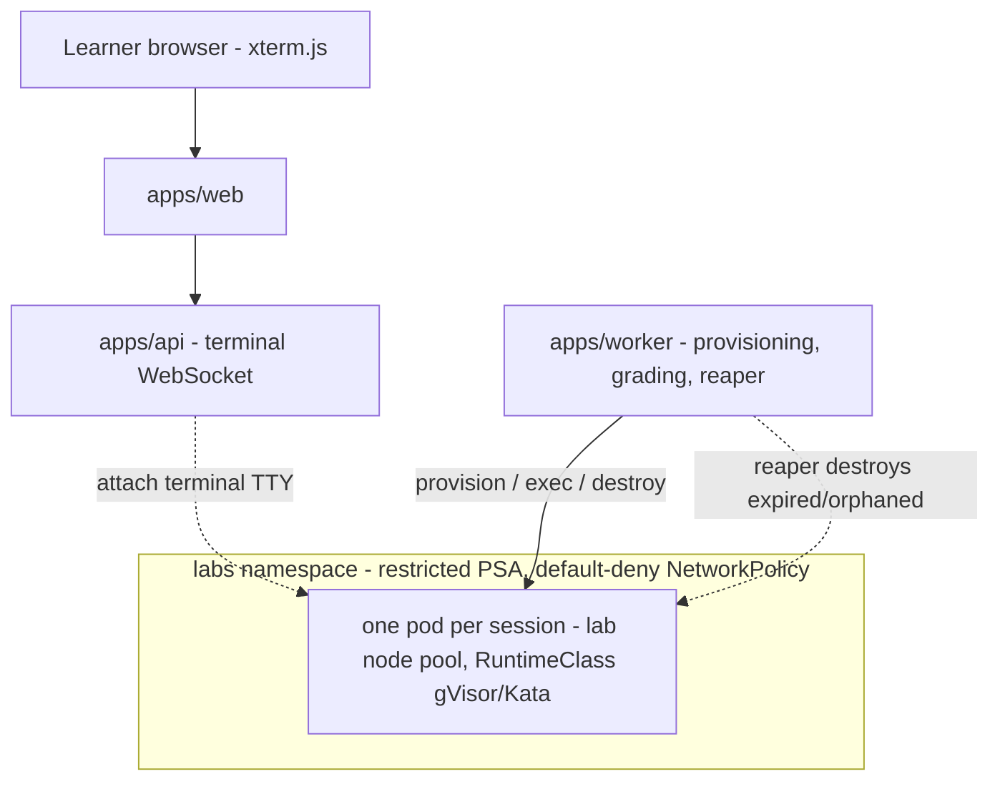
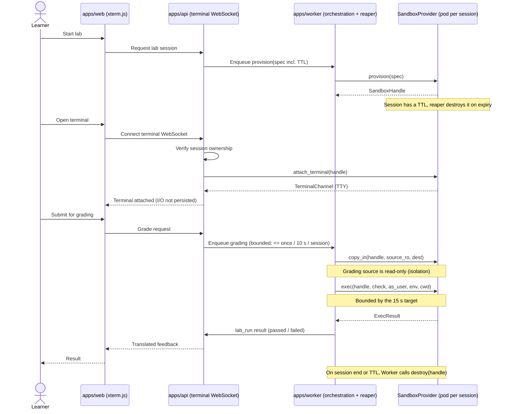
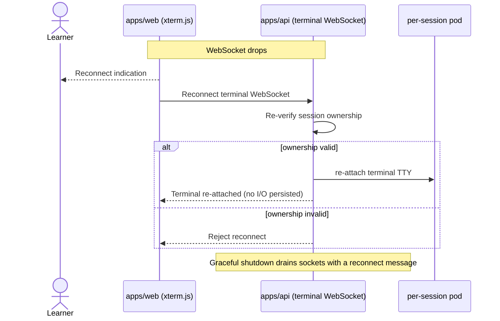

# Labs Design (D4)

This document is the low-level design reference for the EDU-IT labs, sandbox, and terminal
subsystem. It defines the `SandboxProvider` port, the end-to-end sequences that start a lab,
attach a terminal, grade a submission, and return a result, the per-session pod topology, the
per-provider security model, and the required behavior for the lab failure scenarios.

The normative labs, sandbox, and terminal rules live in steering and are not restated as the
source of truth; this document links them and adds the authoritative interface signatures,
diagrams, bounds, and cross-references for reviewers:

#[[file:.kiro/steering/labs.md]]

Where this document and the steering file describe the same rule, the steering file is
authoritative for the rule text and this document is authoritative for the `SandboxProvider`
interface signatures (the steering file marks its own signatures as illustrative and points
here). All numbers and normative wording below are preserved unchanged from steering.

## Scope

EDU-IT learners advance only by proving mastery through quizzes, hands-on labs (real terminals,
graded code), and projects. This document covers the hands-on labs path: how a lab session is
provisioned inside a sandbox, how the authenticated terminal is attached, how graded code is
checked in isolation, and how expired or orphaned sessions are reaped.

Responsibilities are split across the three deployable applications:

- `apps/web` renders the xterm.js terminal.
- `apps/api` hosts the authenticated terminal WebSocket and can attach the terminal TTY to the
  sandbox.
- `apps/worker` performs lab provisioning and grading orchestration, and runs the reaper for
  expired sessions. The worker provisions, executes, and destroys the per-session pool.

Sibling documents:

- Architecture — `docs/ARCHITECTURE.md` (D1)
- Deployment design — `docs/DEPLOYMENT-DESIGN.md` (D5)

## The `SandboxProvider` Port

The sandbox sits behind the `SandboxProvider` port. Its implementations are Docker (dev only),
Kubernetes (prod), and Fake (tests), with a warm-pool extension point. This is the authoritative
version of the interface signatures; the copy in `#[[file:.kiro/steering/labs.md]]` is marked
illustrative and defers here.

```pascal
INTERFACE SandboxProvider              // authoritative signatures — docs/LABS-DESIGN.md (D4)
  FUNCTION provision(spec) RETURNS SandboxHandle
  FUNCTION exec(handle, command, as_user, env, cwd) RETURNS ExecResult
  FUNCTION attach_terminal(handle) RETURNS TerminalChannel
  FUNCTION copy_in(handle, source_ro, dest) RETURNS Void    // read-only source for grading
  FUNCTION copy_out(handle, source, dest) RETURNS Void
  FUNCTION destroy(handle) RETURNS Void
  FUNCTION health(handle) RETURNS HealthStatus
  // Implementations: Docker (dev only), Kubernetes (prod), Fake (tests). Warm-pool extension point.
END INTERFACE
```

### Signature responsibilities

| Function | Responsibility |
|----------|----------------|
| `provision(spec)` | Create the per-session sandbox from a spec (image, resource limits, RuntimeClass, TTL) and return a `SandboxHandle`. One pod per session. |
| `exec(handle, command, as_user, env, cwd)` | Run a single command inside the sandbox and return an `ExecResult`. Used by grading orchestration; runs the check as a specific user, environment, and working directory. |
| `attach_terminal(handle)` | Open a `TerminalChannel` (TTY) to the sandbox for the interactive terminal; the api attaches the terminal TTY to the sandbox over this channel. |
| `copy_in(handle, source_ro, dest)` | Copy files into the sandbox from a read-only source. The read-only source is used for grading so a check cannot mutate its own fixtures. |
| `copy_out(handle, source, dest)` | Copy files out of the sandbox (for example, lab artifacts routed to object storage). |
| `destroy(handle)` | Tear the sandbox down and release its resources; leaves no partial session running. |
| `health(handle)` | Report a `HealthStatus` for the sandbox, used by provisioning and by the reaper. |

The port keeps the domain and application layers free of any sandbox technology: swapping Docker
(dev only), Kubernetes (prod), or Fake (tests) changes only the infrastructure implementation.
See the layering model in `docs/ARCHITECTURE.md` (D1).

## Per-Session Pod Topology

Lab sessions run in the `labs` namespace under a restricted Pod Security Admission profile, with
one pod per session. The pod is scheduled onto a dedicated lab node pool with taints and
tolerations, under a configurable RuntimeClass (gVisor or Kata; plain runc dev-only with a
startup warning). A default-deny NetworkPolicy applies in `labs`. The worker provisions,
executes, and destroys the per-session pool; the api attaches the authenticated terminal
WebSocket to that same pool. The full per-target topology, network policies, and RBAC are in
`docs/DEPLOYMENT-DESIGN.md` (D5).



## Sequence: Start Lab → Terminal → Grade → Result

The flow below covers the full lifecycle: starting a lab provisions a per-session pod, the api
attaches the terminal, the learner works interactively, grading runs in isolation, and the
result is returned. Timeout/TTL and grading isolation are called out inline.



### Timeout and TTL

- Every lab session carries a TTL. When the TTL expires, the reaper destroys the per-session
  pool so no session outlives its lifetime.
- Grading is bounded: results within a 15 s target, executed at most once per 10 s per session.
- On normal completion or TTL expiry, the worker calls `destroy(handle)`, leaving no partial
  session running.

### Grading isolation

- Grading orchestration runs in the worker, not in the interactive terminal path.
- The grading source is copied in through `copy_in(handle, source_ro, dest)` from a read-only
  source, so a check cannot mutate its own fixtures.
- Checks run through `exec(handle, command, as_user, env, cwd)` with an explicit user,
  environment, and working directory, inside the per-session pod under the restricted PSA
  profile and default-deny network policy. The result is recorded as a `lab_run`.

## Security Model per Provider

All three implementations sit behind the identical `SandboxProvider` port; the security posture
differs by environment.

| Provider | Where it runs | Security model |
|----------|---------------|----------------|
| Docker | Dev only | Local Docker sandbox for development. Dev-only; not used in production. When the plain runc RuntimeClass is used it is dev-only and emits a startup warning. |
| Kubernetes | Prod | One pod per session in the `labs` namespace under restricted PSA, on a dedicated lab node pool with taints/tolerations, under a configurable RuntimeClass (gVisor or Kata), with a default-deny NetworkPolicy in `labs`. The worker provisions, executes, and destroys the per-session pool; the api attaches the terminal WebSocket to it. |
| Fake | Tests | In-memory/no-op implementation used by tests; runs no real sandbox and reaches no external system, so domain and application logic can be tested without infrastructure. |

Cross-reference: the per-target Kubernetes topology, namespaces, node pools, network policies,
RBAC, and the ingress/WebSocket path are documented in `docs/DEPLOYMENT-DESIGN.md` (D5).

## Failure Scenarios

The behavior below is required for the named lab failure scenarios. Each corresponds to an
IF/THEN requirement in the spec's requirements document.

### 4.1 Sandbox provisioning failure

IF sandbox provisioning fails, THEN the system:

- surfaces a translated error to the learner,
- leaves no partial session running,
- lets the reaper clean orphaned resources, and
- applies provisioning rate-limits and retries bounded by the maximum values stated in this
  document.

Stated maximum values for this scenario (the bounds referenced above):

- Maximum provisioning retries per lab session: **2** retry attempts (3 provisioning attempts
  total) before the translated error is surfaced and the attempt is abandoned.
- Maximum provisioning rate: at most **1** provisioning attempt per **10 s** per session,
  consistent with the per-session grading cadence.

On any abandoned or failed attempt, `destroy(handle)` is invoked for any handle that was
partially created, and the reaper independently sweeps orphaned resources whose owning session no
longer exists.

### 4.2 Terminal WebSocket drop

IF a terminal WebSocket connection drops, THEN the system:

- re-verifies session ownership on reconnect,
- presents a reconnect indication,
- drains active sockets on graceful shutdown, and
- persists no terminal I/O.

Graceful shutdown drains terminal WebSockets with a reconnect message; terminal input and output
are never recorded or stored.



### 4.3 Grading check timeout

IF a grading check does not return within the 15 s target, THEN:

- grading is bounded (results within a 15 s target, executed at most once per 10 s per session),
- the timeout yields a translated "could not complete" feedback instead of raw output, and
- the run is recorded with a failed status.

The learner never sees raw sandbox output on timeout; they see the translated "could not
complete" feedback, and the corresponding `lab_run` is recorded as failed.

## Related Steering and Documents

- Labs, sandbox, and terminal rules: #[[file:.kiro/steering/labs.md]]
- Architecture (layering, component responsibilities): `docs/ARCHITECTURE.md` (D1)
- Deployment design (Kubernetes topology, network policies, RBAC, ingress/WebSocket path):
  `docs/DEPLOYMENT-DESIGN.md` (D5)
