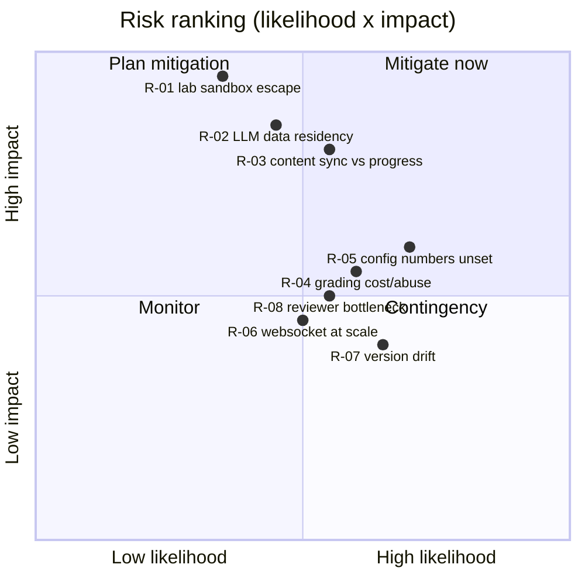

# Risks and Open Questions (D8)

This document (D8) is the design foundation's register of **ranked platform risks** and **open
questions**, each paired with a **recommendation** (a mitigation for a risk, or a proposed path to
a decision for an open question). It is the single place where the challenges and notes raised
elsewhere in the design — most notably the open questions forwarded from `docs/RULES-REVIEW.md`
(D7) — are collected, ranked, and tracked to a recommended resolution.

This document does not restate the normative rules; those live in steering and are the single
source of truth. Where a risk or open question concerns a rule, the rule text is quoted from
steering unchanged and linked:

#[[file:.kiro/steering/domain-rules.md]]
#[[file:.kiro/steering/labs.md]]
#[[file:.kiro/steering/ai-content.md]]
#[[file:.kiro/steering/deployment.md]]
#[[file:.kiro/steering/auth-privacy.md]]

Where a risk or open question is **resolved by an architecture decision record**, this document
cross-references the ADR (A1–A8 under `docs/adr/`) that records the decision rather than deciding
it here. All numbers and normative wording quoted below are transcribed from steering and the
sibling design documents unchanged (for example `0–100`, `< 30`, `30-59`, `60-84`, `>= 85`,
`-1/day`, `15 s`, `10 s`, `24 hours`).

## Scope and Method

Each entry is recorded under a fixed template:

- **ID** — a stable identifier (`R-nn` for risks, `Q-nn` for open questions).
- **Statement** — what the risk or open question is.
- **Likelihood / Impact** — for risks, a qualitative `Low` / `Medium` / `High` on each axis; the
  product of the two drives the ranking.
- **Rank** — the ordering used in the register (highest likelihood × impact first).
- **Recommendation** — the mitigation (for a risk) or the proposed route to a decision (for an open
  question), including the ADR that resolves it where one applies.
- **Owner / Resolution path** — where the decision lands: an ADR, a `domain/config.py` business
  number, a later-phase spec, or operational runbook.

Nothing here changes a rule. Open questions that touch rules are recorded and await a decision;
the rule in steering stays authoritative and unchanged until that decision is recorded (and, where
relevant, a `domain/config.py` business number is set).

---

## 1. Risk Ranking Overview

Risks are ranked by the product of likelihood and impact. The matrix below places each risk so the
ranking is visible at a glance; the detailed entries follow in Section 2.

| Rank | ID | Risk | Likelihood | Impact | Resolved / mitigated via |
|------|------|------|------------|--------|--------------------------|
| 1 | R-01 | Lab sandbox escape or noisy-neighbour from learner-run code | Medium | High | `docs/LABS-DESIGN.md` (D4), `docs/DEPLOYMENT-DESIGN.md` (D5) |
| 2 | R-02 | LLM provider data residency / privacy exposure | Medium | High | ADR A7 (LLM provider and data residency) |
| 3 | R-03 | Content sync corrupting or resetting learner progress | Medium | High | ADR A1/A6 context + `docs/DATA-MODEL.md` (D3), `docs/AI-CONTENT-DESIGN.md` (D6) |
| 4 | R-05 | Business numbers (`domain/config.py`) left unset at implementation | High | Medium | `domain/config.py` + ADR A6 (decay), Q-01/Q-02/Q-03 |
| 5 | R-04 | Grading compute cost and abuse (grading spam) | Medium | Medium | `docs/LABS-DESIGN.md` (D4) |
| 6 | R-08 | Expert reviewer bottleneck stalls the content pipeline | Medium | Medium | `docs/AI-CONTENT-DESIGN.md` (D6) |
| 7 | R-06 | Terminal WebSocket scaling and reconnect churn | Medium | Low-Medium | `docs/LABS-DESIGN.md` (D4), `docs/DEPLOYMENT-DESIGN.md` (D5) |
| 8 | R-07 | Framework / tool version drift from pinned versions | Medium-High | Low | ADR A1 (versions) |

---

## 2. Ranked Risks

### R-01 — Lab sandbox escape or noisy-neighbour (Rank 1)

- **Statement:** Labs run real, learner-authored code on real terminals. A container escape,
  resource-exhaustion, or lateral-movement attempt from learner code could compromise the node, the
  `labs` namespace, or reach the `platform` services.
- **Likelihood / Impact:** Medium / High.
- **Recommendation (mitigation):** Keep the defence-in-depth already specified in the design:
  one pod per session in a restricted-PSA `labs` namespace, a default-deny NetworkPolicy in `labs`,
  a dedicated lab node pool with taints/tolerations, and a configurable RuntimeClass (gVisor or
  Kata; plain `runc` dev-only with a startup warning). Grading runs in isolation with a read-only
  source (`copy_in(handle, source_ro, dest)`). Keep worker egress limited to the LLM provider and
  the Kubernetes API.
- **Owner / Resolution path:** `docs/LABS-DESIGN.md` (D4) security-model section and
  `docs/DEPLOYMENT-DESIGN.md` (D5) network policy / node-pool section; operational hardening in a
  later deployment-phase spec. No open question remains at design-foundation level.

### R-02 — LLM provider data residency and privacy exposure (Rank 2)

- **Statement:** AI drafts content ahead of time. If learner personal data or restricted content
  reached an LLM request, or if the provider stored data outside the EU, the platform's privacy
  posture would be violated.
- **Likelihood / Impact:** Medium / High.
- **Recommendation (mitigation):** The invariant from steering — the LLM provider is used for
  ahead-of-time content generation only, never on a learner's request path — already bounds the
  exposure surface. Enforce the "data allowed in LLM requests" allowlist from
  `docs/AI-CONTENT-DESIGN.md` (D6). The provider choice, the DPA, and EU residency are an
  architecture decision.
- **Owner / Resolution path:** **ADR A7 (LLM provider and data residency)** records the provider
  behind `LLMProvider`, the DPA, and EU residency; `docs/AI-CONTENT-DESIGN.md` (D6) documents the
  allowed-data rule; privacy coverage (export/deletion/retention) is in
  #[[file:.kiro/steering/auth-privacy.md]] and `docs/DATA-MODEL.md` (D3).

### R-03 — Content sync corrupting or resetting learner progress (Rank 3)

- **Statement:** Content is re-synced while learners are actively using it (failure scenario 4.5).
  A naive overwrite could reset progress, drop completions, or orphan in-flight attempts.
- **Likelihood / Impact:** Medium / High.
- **Recommendation (mitigation):** Apply the documented behavior verbatim: the upsert is idempotent
  keyed by stable ID, edits never reset progress, existing completions are kept, new attempts use
  the new version, and removed items are archived rather than deleted. This is specified in both
  `docs/DATA-MODEL.md` (D3) and `docs/AI-CONTENT-DESIGN.md` (D6).
- **Owner / Resolution path:** `docs/DATA-MODEL.md` (D3) and `docs/AI-CONTENT-DESIGN.md` (D6)
  failure-scenario 4.5 sections. ADR A1 (versions) and ADR A6 (decay computation) provide
  supporting context for versioned content and deterministic re-computation, but 4.5 behavior is
  already fully specified — no open question remains.

### R-05 — Business numbers left unset at implementation (Rank 4)

- **Statement:** Several per-event magnitudes and interpretations are `domain/config.py` business
  numbers that the design foundation deliberately does not invent. If implementation begins before
  they are fixed, mastery math could be inconsistent or ad hoc. This risk is the aggregation of
  open questions Q-01, Q-02, and Q-03 forwarded from `docs/RULES-REVIEW.md` (D7).
- **Likelihood / Impact:** High / Medium.
- **Recommendation (mitigation):** Resolve Q-01, Q-02, and Q-03 (Section 3) before the first
  mastery-affecting phase spec. The authoritative values belong in `domain/config.py` (thresholds,
  points, intervals, timeouts). The decay strategy itself (the `-1/day overdue`, deterministic from
  the clock) is settled by **ADR A6 (decay computation)**; the remaining magnitudes are config
  numbers, not architecture decisions.
- **Owner / Resolution path:** `domain/config.py` business numbers; ADR A6 for the decay strategy;
  tracked as open questions Q-01/Q-02/Q-03 below.

### R-04 — Grading compute cost and abuse (Rank 5)

- **Statement:** Graded labs run code and consume compute. Without bounds, a learner could spam
  grading or long-running checks could exhaust the lab node pool.
- **Likelihood / Impact:** Medium / Medium.
- **Recommendation (mitigation):** The grading bounds from steering already cap both latency and
  load: grading is bounded (results within a `15 s` target, executed at most once per `10 s` per
  session), and a run exceeding the target becomes the timeout path (translated "could not complete"
  feedback, run recorded as failed) per failure scenario 4.3. Keep provisioning rate-limited and
  retried bounded by the maximum values stated in `docs/LABS-DESIGN.md` (D4) per failure scenario
  4.1.
- **Owner / Resolution path:** `docs/LABS-DESIGN.md` (D4) grading-bounds and failure-scenario
  sections. No open question remains.

### R-08 — Expert reviewer bottleneck (Rank 6)

- **Statement:** Content is drafted by AI and approved by experts; only approved variants are
  served. If reviewer capacity cannot keep up with generation, the approved-variant pool starves
  and learners see repeated items or stall.
- **Likelihood / Impact:** Medium / Medium.
- **Recommendation (mitigation):** Keep the variant lifecycle gates from
  `docs/AI-CONTENT-DESIGN.md` (D6): generation is ahead-of-time with a `PendingReview` buffer, so a
  review backlog degrades gracefully (pool drains slowly) rather than blocking learners
  synchronously. Monitor the approved-pool depth via `item_statistic` and the variant pool; size
  reviewer capacity and generation rate to keep the pool above a floor. Pool-floor sizing is a
  later-phase operational number.
- **Owner / Resolution path:** `docs/AI-CONTENT-DESIGN.md` (D6) variant-lifecycle section;
  operational sizing in a later content-phase spec.

### R-06 — Terminal WebSocket scaling and reconnect churn (Rank 7)

- **Statement:** The authenticated terminal WebSocket is long-lived and stateful. At scale,
  reconnect storms (e.g. after a rolling upgrade) or uneven load could degrade terminal sessions.
- **Likelihood / Impact:** Medium / Low-Medium.
- **Recommendation (mitigation):** Keep the documented behavior for failure scenario 4.2: ownership
  is re-verified on reconnect, a reconnect indication is shown, graceful shutdown drains active
  sockets, and no terminal I/O is persisted. Deployment drains terminal WebSockets with a reconnect
  message on graceful shutdown (D5). Session backing is settled by **ADR A4 (session storage)**.
- **Owner / Resolution path:** `docs/LABS-DESIGN.md` (D4) failure-scenario 4.2 and
  `docs/DEPLOYMENT-DESIGN.md` (D5) ingress/WebSocket section; ADR A4 for server-side session
  backing.

### R-07 — Framework / tool version drift (Rank 8)

- **Statement:** Without pinned versions, frameworks and test tools drift, producing
  non-reproducible builds and subtle behavior differences between environments.
- **Likelihood / Impact:** Medium-High / Low.
- **Recommendation (mitigation):** Pin current stable versions of all frameworks and test tools and
  record them. This is an architecture decision, not a per-spec choice.
- **Owner / Resolution path:** **ADR A1 (versions)** pins current stable versions; drift is then a
  dependency-maintenance concern for later phases.

---

## 3. Open Questions

These open questions await a recorded decision. The first three (Q-01, Q-02, Q-03) are the open
questions **forwarded from `docs/RULES-REVIEW.md` (D7), Section 10**, transcribed here with their
originating rule. None of them changes the rule text in steering.

### Q-01 — Hint-reveal mastery penalty magnitude (forwarded from D7, from rule 4.1)

- **Statement:** The rule records that hint reveals are tracked (`hint_reveal`) and reflected in
  the learner's progress but fixes **no numeric penalty**. The magnitude by which a recorded
  `hint_reveal` tempers an attempt's mastery gain is a `domain/config.py` business number to be
  decided. The worked example in D7 used an illustrative value only (a hint-revealed correct answer
  `+9` versus a plain correct answer `+18`) — illustrative, not normative.
- **Recommendation:** Fix the hint-reveal penalty as a single `domain/config.py` business number
  before the first mastery-affecting phase spec. Keep it consistent with "reflected in the learner's
  progress" (a recorded reveal tempers, but does not void, the attempt's gain). Decide by product +
  domain review; no ADR is required because this is a config magnitude, not an architecture choice.
- **Owner / Resolution path:** `domain/config.py` business number; consolidated under risk R-05.

### Q-02 — Threshold boundary interpretation (forwarded from D7, note on rule 3.2)

- **Statement:** The mastery bands `< 30`, `30-59`, `60-84`, `>= 85` are treated in D7 as
  **inclusive lower bounds** — `30`, `60`, `85` enter the next band. This interpretation is made
  explicit so implementation does not re-derive it. It is a documented boundary **note**, not a rule
  change; the band text in steering is authoritative and unchanged.
- **Recommendation:** Confirm the inclusive-lower-bound interpretation when the mastery thresholds
  land in `domain/config.py`, and encode the thresholds exactly as `< 30` / `30-59` / `60-84` /
  `>= 85` so the state machine matches the steering wording. No ADR required; this is a
  config/interpretation confirmation.
- **Owner / Resolution path:** `domain/config.py` thresholds; consolidated under risk R-05.

### Q-03 — Per-event point magnitudes are illustrative / non-normative (forwarded from D7)

- **Statement:** The quiz/lab/review point values used in the D7 worked example (for example a
  correct quiz answer `+18`, a hint-revealed correct answer `+9`, a passing lab check `+22`, a
  passed review `+6`, and decay `-1/day` overdue) are **illustrative, not normative**. The decay
  rate `-1/day overdue` is the one value among these that is normative (it is a steering rule); the
  per-event gain magnitudes are not.
- **Recommendation:** Fix the authoritative per-event magnitudes in `domain/config.py` (thresholds,
  points, intervals, timeouts) before implementation, keeping the normative decay rate `-1/day`
  overdue exactly as stated. The deterministic, clock-based decay **strategy** is recorded in
  **ADR A6 (decay computation)**; the gain magnitudes are config numbers decided alongside Q-01.
- **Owner / Resolution path:** `domain/config.py` business numbers; ADR A6 for the decay strategy;
  consolidated under risk R-05.

### Q-04 — Task queue backing choice

- **Statement:** The `TaskQueue` port has no concrete backing chosen in the design foundation; the
  queue is only described as "Redis backing (final queue choice is an ADR)".
- **Recommendation:** Record the concrete backing behind `TaskQueue`.
- **Owner / Resolution path:** **ADR A3 (task queue)**.

### Q-05 — Server-side session storage backing

- **Statement:** Sessions are server-side, but the concrete backing store is not fixed in the
  design foundation.
- **Recommendation:** Record the server-side session backing.
- **Owner / Resolution path:** **ADR A4 (session storage)**.

### Q-06 — Translation storage for FR/EN fields and UI keys

- **Statement:** The platform is bilingual (French/English); how FR/EN learner-facing fields and UI
  keys are stored is not fixed in the design foundation.
- **Recommendation:** Record the translation-storage approach.
- **Owner / Resolution path:** **ADR A2 (translation storage)**.

### Q-07 — MDX allowlisted-component rendering approach

- **Statement:** Lessons render MDX with an allowlist of components; the concrete allowlisted
  rendering approach is an architecture decision.
- **Recommendation:** Record the allowlisted-component rendering approach.
- **Owner / Resolution path:** **ADR A5 (MDX rendering)**.

### Q-08 — Reserved future topic

- **Statement:** One ADR slot is reserved for a future decision; no topic is assigned and no
  decision is recorded yet.
- **Recommendation:** Leave reserved until a concrete topic arises; produce the ADR record with its
  context stating the topic is reserved for future use and its decision stating no decision is
  recorded yet.
- **Owner / Resolution path:** **ADR A8 (reserved topic)**.

---

## 4. Open-Question to ADR Mapping

This table shows which open questions are resolved by an ADR (A1–A8) versus a `domain/config.py`
business number. The three D7-forwarded open questions (Q-01, Q-02, Q-03) are config magnitudes and
notes — only the decay strategy underpinning Q-03 is carried by an ADR.

| Open question | Resolved by | Kind |
|---------------|-------------|------|
| Q-01 Hint-reveal penalty magnitude | `domain/config.py` | Config number (no ADR) |
| Q-02 Threshold boundary interpretation | `domain/config.py` | Config note (no ADR) |
| Q-03 Per-event point magnitudes | `domain/config.py` (strategy: ADR A6) | Config numbers; decay strategy by ADR A6 |
| Q-04 Task queue backing | ADR A3 | Architecture decision |
| Q-05 Session storage backing | ADR A4 | Architecture decision |
| Q-06 Translation storage | ADR A2 | Architecture decision |
| Q-07 MDX rendering approach | ADR A5 | Architecture decision |
| Q-08 Reserved topic | ADR A8 | Reserved record |

Risk-to-ADR cross-references: R-02 → ADR A7; R-06 → ADR A4; R-07 → ADR A1; R-05 → ADR A6 (plus
`domain/config.py`); R-03 → ADR A1/A6 context.

---

## Related Steering and Documents

- Domain rules (authoritative; mastery, hints, review, thresholds): #[[file:.kiro/steering/domain-rules.md]]
- Labs, sandbox, terminal rules (authoritative): #[[file:.kiro/steering/labs.md]]
- AI content generation and review rules (authoritative): #[[file:.kiro/steering/ai-content.md]]
- Deployment and Kubernetes topology rules (authoritative): #[[file:.kiro/steering/deployment.md]]
- Authentication and privacy rules (authoritative): #[[file:.kiro/steering/auth-privacy.md]]
- Rules review and forwarded open questions (D7): `docs/RULES-REVIEW.md`
- Labs design (failure scenarios 4.1–4.3, grading bounds): `docs/LABS-DESIGN.md` (D4)
- AI-content design (failure scenarios 4.4–4.5, variant lifecycle): `docs/AI-CONTENT-DESIGN.md` (D6)
- Data model (failure scenarios 4.5/4.6, privacy coverage): `docs/DATA-MODEL.md` (D3)
- API conventions (failure scenario 4.6, idempotency): `docs/API-CONVENTIONS.md` (D2)
- Deployment design (network policies, ingress/WebSocket): `docs/DEPLOYMENT-DESIGN.md` (D5)
- Architecture decision records (A1–A8): `docs/adr/`
