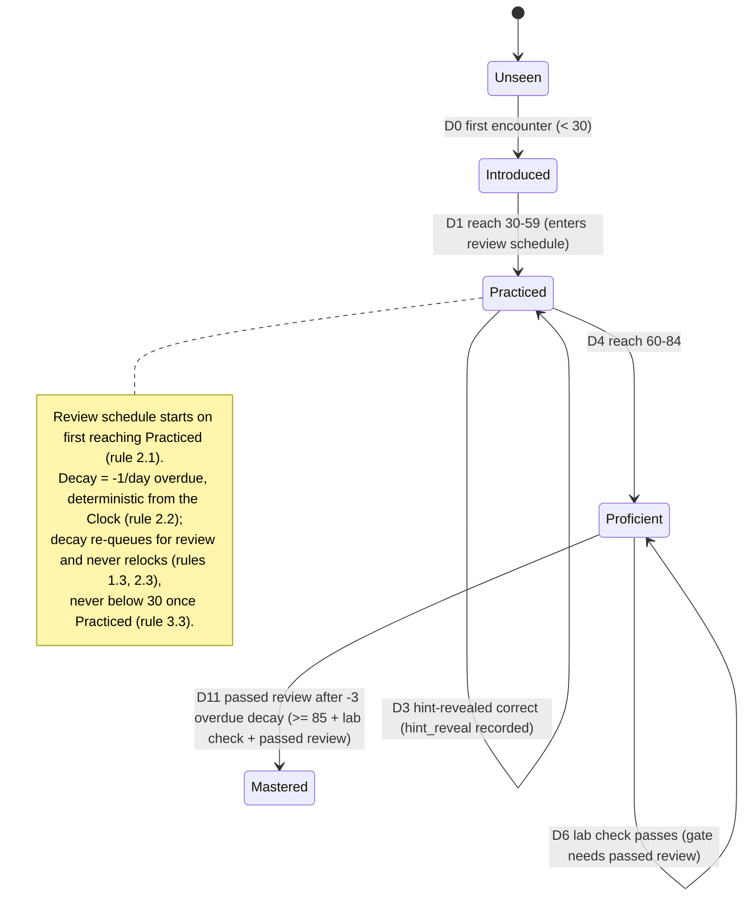

# Rules Review (D7)

This document reviews the EDU-IT domain rules — unlocking, quizzes, labs, projects, mastery,
review, hints, and placement — and either **confirms** each rule as sound and implementable or
**challenges** it with an open question for the design foundation to resolve. It then grounds the
rules in a single **worked example** that traces one learner's mastery points through the seed
track, including one hint reveal and one overdue review.

The normative domain rules live in steering and are not restated here as the source of truth; this
document links them so there is a single source of truth:

#[[file:.kiro/steering/domain-rules.md]]

Where this document and the steering file describe the same rule, the steering file is
authoritative. Every number and all normative wording quoted below is transcribed from the steering
file unchanged (for example `0–100`, `< 30`, `30-59`, `60-84`, `>= 85`, `-1/day`, `15 s`, `10 s`,
`24 hours`); this document adds only review commentary and a worked example on top of that
authoritative text.

## Scope and Method

Each rule is reviewed under a fixed template:

- **Rule** — the rule as transcribed from `domain-rules.md`, numbers and wording preserved.
- **Verdict** — **Confirm** (sound and implementable as written) or **Challenge** (sound in intent
  but with an open question the design must resolve before implementation).
- **Reasoning** — why the verdict holds, and for a challenge, the specific open question.

Challenges never change the rule text. They are recorded here and forwarded to `docs/RISKS.md`
(D8) as open questions; the rule in steering stays authoritative and unchanged until a decision is
recorded.

---

## 1. Progression and Unlocking

### 1.1 Advance only by proving mastery

- **Rule:** Learners rebuild skills step by step and advance only by proving mastery.
- **Verdict:** **Confirm.**
- **Reasoning:** Gating progression on demonstrated mastery rather than time spent or content
  viewed is the product's core promise, and it is mechanically expressible: a module unlocks when
  its prerequisite concepts reach the required mastery state. The `prerequisite` catalog entity and
  the per-user × concept `mastery` value (0–100) give the unlock check everything it needs. No
  ambiguity.

### 1.2 Three mechanisms of proof

- **Rule:** Mastery is proven through three mechanisms: quizzes, hands-on labs (real terminals,
  graded code) and projects.
- **Verdict:** **Confirm.**
- **Reasoning:** The three mechanisms map cleanly onto the catalog (`quiz`, `lab`, `project`) and
  onto progress tables (`quiz_attempt`, `lab_run`, `project_submission`). Each produces a
  `mastery_event` that moves the `mastery` value. The mechanisms are complementary, not
  redundant, so the rule composes well with the mastery thresholds in section 3.

### 1.3 Decay never relocks content

- **Rule:** Decay never relocks content; it only re-queues for review.
- **Verdict:** **Confirm.**
- **Reasoning:** Keeping decay from relocking content protects the learner from losing earned
  access because of calendar time, while still surfacing stale concepts through the review queue.
  This is consistent with the decay floor in section 3 (never below 30 once Practiced): a decayed
  concept is re-queued for review but never falls back into a locked state. The rule appears in
  both this section and the Review section of the steering file; the two statements are identical,
  so there is no conflict.

---

## 2. Review Mechanics

### 2.1 Enters review on first reaching Practiced

- **Rule:** A concept enters the spaced review schedule on first reaching Practiced.
- **Verdict:** **Confirm.**
- **Reasoning:** Anchoring the start of spaced review at the `Practiced` threshold (30-59) gives a
  single, deterministic trigger: the first `mastery_event` that carries the concept to 30 creates
  the `review_schedule` row. "First reaching" makes it idempotent — re-reaching Practiced after a
  decay dip does not create a second schedule.

### 2.2 Decay rate and determinism

- **Rule:** Decay = -1/day overdue, deterministic from the clock.
- **Verdict:** **Confirm.**
- **Reasoning:** A fixed `-1/day overdue` rate computed from the injected `Clock` is fully
  deterministic and reproducible in tests: given a concept's due date and "now", the decay is a
  pure function of the overdue day count. Because the domain reads time only through the injected
  `Clock`, the same inputs always yield the same decay, which is exactly what the worked example in
  section 9 relies on.

### 2.3 Decay re-queues, never relocks

- **Rule:** Decay never relocks content; it only re-queues for review.
- **Verdict:** **Confirm.**
- **Reasoning:** This is the Review-section restatement of rule 1.3 and is consistent with it. The
  effect of decay is limited to lowering the `mastery` value (bounded by the floor in section 3)
  and placing a `review_schedule` entry due; it never changes unlock state. Confirming it in both
  places is deliberate reinforcement, not a contradiction.

---

## 3. Mastery Model

### 3.1 Mastery scale

- **Rule:** Mastery is `mastery` (0–100 per user × concept).
- **Verdict:** **Confirm.**
- **Reasoning:** A bounded 0–100 scale per user × concept is simple, inspectable, and maps directly
  to the state thresholds below. The `mastery` table plus `mastery_event` history give both the
  current value and the audit trail.

### 3.2 States and thresholds

- **Rule:** Mastery states and thresholds:
  - `Unseen` → `Introduced`: first encounter (< 30).
  - `Introduced` → `Practiced`: 30-59.
  - `Practiced` → `Proficient`: 60-84.
  - `Proficient` → `Mastered`: >= 85 + lab check (if lab covers) + passed review.
- **Verdict:** **Confirm, with one documented boundary note.**
- **Reasoning:** The thresholds partition the 0–100 scale cleanly and the `Mastered` gate correctly
  requires more than a numeric score — it also requires a passing lab check where a lab covers the
  concept and a passed review. The one note worth recording (not a rule change): the written bands
  are `< 30`, `30-59`, `60-84`, and `>= 85`, which leaves the integer boundaries at the natural
  cut points (30 enters Practiced, 60 enters Proficient, 85 enters the Mastered gate). The worked
  example treats these as inclusive lower bounds, matching the steering wording. No change is
  proposed; the boundary interpretation is simply made explicit here so implementation does not
  re-derive it.

### 3.3 Decay transitions and floor

- **Rule:**
  - `Mastered` → `Proficient`: decay (never below 30 once Practiced).
  - `Proficient` → `Practiced`: decay (never below 30).
- **Verdict:** **Confirm.**
- **Reasoning:** The decay transitions mirror the forward thresholds and the "never below 30 once
  Practiced" floor guarantees a concept that has ever reached Practiced cannot decay into the
  `Introduced`/`Unseen` region. Combined with rule 1.3 (decay never relocks), the floor means the
  worst decay outcome is a `Practiced` concept sitting on the review queue — never a lost unlock.

---

## 4. Hints

### 4.1 Hint reveals are recorded

- **Rule:** Hint reveals are recorded (`hint_reveal`).
- **Verdict:** **Confirm.**
- **Reasoning:** Recording every hint reveal as a `hint_reveal` row (tracked as a mastery event, per
  the steering reason) makes hint use visible in the learner's progress and auditable in the worked
  mastery example. The rule states that reveals are recorded; it does not by itself fix a numeric
  mastery penalty, so the worked example in section 9 models the hint reveal as a recorded event
  that tempers the mastery gain of the attempt it belongs to, consistent with "reflected in the
  learner's progress". The exact penalty magnitude is a `domain/config.py` business number and is
  called out as an open question in section 10 rather than invented here.

---

## 5. Quizzes

### 5.1 Duplicate submission, dedupe, and 24-hour window

- **Rule:** Duplicate quiz submissions are deduped by an idempotency key; re-answering the same
  question within 24 hours of the first answer yields no additional mastery gain; the best attempt
  still counts for completion.
- **Verdict:** **Confirm.**
- **Reasoning:** The rule cleanly separates three concerns: (a) idempotency-key dedupe guards
  against accidental resubmission; (b) the `24 hours` window stops mastery farming by rapid
  re-answers; (c) "best attempt still counts for completion" ensures a later correct answer is not
  penalized for completion purposes even when it earns no additional mastery inside the window.
  These are consistent — the window limits *mastery gain*, not *completion credit* — and they match
  the data-level treatment in `docs/DATA-MODEL.md` (D3) and the API-level treatment in
  `docs/API-CONVENTIONS.md` (D2) for failure scenario 4.6.

---

## 6. Labs

### 6.1 Labs are hands-on

- **Rule:** Labs are hands-on: real terminals, graded code.
- **Verdict:** **Confirm.**
- **Reasoning:** Real terminals and graded code are what distinguish a lab from a quiz and justify
  the sandbox machinery in `docs/LABS-DESIGN.md` (D4). The rule is implementable through the
  `SandboxProvider` port and the `lab`, `lab_task`, and `lab_check` catalog entities.

### 6.2 Grading is bounded

- **Rule:** Grading is bounded: results within a 15 s target, executed at most once per 10 s per
  session.
- **Verdict:** **Confirm.**
- **Reasoning:** The `15 s` result target plus the `at most once per 10 s per session` rate limit
  together bound both latency and load: a learner cannot spam grading, and a grading run that
  exceeds the target becomes the timeout path documented in failure scenario 4.3 (translated "could
  not complete" feedback, run recorded as failed). The two numbers are preserved exactly from
  steering and are consistent with `docs/LABS-DESIGN.md` (D4) and the quality steering file.

### 6.3 Lab check contributes to Mastered

- **Rule:** A lab check contributes to reaching `Mastered` where a lab covers the concept
  (`>= 85 + lab check (if lab covers) + passed review`).
- **Verdict:** **Confirm.**
- **Reasoning:** This rule is the labs-side view of the `Mastered` gate in section 3.2. The
  conditional "if lab covers" is important and correct: a concept with no lab reaches `Mastered`
  on `>= 85 + passed review` alone, while a lab-covered concept additionally requires a passing lab
  check. The two statements (here and in the mastery model) use identical wording, so there is no
  conflict.

---

## 7. Projects

### 7.1 Projects prove mastery

- **Rule:** Projects are one of the three mechanisms through which mastery is proven.
- **Verdict:** **Confirm.**
- **Reasoning:** This is the Projects-section restatement of rule 1.2 and is consistent with it.
  Projects sit alongside quizzes and labs as a proof mechanism and produce a `project_submission`
  that feeds a `mastery_event`.

### 7.2 Review through the ProjectReviewer extension point

- **Rule:** Project submissions are reviewed through the `ProjectReviewer` extension point: mentor,
  peer or AI-assisted review.
- **Verdict:** **Confirm.**
- **Reasoning:** Modelling project review as an extension point with three interchangeable modes
  (mentor, peer, AI-assisted) keeps the domain independent of who performs the review, matching the
  `ProjectReviewer` port in the architecture. The fake implementation makes project flows testable
  without a human reviewer.

---

## 8. Placement

### 8.1 Placement supported (schema and interfaces only)

- **Rule:** Placement is supported (`placement`, schema and interfaces only for now).
- **Verdict:** **Confirm.**
- **Reasoning:** Scoping placement to schema and interfaces for now is appropriate for a design
  foundation: the `placement` entity and its interfaces are defined so later phases can implement
  the flow, without committing implementation here. The "for now" qualifier is preserved verbatim.

### 8.2 Testing out of a module

- **Rule:** `module_progress` records `tested_out`.
- **Verdict:** **Confirm.**
- **Reasoning:** A `tested_out` flag on `module_progress` lets a learner who proves mastery at
  placement skip a module rather than working through it step by step, which is consistent with
  rule 1.1 (advance by proving mastery): testing out is still proof of mastery, just gathered up
  front. No ambiguity.

---

## Review Summary

| # | Rule area | Verdict |
|---|-----------|---------|
| 1.1 | Advance only by proving mastery | Confirm |
| 1.2 | Three mechanisms of proof | Confirm |
| 1.3 | Decay never relocks (progression) | Confirm |
| 2.1 | Enters review at Practiced | Confirm |
| 2.2 | Decay = -1/day overdue, deterministic | Confirm |
| 2.3 | Decay re-queues, never relocks (review) | Confirm |
| 3.1 | Mastery scale 0–100 | Confirm |
| 3.2 | States and thresholds | Confirm (boundary note) |
| 3.3 | Decay transitions and floor | Confirm |
| 4.1 | Hint reveals recorded | Confirm |
| 5.1 | Duplicate submission / 24-hour window | Confirm |
| 6.1 | Labs are hands-on | Confirm |
| 6.2 | Grading bounded (15 s / 10 s) | Confirm |
| 6.3 | Lab check contributes to Mastered | Confirm |
| 7.1 | Projects prove mastery | Confirm |
| 7.2 | ProjectReviewer extension point | Confirm |
| 8.1 | Placement supported (schema only) | Confirm |
| 8.2 | `module_progress` records `tested_out` | Confirm |

All eighteen reviewed rules are confirmed as sound and implementable as written. One rule (3.2)
carries a documented boundary note and one (4.1) forwards an open question about the hint-penalty
magnitude; neither changes the rule text. Open questions are listed in section 10 and forwarded to
`docs/RISKS.md` (D8).

---

## 9. Worked Example — One Learner Through the Seed Track

This worked example traces a single learner, **Léa**, through the seed track so the mastery model,
the hint rule, and the review/decay rules can be seen operating together on one timeline. It
includes **one hint reveal** and **one overdue review**. Every threshold, floor, and rate used
below is the verbatim number from `domain-rules.md`; the per-event point magnitudes are illustrative
`domain/config.py` business numbers chosen only to walk the example (they are not normative and are
flagged in section 10).

### Setup

- **Learner:** Léa, one enrollment in the seed track.
- **Concept under trace:** `concept: linux-permissions` (call it **C**), which *is* covered by a
  lab, so its `Mastered` gate is the full `>= 85 + lab check (if lab covers) + passed review`.
- **Clock:** deterministic injected `Clock`; all dates below are read from it.
- **Illustrative point magnitudes (not normative):** a correct quiz answer +18; a hint-revealed
  correct answer +9 (tempered because the `hint_reveal` is recorded against the attempt); a passing
  lab check +22; a passed review +6; decay −1 per overdue day per rule 2.2.

### Timeline

| Day | Event | Mechanism | Raw mastery before | Change | Mastery after | State after | Notes |
|-----|-------|-----------|--------------------|--------|---------------|-------------|-------|
| D0 | First encounter with C | lesson view | 0 | 0 | 0 | Unseen → (first encounter, < 30) | Concept introduced; still `< 30` so **Introduced**. |
| D0 | Quiz Q1 correct | quiz | 0 | +18 | 18 | Introduced | `< 30`, stays Introduced. |
| D1 | Quiz Q2 correct | quiz | 18 | +18 | 36 | **Practiced** | Crosses 30 into `30-59`; **enters the spaced review schedule** (rule 2.1). Review due set for D8. |
| D1 | Quiz Q2 re-answered (same question, within 24 h) | quiz | 36 | +0 | 36 | Practiced | Idempotency-key dedupe; re-answer within `24 hours` yields **no additional mastery gain** (rule 5.1). Best attempt still counts for completion. |
| D3 | Quiz Q3 — **hint revealed**, then correct | quiz | 36 | +9 | 45 | Practiced | A `hint_reveal` row is recorded (rule 4.1); the gain is tempered (+9 vs +18) because the reveal is recorded against this attempt. `30-59`, stays Practiced. |
| D4 | Quiz Q4 correct | quiz | 45 | +18 | 63 | **Proficient** | Crosses 60 into `60-84`. |
| D4 | Quiz Q5 correct | quiz | 63 | +18 | 81 | Proficient | Still `60-84`. |
| D6 | Lab check for C passes | lab | 81 | +22 | 100 → capped | Proficient (gate not yet met) | Raw would exceed 100, so **capped at the 0–100 scale** (rule 3.1). Numeric `>= 85` now satisfied and the lab check passed, but the `Mastered` gate also needs a **passed review** (rule 3.2 / 6.3), which has not happened yet. |
| D8 | Review due | — | 100 | 0 | 100 | Proficient | Spaced review becomes due (scheduled at D1). Not yet attempted. |
| D11 | Review attempted and passed (3 days late) | review | 100 | overdue decay −3, then +6 passed-review, capped | Mastered | **Overdue review:** the review was due D8 and attempted D11, so it is **3 days overdue** → decay `-1/day overdue` = −3 (rule 2.2), taking raw 100 → 97; the passed review then adds +6 → 103, **capped at 100**. The concept now has `>= 85` + a passed lab check + a **passed review**, so the `Mastered` gate is met → **Mastered** (rule 3.2 / 6.3). Decay only re-queued the review; it never relocked C (rule 1.3 / 2.3). |

### What the example demonstrates

- **Thresholds are crossed exactly at the steering numbers:** Introduced at `< 30`, Practiced at
  `30-59` (day D1, value 36), Proficient at `60-84` (day D4, value 63), and the `Mastered` gate
  requires `>= 85 + lab check (if lab covers) + passed review` — which is only fully met on D11
  after the passed review, not on D6 when the numeric score and the lab check alone were satisfied.
- **The 24-hour quiz window works:** the D1 re-answer of the same question within `24 hours`
  produced **no additional mastery gain**, yet the best attempt still counts for completion
  (rule 5.1).
- **One hint reveal is recorded and reflected:** the D3 `hint_reveal` is persisted and the attempt's
  mastery gain is tempered, so hint use is visible in Léa's progress (rule 4.1).
- **One overdue review drives decay deterministically:** the review due D8 and taken D11 is 3 days
  overdue, so decay is exactly `-1/day overdue` × 3 = −3 computed from the `Clock` (rule 2.2), and
  that decay only re-queued the review — it never relocked the concept and never pushed C below the
  floor (rules 1.3, 2.3, 3.3).
- **The scale is bounded:** two events (D6 lab check, D11 passed review) would have pushed raw
  mastery past 100 and were capped to the `0–100` scale (rule 3.1).

### Mastery journey diagram

---

## 10. Open Questions Forwarded to Risks (D8)

These are the challenges and notes raised above, forwarded as open questions. None of them changes
the rule text in steering; each awaits a recorded decision (and, where relevant, a `domain/config.py`
business number).

1. **Hint-reveal mastery penalty (from rule 4.1).** The rule records that hint reveals are tracked
   and reflected in progress but fixes no numeric penalty. The magnitude by which a recorded
   `hint_reveal` tempers an attempt's mastery gain is a `domain/config.py` business number to be
   decided; the worked example used an illustrative value only.
2. **Threshold boundary interpretation (note on rule 3.2).** The bands `< 30`, `30-59`, `60-84`,
   `>= 85` are treated here as inclusive lower bounds (30, 60, 85 enter the next band). This is
   made explicit so implementation does not re-derive it; confirm this interpretation when the
   mastery thresholds land in `domain/config.py`.
3. **Per-event point magnitudes.** The quiz/lab/review point values in the worked example are
   illustrative, not normative. The authoritative values belong in `domain/config.py` (thresholds,
   points, intervals, timeouts) and should be fixed before implementation.

## Related Steering and Documents

- Domain rules (authoritative): #[[file:.kiro/steering/domain-rules.md]]
- Data model (mastery, review, hint_reveal tables; failure scenarios 4.5/4.6): `docs/DATA-MODEL.md` (D3)
- API conventions (duplicate quiz submission, failure scenario 4.6): `docs/API-CONVENTIONS.md` (D2)
- Labs design (grading bounds, lab check, failure scenarios 4.1–4.3): `docs/LABS-DESIGN.md` (D4)
- Risks and open questions: `docs/RISKS.md` (D8)
